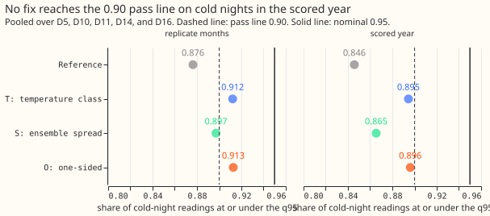
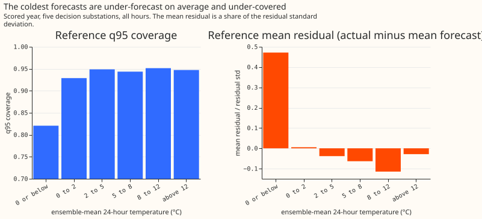
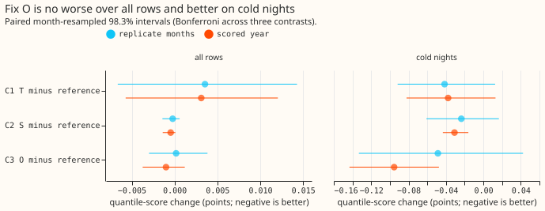

# Experiment 164: a one-sided widening lifts cold-night q95 coverage to 0.896, short of 0.90

**On cold nights, the 95% quantile (q95) of the best forecast of experiment 155 is exceeded on 15% of
readings, and the cause is mostly a prediction interval that is too narrow when it is cold.** A
cold night is a winter night (November to March, evening or night hours) whose daily mean
temperature, from the ERA5 weather reanalysis, is below 2 °C. Coverage is the share of readings at
or below the quantile, so a calibrated q95 has coverage 0.95. We asked whether the shortfall comes
from a narrow interval or from a mean forecast that is too low. We then tested three fixes, called
T, S, and O, that widen the interval on days the ensemble weather forecast calls cold. Each fix was
fitted on one set of months (the tuning months) and scored on a later year (the scored year) and on
other months of the earlier year (the replicate months), with the mean forecast unchanged. Fix O,
which widens only the upper quantiles, lifts cold-night q95 coverage from 0.846 to 0.896. That
misses the 0.90 we set before running the experiment, so the verdict is `refuted` by our decision
rule. The gap of 0.004 is small against the uncertainty of the figure, which rests on 10 cold days.
All scores are in points of effective capacity (percentage points of each substation's rated
demand).

The forecast is arm I of [experiment
160](../00160-calibration-band-width-fix-on-stage-2-winner/result.md): arm D of [experiment
155](../00155-dp-bg-stage2-assembly-night-offset-and-error-correction/result.md) with its table of
quantile offsets (the spread table) read by interpolation along the lead. The cold gate is the
mean temperature of the 51-member ensemble of [experiment
111](../00111-differentiable-physics-6-ens-forecast-engine-against-bg2/result.md),
averaged over about 24 hours centred on the valid time, so the gate exists at forecast time. The three
fixes are T (one multiplier per temperature class at q01, q05, q10, q90, q95, and q99), S (all
offsets scaled by one plus 0.1 times the ensemble temperature standard deviation, below 2 °C only),
and O (multipliers 1.65, 1.36, 1.26, and 1.16 on q75, q90, q95, and q99 below 2 °C only).

- **Row set and schedule.** `fold_a_daily_gap_v1`, the five decision substations D5, D10, D11, D14,
  and D16 (D9 beside), leads 0.5 to 168 hours, rows outside the hand-filtered switching events. The
  mean forecasts come from experiment 155's stored runs (monthly refits on a rolling window, whatever
  schedule 155 used); no refit happens here. The tuning months are the odd months and the replicate
  months the even months of the year before the scored year. The scored year is 2025-07-02 to
  2026-06-29: 5,395 cold-night rows (1,583 each at D10, D11, and D14, and 323 each at D5 and D16) of
  464,228 rows at the five decision substations.
- **Diagnosis (scored year, reference).** The cold-night residual (actual minus mean forecast) has
  mean +1.24 points and standard deviation 7.45 (0.17 of the standard deviation, under the
  pre-registered 0.3 line). By hour band, the residual standard deviation on cold days (any
  month, 9,265 rows) is 1.70, 1.22, 1.04, and 1.29 times that of other winter days. The 1.2 to 1.6
  prediction held in 2 of 4 bands.
  At an ensemble-mean temperature of 0 °C or below the mean residual is +3.12 points (0.47 of the
  standard deviation, 3,201 rows) and q95 coverage is 0.821. No post hoc shift arm was run, because
  the pooled bias is under 0.3.
- **Cold-night q95 coverage, scored year (pooled).** Reference 0.846, T 0.895, S 0.865, O 0.896.
  Replicate months: 0.876, 0.912, 0.897, and 0.913. Pass rule (0.90 or more and all-row upper
  bound under +0.01): O passes in the replicate months only, so no fix passes in both periods.
- **Contrasts, all rows, scored year (98.33% month-resampled intervals).** C1 T minus reference
  +0.0031 (-0.0057 to +0.0121); C2 S minus reference -0.0005 (-0.0014 to +0.0001); C3 O minus
  reference -0.0010 (-0.0037 to +0.0012). Replicate months: +0.0035, -0.0002, and +0.0002. Absolute
  all-row scores in the scored year: reference 2.7529, T 2.7560, S 2.7525, O 2.7519, BG2 2.7804,
  manual heuristic 3.4968, climatology 3.8038.
- **Contrasts, cold nights, scored year.** C1 -0.038 (-0.082 to +0.013); C2 -0.031 (-0.043 to
  -0.016); C3 -0.096 (-0.143 to -0.048).
- **Tail calibration, scored year, all rows (coverage / pinball loss).** Reference: q01 0.022 /
  0.216, q05 0.065 / 0.713, q95 0.947 / 0.746, q99 0.981 / 0.232. O: q95 0.948 / 0.745, q99 0.982 /
  0.232 (O leaves the lower tail unchanged). T: q95 0.954 / 0.754, q99 0.987 / 0.230.
- **Tail calibration, scored year, cold nights.** Reference: q01 0.045 / 0.391, q05 0.090 / 0.950,
  q95 0.846 / 0.934, q99 0.933 / 0.328. O: q95 0.896 / 0.819, q99 0.959 / 0.282. T: q95 0.895 /
  0.830, q99 0.960 / 0.281. S: q95 0.865 / 0.887, q99 0.949 / 0.300. The lower tail is
  under-covered at q05 on cold nights (readings fall below it on 0.090 against 0.05) in every fix.
- **Width by lead day.** O changes the median q05 to q95 width by at most 0.1 points on any lead
  day, because the fix acts on the upper quantiles on cold days only; T widens it by 0.2 to 0.6
  points on lead days 0 to 6 (reference 15.9 to 19.2, T 16.3 to 19.8).
- **Curtailment-cost proxy** (the node-only rule of `studies.node_curtailment` on each substation's
  own demand, scaled limit 0.9 times the maximum before the scored year, GBP 2,000 per MWh, leads 12
  to 36 hours). Avoidable cost against the perfect forecast, summed over the five substations:
  reference GBP 1.32 million, O 1.27 million, T 1.26 million, S 1.31 million, BG2 1.88 million, manual
  heuristic 3.33 million. The 95% month-resampled intervals overlap (reference 0.11 to 3.3 million),
  and the order of the fixes changes at the limit 0.5, so the proxy cannot rank the
  fixes. A Primary substation has no published export limit here and a demand series is treated as
  the flow that can breach, so the figures show the arithmetic and are not a curtailment forecast.
- **Caveats.** The scored cold rows come from 10 valid dates in 5 spells (20 to 21 November, 31
  December, 2 to 6 January, 8 January, and 10 January), and D5 and D16 contribute only on 20 to 21
  November. The day-block 95% interval of pooled cold-night q95 coverage is 0.774 to 0.918 for the
  reference and 0.844 to 0.948 for O, and 0.90 lies inside the second. The reference's cold-night
  coverage is below 0.90 with probability 0.93, and O's is at or above 0.90 with probability 0.45.
  The tuning and replicate months share cold days (four of the seven replicate cold dates are also
  tuning cold dates), so the replicate months are not an independent check. The gate misses 23% of
  the scored cold-night rows, which O never widens. The multipliers pool five substations and one
  winter, so a substation-specific difference (D10 and D11 sit at 0.87 and 0.85 under O) is not
  fitted.
- **What to try next.** (1) A bias correction of the mean forecast at ensemble-mean temperatures of
  0 °C or below, where the mean is 0.47 standard deviations low. (2) Fit and score over at least two
  winters, so the cold days are not 10. (3) A gate that also fires on a short run of cold days
  before the target.

## Checks

- **Median minus mean forecast, per site, at 12 to 36 hours.** Exactly 0.000 for the reference and
  for O at every substation (the spread table has median zero, and fixes S and O leave the median
  offset at zero; T leaves it unchanged).
- **Mean-forecast error beside each quantile-score contrast.** The mean absolute error of the mean
  forecast is identical across arms (contrast 0.0000 for C1, C2, and C3), because the mean is
  unchanged, so no pair of contrasts can point in opposite directions.
- **Reproduction control.** The reference rescored from experiment 160's stored forecasts scores
  2.7529, a gap of 7e-6 from experiment 160's printed 2.7529.
- **Audit triggers.** Trigger 4 fired: leaving out D10 or D11 lifts O's pooled cold-night q95
  coverage from 0.896 to 0.909 or 0.917. A fresh Opus audit re-derived the coverages and contrasts
  from the stored forecasts with its own code and agreed with every number. Its findings and
  triage: (F1, F2) the arm files on disk had been built before the fit script's final edits, and
  the committed fix O did not apply its q75 multiplier, so the fit, report, and charts were rerun
  with the corrected code, which moved only C1 (from +0.0089 to +0.0031); (F5b) the replicate
  months share cold days with the tuning months, recorded above; (F6) the day-block intervals above;
  (F7) the gate catches 77% of cold-night rows, recorded above. F5a, F5c, F5d, F5e, and F8 were
  confirmed harmless. The audit report is private (`data/ml-experiments/briefs/e164_audit_report.md`).
  Triggers 1 to 3 and 5 to 7 did not fire.
