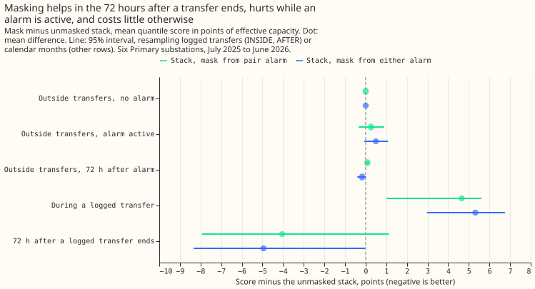
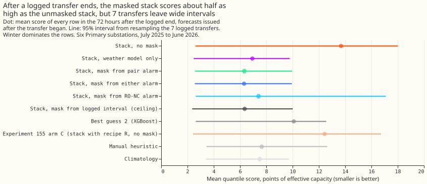
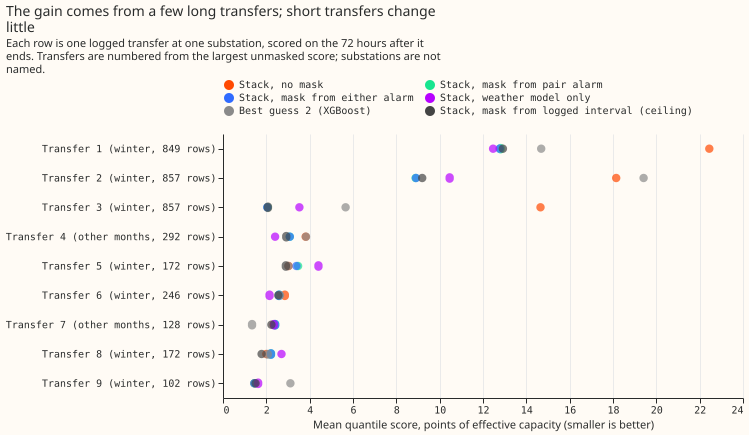
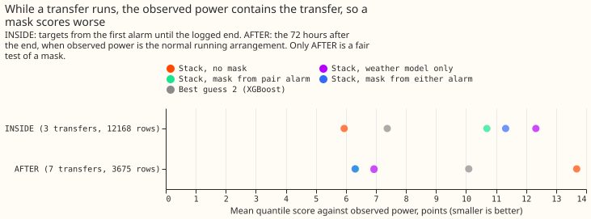
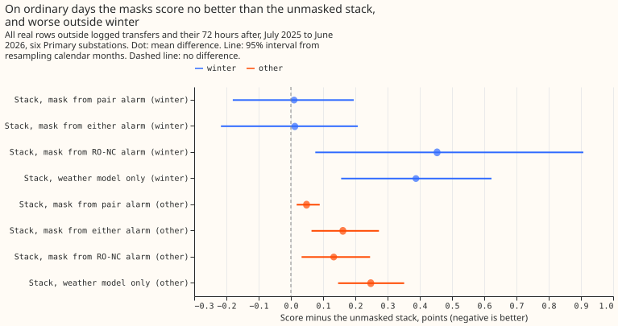

**Ignoring recent power while a switching alarm is active helps only in the days after a logged
transfer ends, and the mask from either alarm fails the pre-registered limit on rows outside
transfers.** The stack scores 6.31 points of a substation's effective capacity in the 72 hours after
a logged transfer ends, against 13.69 with no mask and 10.09 for best guess 2 (BG2). On the 559,137
real rows outside logged transfers, the mask scores 0.102 points worse than no mask (95% interval
from resampling calendar months, -0.013 to +0.205). The extra error is largest while an alarm is
active on rows that match no logged transfer, and in months outside winter (November to March). The
next step is a mask gated on how reliable the alarm is, or used in winter only.

**We asked whether the filter on recent errors should be switched off while a switching alarm is
active.** The forecast, called the stack here, is a frozen generalised additive model (GAM) with a
Kalman filter that corrects each forecast using its recent errors, as in [experiment
163](../00163-switching-real-event-comparison-gam-stack-against-bg2/result.md). The mask sets the
filter's readings missing from the moment an alarm is known until the end rule of [experiment
147](../00147-causal-live-end-rule-for-ro-nc/result.md) and [experiment
148](../00148-switching-end-rule-lookahead-ro-nc/result.md) fires (the rule that decides a switching
event has ended), and the filter then restarts. The alarms are the pair alarm of [experiment
156](../00156-switching-faster-onset-alarm-from-opposite-steps/result.md) (two metered substations
step in opposite directions within hours) and the refit-offset neighbour-count detector (RO-NC).
Experiment 163 scored the mask on logged transfers and on ordinary rows that left out the
hand-filtered switching events. This experiment scores every real row at the six decision Primary
substations, in the scored year July 2025 to June 2026, and splits the rows by logged transfer and
by the alarm active at the forecast origin. Scores are twice the mean pinball loss over 11 quantiles
(the standard loss for quantile forecasts), in points of effective capacity; lower is better.

**By the pre-registered rule the verdict is `not supported`.** The gain test passes: the mask from
either alarm scores 7.38 points lower than no mask after a transfer ends on the 7 transfers BG2
also forecasts, and 4.95 points lower on all 11 transfers, with intervals that end just below zero.
The no-harm test fails: the upper end of the interval for the mask from either alarm on the real
rows outside logged transfers is +0.205, against a required +0.01. The mask from the pair alarm
alone also fails, with an upper end of +0.105. The test while a transfer runs fails as predicted,
because the observed power then contains the moved load.

- **Arms.** K0 (the stack with no mask), MASK_NEW (mask from the pair alarm), MASK_UNION (mask from
  either alarm, the headline), MASK_RONC and GAM_ONLY (the generalised additive model alone, with no
  recent power) as references, ORACLE (the logged interval masked from its logged onset, on
  logged-transfer rows only), BG2 ([experiment
  87](../00087-bg2-best-guess-assembled-with-drop-one-ablations/result.md)), [experiment
  155](../00155-dp-bg-stage2-assembly-night-offset-and-error-correction/result.md)'s arm C, the
  manual heuristic, and climatology. The stack arms share the K0 spread of [experiment
  115](../00115-differentiable-physics-w1-diurnal-shape-state-on-ens/result.md), so they differ in
  location only. The GAM and the filter are frozen, so no refit schedule applies.
- **Rows.** The scored year holds 586,232 rows with a reading at D5, D9, D10, D11, D14, and D16
  (anonymised substation labels), and 581,078 of them are shared with BG2. Of the 586,232 rows,
  27,095 lie within a logged transfer or the 72 hours after it, and 559,137 are outside. Scores that
  involve BG2, and the absolute scores below, use the rows shared with BG2. The alarm is active at
  the forecast origin on 14.7% of rows for the pair alarm (D5 32.2%, D9 0%), 10.2% for RO-NC, and
  22.2% for the union (D5 35.7%, D10 28.6%).
- **Absolute scores, outside logged transfers (shared rows).** K0 2.725, MASK_NEW 2.758,
  MASK_UNION 2.826, MASK_RONC 2.986, GAM_ONLY 3.029, BG2 2.693, arm C 2.664, manual heuristic
  3.390, climatology 3.652.
- **C1, outside logged transfers (95%, resampling calendar months).** MASK_UNION minus K0 +0.102
  (-0.013 to +0.205); MASK_NEW minus K0 +0.033 (-0.042 to +0.105). Winter (223,434 rows):
  MASK_UNION +0.012 (-0.217 to +0.208), MASK_NEW +0.010 (-0.180 to +0.195). Other months (335,703
  rows): MASK_UNION +0.161 (+0.064 to +0.273), MASK_NEW +0.049 (+0.018 to +0.090). MASK_UNION minus
  BG2 +0.134 (-0.076 to +0.343); K0 minus BG2 +0.032 (-0.113 to +0.185). Leaving out one
  substation, the upper end stays at or above +0.17 for MASK_UNION. By substation, MASK_UNION minus
  K0 is +0.265 at D9, +0.255 at D10, +0.052 at D16, +0.044 at D11, +0.021 at D14, and -0.052 at D5.
- **Where the mask adds error.** On rows outside logged transfers where no pair alarm is active or
  in its 72 hours after, MASK_NEW minus K0 is +0.002 (-0.000 to +0.003) on 489,420 rows; for the
  union it is +0.004 (+0.001 to +0.010) on 446,365 rows. While the union alarm is active at the
  forecast origin outside logged transfers (111,159 rows; the means use the rows shared with BG2),
  MASK_UNION scores 3.475 against 2.979 for K0, +0.496 (-0.070 to +1.081). While the pair alarm is
  active (68,539 rows) the difference is +0.258 (-0.335 to +0.905). In the 72 hours after the union
  alarm's end is known (1,613 rows), MASK_UNION minus K0 is -0.171 (-0.400 to +0.008).
- **C2, during a logged transfer (INSIDE, 5 transfers, 12,540 rows, observed power contains the
  transfer).** K0 5.838, MASK_NEW 10.494, MASK_UNION 11.156, GAM_ONLY 12.151, ORACLE 10.238.
  MASK_UNION minus K0 +5.318 (+2.977 to +6.750); MASK_NEW minus K0 +4.655 (+1.013 to +5.622). The
  rows before the first alarm (BEFORE, 2 transfers, 2,440 rows) score the same for every stack arm,
  because no alarm is known yet.
- **C3, the 72 hours after a logged transfer ends (AFTER).** Shared with BG2 (7 transfers, 3,675
  rows): K0 13.686, GAM_ONLY 6.936, MASK_NEW 6.321, MASK_UNION 6.307, MASK_RONC 7.406, ORACLE 6.354,
  BG2 10.091, manual heuristic 7.649, climatology 7.494. All stack rows (11 transfers, 13
  transfer-substation pairs, 5,993 rows): K0 10.129, MASK_NEW 6.083, MASK_UNION 5.177, GAM_ONLY
  5.218, ORACLE 4.790. MASK_UNION minus K0 is -7.379 (-9.839 to -0.042) on the shared rows and
  -4.952 (-8.341 to -0.031) on all stack rows; MASK_NEW minus K0 is -7.365 (-9.832 to -0.025) and
  -4.047 (-7.933 to +1.122). MASK_UNION minus BG2 is -3.785 (-6.005 to +0.001); MASK_NEW minus BG2
  is -3.771 (-6.004 to +0.011), with no threshold. Leaving out D5 or D16 widens the interval of
  MASK_UNION minus K0 to include zero (-3.307, -7.699 to +0.290, and -3.648, -7.327 to +0.307).
- **Tail calibration (share of readings at or below the quantile; pinball loss in points).** Outside
  logged transfers, MASK_UNION: q01 0.0201 (0.210), q05 0.0612 (0.728), q95 0.9563 (0.714), q99
  0.9884 (0.202); K0: 0.0146 (0.195), 0.0493 (0.687), 0.9578 (0.710), 0.9882 (0.208); BG2: 0.0097
  (0.208), 0.0404 (0.617), 0.9445 (0.738), 0.9831 (0.249). After a transfer ends, MASK_UNION covers
  0.172, 0.218, 0.832, and 0.896; K0 covers 0.409, 0.453, 0.757, and 0.832; BG2 covers 0.0035,
  0.323, 0.745, and 0.842, so every forecast is too confident in the days after a transfer, because
  coverage should be 0.01, 0.05, 0.95, and 0.99. The node-plus-generators curtailment metric is not
  scored, because the experiment forecasts six Primaries alone.
- **D8's 29 multi-day drops of [experiment
  159](../00159-switching-d8-multi-day-drops-recurrence-and-report/result.md) (descriptive; D8 has
  no frozen GAM here).** An alarm onset lies within 24 hours of the drop's start for 3 drops with
  the pair alarm, 5 with RO-NC, and 7 with either, out of 79 alarms on D8 in the union table (46
  from the pair alarm, 37 from RO-NC). An onset up to 24 hours after the start counts, so a later
  onset would not have been known at the start.
- **Predictions against outcome.** The union mask outside logged transfers was predicted 0.04 to
  0.15 worse: +0.102. After a transfer, MASK_UNION was predicted at 5 to 8 points (6.31), K0 at 12
  to 15 (13.69), and BG2 at 9 to 11 (10.09). The mask was predicted to score worse than K0 during a
  logged transfer (+5.32). While an alarm is active the mask was predicted within 1 point of K0:
  +0.50 outside logged transfers, +0.72 on all rows.
- **Post hoc, labelled.** The row split by the alarm active at the forecast origin and the
  leave-one-substation-out checks were not part of the pre-registered verdict.

## Checks

- **Median minus mean forecast,** identical for every stack arm: D10 -0.064, D11 -0.027, D14
  +0.033, D16 +0.014, D5 -0.135, D9 -0.021 points of capacity.
- **Error of the median forecast beside the quantile contrast.** Outside logged transfers (shared
  rows): K0 4.773, MASK_NEW 4.853, MASK_UNION 4.961, GAM_ONLY 5.334, BG2 4.734. After a transfer:
  K0 18.232, GAM_ONLY 10.726, MASK_NEW 9.639, MASK_UNION 9.616, BG2 15.467. Both agree with the
  quantile score in direction.
- **Triggers.** Trigger 4 fired in part: leaving D5 or D16 out makes the interval of MASK_UNION
  minus K0 after a transfer include zero (C3), but the sign holds and the `not supported` verdict
  rests on C1, whose upper end stays at or above +0.17 whichever substation is left out, so no
  verdict could change and no audit was run. Trigger 5 holds as in experiment 163: the mask scores
  level with the logged-interval mask (ORACLE) after a transfer (-0.05 points, 95% -0.14 to +0.25),
  so the logged interval is not a ceiling. Triggers 1, 2, 3, 6, and 7 did not fire: the no-alarm
  rows score within +0.004 of K0, every result lies in its predicted range, the two error measures
  agree, the interval widths match experiment 163's, and no later design depends on this result.

## Caveats

- **11 transfers, 7 shared with BG2.** The 72-hour test rests on 11 logged transfers. The
  per-transfer figure shows most of the gain at two transfers, as in experiment 163.
- **Active alarms are common.** The union alarm is active at the forecast origin on 22.2% of rows,
  and 111,159 of those rows lie outside logged transfers. Some of those rows are real switching that
  the log lacks, so the extra error from the mask on those rows may be overstated.
- **Lab conditions.** The filter's residual uses the analysis proxy, and the alarm tables are
  experiment 156's, tuned on odd months of the same stream ([experiment
  156](../00156-switching-faster-onset-alarm-from-opposite-steps/result.md)).
- **Masked history persists.** After an alarm ends, the readings inside it stay missing in the
  filter's history, That missing history explains the +0.004 on rows with no alarm active.

## What the next experiment should answer

The next question is whether a mask from the pair alarm alone, or a mask used only in winter, keeps
the gain after a transfer and keeps the extra error outside logged transfers under +0.01. A gate on
the alarm's step size, or a partial mask that down-weights recent power instead of removing it, are
the two variants the pattern of extra error suggests.
