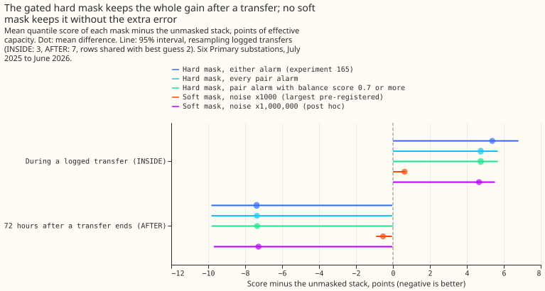
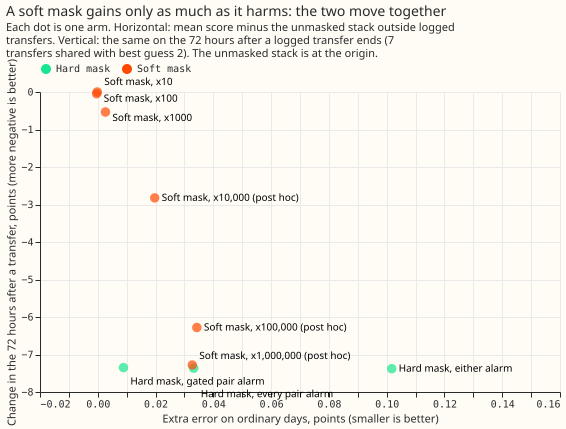
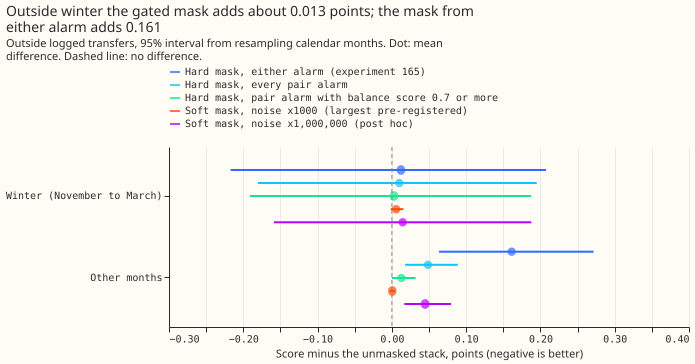
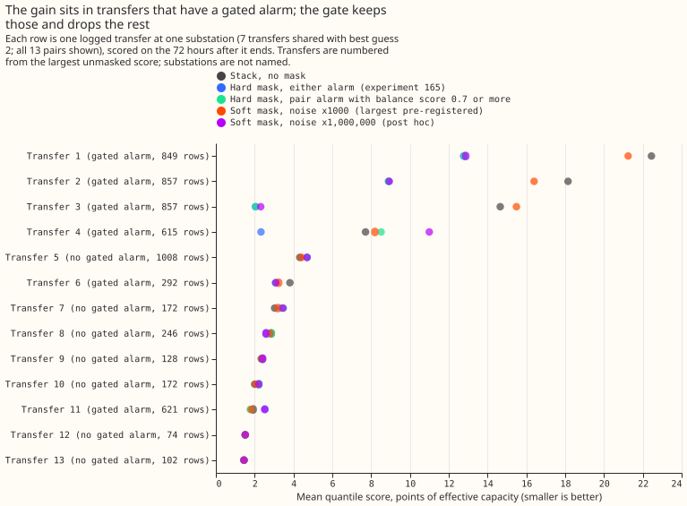
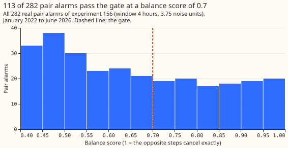

 **When a detector flags that load may have been switched between substations, a forecast that
ignores recent power only for trustworthy flags keeps 99.6% of the gain after a transfer and removes
almost all the extra error elsewhere, but one year of data cannot show that the extra error is below
the limit we set.** Our forecast corrects itself using recent power. After a load transfer between
substations has been recorded in NGED's switching log (a "logged transfer"), recent power misleads
the correction, so [experiment
165](../00165-switching-drop-recent-power-while-alarmed-all-rows/result.md) ignored recent power (a
"mask") whenever a switching alarm was active. That helped after a transfer but added error on other
days. Here the "gated" mask ignores recent power only for alarms whose opposite steps at a
neighbouring substation roughly cancel (a balance score of 0.7 or more). In the 72 hours after a
logged transfer ends, the forecast error score is 6.34 points of a substation's effective capacity
with the gated mask, against 13.69 with no mask and 10.09 for best guess 2 (BG2, the
production-style XGBoost forecast of [experiment
87](../00087-bg2-best-guess-assembled-with-drop-one-ablations/result.md)). On the 559,137 real rows
outside logged transfers the gated mask scores 0.009 points worse than no mask (95% interval from
resampling calendar months, -0.068 to +0.081), where the mask from either alarm of experiment 165
scored 0.102 worse. The limit set before scoring was an interval within +/-0.03, so the verdict is
`not supported`. A soft mask, which keeps the readings but treats them as noisier, changes almost
nothing (at the three pre-registered factors) or gains and harms about as much as a hard mask (at
factors we added afterwards). The next step is to re-test the gated mask on a longer period.

**We asked whether recent power can be ignored less bluntly while a switching alarm is active.** The
forecast, called the stack here, is a frozen generalised additive model (GAM) with a Kalman filter
([Kalman, 1960](https://doi.org/10.1115/1.3662552)) that corrects each forecast using its recent
errors, as in [experiment
163](../00163-switching-real-event-comparison-gam-stack-against-bg2/result.md). Experiment 165 set
the filter's readings missing from the moment an alarm was known until the end rule (the rule that
decides an alarm has ended) of [experiment 147](../00147-causal-live-end-rule-for-ro-nc/result.md)
and [experiment 148](../00148-switching-end-rule-lookahead-ro-nc/result.md) fired. That mask helped
after a transfer and added error elsewhere. Here the gated mask applies only to the pair alarms of
[experiment 156](../00156-switching-faster-onset-alarm-from-opposite-steps/result.md) (two metered
substations step in opposite directions within hours) whose balance score is at least 0.7. The
balance score is the smaller of the ratio of the two steps and its inverse, so 1 means the steps
cancel exactly. The soft mask keeps every reading and multiplies the filter's observation-noise
variance, from the moment the alarm is known until the end rule fires, by a factor that rises with
the balance score. Scores are twice the mean pinball loss over 11 quantiles (a standard loss for
quantile forecasts), in points of effective capacity; lower is better.

**By the pre-registered rule the verdict is `not supported`, for different reasons in the two
parts.** Part 1 (the gated mask) passes the gain test, G2: it keeps 99.6% of the hard mask's gain,
against a required 70%. It fails the no-harm test, G1, because the interval is wider than the
required +/-0.03, although the point estimate of +0.009 lies inside it. Six of the 13
transfer-substation pairs (one logged transfer seen at one substation) have a gated alarm known
before the transfer ends, so the part is scored. Part 2 (the soft mask) fails the gain test, S2, at
every pre-registered factor: at best the soft mask recovers 0.53 of the 7.38 points. The other two
soft-mask tests pass trivially, because a soft mask that does nothing also does no harm.

- **Arms.** K0 (the stack with no mask), GAM_ONLY (the GAM alone), MASK_NEW (hard mask, every pair
  alarm), MASK_RONC and MASK_UNION (hard masks of experiment 165), MASK_GATED (hard mask, pair
  alarms with a balance score of 0.7 or more), SOFT_F10, SOFT_F100, SOFT_F1000 (soft mask on every
  pair alarm, observation-noise variance multiplied by up to 10, 100, and 1000 at a perfect balance
  and by less at lower scores), ORACLE (the logged interval, event rows only), BG2 ([experiment
  87](../00087-bg2-best-guess-assembled-with-drop-one-ablations/result.md)), [experiment
  155](../00155-dp-bg-stage2-assembly-night-offset-and-error-correction/result.md)'s arm C, the
  manual heuristic, and climatology. **Post hoc, labelled:** SOFT_F10000, SOFT_F100000, and
  SOFT_F1000000, added after the three pre-registered factors changed almost nothing. The stack arms
  share the K0 spread of [experiment
  115](../00115-differentiable-physics-w1-diurnal-shape-state-on-ens/result.md), so they differ in
  location only. The GAM and the filter are frozen, so no refit schedule applies.
- **Rows.** The same 586,232 rows with a reading as experiment 165, at D5, D9, D10, D11, D14, and
  D16 (anonymised substation labels), July 2025 to June 2026; 581,078 are shared with BG2. The
  scores of K0, MASK_NEW, and MASK_UNION match experiment 165's to the last stored digit. The gated
  alarm is active at the forecast origin on 10.3% of rows (D5 23.1%, D9 0%), the pair alarm on
  14.7%, and the union on 22.2%. Of the 282 real pair alarms, 113 pass the gate (figure 5).
- **Absolute scores, outside logged transfers (shared rows).** K0 2.725, MASK_GATED 2.733, MASK_NEW
  2.758, MASK_UNION 2.826, SOFT_F1000 2.727, SOFT_F1000000 2.757, GAM_ONLY 3.029, BG2 2.693, manual
  heuristic 3.390, climatology 3.652.
- **Absolute scores, 72 hours after a transfer ends (7 transfers shared with BG2).** K0 13.686,
  MASK_GATED 6.336, MASK_NEW 6.321, MASK_UNION 6.307, SOFT_F10 13.684, SOFT_F100 13.640, SOFT_F1000
  13.155, SOFT_F1000000 6.406, GAM_ONLY 6.936, ORACLE 6.354, BG2 10.091, manual heuristic 7.649,
  climatology 7.494.
- **G1, outside logged transfers (95%, resampling calendar months).** MASK_GATED minus K0 +0.009
  (-0.068 to +0.081); winter (223,434 rows) +0.003 (-0.191 to +0.188); other months (335,703 rows)
  +0.013 (0.000 to +0.032). MASK_GATED minus MASK_UNION -0.093 (-0.176 to -0.023). MASK_GATED minus
  BG2 +0.041 (-0.123 to +0.206). Leaving out one substation, the estimate ranges from -0.024 (D10
  left out) to +0.025 (D16 left out), with every interval wider than +/-0.03. On the 514,228 rows
  with no gated alarm active, MASK_GATED minus K0 is -0.000 (-0.001 to +0.001). On the 44,216 rows
  outside logged transfers while a gated alarm is active it is +0.116 (-0.816 to +1.005), against
  +0.258 (-0.339 to +0.896) for the pair alarm and +0.496 (-0.066 to +1.090) for the union.
- **G2, 72 hours after a transfer (shared rows, 7 transfers, resampling transfers).** MASK_GATED
  minus K0 -7.349 (-9.822 to +0.007), against -7.379 (-9.832 to -0.042) for MASK_UNION, so the gated
  mask keeps 99.6% of the gain (required 70%, 5.17 points). On all 13 transfer-substation pairs (11
  transfers): MASK_GATED -4.377 (-8.104 to +0.298), MASK_UNION -4.952 (-8.405 to +0.027). Leaving
  out D5 or D16 gives -2.478 (-7.229 to +0.382) and -3.736 (-7.373 to +0.146). The gain sits in 3
  transfer-substation pairs: two at D5 and one at D16 (figure 4).
- **Gate coverage.** Six of 13 transfer-substation pairs have a gated alarm known before the
  transfer ends (required for a verdict: 5). Six gated alarms in all on D8, none within 24 hours of
  a start of the 29 multi-day drops at D8 of [experiment
  159](../00159-switching-d8-multi-day-drops-recurrence-and-report/result.md), against 3 for the
  ungated pair alarm and 7 for either alarm (descriptive; D8 has no frozen GAM here).
- **During a logged transfer (INSIDE, observed power contains the transfer; 5 transfers, 12,540
  rows).** K0 5.838, MASK_UNION 11.156, MASK_GATED 10.463; MASK_GATED minus K0 +4.625 (+0.282 to
  +5.620). On the 3 transfers shared with BG2, the soft mask scores worse than no mask by +0.008,
  +0.083, and +0.631 at factors 10, 100, and 1000, against +5.378 for MASK_UNION.
- **S1 to S3, soft mask at the pre-registered factors.** Outside logged transfers, SOFT_F10,
  SOFT_F100, and SOFT_F1000 minus K0 are -0.000, -0.000, and +0.003, so minus MASK_UNION they are
  -0.102, -0.102, and -0.099 (S1 passes). After a transfer they change K0 by -0.002, -0.045, and
  -0.531 points (S2 needs at least 5.90; fails). During a transfer the harm is +0.008, +0.083, and
  +0.631 points (S3 allows up to 6.45; passes). No factor passes all three.
- **Post hoc soft-mask sweep.** SOFT_F10000: outside +0.020 (+0.007 to +0.036), after a transfer
  -2.824 (-4.213 to -0.039). SOFT_F100000: +0.034 (+0.003 to +0.076), -6.280 (-8.257 to -0.027).
  SOFT_F1000000: +0.033 (-0.036 to +0.099), -7.280 (-9.698 to -0.025). The factor that recovers the
  gain adds the extra error of the hard mask from every pair alarm (+0.033).
- **Tail calibration (share of readings at or below the quantile; pinball loss in points).** Outside
  logged transfers, MASK_GATED: q01 0.0136 (0.186), q05 0.0485 (0.678), q95 0.9554 (0.709), q99
  0.9879 (0.203); K0: 0.0146 (0.195), 0.0493 (0.687), 0.9578 (0.710), 0.9882 (0.208); BG2: 0.0097
  (0.208), 0.0404 (0.617), 0.9445 (0.738), 0.9831 (0.249). After a transfer, MASK_GATED covers
  0.176, 0.233, 0.835, and 0.898; K0 covers 0.409, 0.453, 0.757, and 0.832; BG2 covers 0.0035,
  0.323, 0.745, and 0.842. Coverage should be 0.01, 0.05, 0.95, and 0.99, so every forecast except
  BG2 at q01 is too confident in the days after a transfer, and BG2 is too confident at q05, q95,
  and q99. The node-plus-generators curtailment metric is not scored, because the experiment
  forecasts six Primary substations alone.
- **Predictions against outcome.** The gated mask was predicted within +/-0.03 (interval): the
  estimate is inside and the interval is not. The gated gain was predicted at least 70% of the hard
  gain: 99.6%. The soft mask was predicted to beat the hard mask outside logged transfers by at
  least 0.051 at the best factor: the soft mask does, because the soft mask does almost nothing. It
  was predicted to keep 80% of the gain after a transfer: it keeps 7% at best (factor 1000).
- **Post hoc, labelled.** The three added soft-mask factors, the leave-one-substation-out checks,
  the winter and other-month split, and the split of rows by whether a gated alarm is active.

## Checks

- **Median minus mean forecast,** identical for every stack arm: D10 -0.064, D11 -0.027, D14 +0.033,
  D16 +0.014, D5 -0.135, D9 -0.021 points of capacity.
- **Error of the median forecast beside the quantile contrast.** Outside logged transfers (shared
  rows): K0 4.773, MASK_GATED 4.809, MASK_UNION 4.961, SOFT_F1000 4.778. After a transfer: K0
  18.232, MASK_GATED 9.666, MASK_UNION 9.616, SOFT_F1000 17.653. Both measures agree with the
  quantile score in direction.
- **Triggers.** Trigger 2 fired in part: the interval for G1 is wider than the +/-0.03 the plan
  required. The explanation was tested and holds: the arm scores -0.000 (-0.001 to +0.001) on the
  514,228 rows with no gated alarm, so the width comes from the 44,909 rows outside logged transfers
  while a gated alarm is active or has just ended, and the extra error is confined to them. That
  width is 0.149 here and 0.147 for the pair alarm in experiment 165, so trigger 6 did not fire.
  Trigger 4 fired in part: leaving out D5 or D16 makes the interval for the gated gain after a
  transfer include zero, but the sign holds, and the `not supported` verdict rests on interval
  width, which no leave-one-out check changes. Triggers 1, 3, 5, and 7 did not fire: there is no
  control, the two error measures agree, the gated mask (a subset of the pair-alarm mask) scores
  within 0.015 points of it after a transfer, and no later design depends on this result yet. No
  audit was run.

## Caveats

- **Six of 13 pairs.** The gain after a transfer rests on 3 transfer-substation pairs, at D5 and
  D16. One year of data is the limit, not the gate.
- **The gate threshold of 0.7 was fixed after counting how many alarms pass.** It was not tuned on
  any forecast score; gates of 0.6 and 0.8, planned as post hoc checks, were not run.
- **Lab conditions.** The filter's residual uses the analysis proxy, the alarm tables are experiment
  156's, tuned on odd months of the same stream, and the end of each alarm is known by the 6-hour
  rule of experiment 148.
- **The soft mask applies to the pair alarm only.** Its comparison with MASK_UNION in S1 mixes the
  change of alarm set with the change of mechanism, so the comparison with MASK_NEW and MASK_GATED
  in the post hoc sweep is the cleaner one.

## What the next experiment should answer

The next question is whether the gated mask keeps its no-harm point estimate on a longer history.
The interval half-width is about 0.075 points, so reaching +/-0.03 needs roughly six times as many
months of rows, if the residual stream can be rebuilt for a longer history. A second question is why
only 6 of 13 transfer-substation pairs have a pair alarm that passes the gate.
