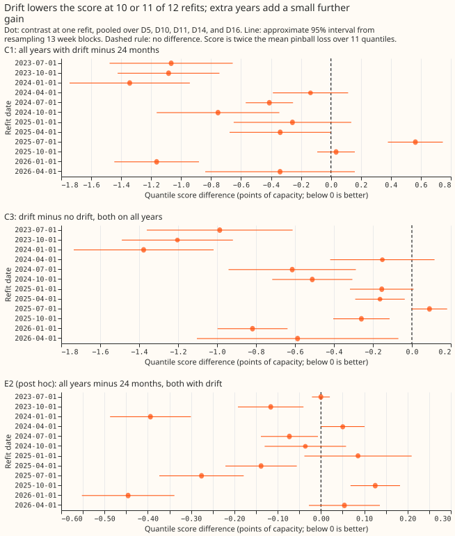
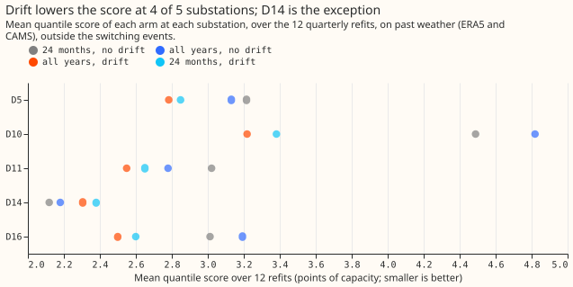
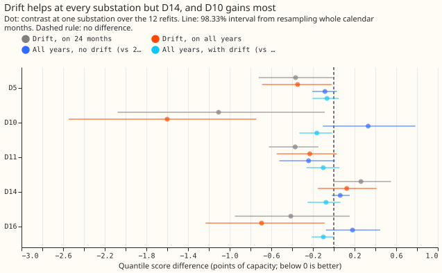
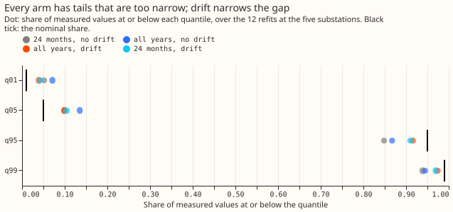

**Adding a drift term lowered the forecast error much more than training on extra years of history
did.** A drift term is a slow, smooth adjustment to the level of demand, fitted to the history and
held at its last value over the months being forecast. "Score" below means the quantile score,
where lower is better, measured in points of each substation's effective capacity. The demand model
trained on all years of history (back to late 2019) with a drift term scored 0.50 points better than
the same model trained on the last 24 months without one. A drift term on the last 24 months alone
gives 0.40 of that 0.50. The extra years add the remaining 0.10, and without a drift term the extra
years give no gain. By the rule written before the fits, the verdict is `supported`. The verdict
needs a qualifier: the rule compared "all years with drift" against "24 months without drift", and
most of the gain belongs to the drift term.

**We asked whether the demand model, with an explicit solar term, can train on every year of
history instead of the last 24 months.** The model is a generalised additive model (GAM) of demand
minus solar output, the convex model of [experiment
107](../00107-differentiable-physics-rolling-origin-history-and-tails/result.md). Its heating terms
are split by day type, as in [experiment
136](../00136-dp-bg-stage1-assembly-on-the-ensemble-mean/result.md) (the split is called T-all),
and the photovoltaic (PV) capacity is pinned to the as-of table, which holds each Primary
substation's capacity as estimated at the time of each refit. We refitted the model every quarter
from July 2023 to April 2026, which gives 12 refits. Each refit was scored on the following 3 months
at five Primary substations (D5, D10, D11, D14, and D16, the decision substations; the codes are
anonymised labels). All arms used past weather only: ERA5 and CAMS estimates of the weather that
occurred. The refit schedule and the baseline spread (each arm's own recent residuals, by hour band
and calendar quarter) follow experiment 107. The quantile score is twice the mean pinball loss over
11 quantiles, in points of each substation's effective capacity (its rated maximum output).

**Figure 1 shows the drift gain at most refits and the extra-years gain mixed in sign.** The figure
shows C1, C3, and E2, which the Results section defines. C1 is below zero at 10 of 12 refits, with
one clear exception (the July 2025 refit, +0.563 points). C3 (drift on all years) is below zero at
11 of 12. E2, which compares all years with 24 months with drift in both arms, is below zero at 8 of
12 and ranges from -0.45 to +0.13 points.

**Figure 2 shows both drift arms ahead of both no-drift arms at D5, D10, D11, and D16, and behind
at D14.**

**Figure 3 shows that the drift gain is largest at D10 and has the opposite sign at D14.** With D10
left out, C1 is still -0.311 points (interval -0.531 to -0.104), with 9 of 12 refits below zero.

**Figure 4 shows that every arm is too narrow in the tails.** The drift arms are closer to nominal
at q01, q95, and q99, and no closer than 24 months without drift at q05. At q95 the all-years drift
arm has 91.6% of measured values below its forecast.

## Results

- **Arms and rows.** Every arm is the T-all GAM with the PV capacity pinned to the as-of table,
  experiment 104's penalty settings, and past weather. The four arms are m24 (24 months, no drift),
  all (all years, no drift), all_d1 (all years, drift D1), and the exploratory m24_d1 (24 months,
  drift). The decision substations are scored at 12 refits for D5, D10, and D11 and 11 for D14 and
  D16 (243,741 scored half-hours per arm, outside the hand-filtered switching events), identical
  across arms. D10's two windows of level jumps with no recorded cause are removed from training
  and scoring.
- **Absolute scores (points; m24, all, all_d1, m24_d1).** 3.177, 3.220, 2.673, and 2.774. D9 is
  described beside the five and scored at 3 refits only: 2.232, 2.249, 2.376, and 2.360.
- **C1, all_d1 minus m24 (headline):** -0.503 points (98.33% interval from resampling calendar
  months -0.770 to -0.234); 10 of 12 refits below zero. Winter-quarter refits -0.772 (-1.123 to
  -0.403), 5 of 6 below zero; summer-quarter refits -0.233 (-0.571 to +0.092), 5 of 6. Leaving one
  site out gives -0.311 to -0.671, and the verdict stays `supported`.
- **C2, all minus m24:** +0.043 (-0.092 to +0.167); 5 of 12 below zero.
- **C3, all_d1 minus all:** -0.547 (-0.756 to -0.341); 11 of 12 below zero.
- **E1, m24_d1 minus m24 (exploratory):** -0.402 (-0.639 to -0.154); 11 of 12 below zero.
- **E2, all_d1 minus m24_d1 (post hoc, not pre-registered):** -0.101 (-0.188 to -0.019); 8 of 12
  below zero; winter-quarter -0.133 (-0.269 to +0.001), summer-quarter -0.069 (-0.168 to +0.012).
  The drift penalty scales with the number of training rows. All years therefore smooths the drift
  about three times more than 24 months does, so E2 mixes the effect of history length with the
  effect of smoothing.
- **Tails, decision substations (coverage at q01, q05, q95, q99; nominal 1, 5, 95, and 99%).**
  m24 5.2, 9.9, 84.9, and 93.8%; all 7.1, 13.5, 86.7, and 94.4%; all_d1 3.9, 9.9, 91.6, and 97.4%;
  m24_d1 4.2, 10.5, 91.0, and 96.9%. Pinball loss at q99 (m24, all, all_d1, m24_d1): 0.302, 0.288,
  0.205, and 0.224.
- **Without the D10 mask,** C1 is -0.455 (-0.723 to -0.191) and C3 is -0.484 (-0.703 to -0.277).
  The mask moves each by about 0.05, and the verdict is unchanged.

## Checks

- **Median minus mean forecast.** The median forecast minus the mean forecast is zero at every site
  and arm, because the baseline spread is centred on the median residual.
- **Mean-forecast error beside the quantile score.** The mean absolute error contrast has the same
  sign as the quantile score on every contrast (points): C1 -0.780, C2 +0.026, C3 -0.806, E1
  -0.618, and E2 -0.162.
- **Audit triggers.** The ml-experiment skill lists seven conditions that call for an audit.
  Trigger 2 (a result contradicts its own prediction) fired: the prediction was C1 of -0.10 to
  +0.05 and C3 of -0.15 to -0.40, and the measured C1 is -0.503 and C3 -0.547. The explanation was
  tested and is recorded here. Experiment 107 also found a drift gain (-0.451), and masking D10's
  jump windows moves C3 by only 0.06, so the prediction was wrong to assume that the jumps carried
  the drift gain. Trigger 5 (a nested arm beats the arm that contains it) did not fire, because all
  years without drift against 24 months is a tie (+0.043, interval spanning zero). Triggers 1, 3,
  4, and 6 did not fire, because leaving one site out keeps the verdict. Trigger 7 stays open until
  a later experiment depends on this result. No Opus audit was run.
- **Code review.** A Sonnet code review found no lookahead. It found that the history rule counted
  meter readings instead of trainable rows, and the final code counts trainable rows.

## Caveats

- **The pinned capacity is hindsight at the earliest refits.** The first as-of capacity table dates
  from 2023-08-07. The 2023-07-01 refit therefore uses a table built partly from readings after the
  refit date, and the four earlier cuts, which only build the baseline spread, use a growth prior.
  All arms share this, but the all-years arms lean on the old capacity path more.
- **Drift is a recent-level term here.** Its last value is held over the scored 3 months. Part of
  its gain may therefore come from tracking the recent demand level, an effect that [experiment
  111](../00111-differentiable-physics-6-ens-forecast-engine-against-bg2/result.md) did not
  separate from the rest.
- **Past weather, not forecasts.** Every arm uses ERA5 and CAMS estimates of the weather that
  occurred, which are not available when a live forecast is issued. The contrasts therefore rank
  training windows, not forecasts.
- **Not scored.** The curtailment-cost saving against the manual heuristic is not scored, because
  the experiment ranks training windows on past weather.
- **Schedule.** Quarterly refits on the whole history, frozen between refits, as in experiment 107.

## What to try next

- Port the drift term to the GAM with ensemble weather and check D14 first.
- Test whether all-years training still adds 0.10 points under the same drift smoothing in both
  windows.
