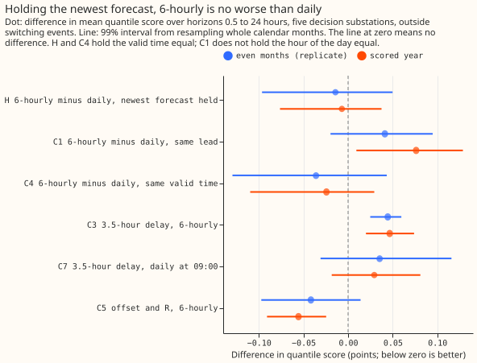
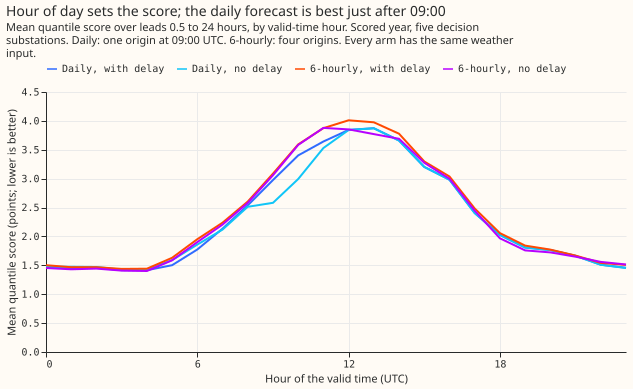
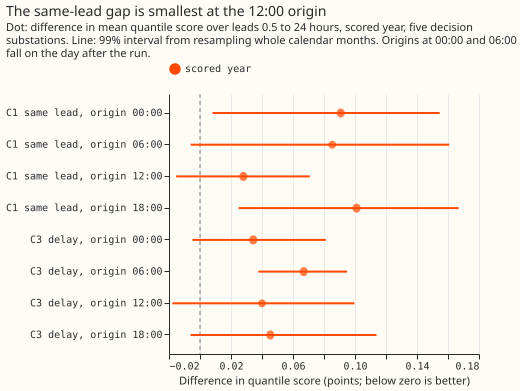
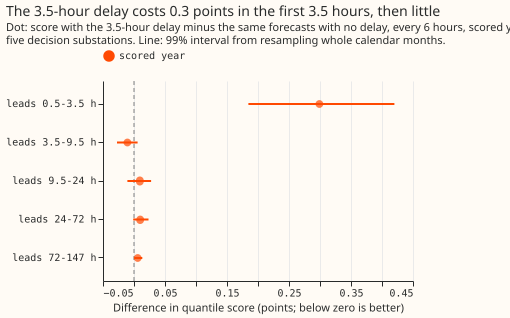

# Experiment 168: issued every 6 hours, the forecast is about as good as once a day

**Issued every 6 hours with power readings 3.5 hours old, the stage 2 forecast scores about the same
over the next 24 hours as the once-a-day forecast (-0.007 points; 99% interval -0.076 to +0.037),
and its largest loss, 0.073 points, falls between 09:00 and 12:00 UTC.** The pre-registered test of
this was confounded, so the verdict is `inconclusive`. Scores are twice the mean pinball loss over 11
quantiles, in points of a substation's effective capacity. Lower is better, and every contrast is
the first schedule minus the second, so a positive contrast means the first schedule scores worse.

**The stage 2 forecast is arm D of [experiment
155](../00155-dp-bg-stage2-assembly-night-offset-and-error-correction/result.md).** It is the
convex demand model (a generalised additive model) with a Kalman filter on recent errors (GAM-K),
driven by the ensemble-mean weather forecast, with two corrections added: a winter night offset and
recipe R, which subtracts 0.75 times the mean error of the last 14 days by half-hour of the day.
"Daily D" below means this forecast issued once a day, and "6-hourly D" means the same forecast
issued four times a day.

**Production would issue a forecast every 6 hours from the newest ECMWF weather run.** ECMWF (the
European Centre for Medium-Range Weather Forecasts) publishes one run a day, at about 09:00 UTC for
the 00:00 UTC run, so the weather forecast is 12 to 30 hours old when a forecast is issued.
Experiments 136 and 155 issued one forecast a day at 09:00 UTC. We re-issued each stored run at
12:00, 18:00, 00:00, and 06:00 UTC. The origin of a forecast is the time it is issued. The filter
reads only power readings that ended at least 3.5 hours before the origin, because production
receives telemetry about that late. The page scores one row per forecast of one substation's power
for one half-hour, at the five Primary substations D5, D10, D11, D14, and D16 (anonymised labels) in
the scored year, which runs from July 2025. The replicate months are the even months of the year
before, used to check signs.

**The pre-registered contrast, C1, is confounded, so the verdict is `inconclusive`.** C1 is 6-hourly
D minus daily D at the same run and lead, pooled over leads 0.5 to 24 hours. C1 reads +0.076 (99%
interval from resampling calendar months +0.009 to +0.129). The plan fixed a threshold of +0.05
before any score was read, and by that rule +0.076 is `refuted`. The once-a-day origin is always
09:00 UTC, so each lead falls on one hour of the day. An independent audit (see Checks) found that,
within lead bands, C1 runs from -2.09 to +1.24 points, so +0.076 is a small remainder of large
effects that cancel.

**H is a post hoc contrast that holds the hour of the day equal.** At every half-hour request time
in the scored year, H compares the newest forecast that each schedule holds: the once-a-day schedule
holds the 09:00 UTC forecast, and the 6-hourly schedule holds the newest of its four. Both forecasts
are scored at the same valid times (the half-hours being forecast), 0.5 to 24 hours after the
request time. H is -0.007 (-0.076 to +0.037). The plan's +0.05 threshold applied to H would read
`supported`, but H was chosen after the audit.

## Results

- **Method.** Each stored run of experiments 136 and 155 is re-issued at origins 3, 9, 15, and 21
  hours after its original 09:00 UTC origin. The weather input is the same run's ensemble mean and
  the GAM fit is the same, so only the filter's state and the lead change. The GAM's raw mean is
  experiment 136's stored mean minus its stored filter correction. Arm D's shift (offset and
  recipe R) is experiment 155's stored shift for the same run and valid time, and each arm's
  spread is refitted on its own tuning-month forecasts. Experiment 136's T-all fits, filter, and
  pooled filter noise are copied unchanged. No new modelling.
- **Reproduction control (passes).** An origin shift of zero hours reproduces the stored means to
  within 1.3e-6 points and the stored quantiles to within 1.5e-5 points at every substation.
- **Rows.** `fold_a_daily_gap_v1`, scored year, five decision substations (D9 beside them in the
  tables), outside the hand-filtered switching events. Leads run to 147 hours at all four origins
  and to 165 hours at fewer, because the stored window ends 168 hours after the original origin.
  The once-a-day arms have 464,363 rows and each 6-hourly arm 1,723,837. H holds 3,107,085 pairs of
  (request time, valid time, substation).
- **Absolute scores over leads 0.5 to 24 hours.** Once-a-day arm D 2.306, once-a-day arm D with no
  delay 2.277, 6-hourly arm D 2.386, 6-hourly arm D with no delay 2.339, once-a-day arm A 2.364,
  6-hourly arm A 2.441, BG2 2.433, manual heuristic 3.506, climatology 3.801. Over leads 0.5 to 147
  hours: once-a-day arm A 2.774, arm D 2.738; 6-hourly arm A 2.797, arm D 2.763; BG2 2.771;
  manual heuristic 3.532; climatology 3.832. BG2, the manual heuristic, and climatology are
  once-a-day forecasts. These scores by lead differ in the hour of the day each arm sees, so
  contrasts are read from H, C3, C4, C5, and C7.
- **H (post hoc), the newest forecast held, 6-hourly D minus once-a-day D.** All horizons -0.007
  (-0.076 to +0.037); replicate months -0.014 (-0.096 to +0.050). By horizon: 0.5 to 3.5 hours +0.036
  (-0.000 to +0.067), 3.5 to 9.5 hours +0.023 (-0.039 to +0.071), 9.5 to 24 hours -0.030
  (-0.112 to +0.019). By request time: 09:00 to 12:00 UTC +0.073 (+0.049 to +0.096; replicate
  months +0.078), all other request times -0.016 (-0.092 to +0.033). By substation: D5 +0.039, D14
  +0.019, D10 -0.026, D11 -0.033, D16 -0.029. The mean absolute error contrast is +0.003. Winter
  nights -0.045 (-0.141 to +0.010); cold nights (daily mean temperature below 2 degrees Celsius,
  37,146 pairs) -0.099 (-0.115 to -0.034) in the scored year and +0.110 in the replicate months,
  which is too unstable to read. The same contrast for arm A alone is -0.009 (-0.077 to +0.035),
  and for the no-delay forecasts (6-hourly D with no delay minus once-a-day D with no delay) -0.027
  (-0.085 to +0.023).
- **C1, 6-hourly D minus once-a-day D at the same lead.** Under 24 hours +0.076 (+0.009 to +0.129; 5
  of 5 substations, 10 of 12 months worse); all leads to 147 hours +0.017 (-0.021 to +0.042).
  Assigning rows to the month of the original run instead of the new origin moves the lower bound
  under 24 hours to +0.0005. Replicate months: +0.041 (-0.020 to +0.095) under 24 hours. By origin
  under 24 hours: 12:00 +0.028, 18:00 +0.101, 00:00 +0.091, 06:00 +0.085. The hour-band subsets of
  C1 (winter nights, cold nights, and holidays) are not reported. The paired row of the daily arm
  sits 3 to 21 hours earlier in the day than the 6-hourly row, so the subsets compare night with
  day.
- **C3, the 3.5-hour delay at the 6-hourly origins (no-delay forecasts subtracted).** Under 24 hours
  +0.047 (+0.020 to +0.074); leads 0.5 to 3.5 hours +0.299 (+0.184 to +0.420); 3.5 to 9.5 hours
  -0.011; 9.5 to 24 hours +0.009; all leads +0.014 (+0.004 to +0.026). By origin under 24 hours: 06:00
  +0.067 (+0.038 to +0.095), the others +0.034 to +0.045 with intervals that include zero. Replicate
  months +0.044 (+0.025 to +0.060) under 24 hours.
- **C7, the same delay at the once-a-day 09:00 origin.** Under 24 hours +0.029 (-0.018 to +0.081);
  leads 0.5 to 3.5 hours +0.260 (+0.114 to +0.413), close to the 6-hourly origins' +0.299.
- **C4 (post hoc), 6-hourly D minus once-a-day D at the same run and valid time.** Under 24 hours
  -0.024 (-0.110 to +0.029); all leads -0.019 (-0.058 to +0.004). C4 holds the weather run fixed, so
  it measures only the refresh of the filter, with a shorter lead for the same valid time. C4 is
  not a bound on the effect of the 6-hourly schedule. At the 18:00 origin C4 is +0.032 (-0.029 to
  +0.075), so a filter state 9 hours fresher scored slightly worse there. No explanation was found.
- **C5, arm D minus arm A at the 6-hourly origins.** Under 24 hours -0.056 (-0.091 to -0.025); all
  leads -0.034 (-0.061 to -0.012); all 5 substations lower. Replicate months under 24 hours -0.042
  (-0.097 to +0.014).
- **The mean absolute error gives the same signs as the quantile score.** The C1 contrast on the
  mean forecast is +0.136 (+0.024 to +0.225) under 24 hours and +0.032 (-0.022 to +0.073) over all
  leads.
- **Lead check of experiment 155.** The 6-hourly arm D scores +0.021 points higher at 3.5 to 9.5
  hours than at 0.5 to 3.5 hours. The once-a-day arm D scores -0.522 points lower, because its
  first 3.5 hours of lead are 09:00 to 12:30 UTC, among the hardest hours of the day (figure 2). The
  difference in growth is +0.543 (+0.232 to +0.906) and fails the pre-registered limit of +0.02,
  but the once-a-day growth is set by the hour of the day, so the check cannot tell us about
  growth with lead.
- **Predictions against outcome.** C1 +0.076 against +0.00 to +0.03 (a miss, high, and the contrast
  is confounded). C3 +0.047 against +0.01 to +0.04 under 24 hours (just outside) and +0.299 against
  more than +0.04 in the first 3.5 hours (inside). C4 -0.024 against -0.02 to -0.06 (inside). The
  06:00 origin has the largest C3 (+0.067) but not the largest C1 (18:00, +0.101), so that
  prediction missed. The cold-night prediction (C1 at most +0.10) cannot be scored, because the
  cold-night C1 is not reported.

## Tail calibration (scored year, five decision substations)

| Subset | Arm | q01 cov | q05 cov | q95 cov | q99 cov | Pinball q95 | Pinball q99 |
|---|---|---|---|---|---|---|---|
| 12-36 h | Daily D | 0.024 | 0.069 | 0.945 | 0.982 | 0.648 | 0.201 |
| 12-36 h | 6-hourly D | 0.025 | 0.072 | 0.948 | 0.983 | 0.666 | 0.206 |
| 12-36 h | BG2 | 0.009 | 0.036 | 0.948 | 0.985 | 0.699 | 0.242 |
| Cold nights | Daily D | 0.041 | 0.089 | 0.838 | 0.946 | 0.933 | 0.316 |
| Cold nights | 6-hourly D | 0.045 | 0.094 | 0.841 | 0.946 | 0.929 | 0.303 |
| Cold nights | BG2 | 0.019 | 0.033 | 0.761 | 0.866 | 1.347 | 0.788 |

- **The tails match the daily forecast's.** The 6-hourly q95 and q99 coverage at 12 to 36 hours is
  within 0.3 percentage points of the daily forecast's, and the cold-night q95 coverage stays near
  84%, as in experiment 155. The 12 to 36 hour rows hold 66,838 daily and 267,126 6-hourly forecasts.
- **Curtailment cost.** The node-level curtailment metric and the saving against the manual heuristic
  need node forecasts, which this experiment does not produce, so neither is reported.

## Checks

- **Median minus mean forecast, per substation.** 0.00 points at every substation for both arms at
  12 to 36 hours, because the spread is centred on the mean.
- **Audit triggers.** The `ml-experiment` skill lists seven conditions that call for an audit.
  Two held. First, a result contradicts its own prediction: C1 (+0.076) against the predicted
  +0.00 to +0.03. The hour of the day explains it, as C4, the no-delay contrast, and C7 show, and
  the audit confirmed it. Second, a later design depends on the headline: the GAM-K serving design
  does. The other five did not hold: the reproduction control passed, the mean-error and
  quantile-score contrasts agree in sign, every substation's C1 is positive so leaving one out
  keeps the sign, no nested arm beat the arm containing it except at one origin (C4 at 18:00,
  +0.032, a later origin scoring worse than an earlier one, for which no explanation was found),
  and we found no sister experiment on these rows to compare interval widths with (searched
  `ml-experiments/`).
- **Audit.** A fresh Opus agent re-derived every printed number from the stored predictions and
  found no leakage. It found that C1 is confounded with the hour of the day, so the verdict is
  `inconclusive`, and it proposed H. Its report is in the private `data/ml-experiments/briefs/`
  folder. It also found that the hour-band subsets of C1 compare night with day, so they are not
  reported, and that C1's lower bound moves to +0.0005 when rows take the month of the original run.
- **Order of work.** The planning commit precedes the scoring script. The build script had run
  once, and its reproduction control had been read, before the planning commit. No score had been
  read.

## Caveats and what to try next

- **The pre-registered contrast cannot be repaired from this folder's files.** Holding the hour of
  the day equal at the same lead needs ensemble runs at 06:00, 12:00, and 18:00 UTC, so H is the
  nearest estimate that this folder's files allow, and the plan did not name it.
- **Leads beyond 147 hours have fewer origins.** The stored window ends 168 hours after the
  original origin, so leads from 147 to 165 hours are not in the all-lead figures.
- **The monthly GAM refit is not re-timed.** A 00:00 or 06:00 origin on the first of a month uses
  the previous month's weights, where production would have used the new ones.
- **Arm D's shift is the stored shift.** The offset and recipe R are those fitted on the
  once-a-day forecasts' errors, not on the 6-hourly forecasts' errors.
- **Next.** Measure how soon after a half-hour ends production can read its power telemetry, and
  score one extra issue between 09:00 and 12:00 UTC. These arms hold only delays of 0 and 3.5
  hours, so the effect of a delay between them is not measured.
