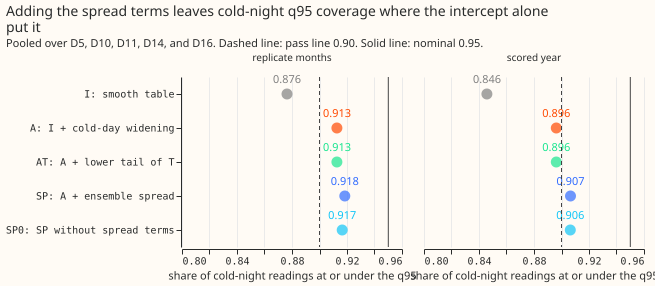
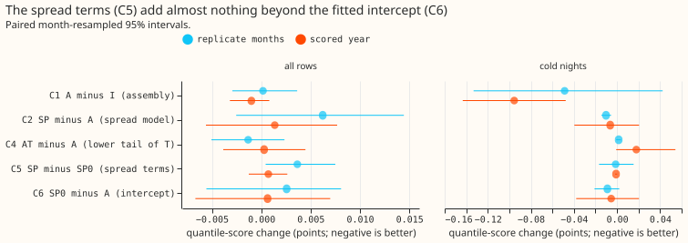
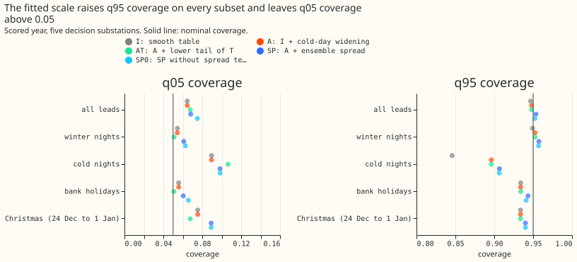
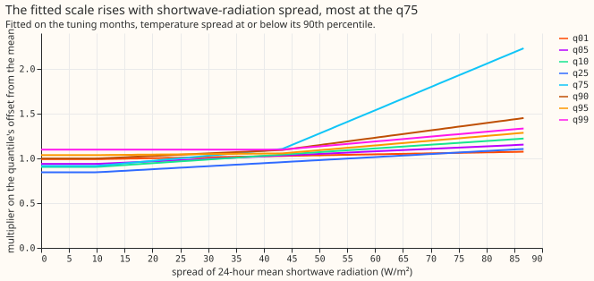

# Experiment 169: the combined calibration fixes, and whether the ensemble spread sets the width

**The ensemble spread does not predict how wide the forecast's errors are once the cold-day
widening is in place; a plain widening of the upper quantiles by 4% to 10% gives the same coverage.**
We asked two questions about the best demand forecast of
[experiment 155](../00155-dp-bg-stage2-assembly-night-offset-and-error-correction/result.md).
First, do the two calibration fixes found since then work together? They are the smooth spread
table of [experiment 160](../00160-calibration-band-width-fix-on-stage-2-winner/result.md) and the
one-sided widening on forecast-cold days of
[experiment 164](../00164-calibration-cold-night-tail-under-coverage/result.md) (fix O). Second,
does the spread of the 51-member ensemble weather forecast (how much the members disagree about
temperature and about downward shortwave radiation) predict how large the forecast's errors are?
We fitted a convex quantile model on the tuning months, scored it on the scored year and the
replicate months of experiment 164, and left the mean forecast unchanged. The two fixes combine
without loss: the combined forecast reproduces experiment 164's cold-night coverage of the 95%
quantile (q95), 0.896. The spread model lifts that coverage to 0.907, which meets the pre-registered
0.90 in the scored year and not in the replicate months. A control with the spread terms switched
off reaches 0.906, so the lift comes from a general widening, not from the spread. Scores are in
points of effective capacity (percentage points of each substation's rated demand); lower is better.

- **Arms.** I: experiment 160's interpolated spread table. A: I plus experiment 164's fix O
  (multipliers 1.65, 1.36, 1.26, and 1.16 on q75, q90, q95, and q99 on forecast-cold days). AT: A
  plus the q01, q05, and q10 multipliers of experiment 164's fix T. SP: A with each offset from the
  mean multiplied by `c + sum a_k max(z1 - k1_k, 0) + sum b_k max(z2 - k2_k, 0)` for the levels 0.01,
  0.05, 0.10, 0.25, 0.75, 0.90, 0.95, and 0.99. Here z1 is the standard deviation across members of
  the 24-hour mean temperature, z2 the same for shortwave radiation, the knots are their 25th, 50th,
  75th, and 90th tuning-month percentiles, and a and b are non-negative. SP0 (post hoc control): SP
  with a and b set to zero, so only the fitted intercept c remains. The pinball loss is linear in
  the coefficients, so each level is a linear programme (HiGHS) on 150,000 tuning rows.
- **Row set and schedule.** `fold_a_daily_gap_v1`, the five decision substations D5, D10, D11, D14,
  and D16 (D9 beside), leads 0.5 to 168 hours, rows outside the hand-filtered switching events. The
  mean forecasts are experiment 155's stored monthly refits, so no contrast depends on the retraining
  schedule. Scored year: 2025-07-02 to 2026-06-29, 464,228 rows at the five substations. The
  ensemble spreads come from experiment 111's stored 51-member forecasts, which exist at forecast
  time. The store holds temperature and shortwave radiation, not wind, so the wind spread and the
  spread of the GAM-K forecast across members were not tested.
- **Fitted coefficients.** Every fitted intercept `c` lies between 0.85 and 1.10: 0.99 at q01, 0.94
  at q05, 0.91 at q10, 0.85 at q25, 0.92 at q75, 1.00 at q90, 1.04 at q95, and 1.10 at q99. The
  temperature-spread terms are zero except above the 90th percentile of the spread, where the
  coefficient is 0.49 (q75), 0.18 (q90), and 0.10 (q95). The shortwave terms are non-zero at every
  level, at most 0.2 per knot for the lower levels and 0.2 to 0.9 for the upper ones (figure 4).
- **Assembly (C1, A minus I), scored year.** All rows -0.0010 (95% interval -0.0032 to +0.0008);
  cold nights -0.095 (-0.143 to -0.048); cold-night q95 coverage +0.050 (+0.031 to +0.070).
  Replicate months: all rows +0.0002 (-0.0029 to +0.0036), cold-night q95 coverage 0.913.
- **Spread model (C2, SP minus A), scored year.** All rows +0.0014 (-0.0056 to +0.0077); cold nights
  -0.006 (-0.040 to +0.021); cold-night q95 coverage +0.010 (+0.005 to +0.016). By lead: under 24
  hours -0.0011, 24 to 72 hours +0.0006, 72 to 168 hours +0.0024 (-0.0062 to +0.0103). Replicate
  months: all rows +0.0062 (-0.0025 to +0.0145), cold-night q95 coverage 0.918.
- **Control (C5, SP minus SP0, and C6, SP0 minus A).** C5, scored year: all rows +0.0007 (-0.0013 to
  +0.0026); cold nights -0.001 (-0.002 to 0.000); cold-night q95 coverage +0.000. C6: all rows
  +0.0006 (-0.0067 to +0.0070); cold-night q95 coverage +0.010 (+0.005 to +0.015). Replicate months:
  C5 all rows +0.0037 (+0.0005 to +0.0075), C6 +0.0026 (-0.0056 to +0.0081).
- **Lower tail (C4, AT minus A).** All rows +0.0003 (-0.0038 to +0.0045); cold nights +0.018 (-0.001
  to +0.054). Fix T's lower multipliers raise the cold-night q05 coverage from 0.090 to 0.107, away
  from 0.05.
- **Absolute scores, scored year, all rows.** I 2.7529, A 2.7519, AT 2.7522, SP 2.7533, SP0 2.7526,
  BG2 2.7804, manual heuristic 3.4968, climatology 3.8038. Replicate months: I 2.6819, A 2.6821, AT
  2.6807, SP 2.6883, SP0 2.6846.
- **Tail calibration, scored year, cold nights (coverage / pinball loss).** I: q01 0.045 / 0.391, q05
  0.090 / 0.950, q95 0.846 / 0.934, q99 0.933 / 0.328. A: 0.045 / 0.391, 0.090 / 0.950, 0.896 / 0.819,
  0.959 / 0.282. SP: 0.046 / 0.394, 0.098 / 0.965, 0.907 / 0.798, 0.970 / 0.247. BG2's q95 coverage
  is 0.756.
- **Tail calibration, scored year, all rows (coverage / pinball loss).** A: q01 0.022 / 0.216, q05
  0.065 / 0.713, q95 0.948 / 0.745, q99 0.982 / 0.232. SP: 0.022 / 0.216, 0.068 / 0.714, 0.954 /
  0.748, 0.987 / 0.228. SP0: q05 0.075, q95 0.952. On all rows, C2's q99 loss changes by -0.0042
  (-0.0105 to +0.0016) and its q95 loss by +0.0031 (-0.0011 to +0.0073).
- **By lead day (q95 coverage, all rows).** A: 0.946, 0.948, 0.951, 0.951, 0.952, 0.946, 0.943 for
  lead days 0 to 6. SP: 0.951, 0.953, 0.955, 0.956, 0.957, 0.952, 0.951. SP widens the median q05 to
  q95 width by 0.0 to 0.4 points on every lead day.
- **By hour band (q95 coverage, all rows).** A: 0.954, 0.951, 0.934, 0.951 for the four bands in
  order (night, morning, daytime, evening as `studies.dp_calendar` orders them); SP: 0.959, 0.956,
  0.941, 0.956.
- **Bank holidays and Christmas, scored year.** Bank holidays (9,812 rows): q95 coverage 0.934 (A)
  and 0.943 (SP); C2 -0.0044 (-0.0246 to +0.0137). Christmas, 24 December to 1 January (8,641
  rows): 0.934 and 0.940; C2 +0.0052 (-0.0172 to +0.0055). The q05 coverage on Christmas rises from
  0.075 to 0.089 under SP, so the lower tail is thinner there.
- **Curtailment-cost proxy** (the node-only rule of `studies.node_curtailment` on each substation's
  own demand, scaled limit 0.9 times the maximum before the scored year, GBP 2,000 per MWh, leads 12
  to 36 hours). Avoidable cost against the perfect forecast, summed over the five substations: I GBP
  1.321 million, A 1.272 million, SP 1.310 million, SP0 1.309 million, BG2 1.881 million, manual
  heuristic 3.332 million. The 95% month-resampled intervals overlap (A 0.11 to 3.14 million), so
  the proxy cannot rank the arms. A Primary substation has no published export limit here and a
  demand series is treated as the flow that can breach, so the figures show the arithmetic and are
  not a curtailment forecast.
- **What remains miscalibrated.** (1) Cold nights: SP's q95 coverage is 0.907 against 0.95
  nominal, and its lower tail is thin (q05 coverage 0.098 against 0.05, q01 0.046 against 0.01).
  (2) The lower tail overall: q05 coverage is 0.065 to 0.075 on all rows in every arm. (3) The
  coldest forecasts are biased low (experiment 164 found a mean residual of +3.1 points at 0 °C or
  below), which no scaling of the offsets removes. (4) Economy 7 steps and switching rows were not
  scored separately here. (5) Christmas lower-tail coverage (0.075 to 0.089).
- **Caveats.** The scored year's cold-night figure rests on 10 cold days; the day-block 95%
  interval of SP's coverage is 0.858 to 0.956 and contains 0.90 (the probability of at least 0.90 is
  0.61, against 0.45 for A). Leaving out one substation moves SP's cold-night q95 coverage to 0.901
  (D5), 0.922 (D10), 0.924 (D11), 0.886 (D14), or 0.903 (D16), so the pass in the scored year
  depends on D14. In the replicate months SP's all-row upper bound (+0.0145) is over the +0.010
  limit, and leaving D10 out gives 0.896. The tuning and replicate months share cold days with each
  other. The spread model has no quarter or hour-band term, so the prediction that the shortwave
  coefficients are larger in summer was not tested. SP0 is a post hoc arm, so its pass on both periods is a
  suggestion, not a pre-registered result.
- **What to try next.** (1) A bias correction of the mean forecast on days the ensemble forecasts
  at 0 °C or below. (2) Fit and score the widening over at least two winters. (3) A spread model with
  hour-band and quarter terms if a wind spread becomes available.

## Checks

- **Median minus mean forecast, per site, at 12 to 36 hours.** Exactly 0.000 for every arm at every
  substation: the spread table has median zero, and no arm scales the q50 offset.
- **Mean-forecast error beside each quantile-score contrast.** The mean absolute error of the mean
  forecast is identical across all arms (contrast 0.0000), because the mean is unchanged.
- **Reproduction control.** Arm I rescored from experiment 164's stored forecasts scores 2.75291,
  a gap of 7e-6 from experiment 160's printed 2.7529. Arm A scores 2.75191, a gap of 1e-5 from
  experiment 164's printed 2.7519. Both are inside the 0.001 cap.
- **Prediction check.** Cold-night coverage rose by 0.010 (predicted 0.00 to 0.03) and the all-row score
  by +0.0014 (predicted -0.01 to +0.005): both inside the ranges. The prediction about shortwave
  against temperature coefficients by quarter could not be tested.
- **Audit triggers.** Trigger 4 fired: leaving D14 out lowers SP's cold-night q95 coverage from 0.907
  to 0.886, below the 0.90 line that decides the scored-year pass. Triggers 1 to 3 and 5 to 7 did not
  fire (SP0 is a post hoc control, and SP minus SP0 is small).
