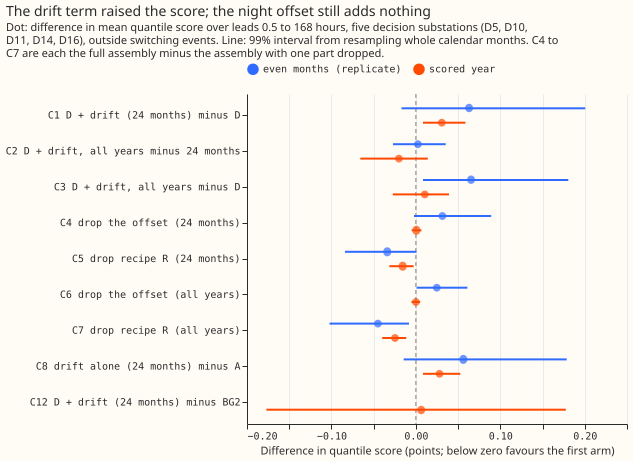
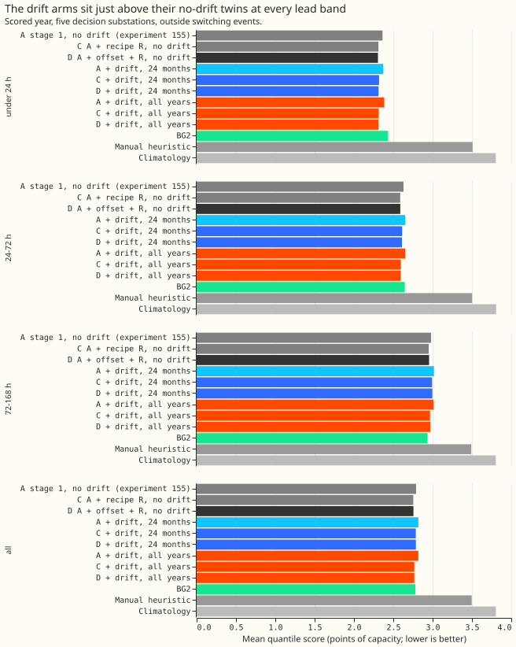
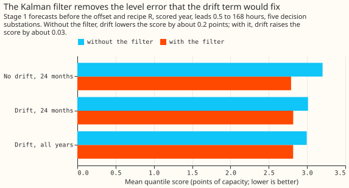
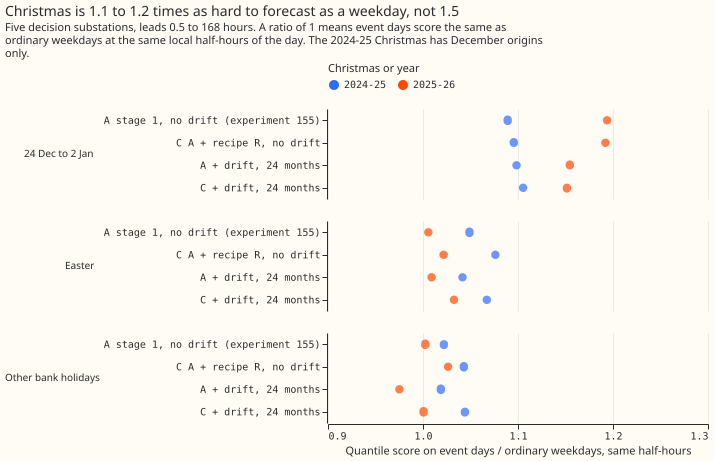

**The Kalman filter on recent errors already removes the slow demand-level error that a drift term
fixes, so the drift term does not improve the stage 2 assembly.** In [experiment
167](../00167-dp-full-history-gam-24-months-or-all-years-with-drift/result.md) the drift term
improved the quantile score by 0.40 points. Here it worsened the score by 0.03 points. Lower scores
are better throughout. The quantile score is twice the mean pinball loss over 11 quantiles, in
points
of a substation's effective capacity (its rated maximum output), over forecasts 0.5 to 168 hours
ahead at five Primary substations (D5, D10, D11, D14, and D16, anonymised labels) in the year from
July 2025 to June 2026 (the scored year).

**The drift term is a slowly varying demand level added to the demand model, and the Kalman filter
updates a demand level from each recent forecast error.** Arm D of [experiment
155](../00155-dp-bg-stage2-assembly-night-offset-and-error-correction/result.md) is the demand model
with the filter, a winter night offset, and recipe R (the mean error of the last 14 days by
half-hour, subtracted at 0.75 times its size). It scored 2.756. Arm D with a drift term, trained on
the last 24 months, scored 2.787 (C1, +0.031; 99% interval from resampling calendar months +0.008
to +0.059). Arm D with a drift term trained on all years back to late 2019 scored 2.767 (C3, +0.011;
-0.027 to +0.039). The plan asked for a gain of at least 0.20 points, so the verdict is `refuted`.
Training on all years scored 0.020 lower than 24 months (C2; -0.066 to +0.014). That gain is under
the plan's 0.05 threshold, and its interval includes zero.

**Without the Kalman filter, the drift term improves the score by 0.19 points (not significant), so
the filter appears to remove the level error that the drift term would fix.** The stage 1 forecast
(before the offset and recipe R) improved by 0.19 points with a drift term on 24 months and no
filter (-0.482 to +0.069), the same sign as in experiment 167. Adding the filter improved the
no-drift forecast by 0.41 points (-0.662 to -0.178). With the filter, the drift term worsened the
forecast by 0.03 points (figure 3). A review by a second Claude model (Opus) proposed a mechanism,
and its diagnostics fit it: at each monthly refit, the new drift fit's held level absorbs the same
recent error that the filter's carried-over level already holds, so the first weeks after the refit
would correct the same error twice. The refit's jump in demand level is 2.39 points root mean square
with drift and 1.16 without. The jump correlates +0.73 with the filter's level. The loss sits in
days 1 to 20 after each refit. Re-basing the filter at each
refit, without lookahead, cuts the loss from +0.028 to +0.011 (-0.002 to +0.026), and the drift term
still does not win. The code that makes the drift fits is checked by a reproduction control: the
same code with no drift reproduces experiment 136's stage 1 forecast exactly.

**Christmas is only 1.13 times as hard to forecast as an ordinary weekday, and recipe R improves the
score on those days by 0.04 points.** The experiment also scored 24 December to 2 January, Easter,
and
the bank holidays. The quantile score on 24 December to 2 January was 1.13 times the score on
ordinary
weekdays at the same half-hours of the day (arm D; 1.10 in 2024-25 and 1.19 in 2025-26). The plan
predicted at least 1.5 times, and predicted that recipe R would worsen the score on those days. Both
predictions failed.

## Results

- **Arms and schedule.** A row below is one forecast of one substation for one half-hour at one lead
  time, and D+1 means forecasts for the next calendar day. Every stage 1 arm is experiment 136's T-all
  demand model (heating split by day type and half of the hour band, lighting split by day type) with
  the pinned solar capacity, driven by the ensemble-mean weather, with the filter noise POOL
  (experiment 133's single shared filter setting) and monthly refits. The fit sets are no drift on 24
  months (`a2_repro`), drift D1 on 24 months (`m24_d1`), and drift D1 on all years (`all_d1`), with
  experiment 104's tuned penalties. Each stage 1 arm gets experiment 155's four stage 2 variants: none
  (`_a`), offset (`_b`), recipe R (`_c`), and offset then R (`_d`). Prefixes are `r` (no drift), `s24`
  (drift, 24 months), and `sall` (drift, all years); `a155`, `c155`, and `d155` are experiment 155's
  stored arms.
- **Rows.** `fold_a_daily_gap_v1`, scored year 2025-07-02 to 2026-06-29, five decision substations,
  outside the hand-filtered switching events; 561,172 rows shared by every arm and BG2 in the scored
  year (464,363 at leads up to 168 hours for the stage 1 diagnostic, which has no BG2). The
  replicate year (even months of 2024-25) gives the sign check.
- **Absolute scores, all leads (points).** A 2.791, C 2.754, D 2.756, BG2 2.780. Drift on 24 months:
  A 2.819, offset 2.802, R 2.786, both 2.787. Drift on all years: A 2.818, offset 2.791, R 2.767,
  both 2.767. Day D+1: D 2.432, drift on 24 months 2.445, drift on all years 2.435.
- **C1, D plus drift (24 months) minus D (headline):** +0.031 (+0.008 to +0.059); 1 of 5 substations
  and 2 of 12 months lower. Replicate year +0.063 (-0.017 to +0.201). Mean-forecast absolute error
  +0.066.
- **C2, drift on all years minus 24 months:** -0.020 (-0.066 to +0.014); 4 of 5 substations and 6 of
  12 months lower. Replicate year +0.002 (-0.027 to +0.035).
- **C3, drift on all years minus D:** +0.011 (-0.027 to +0.039).
- **Drop-one table.** Dropping the drift term improves the score by 0.031 (C1). Dropping the offset
  improves it by 0.001 on 24 months (C4, +0.001; -0.005 to +0.007) and changes it by 0.000 on all
  years (C6).
  Dropping recipe R worsens it by 0.016 on 24 months (C5, -0.016 for the full assembly minus the
  assembly without R; -0.031 to -0.003) and by 0.025 on all years (C7, -0.025; -0.040 to -0.012).
  Without drift, R lowered the score by 0.037 in experiment 155.
- **Cold nights (day mean below 2 C, 5,395 rows).** D 3.342, drift on 24 months 3.153, drift on all
  years 3.080. The contrast C1 on those rows is -0.189 (-0.378 to +0.150). On winter nights as a
  whole C1 is +0.048 (+0.013 to +0.100), and D+1 over all rows +0.013 (-0.005 to +0.035). The q95
  coverage on cold nights is 83.7% for D, 86.2% for drift on 24 months, and 85.2% for drift on all
  years.
- **Christmas rows of the calendar (Christmas Day, Boxing Day, and the Christmas run; 7,775 rows,
  one Christmas).** D 3.176, drift on 24 months 3.215, drift on all years 2.900, BG2 2.309. BG2 beat
  arm D by 0.87 points on those rows, from one Christmas and 12 runs, as in experiment 155; it is
  not a ranking.
- **Tails, all leads (coverage at q01, q05, q95, q99; nominal 1, 5, 95, and 99%).** D 2.4, 7.0,
  94.7, and 98.3%; drift on 24 months 2.5, 7.2, 94.8, and 98.2%; drift on all years 2.4, 7.3, 94.8,
  and 98.2%. Pinball loss at q99: 0.232, 0.234, and 0.232.
- **Stage 1 with and without the filter (all leads).** No drift 3.202 without and 2.791 with the
  filter; drift on 24 months 3.012 and 2.819; drift on all years 2.995 and 2.818. Drift minus no
  drift without the filter: -0.190 (-0.482 to +0.069) on 24 months and -0.207 (-0.498 to +0.075) on
  all years; with the filter: +0.028 (+0.008 to +0.053) and +0.027 (-0.009 to +0.056).

## Christmas, Easter, and bank holidays score 1.04 to 1.13 times an ordinary weekday

The score on each event is divided by the score on ordinary days at the same local half-hours of the
day. Christmas is 24 December to 2 January; Easter is Good Friday to Easter Monday; the bank
holidays
are May Day, the Spring and Late Summer Bank Holidays, and one-off holidays. The tuning months fit
the
spread, so only the replicate year and the scored year are scored. The ratios are for leads 0.5 to
168
hours; `printed_report.txt` has the D+1 and Sunday-reference rows.

| Event (dates, rows) | Ratio to weekdays, arm D | Ratio, drift on 24 months with offset and R | Ratio to Sundays, arm D |
|---|---|---|---|
| 24 December to 2 January (20 dates, 25,673 rows) | 1.128 | 1.115 | 1.214 |
| Easter (8 dates, 12,140 rows) | 1.045 | 1.044 | 1.125 |
| Other bank holidays (5 dates, 6,340 rows) | 1.057 | 1.037 | 1.138 |

- **Christmas by year.** Arm D scored 1.099 times a weekday in 2024-25 and 1.194 in 2025-26; arm A
  (no corrections, no drift) scored 1.089 and 1.194. The 2024-25 rows hold December origins only, so
  1 January and 2 January are
  forecast at long leads there.
- **Recipe R on Christmas.** R lowered the quantile score by 0.041 points without drift (5 of 20
  dates worse, 1 of 5 substations worse) and by 0.040 with drift (3 of 20 dates, 2 of 5
  substations). The mean-forecast absolute error moved by -0.093 and -0.083 (an improvement).
- **Recipe R on Easter and the other bank holidays.** R raised the score by 0.016 and 0.023 points
  without drift and by 0.026 and 0.033 with drift. The 14-day profile that R subtracts averages
  ordinary days, which are further from a holiday than from Christmas.
- **The drift term on Christmas.** Drift changed the Christmas score by +0.023 (24 months, no R);
  the sign differs by Christmas (+0.081 in 2024-25, -0.078 in 2025-26).
- **Holiday-aware filter update.** [Experiment
  143](../00143-differentiable-physics-holiday-aware-updating-of-the-gam-k-filter/result.md) found
  that leaving holiday readings out of the filter's update was not supported, so this experiment
  did not add it as an arm.

## Checks

- **Median minus mean forecast.** Zero at every substation and arm by construction, because each
  spread table is centred on the median residual.
- **Mean-forecast error beside the quantile score.** The mean-forecast absolute error contrast has
  the same sign as the quantile-score contrast for C1 (+0.066), C2 (-0.037), C4 (0.000), and C5
  (-0.047).
- **Controls.** The reproduction control passed: `a2_repro` reproduces experiment 136's stored
  A2 mean and quantiles exactly (largest difference 0), and the stage 2 code run on it gives arm D's
  2.756 (R1 and R2 are 0.000).
- **Audit triggers.** Trigger 2 (a result contradicts its prediction and an earlier experiment)
  fired: C1 was predicted at -0.20 or lower and is +0.031, against experiment 167's -0.40. The filter
  diagnostic above is the tested explanation. Trigger 5 (a nested arm beats the arm that contains it)
  fired, because the arm with a drift term scores worse than the arm without. A fresh audit by Opus
  ran (private report `data/ml-experiments/briefs/e170_audit_report.md`) and found no leakage and no
  defect in the drift fit, the filter's residual stream, or the scoring, and did not change the
  verdict's decision. Triage: (1) the audit found that a t-interval over the 12 months gives C1 as
  -0.002 to +0.063, so the label `refuted` could read as `inconclusive`; the pre-registered month
  bootstrap stands, and the decision to drop the drift term holds either way, because `supported`
  needed -0.20 or lower. (2) The refit double-count is in the opening section. (3) Shrinking the last
  knot (+0.016), holding the second-to-last (+0.021), or holding the mean of the last three (+0.021)
  leaves C1 positive. (4) The no-filter gain rests on D5 (-0.65) and D16 (-0.38), and D10 goes the
  other way (+0.16), so it does not replicate experiment 167's size. (5) The filter's POOL settings
  were tuned without a drift term (a limitation, not re-run). Triggers 1, 3, 4, and 6 did not fire:
  leaving one site out keeps C1 positive (+0.021 to +0.038), and the contrasts on the mean-forecast
  error agree in sign.
- **Lead check.** The growth in score from 0.5 to 3.5 hours to 3.5 to 9.5 hours, minus arm A's, has
  a 99% upper bound of +0.041 for drift on 24 months and +0.033 for arm D; neither passes the 0.02
  bound, as in experiment 155.

## Caveats

- **Past drift fits are monthly, and the last drift knot is held.** Experiment 167 refitted every 3
  months and held the last knot for 3 months. This experiment refits every month and holds it for 1
  month, so the held level is more recent but also noisier.
- **D10's unlabelled jumps stay in training.** Experiment 167 removed two windows of unlabelled
  level jumps at D10 (November to December 2024 and 2025). Experiment 136's fits, which arm D
  copies, left them in, so this experiment does too. The scored rows leave out the hand-filtered
  switching events.
- **Two Christmases.** The Christmas ratios rest on 20 dates, of which the 2024-25 Christmas holds
  only December origins. They describe these two years and carry no interval.
- **Not scored.** The curtailment-cost saving against the manual heuristic is not scored, because
  no drift arm beat arm D.
- **The filter's noise settings (POOL) were tuned without a drift term.** The drift arms' refit
  jumps are twice as large, so the settings are not neutral between the arms; the audit's re-basing
  removes most of the effect a retune could target.
- **Schedule.** Monthly refits on a 24-month window or on all years, as in experiments 136 and 155;
  the contrast could differ under weekly refits, which the filter might not absorb as fully.

## What to try next

- Keep the stage 2 assembly of experiment 155 (arm C or D) as the best guess. Recipe R is the part
  that improves the score.
- If a drift term is tried again on a filtered forecast, re-base the filter's level at each refit
  first; the audit found no gain over no drift even then (+0.011).
- If a drift term is wanted for cold nights, test it as a winter-night-only term. Its gain on nights
  with a day mean below 2 C (-0.19 points) is not significant, rests on 3 months, and did not
  appear in the replicate year on 24 months (D 2.182, drift 2.190), so it is a lead and not a result.
