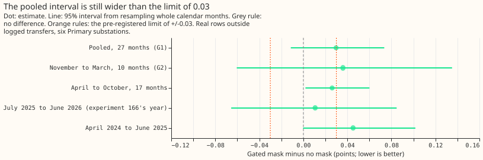
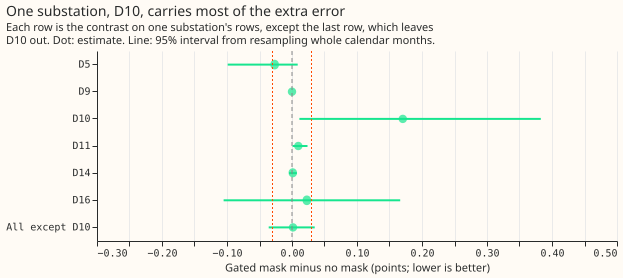
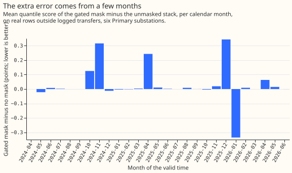

**The gated mask scores 0.030 points of effective capacity worse than no mask on 27 months of rows
outside logged transfers (95% interval -0.011 to +0.074).** The interval includes zero and is wider
than the limit of +/-0.03 that we set in advance. The verdict is therefore `inconclusive`: harm
below 0.03 is neither shown nor excluded. Most of the difference comes from one substation, D10.

**Background: what the mask is.** Our forecast corrects itself using recent power. A "mask" sets
recent power aside while a switching alarm is active. A logged transfer is a movement of load
between two substations recorded in NGED's switching log. [Experiment
166](../00166-switching-gated-mask-and-soft-mask-while-alarmed/result.md) masked recent power only
while a "gated alarm" was active. A gated alarm is a pair alarm (a step at one substation matched by
an opposite step at a neighbouring metered substation, from [experiment
156](../00156-switching-faster-onset-alarm-from-opposite-steps/result.md)) with a balance score of
0.7 or more. The balance score measures how nearly the two steps cancel, and 1 means exactly.
Experiment 166 found a gain of 7.35 points in the 72 hours after a logged transfer ends. It could not show that the mask does no
harm on other rows, because 12 months of rows gave an interval of -0.068 to +0.081. A score in
points of effective capacity is the score in megawatts divided by the substation's effective
capacity (as in experiment 166), times 100. Primary substations are the substations that step power
down onto the local distribution network.

**The first year's near-zero harm (+0.009) is reproduced here (+0.011), but the earlier 15 months
give +0.045.** We scored every cached forecast run of the same six Primary substations, 27 months
instead of 12, on rows outside logged transfers. A row is one forecast for one half-hour from one
forecast origin. The forecast, called the stack here, is a frozen generalised additive model with a
Kalman filter ([Kalman, 1960](https://doi.org/10.1115/1.3662552)). The filter corrects each
forecast using its recent errors, as in [experiment
163](../00163-switching-real-event-comparison-gam-stack-against-bg2/result.md). Nothing is refitted;
only the rows change. Scores are twice the mean pinball loss over 11 quantiles, in points of
effective capacity; lower is better. The gain of 7.35 points is taken from experiment 166 (7 logged
transfers, 72 hours after each ends). It is not pooled with the rows outside logged transfers.

## Design and results

- **Decision rule.** G1: the pooled contrast has a 95% interval inside -0.03 to +0.03. G2: the
  November to March contrast has an interval inside -0.05 to +0.05. The verdict is `supported` when
  both hold, `partly supported` when only G1 holds, `refuted` when the pooled point estimate is
  above +0.03, and `inconclusive` otherwise. The limit of 0.03 is there because the mask adds alarm
  tables to the serving path, which is worth doing only if ordinary rows do not get worse.
- **Arms.** K0 (no mask), MASK_GATED (readings set missing from the moment a gated alarm is known
  until the end rule of [experiment 148](../00148-switching-end-rule-lookahead-ro-nc/result.md)
  fires), and for reference MASK_NEW (every pair alarm) and MASK_UNION (pair alarm or refit-offset
  neighbour-count alarm, as in [experiment
  165](../00165-switching-drop-recent-power-while-alarmed-all-rows/result.md)). The stack is frozen.
  The K0 forecast spread of experiment 115 is shared, so arms differ only in where the forecast
  distribution sits.
- **Rows.** 1,579,711 rows with a reading, from 811 cached forecast runs (one per day) at D5, D9,
  D10, D11, D14, and D16 (anonymised substation labels), forecast origins 2024-04-10 to 2026-06-29.
  Each row's valid time lies outside every logged transfer from onset to 72 hours after its end.
  Each substation has more than 12 months of past forecast errors before its first run, because the
  power panel starts in 2022-01. The cached forecasts start in 2024-04, so none earlier were
  available to score.
- **Absolute scores, pooled.** K0 2.718, MASK_GATED 2.748, MASK_NEW 2.773, MASK_UNION 2.915.
- **G1 and G2.** Pooled (27 months): MASK_GATED minus K0 +0.030 (-0.011 to +0.074), half-width 0.042
  against the limit 0.03. November to March (10 months, 579,096 rows): +0.036 (-0.060 to +0.135),
  half-width 0.098 against the limit 0.05. April to October (17 months): +0.026 (+0.002 to +0.060).
- **Reference arms, pooled.** MASK_NEW minus K0 +0.055 (+0.009 to +0.105). MASK_UNION minus K0
  +0.197 (+0.078 to +0.342). Masking on more alarms, including the ones with no balanced opposite
  step, raises the error further.
- **Post hoc, labelled: the two periods.** Valid times from July 2025, the 12 months of experiment
  166's scored year (here on every row of those valid times, where experiment 166 used the
  forecasts shared with best guess 2): +0.011 (-0.066 to +0.085). Valid times before July 2025:
  +0.045 (-0.000 to +0.102). The two intervals overlap almost completely.
- **Post hoc, labelled: by substation.** Alone: D5 -0.027 (-0.099 to +0.009), D9 0.000 (no gated
  alarm from 2024-04-10 onwards), D10 +0.170 (+0.011 to +0.383), D11 +0.010 (+0.001 to +0.024), D14
  +0.001 (-0.004 to +0.007), D16 +0.023 (-0.105 to +0.167). Leaving out D10: +0.002 (-0.036 to
  +0.035). Leaving out any other substation leaves the estimate between +0.031 and +0.040.
- **Post hoc, labelled: rows with a gated alarm active at the forecast origin.** 122,598 rows
  (7.8%): +0.386 (-0.164 to +0.893). The other 1,457,113 rows: 0.000 (-0.001 to +0.001), rounded
  from a value below 0.0005 in size. A mask changes the forecast only while a gated alarm is active
  or its filter state is recovering, so the 7.8% carry the whole difference.
- **Gated alarms and masked half-hours.** The table counts gated alarms known from 2024-04-10 (2024
  is April to December and 2026 is January to June) and the half-hours between each alarm being
  known and its end being known.

| Substation | 2024 gated alarms / masked half-hours | 2025 gated alarms / masked half-hours | 2026 gated alarms / masked half-hours |
|---|---|---|---|
| D5 | 1 / 186 | 7 / 3,639 | 3 / 979 |
| D9 | 0 / 0 | 0 / 0 | 0 / 0 |
| D10 | 4 / 3,528 | 7 / 1,982 | 4 / 819 |
| D11 | 4 / 928 | 5 / 1,711 | 6 / 1,133 |
| D14 | 4 / 711 | 10 / 2,093 | 3 / 598 |
| D16 | 0 / 0 | 4 / 1,765 | 3 / 979 |

- **Share of masked half-hours outside every logged transfer.** Gated alarms: 65 alarms, 21,051
  masked half-hours, 17,028 outside (80.9%). Every pair alarm: 146 alarms, 39,789 half-hours, 86.2%
  outside. Either alarm: 178 alarms, 54,660 half-hours, 89.2% outside. Most masked half-hours
  therefore fall outside logged transfers, though the rows scored here are defined by valid time
  and the half-hours by the alarm's span, so the two sets overlap without matching.
- **Prediction against outcome.** The interval was expected to be about +/-0.05 wide, not inside
  +/-0.03, so the prediction that it would fall inside +/-0.03 failed on its own terms. The
  observed half-width is 0.042. The winter half-width is 0.098 against a limit of 0.05; the winter
  subset has 10 months against 27 pooled. The point estimate stayed below +0.03 (0.0297).

## Checks that did not change the verdict

- **Median minus mean forecast, per substation (identical for every arm).** D5 -0.146, D9 -0.019,
  D10 -0.058, D11 -0.030, D14 +0.037, D16 +0.017 points.
- **Error of the mean forecast beside the quantile contrast.** Mean absolute error of the mean
  forecast, MASK_GATED minus K0: +0.064 (-0.003 to +0.140), in the same direction as the quantile
  score.
- **Audit triggers (the seven conditions in the experiment procedure that call for an independent
  audit).** None fired. The wide interval was predicted. Leaving out D10 moves the estimate from
  +0.030 to +0.002, but the estimate stays positive and the verdict stays `inconclusive`. The
  half-width of 0.042 is 0.57 of experiment 166's 0.075, not under half. No audit was run.

## Caveats

- **The 27-month limit comes from the data, not the method.** A half-width of 0.03 would need about
  54 months at this variance, if the true harm is well below 0.03.
- **With 27 months, 10 of them in winter, the resampled interval is itself uncertain.**
- **Pair alarms appear at both ends of one transfer.** D5 and D16 share identical 2026 gated alarms,
  so the rows of neighbouring substations are not independent.
- **Three conditions favour the mask in this test.** The residual uses the analysis proxy (a
  weather estimate for the recent past), the alarm tables of experiment 156 were tuned on odd
  months of the same stream, and each alarm's end is known by the end rule of experiments 147 and
  148, which uses a 6-hour wait. The filter and spread settings were tuned on the odd months of
  2024-07 to 2025-06, which are inside the rows scored here.

## What the next experiment should answer

The next question is why D10's 15 gated alarms raise the error: whether they follow real switching
that no log records, or false alarms. Leaving D10 out gives +0.002. More than 7 logged transfers
are needed to measure the gain before the mask can be added to production.
