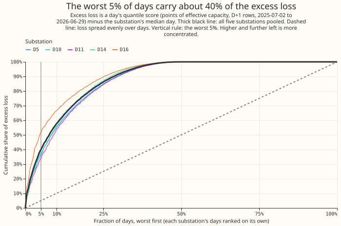
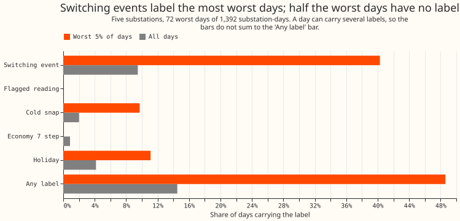
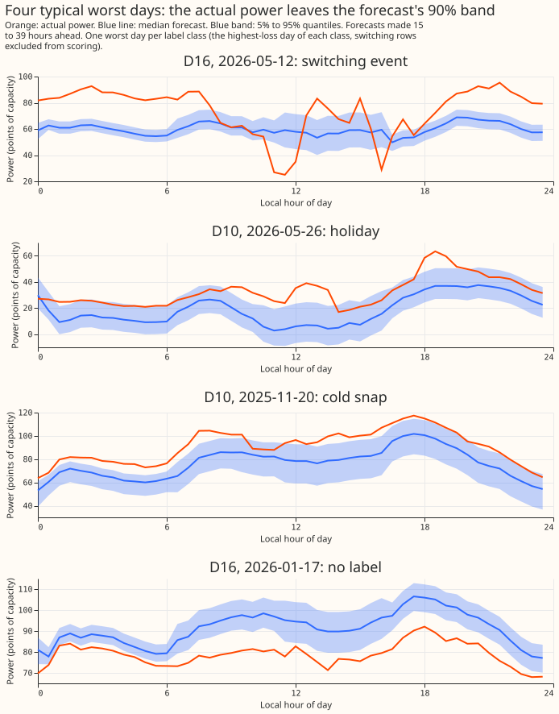

**A small number of bad days carries a large share of the forecast's error.** We asked whether the
forecast's error is spread over ordinary days or sits on a few days that the project already knows
how to label. We took the forecasts of experiment 155's arm D (a convex demand model with a Kalman
filter on recent errors, plus a winter night offset and a 14-day mean-error correction) for five
substations, D5, D10, D11, D14, and D16, over 2025-07-03 to 2026-06-30. D9 is scored beside them
and sits in no headline number. For each substation we scored every day, subtracted the
substation's median day, and ranked the days by this excess loss. The worst 5% of substation-days
(72 of 1,392) carry 41.7% of the total excess loss. Of those 72 days, 48.6% overlap a switching
event, a holiday, a cold snap, a flagged reading, or an Economy 7 step (the night-time step in
demand from off-peak storage heating), against 14.5% of all days. The main answer is that the error
is concentrated enough to target, and that about half of the worst days have no label yet.

**The pre-registered verdict is `inconclusive`.** The share clears its 30% threshold and the
labelled fraction misses its 50% threshold by 1.4 percentage points, which would give `partly
supported`. The decision rule caps the verdict at `inconclusive` when the injected known-answer
control recovers fewer than 90% of injected days, and it recovered 89.2%. The control's failure sits
at D16 alone (see Results). The labelled fraction is 35 of 72 days, so one more labelled day would
reach 50%.

Excess loss is a day's mean quantile score minus the substation's median day. The quantile score is
twice the mean pinball loss over 11 quantiles, in points of effective capacity (1% of a series' own
99th percentile of cleaned demand), over forecasts made 15 to 39 hours ahead. Days are local
calendar days. The rows exclude the hand-filtered switching events, as in experiment 155.

## Worst days

The 20 worst days of the 72 are below. The full list is in
[`worst_days.csv`](worst_days.csv).

| Substation | Local date | Day's score | Excess over median day | Labels |
|---|---|---|---|---|
| D5 | 2026-01-15 | 21.0 | +18.3 | switching |
| D16 | 2026-05-12 | 15.6 | +13.8 | switching |
| D5 | 2026-01-16 | 13.2 | +10.5 | switching |
| D16 | 2026-01-15 | 11.4 | +9.5 | switching |
| D16 | 2026-01-16 | 11.3 | +9.4 | switching |
| D10 | 2026-06-11 | 11.1 | +8.7 | switching |
| D16 | 2026-05-11 | 9.9 | +8.0 | switching |
| D10 | 2025-11-20 | 9.0 | +6.7 | cold snap |
| D16 | 2026-01-17 | 8.5 | +6.6 | none |
| D16 | 2026-05-14 | 8.1 | +6.3 | switching |
| D16 | 2026-05-16 | 8.1 | +6.3 | switching |
| D16 | 2026-04-20 | 7.9 | +6.0 | switching |
| D11 | 2026-01-04 | 7.8 | +5.8 | switching, cold snap |
| D10 | 2026-05-26 | 8.2 | +5.8 | none |
| D16 | 2026-05-15 | 7.6 | +5.8 | switching |
| D10 | 2025-12-01 | 7.6 | +5.3 | switching |
| D16 | 2026-01-19 | 6.5 | +4.6 | none |
| D5 | 2026-01-17 | 7.4 | +4.6 | switching |
| D16 | 2025-12-27 | 6.2 | +4.4 | switching, holiday |
| D5 | 2026-01-24 | 7.0 | +4.3 | switching |

## Results

- **Share of the excess in the worst 5% of days:** 41.7% (95% interval 33.5% to 46.9%, resampling the
  12 months of the scored year). By substation: D5 42.2%, D10 37.6%, D11 34.4%, D14 37.3%, D16 52.9%,
  and D9 35.7%. Leaving one substation out gives 38.1% to 43.3%. The worst 10% carry 59.2%, the worst
  25% carry 86.7%. The excess of a site is summed over its days with positive excess.
- **Labels on the worst 72 days (against all 1,392 days):** switching event 29 (9.5% of all days),
  holiday 8 (4.2%), cold snap 7 (2.0%), flagged reading 0 (0.0%), Economy 7 step 0 (0.9%), any
  label 35 (14.5%). A day can carry several labels. The labelled fraction by substation is 27% (D14)
  to 71% (D16).
- **Share of the total excess on labelled days:** any label 35.8%, switching 29.2%, holiday 7.2%,
  cold snap 5.3%.
- **Unlabelled worst days:** 37 of 72, spread across 11 of the 12 months (every month but February).
  We did not look for a further label in them. January 2026 holds 19 of the 72 worst days.
- **Cold nights.** The pre-registered ratio is the cold nights' share of the row-level excess over
  their share of all rows. It is 2.88 with a 95% interval of -0.42 to 5.81, so the interval is too
  wide to say that the loss sits on cold nights. Post hoc, two stabler ratios agree on the
  direction. Cold days (day mean ERA5 temperature below 2 C) carry 2.6 times their share of the day
  excess (95% interval 1.9 to 3.6), and the mean night score on cold days is 1.7 times that on other
  winter days (1.2 to 2.0). The cold days are only 28 of 1,392 days and carry 5.3% of the excess. At
  3 C and 5 C the day ratios fall to 1.7 and 1.4.
- **Controls.** The best of 1,000 random draws of the same number of days carried 8.5% of the excess
  (mean 3.1%), so the real share of 41.7% is not an accident of the ranking. The pre-registered
  injected control adds 5 points to 10 random days per substation (the plan first said 18 days, and
  was corrected to 10 before any score was read, because 18 exceeds the 14 to 15 slots of the worst
  5%). It put 89.2% of the injected days in the worst 5%, below the required 90%. By substation it
  recovered 94% (D5), 100% (D10, D11, D14), and 52% (D16). D16 has the heaviest tail, so its
  worst-5% slots are already taken by real days with more than 5 points of excess. Post hoc, 10
  injected points recovered 100% at every substation.

## Checks

- **Median forecast minus mean forecast, per site:** 0.0 points at all six substations, and the
  largest absolute difference at any row is 0.0. Arm D's median forecast equals its mean forecast,
  so a quantile spread that shifts the median away from the mean cannot explain the loss.
- **Mean forecast's error beside the quantile score:** ranking days by the mean forecast's mean
  absolute error gives a worst-5% share of 36.7% (41.7% for the quantile score), and 76 of the 87
  worst pinball days (six substations) are among the worst mean-error days. Both measures point
  the same way.
- **Audit triggers:** trigger 1 (a control fails) fired, because of the injected control. An Opus
  audit ran, and the "Audit" section below gives its findings and their triage. Trigger 2 was also considered, because
  the labelled fraction (48.6%) came in just under the predicted half: the sensitivity with the
  switching rows kept (62.7%) tests the explanation that the scored rows hide switching days.
  Dropping one substation moves the share by at most 3.6 points.

## Sensitivities (post hoc)

- **Switching rows kept:** the share rises to 45.6% and 62.7% of the worst days are labelled.
- **All leads (0 to 168 hours) instead of the D+1 band:** the share is 44.9% and 47.8% of the worst
  days are labelled.

## Audit

An Opus agent re-derived the numbers from the stored forecasts with its own code. Its report is
private (`data/ml-experiments/briefs/e172_audit_report.md`). No headline conclusion changed.

- **Reproduced:** the worst-5% share (41.73%), the per-site shares, the leave-one-out range, and the
  month bootstrap interval match. The audit's day table matches ours on every day, and its labels
  for switching, cold snap, holiday, flagged reading, and any label agree on all 1,392 days.
  Economy 7 was not re-derived.
- **The share is robust:** 39.6% to 42.5% across 18 day definitions (local or UTC days, start or end
  dating, 1 to 48 minimum rows). Dropping January 2026 gives 38.0%.
- **The labelled fraction sits on the 50% bar:** a one-day pad around switching intervals, or UTC
  dating, gives 52.8%. Padding both switching and holiday days gives 56.9%. RO-NC intervals alone
  give 45.8%. A different window would therefore read as `supported` where ours reads `partly
  supported`, so "about half" is the finding.
- **The switching label is not an artefact:** shifting the switching days by 7 to 28 days labels 2
  to 6 of the worst days, against 29 for the real label. One D10 interval runs 60 days
  (2025-12-12 to 2026-02-10) and covers 17% of D10's days.
- **The control failure is explained:** D16 has 9 days with more than 5 points of excess, and 14
  worst-day slots, so a 5-point injection must beat the fifth-largest real excess (6.6 points) and
  about half of the injected days land. Ranking by excess cannot misorder days, so the control tests
  the size of D16's tail and not the method. The pre-registered cap stays.
- **Fixed:** the detector stamps mark the end of a half-hour and were dated as starts. Correcting
  them changed no day and no number. The flagged-reading day is dated by the reading's own
  timestamp and was not changed.

## Method and caveats

- **Row set:** `fold_a_daily_gap_v1`, the scored year of experiment 155, arm D, `d_scored_*`
  forecasts. Days with fewer than 24 rows in the D+1 band are dropped, which removes about 13% of D5's
  days (252 of 287 remain) because many of its switching rows are excluded, and ranks D5's tail on
  fewer days. No forecasting model was fitted. The run used one CPU core and about a minute.
- **Dating:** a row's day is the local date of the half-hour's start, as in the holiday flag of
  `studies.dp_calendar`.
- **Switching label:** the day overlaps an interval of the refit-offset neighbour-count detector
  (RO-NC, setting R0, [experiment 147](../00147-causal-live-end-rule-for-ro-nc/result.md)) or a pair
  alarm ([experiment 156](../00156-switching-faster-onset-alarm-from-opposite-steps/result.md),
  window 8) on the substation's series. The intervals use hindsight end rules, as in a lab test.
  The alarm table may cover only part of the year. The earlier detectors of
  [experiment 141](../00141-switching-detector-fed-into-gam-k/result.md) are not used. The D8 drops
  of
  [experiment 159](../00159-switching-d8-multi-day-drops-recurrence-and-report/result.md) do not
  apply, because D8 is not among the six substations.
- **Flagged reading:** the cleaned power table flags a reading on the day, or the day has fewer than
  42 of 48 readings. Only D9 has such a day among the worst days; none of the decision substations
  does.
- **Cold snap:** the day's mean ERA5 temperature (the ECMWF reanalysis of past weather) is below 2 C.
  ERA5 labels days after the fact and is not a forecast input.
- **Economy 7 step:** a winter day on which the four half-hours starting 00:00 to 01:30 UTC carry at
  least 35% of the day's loss above the median. The 35% is an assumption fixed before any score was
  read, and fits 0.9% of days. A different definition could label more days.
- **Holiday:** a holiday period of `studies.dp_calendar`.
- **One year:** the scored year has one winter, and 19 of the 72 worst days fall in January 2026.
  The shares describe that year.

## What to try next

- Look for a label for the 37 unlabelled worst days, starting with the D16 days of January 2026.
- Test a cold-night term on a winter with more cold days, since this year cannot rank it.
