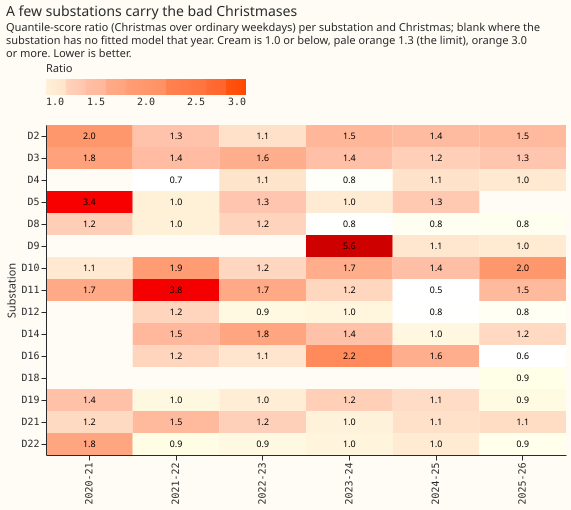
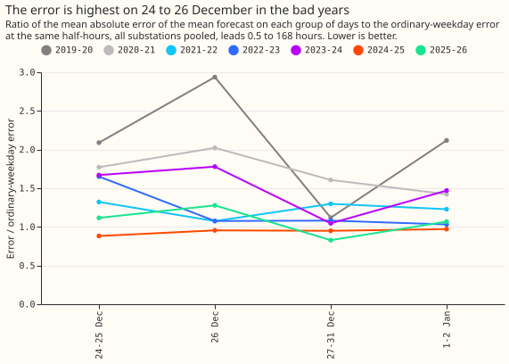
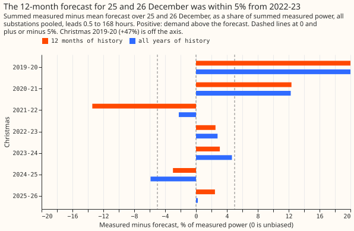

**The prediction failed, but only fits with little or no winter in their training data failed; on
fits
with a winter, every Christmas scored under 1.3 times an ordinary weekday.** We asked how much worse
a
demand forecast gets over Christmas. We fitted a demand model at up to 16 Primary substations (the
stations that step 33 kV down to 11 kV; 7 to 15 had enough data in each Christmas) before each
Christmas back to 2019-20, forecast the next 168 hours every day, and compared the quantile score (a
probabilistic error measure; lower is better) on 24 December to 2 January with the score on ordinary
weekdays at the same times of day. A ratio of 1.0 means Christmas is no harder than a weekday. We
wrote down, before reading any score, that the ratio would stay under 1.3, the level at which a
Christmas-specific term would begin to be worth adding. It did not: the ratio was 1.91, 1.38, 1.22,
and 1.50 for 2020-21 to 2023-24, and 0.98 and 0.97 for 2024-25 and 2025-26. The lockdown window (23
March 2020 to 19 July 2021) is left out of training, so the fits for the first two Christmases saw
little winter. Keeping only fits with at least 180 days of training rows, a choice made after the
scores were read, gives 1.22, 1.12, 0.98, and 0.97 for 2022-23 to 2025-26. The demand model is that
of [experiment 107](../00107-differentiable-physics-rolling-origin-history-and-tails/result.md),
fitted by convex optimisation, with a Kalman filter (a running correction from recent errors) and
recipe R (the mean error of the last 14 days, held to 0.75 of its size), as [experiment
170](../00170-dp-bg-stage3-drift-and-holiday-scoring/result.md) scored over two Christmases at five
substations. Observed weather drives every forecast, because ensemble forecasts exist only from
2024, so the ratios exclude the error a real weather forecast would add.

## Results

- **Arms.** `m12` (pre-registered): convex model on 12 months of history, fitted solar capacity, no
  drift term, cut on 1 November (16 December for Christmas 2019-20), Kalman filter with the single
  noise setting shared by all substations from experiment 133, recipe R, and no night offset (a
  correction to winter nights). `all` (post hoc): the same with all years of history.
- **Rows.** 24 December to 2 January (local dates), daily 09:00 UTC runs of 168 hours, outside the
  hand-filtered switching events. Reference: Monday to Friday from 8 December to 31 January, outside
  bank holidays and the Christmas window. Substations with a fitted model: 7, 9, 13, 13, 14, 14, 15
  in the seven seasons; D15 has a model only for 2025-26.
- **P1 fails on the pre-registered rows.** Pooled quantile-score ratio (95% interval from resampling
  days): 1.91 (1.47 to 2.40) in 2020-21, 1.38 (1.21 to 1.56), 1.22 (1.04 to 1.46), 1.50 (1.20 to
  1.87), 0.98 (0.84 to 1.17), 0.97 (0.84 to 1.12). Christmas 2019-20 has no spread, so only the
  absolute error of the mean exists: 1.70 (1.19 to 2.32). **By its own decision rule the
  pre-registered result is `refuted`** (a pooled ratio of 1.4 or more in 2020-21 and 2023-24, and 7
  substations at 1.3 or more); the verdict is `inconclusive` only because of the control cap below.
- **P2 fails on the pre-registered rows.** Pooled over Christmases, 7 of 15 substations have a ratio
  of 1.3 or more (D2, D3, D5, D9, D10, D11, D14). With all years of history (arm `all`), 5 of 15
  reach it on the pre-registered rows, and the pooled ratios by Christmas are 1.88, 1.27, 1.11,
  1.50, 0.96, 0.89 for 2020-21 to 2025-26.
- **P3 fails on the pre-registered rows.** Bias on 25 and 26 December as a share of measured power
  (positive: demand above the forecast): +47%, +12%, -13%, +2.5%, +3.1%, -3.0%, +2.5% for the seven
  Christmases. In 2021-22 the ordinary weekdays are also 10% too high, so that bias is not specific
  to Christmas.
- **Post hoc subset: fits with at least 180 days of training rows.** Ratio 1.22 (1.04 to 1.46), 1.12
  (1.00 to 1.26), 0.98 (0.84 to 1.17), 0.97 (0.84 to 1.12) for 2022-23 to 2025-26, 1.06 (0.97 to
  1.15)
  pooled. Three of 15 substations reach 1.3 (D2, D3, D10). The bias on 25 and 26 December is +2.5%,
  -5.0% (on the limit, with D9 removed from 2023-24), -3.0%, +2.5%. Thresholds of 90 and 270 days
  give the same picture for
  2022-23 to 2025-26; 90 days keeps Christmas 2020-21 and 2021-22 (1.43 and 1.38). Under this
  rule the prediction holds, but the subset was chosen after the scores were read.
- **Day groups** (quantile-score ratio, all Christmases pooled, pre-registered rows): 24 to 25
  December 1.48, 26 December 1.39, 27 to 31 December 1.23, 1 to 2 January 1.29. The last two
  Christmases are 0.82 to 1.23 in every group.
- **Absolute quantile scores** (points of effective capacity, quantile score, `m12`, Christmas
  window): 5.92,
  10.14, 2.81, 4.34, 3.20, 3.29 for 2020-21 to 2025-26.
- **Tail coverage (`m12`, pre-registered rows, all Christmases pooled).** Coverage of the 95%
  quantile:
  0.886 over the Christmas window (0.834 on 24 to 25 December, 0.915 on 27 to 31 December) against
  0.916 on ordinary weekdays. Coverage of the 5% quantile: 0.174 against 0.124. Pinball losses are
  in `report_m12.json`.
- **Leave-one-out.** Removing one substation moves the 2020-21 ratio to 1.49 to 2.07 and 2023-24 to
  1.12 (without D9) to 1.68. D9's own 2023-24 ratio is 5.6.

## Checks

- **Positive control, pre-registered: failed.** The pooled ratio at the five decision substations
  in the last two Christmases was 1.07 (experiment 170: 1.13), within the allowed 0.15. The
  ordinary-weekday score was 3.09 points against experiment 170's 2.756, above the allowed value,
  on unlike rows (a year-round score against a December and January weekday score). The verdict is
  capped at `inconclusive` for this reason.
- **Matched-rows control, post hoc.** On the 106,924 half-hours of November 2025 to January 2026
  that
  this experiment and experiment 155's arm D both forecast (decision substations, scored runs,
  paired on substation, origin, and valid time), this pipeline scores 2.941 against 3.046, but on
  ordinary weekdays 3.372 against 3.356. The pipeline is roughly level with arm D, not clearly
  better, which is the expected size of the observed-weather gain minus the missing night offset.
- **Median minus mean forecast.** Zero at every substation by construction, because the spread is
  centred on the corrected mean; the check does not expose a shifted forecast here.
- **Error of the mean beside the quantile score.** The absolute-error ratios agree with the
  quantile-score ratios in direction in every Christmas (figure 1).
- **Triggers fired.** Two review triggers fired: the positive control failed, and leaving one
  substation (D9) out moves a pooled ratio (2023-24) from 1.50 to 1.12. A fresh Opus audit
  re-derived every headline ratio and
  bias exactly from the stored forecasts and found no leakage in the mean forecast: the fit's
  training rows end at the cut, the filter reads only data ending 3.5 hours before each origin, and
  recipe R's newest input ends 9 hours before. Triage of its findings:
    - **Fits with too little training data: accepted.** The lockdown window (23 March 2020 to 19
      July 2021) is left out of training, so Christmas 2020-21 fits used 51 to 143 days, every
      substation in Christmas 2021-22 used the same 104 summer days, and D9 in 2023-24 used 31 days.
      The plan applied its 90-day minimum only to 2019-20. This experiment now reports the
      180-day subset beside the pre-registered rows, and does not change the verdict.
    - **Matched control double counted rows: accepted.** The file pattern matched six file families
      of experiment 155; the control now uses the scored rows only, deduplicated, and reads
      roughly level as above.
    - **The spread sees part of the reference: accepted as minor.** With a 3 to 31 January
      reference, 2023-24 moves from 1.50 to 1.43 and 2021-22 from 1.38 to 1.35.
    - **Reference choice: noted.** A 15 to 31 January reference raises 2021-22 to 1.46 and 2022-23
      to
      1.36; 2020-21 stays at 1.9 or more under all four references tried (15 to 31 January only, 8
      to 23
      December only, Tuesday to Thursday only, and weekends included).
    - **Plan names the 2.756 benchmark inconsistently (experiment 170 or 155): accepted**, both are
      the same arm D score.

## Caveats

- **Spread.** The spread is fitted on 16 November to 22 December of the same season and is poorly
  calibrated in some seasons (coverage of the 5% quantile 0.37 on ordinary weekdays in 2021-22), so
  the quantile-score ratio there is unreliable. The absolute error of the mean does not use it.
- **Observed weather.** The weather at forecast time is not available live, so these ratios are a
  ceiling for the ensemble-driven forecast, and the Christmas weather is not an error source.
- **Post hoc subset.** The 180-day rule was chosen after the audit showed which fits were short, and
  only four Christmases pass it, so the result rests on four Christmases, each with 10 days.
- **Not arm D.** The winter night offset, the pinned solar capacity, the 24-month window, and the
  ensemble weather of experiment 170's arm D are left out.
- **COVID.** Christmases 2020-21 and 2021-22 were under tier restrictions and the omicron wave; the
  model has no term for either.

## What to try next

- **Do not add a Christmas term.** The four Christmases with at least 180 days of training rows
  score 0.97 to
  1.22 times a weekday.
- **Add a minimum-history flag.** A forecast from a fit with under 180 days of usable training rows
  should carry a degradation flag and wider bands, as the inherent-stability rules ask.
- **Re-score the ensemble-driven forecast over the next Christmas** with the day-group table above
  as
  the baseline, because the ratio here excludes weather error.
