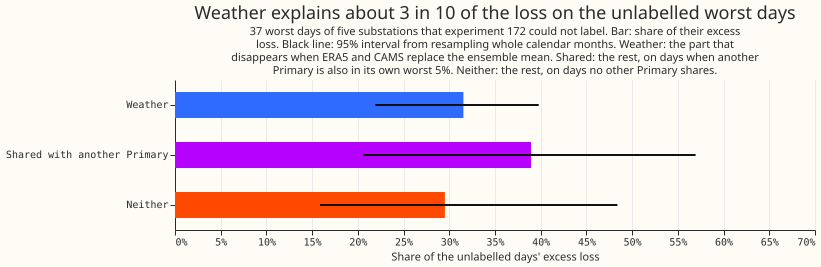
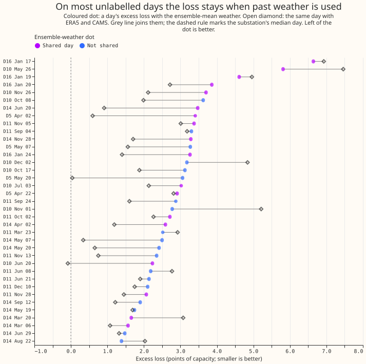
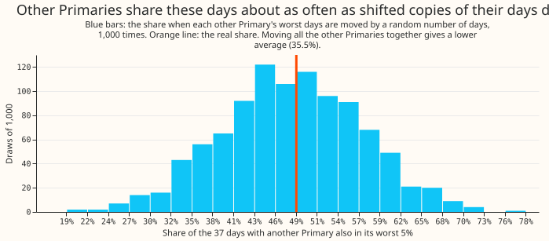

**Replacing the weather forecast with estimates of past weather removes only about a third of the
loss on the worst days that experiment 172 could not explain, so most of that loss is not weather
error.**
[Experiment 172](../00172-dp-error-budget-worst-days/result.md) ranked each day of five Primary
substations (D5, D10, D11, D14, and D16) by its excess loss, the day's quantile score above the
substation's median day. It labelled the worst 5% of days that overlap a switching event, a
holiday, a cold snap, a flagged reading, or an Economy 7 step. Of its 72 worst days, 37 carry no
label. We re-ran the forecast that experiment 172 scored (experiment 155's arm D) for those days
with past weather in place of the forecast weather. The past weather is ERA5 (the ECMWF
reanalysis) temperature and Copernicus Atmosphere Monitoring Service (CAMS) solar irradiance, and
the forecast weather is the mean of the ECMWF ensemble forecast. We also counted how many of the
other Primaries of [experiment 87](../00087-bg2-best-guess-assembled-with-drop-one-ablations/result.md)
were in their own worst 5% of days on the same day. Past weather removes 31.5% of the unlabelled
days' excess loss. The other 68.5% splits into 38.9% on days that another Primary also has and
29.5% on days that no other Primary has, so the three shares add to 100% of the excess loss. Other
Primaries share these days about as often as random shifting of their days gives, so the remaining
loss could come from events at one substation.

**The pre-registered verdict is `partly supported`.** The weather condition failed: 31.5% against
the required 50% (95% interval 21.9% to 39.8%). The shared condition passed its stated threshold:
48.6% of the unlabelled days coincide with another Primary's worst-5% day, against one third
required. The shifting control shows that this condition carries little information. Shifting
each other Primary's days separately gives 46.6% on average. Shifting all of them together, which
keeps their own worst days on the same days, gives 35.5%, and 7.8% of those draws reach 48.6%. ERA5
arrives about 5 days late, so the past-weather forecast cannot be issued in practice. ERA5 and
CAMS are themselves estimates, so 31.5% is a lower bound for the weather share.

## Results

- **Weather share W (headline):** 0.315 of the 37 unlabelled days' excess loss (total 108.1 points of
  day score), 95% interval 0.219 to 0.398 from resampling the 11 calendar months that hold an
  unlabelled day. By substation: D5 0.60, D14 0.45, D10 0.28, D11 0.20, D16 0.16. Leaving one
  substation out gives 0.28 to 0.35.
- **Labelled comparison set:** the 35 labelled worst days (total excess 188.0) lose 0.063 of their
  excess to past weather.
- **Weather share sensitivities:** 0.319 with the ensemble arm's quantile-band widths kept (the
  quantiles shift only), 0.340 with the Kalman filter also run on the ERA5-driven residuals, 0.367
  with the ensemble arm's median day as the reference, and 0.292 on the mean forecast's absolute
  error. All sit under 0.5.
- **Shared share S:** 0.486 (95% interval 0.279 to 0.704) of the unlabelled days have at least one
  other Primary in its own worst 5% (mean 0.84 others). The labelled days give 0.657 (mean 1.26).
  Leaving one substation out gives 0.42 to 0.56. The 16 series of experiment 87 sit on 15 Primaries
  (two series share one Primary), and a series on the target's own Primary does not count.
- **Chance control:** each other Primary's worst-day series is moved by a random whole number of
  days, 1,000 times. Moved separately, the share averages 0.466 (95% interval 0.297 to 0.649) and
  47.5% of draws reach 0.486. Moved together by one amount per draw, it averages 0.355 (0.189 to
  0.568) and 7.8% of draws reach 0.486. Interconnected neighbours (25 interconnected pairs among
  the 15 Primaries) share 16.2% of the unlabelled days, against 15.6% when moved separately.
- **Split of the unlabelled days' excess:** weather 31.5%, shared 38.9% (interval 20.6% to 56.9%),
  neither 29.5% (15.9% to 48.4%). The shared part is the excess that stays with past weather on a
  day another Primary also has. Chance alone would give a share of days about this large.
- **Known-answer controls:** 10 points added to 10 random days per substation. The pre-registered
  bar was 90% of the 50 days recovered. Added to the observed demand of both arms, 100% of the days
  keep their excess (weather share under 0.5; mean share 0.03). Added to the ensemble arm's
  forecast only, 92% of the days lose it (share at least 0.5; mean 0.89). Both pass, so the controls
  do not cap the verdict.
- **Unlabelled days by month:** every month but February 2026 holds at least one; November 2025
  and May 2026 hold 6 each. The four January 2026 days (all at D16) lose 3.0 of their 18.4 points
  of excess to weather (16%), and all four coincide with another Primary.

## Checks

- **Median forecast minus mean forecast, per site:** 0.0 points at all six substations in the past-
  weather arm, as in experiment 172.
- **Mean forecast's error beside the quantile score:** the share computed on the mean forecast's
  absolute error is 0.292, against 0.315 on the quantile score, so both point the same way.
- **Audit triggers:** the plan listed seven audit triggers (`ml-experiment` skill, "Audit before
  merge"). The reproduction control matches: the ensemble arm's day table equals experiment 172's,
  with a maximum score difference of 0.0. The trigger for a result outside its predicted range
  fired, because W came in below the predicted 40% to 70%. The explanations tested are in the
  sensitivities above: the filter's state carried over from the ensemble-driven runs (0.340 when
  rerun on ERA5), the spread (0.319), and the reference median (0.367). None reaches 0.5, so no
  audit was requested. The other six triggers did not fire.

## Method and caveats

- **Row set:** `fold_a_daily_gap_v1`, the scored year of experiment 155, arm D, D+1 band (lead 15 to
  39 hours), hand-filtered switching rows excluded, days of at least 24 rows, as in experiment 172.
- **Arm D:** experiment 136's monthly T-all fits (a convex demand model) driven by the calibrated
  ensemble mean, plus a Kalman filter on recent errors, experiment 155's winter night offset, and
  its 14-day mean-error profile.
- **Past-weather arm:** the fits and the stored Kalman level and anomaly stay. The temperature,
  irradiance, and PV shape come from the feature cache's ERA5 and CAMS columns at each valid time.
  Experiment 155's offset and profile and the spread are rebuilt from the new forecast's own errors.
  The stored Kalman state came from ensemble-driven residuals and may partly absorb ensemble-weather
  error, which would understate W; the 0.340 sensitivity reruns the filter on ERA5 residuals.
- **Other Primaries:** experiment 87's BG2 forecasts (the production-style XGBoost blend) cover 16
  series of 15 Primaries, including the five decision substations and D9. BG2 has no switching
  mask, so the hand-filtered switching rows stay in its scores. Topology is the interconnection
  table NGED supplied; only D-labels appear here.
- **Controls:** the injected controls act on the day table and do not rebuild experiment 155's
  correction. The weather-side control adds error to the ensemble arm only, so it tests the
  day-level split and not the ERA5 pipeline.
- **One year:** the scored year has one winter, and shares are approximate. The bootstrap resamples
  the 11 months that hold an unlabelled day.

## What to try next

- Read the 13 unlabelled days that keep more than 1.5 points of excess with past weather and have no
  other Primary in its worst 5% against the substation's own readings and NGED's switching logs, to
  find a further label.
- Test whether weather matters more at D5 and D14 (W 0.60 and 0.45) than at D11 and D16 (0.20 and
  0.16), which would point to site-specific weather sensitivity.
