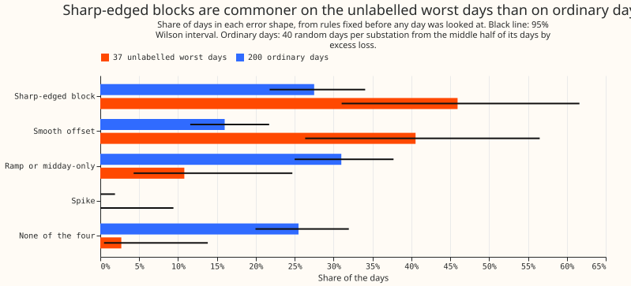
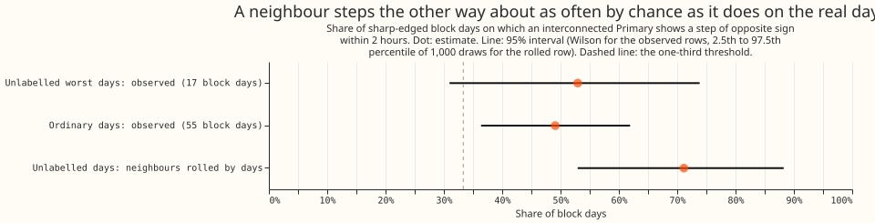
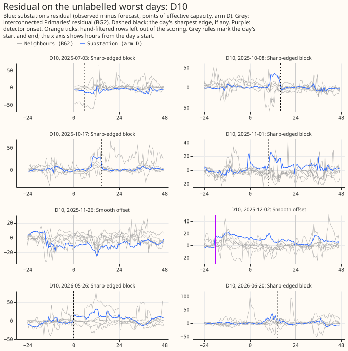
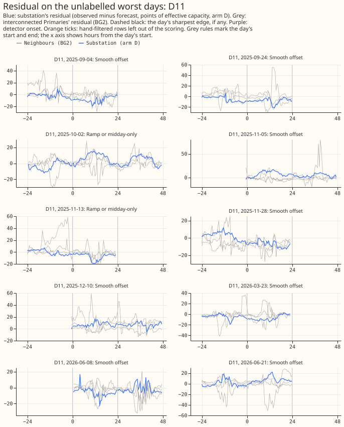
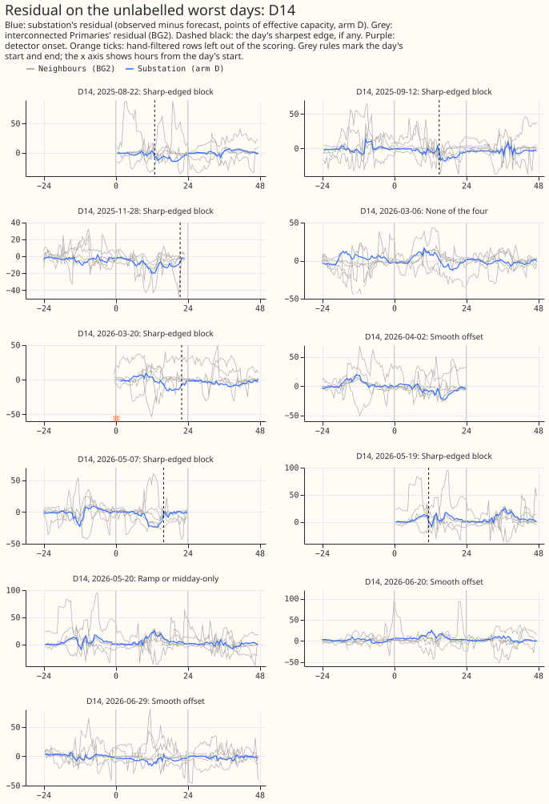
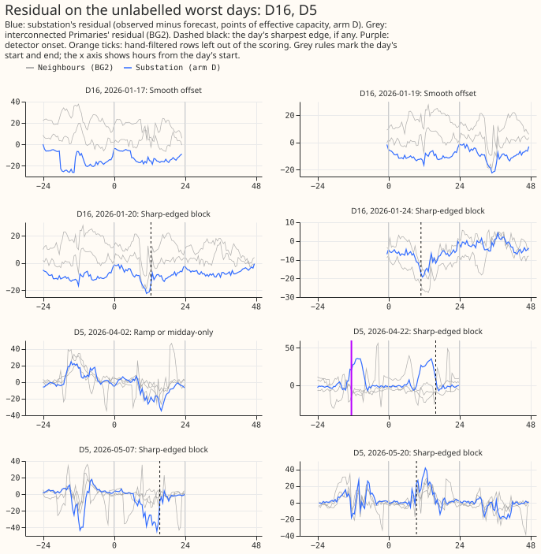

**The forecast's worst unlabelled days are about half sharp-edged blocks and 40% smooth offsets, and
interconnected neighbours do not explain the blocks.**
[Experiment 172](../00172-dp-error-budget-worst-days/result.md) ranked every day of five Primary
substations (the substations that step transmission voltage down to distribution voltage) by its
forecast loss, and labelled the worst days that overlap a logged switching event, a holiday, a cold
snap, a flagged reading, or an Economy 7 step.
[Experiment 174](../00174-dp-unlabelled-worst-days-weather-shared-or-single-site/result.md) took the
37 worst days that carry no label, and found that most of their loss is not weather error and is not
shared with other Primaries. We took the forecast's error on each of those 37 days (observed minus
forecast power at each half-hour, for the forecast of experiment 155's arm D: a convex demand model
with a Kalman filter, driven by the ensemble weather forecast). We then sorted each day into one of
four shapes with rules fixed before any day was looked at: (a) a sharp-edged block, where the error
jumps and stays shifted for hours, as a switching event would; (b) a smooth offset, with the same
sign most of the day; (c) a ramp or midday-only error; or (d) a spike of 1 to 3 half-hours. For each
block day we asked whether a Primary joined to the first by an interconnection shows a step of
opposite sign within 2 hours (a load transfer between the two), and whether the switching detectors
of earlier experiments fired.

**The pre-registered verdict is `refuted`.** Class (a) holds 17 of the 37 days, and half of 37
rounded up is 19. A neighbour's opposite step on the block days (52.9%) is below what rolling the
neighbours' residuals by whole days gives (71.2%), so the second half of the prediction failed the
rule that the observed rate must exceed chance by 10 points. The shape rules recover only about 60%
of injected blocks, so 17 against 19 does not exclude a majority of blocks, and the block-share half
is unresolved at that recovery rate. The block share is higher than on ordinary days (45.9% against
27.5%, with intervals that just overlap). The offset share is the stronger contrast (40.5% against
16.0%). [Experiment 172](../00172-dp-error-budget-worst-days/result.md)'s known-answer control
recovered 89.2% of injected days against a 90% bar, so every share here is approximate.

Figures 3 to 6 show every one of the 37 days, one panel each, grouped by substation:

## Results

- **Shape counts (37 days):** sharp-edged block 17 (45.9%, 95% Wilson interval 31.0% to 61.6%),
  smooth offset 15 (40.5%, 26.3% to 56.5%), ramp or midday-only 4 (10.8%), none of the four 1, spike
  0. All 4 ramp days put at least half their squared residual in 10:00 to 16:00, so the midday part
  of class (c) is not separated from the ramp part.
- **By substation:** D10 6 blocks and 2 offsets; D11 0 blocks, 8 offsets, and 2 ramps; D14 6 blocks,
  3 offsets, 1 ramp, 1 none; D16 2 blocks and 2 offsets; D5 3 blocks and 1 ramp.
- **Ordinary days (200 days, 40 per substation from the middle half by excess loss):** block 27.5%
  (21.8% to 34.1%), offset 16.0%, ramp or midday-only 31.0%, none of the four 25.5%.
- **Neighbour step on the block days:** all 17 block days have at least one neighbour with a BG2
  forecast. Of these, 9 show an opposite-signed step within 2 hours (52.9%, 31.0% to 73.8%). Rolling
  each neighbour's residuals by 1 to 90 whole days (1,000 draws) gives a mean of 71.2% (95% range
  52.9% to 88.2%). The 55 ordinary-day blocks give 49.1% (36.4% to 61.9%). The neighbour test is
  lenient (2 spreads, 8 candidate times, a noisy neighbour forecast), so chance is high.
- **Detectors on the 17 block days:** the refit-offset neighbour-count detector (RO-NC; experiments
  141 and 147) fired within 3 hours of the edge on 0 with either the causal-live end rule (R2) or
  the hindsight end rule (R0), and the pair alarm of experiment 156 on 0. The five substations have
  2 to 26 RO-NC onsets over the whole stored history, and the base rate over all 200 ordinary days
  (an onset within 3 hours of any part of the day) is 0 of 200 for RO-NC with either end rule and 3
  of 200 for the pair alarm.
- **Return and persistence:** 4 of the 17 blocks return within the local day. The step persists over
  the following 7 days on 1 of 17 and reverts on 14 (2 unknown), but the Kalman filter inside arm D
  adapts to a level shift, so persistence of the real step is understated. Ordinary-day blocks
  persist on 1 of 55.
- **Known-answer control** (a shape added to 40 ordinary days each): intended class recovered on
  24 of 40 injected blocks, 24 of 40 offsets, 1 of 40 ramps, and 3 of 40 spikes. Blocks and offsets
  are found about 60% of the time. A ramp to 4 spreads usually passes the offset test first, so
  offsets absorb ramps, and a spike of 3 readings usually fails the half-of-the-deviation test. The
  ramp and spike counts are therefore lower bounds, and every count is approximate. Injected
  blocks sit exactly on the 3-spread edge threshold, which also lowers their recovery.

## Checks

- **Median forecast minus mean forecast, per site:** 0.0 points at every substation, as in
  experiments 172 and 174 (the arm D quantile forecast has its median equal to its mean).
- **Audit triggers:** trigger 2 (a result contradicting its own prediction) fired on five
  predictions: class (a) 17 days against 19 to 28; class (b) 15 against 5 to 10; chance rate of a
  neighbour step 71.2% against 10% to 25%; detector firing 0 of 17 against 25% to 50%; persistence 1
  of 17 against 15% to 35%. The explanations tested are the known-answer control (about 60% recovery
  of blocks, which covers the 2-day shortfall in class (a) and may move days between classes (a)
  and (b)), the ordinary-day rates (block 27.5% and offset 16.0%), and the neighbour test's
  leniency (49.1% on ordinary-day blocks, 71.2% on rolled neighbours). The pre-registered rule gives
  `refuted` on both halves, and no later experiment depends on this result's sign yet, so the
  session did not request an audit; the manager decides whether to run one.

## Method and caveats

- **Row set:** `fold_a_daily_gap_v1`, experiment 155's arm D (a convex demand model with a Kalman
  filter, driven by the ensemble-mean weather forecast), D+1 band (lead 15 to 39 hours),
  hand-filtered switching rows left out, 2025-07-03 to 2026-06-30. Weather at forecast time is the
  ensemble forecast, so nothing here uses weather that arrives late.
- **Rules:** fixed in the plan commit of this pull request before any day was looked at, and
  coded in `e00175_classify.py`. A day is a block when its residual has a jump of more than 3
  day-before spreads within 1 hour that lasts 4 hours. The classes are tested in the order block,
  spike, offset, ramp or midday-only.
- **Neighbours:** Primaries joined to the substation's Primary by NGED's interconnection table that
  have a BG2 forecast (experiment 87, 16 series). BG2's residual is observed minus its median
  forecast, in the same points of effective capacity as arm D, and it has no switching mask.
- **Small departures from the plan:** the spread floor is the 10th percentile of daily spreads over
  2025-06-01 to 2026-07-31, a month wider than the scored year on each side, and edges that
  qualify within 1 hour of each other merge into the strongest one, chained from the last kept edge.
- **Block edge at the day boundary:** a block that starts before the day's first half-hour is not
  found, and the 8-reading windows need at least 4 valid readings on each side.
- **One year, five substations:** the denominators are small (17 block days), and the 95% intervals
  are wide (about 30 points for the shape shares and 43 for the neighbour-step share).

## What to try next

- Read the 17 block days against NGED's switching logs (`Switching Logs.xlsx` in the hierarchy
  folder), to see which blocks are logged switching that the detectors missed and which are
  unlogged.
- Test a faster level adaptation in the Kalman filter on the 15 offset days. Offset days are 2.5
  times as common as on ordinary days and concentrated at D11 (8 of 10 days).
