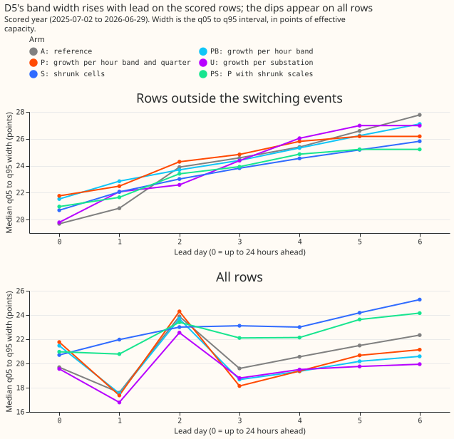
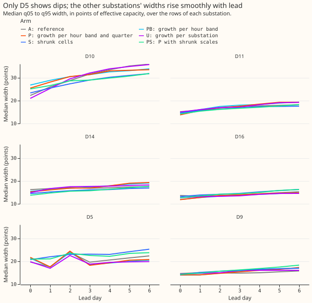
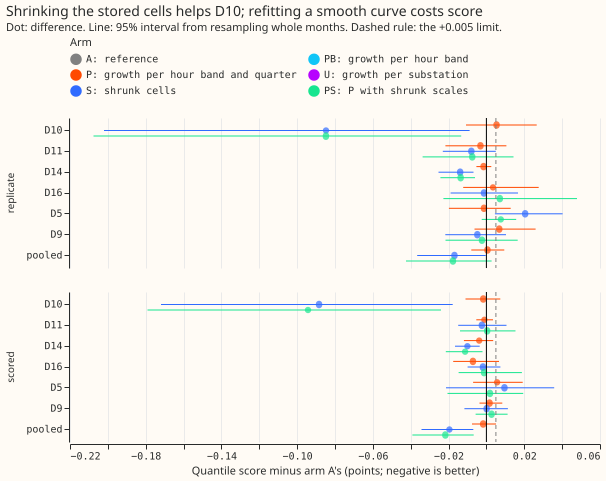
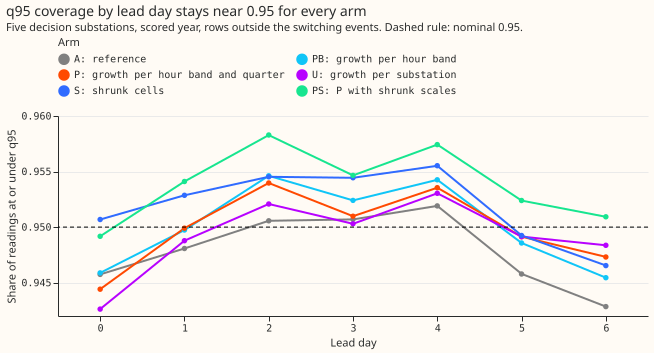

# Experiment 176: does the band width need to be smoother in lead?

**D5's forecast band already widens with lead time on the rows we score. The dips seen on D5 are
therefore not a property of the spread table, and smoothing the table does not remove them.** The
spread table holds one quantile offset for each cell, a combination of hour band, calendar quarter,
and lead band. D5 is one of six anonymised substations (D5, D9, D10, D11, D14, and D16). The five
decision substations are all of them except D9. The forecast is arm A of [experiment
169](../00169-calibration-combined-fixes-and-ensemble-spread/result.md). Arm A reads the
interpolated spread table of [experiment
160](../00160-calibration-band-width-fix-on-stage-2-winner/result.md) and widens the upper
quantiles on forecast-cold days, as [experiment
164](../00164-calibration-cold-night-tail-under-coverage/result.md) did (fix O). Arm A's band is the
interval from its q05 to its q95, the 5th and 95th percentile forecasts, and its width is the q95
minus the q05, in points of effective capacity (percentage points of a substation's rated demand).
Lead day 0 is the first 24 hours ahead. A request from the experiment manager reported that D5's
median width by lead day peaks on day 3, dips, and jumps on day 7, and asked whether three fixes
remove that shape. Fix P is a growth in lead that is non-decreasing and piecewise linear. Fix S
shrinks sparse cells of the stored table towards the table pooled across the six substations (the
mean of the substations' tables, each scaled by its substation's mean width). Fix PS combines the
two. We fitted every fix on the tuning months (the odd months of 2024-07 to 2025-06) and scored
each fix on the scored year (2025-07-02 to 2026-06-29) and on the replicate months (the even
months). The score is the quantile score: twice the mean pinball loss over 11 quantiles, in
points, where lower is better. A row is one forecast of one substation from one forecast run (one
issue time) for one valid time. The scored rows are the rows outside the hand-filtered switching
events, which every experiment in this series scores. The mean forecast is unchanged. Fix P leaves
the score unchanged and leaves the dip. Fix S lowers the score at D10 and D14 and raises it at D5.

- **Diagnosis.** On the rows the experiments score (outside the hand-filtered switching events),
  arm A's D5 median width by lead day is 19.7, 20.8, 23.9, 24.6, 25.4, 26.6, and 27.8 points, which
  never falls. On all rows it is 19.7, 17.6, 23.9, 19.6, 20.6, 21.5, and 22.3. The row sets differ
  by 3.2 to 5.5 points on five of the seven days. The median of D5's cells may sit between a group
  of narrower cells (hour bands 0 and 3, widths 6 to 28 points in the stored table) and a group of
  wider ones (hour bands 1 and 2, 20 to 51 points), so that a small change in the row mix moves it.
  That mechanism is a hypothesis: we did not test it, and did not identify which cells the
  switching rows sit in. The brief's "day 7" holds the 282 rows at a lead of exactly 168.0 hours,
  all in hour band 1 with a median width of 37.6, because `floor(lead / 24)` puts them in an eighth
  day. Binning by `ceil(lead / 24) - 1` removes day 7. The brief's eight widths mix a scored-row
  value (24.6 on day 3) with an all-rows value (20.6 on day 4), so no single row set reproduces
  them. The other five substations have no fall larger than 3% from one lead day to the next on
  either row set (figure 2).
- **Arms.** A: the reference. P: offset = scale(substation, hour band, quarter) times a growth
  curve per hour band and quarter, pooled over substations, non-decreasing in lead with a knot every
  24 hours, fitted on the pinball loss by linear programme (the open-source HiGHS solver) at the
  eight levels q01, q05,
  q10, q25, q75, q90, q95, and q99. PB: the growth curve per hour band only. U: a growth curve per
  substation, hour band, and quarter (no pooling). S: each cell of the stored table shrunk towards
  the pooled table (the pool includes D9), with weight runs / (runs + k), where runs counts the
  forecast runs of the cell in the tuning months and k = 80. PS: P with its cell scales shrunk the
  same way. All fitted residuals are centred on the median of their cell, as the stored table is.
  Every arm keeps the mean, the offsets at q40, q50, and q60, and experiment 164's fix-O
  multipliers (1.65, 1.36, 1.26, and 1.16 at q75, q90, q95, and q99 on forecast-cold days).
  Contrasts: C1 is P minus A, C2 is S minus A, C3 is PS minus A.
- **Shrinkage constant.** Three-fold cross-validation across alternate tuning months gave held-out
  pinball losses of 19.91, 19.58, 19.40, 19.32, 19.32, and 19.33 for k = 0, 5, 20, 80, 320, and
  1280. The curve is flat from 80 upwards, so 80 is weakly identified. The grid runs from 0 to 1280.
  The same k = 80 is
  reused for PS, whose cells hold about four times as many runs, so PS shrinks less than S.
- **Row set and schedule.** `fold_a_daily_gap_v1`, the five decision substations D5, D10, D11, D14,
  and D16 (D9 is scored beside them, is in the pool of fix S, and is in the per-substation limit of
  rule 2 but not in any pooled contrast), leads 0.5 to 168 hours, rows outside the switching
  events, 464,363 rows over the five substations in the scored year. The mean forecasts are
  experiment 155's monthly refits, so no contrast depends on the retraining schedule. We rebuilt arm
  A from experiment 169's reference arm and the fix-O multipliers. It scores 2.7521 over the five
  substations against the printed 2.7519, inside the 0.001 cap.
- **Pre-registered rule, scored year.** The plan's "all-row" score means the rows outside the
  switching events. Rule 1 (D5's median width non-decreasing to within 3% on both row sets): A
  passes on the scored rows and fails on all rows (day 3 is 0.82 of day 2); P fails on all rows
  (0.75); PS fails (0.95); S passes both (lowest ratio 0.995). Rule 2 (every substation's upper
  bound at or under +0.005): no arm passes (largest upper bound P +0.0192, S +0.0358, PS +0.0194).
  Rule 3 (cold-night q95 coverage at or above 0.89): A 0.896, P 0.897, S 0.888, and PS 0.886, so S
  and PS miss by 0.002 and 0.004. A cold night is a winter night (November to March, night or
  evening hours) with an ERA5 day-mean temperature below 2 °C, over 5,395 rows at the five
  substations.
- **Pooled contrasts against A, five substations.** Scored year / replicate months. C1 (P):
  -0.0017 (-0.0076 to +0.0050) / +0.0005 (-0.0080 to +0.0094). C2 (S): -0.0196 (-0.0343 to
  -0.0069) / -0.0169 (-0.0366 to -0.0004). C3 (PS): -0.0217 (-0.0391 to -0.0067) / -0.0177 (-0.0425
  to +0.0027). PB: -0.0017 / -0.0008. U: +0.0014 / +0.0039. Absolute scores, scored year: A 2.7521,
  PB 2.7504, P 2.7503, U 2.7534, S 2.7325, PS 2.7304; replicate months: A 2.6821, PB 2.6812, P
  2.6826, U 2.6859, S 2.6651, PS 2.6644.
- **Per substation, scored year.** P: D5 +0.0056 (-0.0070 to +0.0192), D16 -0.0071, the other four
  within 0.004. S: D10 -0.0884 (-0.1719 to -0.0178), D14 -0.0100 (-0.0166 to -0.0036), D5 +0.0095
  (-0.0214 to +0.0358), D11 -0.0024, D16 -0.0019, D9 +0.0001. PS: D10 -0.0943 (-0.1791 to
  -0.0240), D14 -0.0113 (-0.0215 to -0.0021), D5 +0.0019. Replicate months, S: D10 -0.0848 (-0.2021
  to -0.0089), D14 -0.0139 (-0.0253 to -0.0068), D5 +0.0205 (+0.0045 to +0.0403).
- **Leaving one substation out, pooled contrast.** Without D10, S is -0.0015 (-0.0108 to +0.0060)
  in the scored year and -0.0006 (-0.0100 to +0.0087) in the replicate months, and PS is -0.0027
  (-0.0107 to +0.0056) and -0.0015 (-0.0158 to +0.0144). Leaving out any other substation keeps S
  at -0.022 to -0.026 in the scored year. D10's quarter-3 cells come from November 2024 alone
  (about 30 runs each, a shrinkage weight of 0.27). The month has q05 offsets down to -31.5 points.
  Shrinkage therefore pulls those cells strongly towards the pool. The audit found the same D10 gain
  in October 2024 and in October to December 2025.
- **Tail pinball loss, scored year, five substations (q01, q05, q95, q99).** A: 0.216, 0.714,
  0.745, 0.232. P: 0.210, 0.710, 0.746, 0.228. S: 0.217, 0.705, 0.732, 0.223. PS: 0.213, 0.704,
  0.733, 0.220. Cold-night q05 coverage: A 0.090, P 0.093, S 0.083, PS 0.086.
- **q95 coverage by lead day, scored year.** A: 0.946, 0.948, 0.951, 0.951, 0.952, 0.946, 0.943.
  S: 0.951, 0.953, 0.955, 0.954, 0.956, 0.949, 0.947. PS: 0.949, 0.954, 0.958, 0.955, 0.957, 0.952,
  0.951.
- **Caveats.** The tuning months are six alternate months, so a cell holds about 45 forecast runs.
  The shrinkage cross-validation holds out whole months, so a held-out November or May is scored
  against cells built from a few runs in the same quarter. That set-up makes heavy shrinkage score
  well. Month-end
  runs forecast seven days into the next month, so 18% of the replicate months' valid times are
  also targets of tuning runs (the scored year has no overlap). No arm can meet rule 2 unless its
  effect is near zero. Month-resampled intervals over 12 months have half-widths of 0.004 to 0.10,
  and rule 2 requires an upper bound of +0.005 at every substation. S's drop in cold-night coverage
  comes mostly from D11
  (0.846 to 0.810), not D5. The cold-night rows are dominated by D10, D11, and D14 (1,583 rows
  each) over D5 and D16 (323 each).
- **Candidate follow-ups.** (1) Show the substation cards' band width by lead day on the scored
  rows,
  per hour band. (2) Test shrinking stored cells on more substations. (3) A small neural component
  that learns the offsets as a smooth function of lead, hour band, and season, pooled over
  substations and fitted to residuals from a longer history, is a candidate, with the convex
  growth as the comparison arm. The prediction that could fail: its pooled score stays within
  ±0.005 of arm A's, because the convex growth already scores within that range. The neural
  component can then gain only by improving a substation that shrinkage improves (D10 or D14).

## Checks

- **Median minus mean forecast, per site.** Exactly 0.000 for every arm and decision substation.
- **Mean-forecast error beside each quantile-score contrast.** The mean absolute error of the mean
  forecast is 4.7096 in the scored year and 4.6207 in the replicate months for every arm, because
  the mean is unchanged.
- **Reproduction control.** Arm A rebuilt from the stored reference and fix-O multipliers differs
  from experiment 169's stored arm A by at most 1.5e-5 points in any quantile.
- **Triggers.** Trigger 2 of the ml-experiment skill (a result contradicts its prediction) fired:
  fix S moved the pooled score by -0.0196 against a prediction of under 0.003, and D10 moved by
  -0.0884. The leave-one-out and the audit explain the D10 move and the fix-S move (D10's November
  cells). Trigger 4 (leaving one site out changes a contrast's verdict) fired: S's and PS's pooled
  gains lose significance without D10, and
  S's replicate-month gain does without D14. The experiment's verdict does not depend on either,
  because every arm fails rule 2 with or without them.
- **Audit (fresh Opus agent; report private, `data/ml-experiments/briefs/e176_audit_report.md`).**
  The stored table is centred on each cell's median, so every fit here uses residuals centred the
  same way (audit finding F1). Fitting raw residuals instead carried each cell's bias into the band
  and gave P +0.0052 in the scored year and +0.0644 in the replicate months (D10 +0.1695). The
  shrinkage cross-validation builds centred tables too (F3), and k stayed 80. Fix S matches an
  independent rebuild with a gap of 0, and D10's gain is real but comes from one substation's
  one-month cells, as described under "Leaving one substation out" (F2). The pool includes D9
  (F4). The audit found no leakage; the 18% overlap is in the caveats (F5).
- **Code review (Sonnet).** The reviewer found no leakage and no bug that changes a result in the
  scripts it read. The cross-validation's confound with season and the reuse of k for PS are in the
  caveats. The 0.001 reproduction cap is applied by hand (gap 0.00016).
