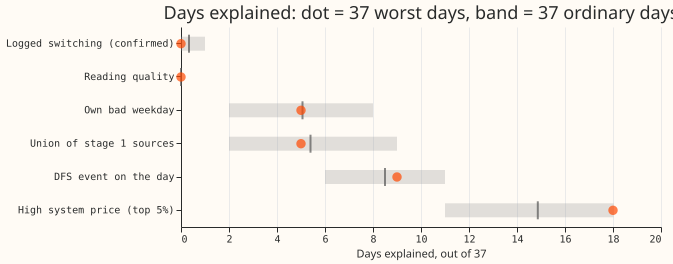

**None of the six sources we tested explains the 37 worst unlabelled days, so the hypothesis that
data we already hold explains them is refuted.** Each day here is one substation on one local date.
The best-guess forecast is arm D of [experiment 155](../00155-dp-bg-stage2-assembly-night-offset-and-error-correction/result.md),
a convex demand model with a Kalman filter, driven by the ensemble weather forecast.
[Experiment 172](../00172-dp-error-budget-worst-days/result.md) ranked every substation-day of five
Primary substations (the substations that step transmission voltage down to distribution voltage) by
the forecast's loss, and set aside the worst days that overlap a logged switching event, a holiday,
a cold snap, a flagged reading, or an Economy 7 step. The 37 worst days left over are the
"unlabelled" days.
[Experiment 174](../00174-dp-unlabelled-worst-days-weather-shared-or-single-site/result.md) found
that better weather inputs explain under a third of their forecast error, and
[experiment 175](../00175-dp-unlabelled-day-shapes/result.md) found that about half show an error
that steps up or down for several hours. We asked whether other data marks those days: NGED's
(National Grid Electricity Distribution's) logged switching operations, faults in the substation's
own readings, the substation's own bad weekdays, and public Demand Flexibility Service (DFS) events
and national system prices from NESO (the National Energy System Operator) and Elexon (the
Balancing and Settlement Code company). Each source gives one yes-or-no indicator per day. We
counted the days each indicator covers among the 37, and among 1,000 random sets of 37 ordinary
days, which are days outside the worst 5% at the same substations and in the same calendar months.

**The decision rule asked for a source that covers at least 15 percentage points more of the 37
days than ordinary days do (5.6 days), and none did.** The closest is a high national system price,
which covers 18 days against a mean of 14.9 over the 1,000 ordinary-day draws, 3.1 days more. In the
table, "covers" means the indicator is true on the day, and p is the share of the 1,000 draws that
cover at least as many days as the 37 worst days do.

| Source (indicator) | 37 worst days | Ordinary days (mean, 95% range) | p | Share of all scored days |
|---|---|---|---|---|
| S1 logged switching: a confirmed open or close on the substation's switching-log sheet | 0 | 0.3 (0 to 1) | 1.0 | 0.7% |
| S3 reading quality: 6 or more missing half-hours, or 8 or more identical readings in a row | 0 | 0.0 (0 to 0) | 1.0 | 0.4% |
| S4 own history: 2 other worst days on the same weekday within 8 weeks | 5 | 5.1 (2 to 8) | 0.62 | 12.4% |
| Union of S1, S3, and S4 | 5 | 5.4 (2 to 9) | 0.69 | 13.4% |
| P1 DFS event scheduled on the day | 9 | 8.5 (6 to 11) | 0.49 | 25.9% |
| P2 a settlement-period system price in the top 5% of the scored year | 18 | 14.9 (11 to 18) | 0.075 | 39.9% |
| S2 metered-generator step on the same or an interconnected Primary | not testable | not testable | n/a | 0% |

- **The prediction missed.** The plan predicted that the raw switching log would cover 8 to 15 days.
  It covers none.
- **Raw NGED files.** In the three files read, one for each of three decision Primaries, each reading
  holds only `startTime`, `endTime`, and `value`. The top-level fields are the ones the metadata table
  already stores. No voltage, current, power factor, or tap position was available.
- **S2 could not be tested.** The 13 metered generators have their own substation numbers, so none
  shares a number with a Primary or an interconnected Primary. A step test needs a location join
  that this experiment did not build.
- **The selection of the 37 days weakens S1 and S3.** Experiment 172 set aside every day that
  overlaps a hand-filtered switching event or a flagged reading, so none of the 37 days carries
  either. The ordinary-day pool still holds such days (25 of its 200), so the ordinary-day means
  for S1 and S3 are not matched on that label. S1 and S3 were close to certain to cover none of the
  37 days.
- **Looser indicators cover too many days to be informative.** Switching-log rows of any state and
  action cover 15 of 37 days (ordinary 11.2, p = 0.035), but the indicator is true on 39.5% of all
  scored days. A step in any generator in the area covers 26 of 37 (ordinary 20.5, p = 0.019,
  14.9 percentage points above ordinary, just under the bar), but is true on 62.6% of all days and
  uses a step test that departs from the plan (below).
- **Coverage gaps.** The switching log ends on 2026-03-25, and the DFS archive on 2026-03-27, so
  about 3 of the 12 scored months have no record to test. That includes 14 of the 37 days for DFS.
  The DFS archive holds live events only, and no test events.
- **Matching.** One of the 37 days has no ordinary day from the same month at its substation, so each
  draw falls back to the substation's other months for that day.

## Departures from the plan

- **S4's second branch was not run.** The plan also counted a repeat of the date a year earlier. The
  scored period starts on 2025-07-03, so no earlier year is available.
- **The step test for S2 differs from the plan.** The code compares the day-on-day change in power
  (a lag of 48 readings) averaged over the 8 readings after each half-hour with the 8 before. A step
  is a shift above the larger of 3 times the standard deviation of that shift over the previous 28
  days and 5% of the series' 99th percentile. This feeds only the any-generator sensitivity.
- **"Evening before" for S1 means 18:00 or later,** and the switching log's `Manual Time` is read as
  local time. The log's own time zone is not stated.
- **Neighbours for S1 and S2** are the Primaries joined to the substation by NGED's interconnection
  table that have a series in experiment 87's forecast (16 series). Neighbours outside that set are
  not searched.
- **The switching-log actions** are the four the plan named (`Telecontrol OPEN`, `Telecontrol CLOSE`,
  `Open from Earth`, `Confirm Opened`). Plain `OPEN` and `CLOSE` rows, `Confirm Closed`, and the
  parallel-switching actions are not counted. An operation that opens on one day and closes days
  later flags only its opening day.
- **The price threshold** is the 95th percentile of all settlement periods in 2025-07-03 to
  2026-06-30, 143.5 pounds per megawatt-hour.
- **Unreported sensitivities.** The top 0.5% price indicator covers 1 of 37 days (ordinary 2.7). The
  union of P1 and P2 covers 24 (ordinary 21.6, p = 0.18).

## What was looked at

- **Public data checks.** The 365 cached days of system prices (2025-07-02 to 2026-07-01) hold 17,520
  settlement periods: 363 days of 48 periods, one of 50, and one of 46 at the clock changes. There
  are no duplicate keys and no nulls. Prices run from -97.92 to 800.00 pounds per megawatt-hour, and
  the monthly mean runs from 64.5 to 103.1 pounds per megawatt-hour. The sell and buy prices are
  identical in every period.
- **The NGED Connected Data Portal** publishes 92 datasets. Of those we looked at, none gives
  events at the five Primaries for 2025-07 to 2026-06. Live Power Cuts is a live snapshot with no
  history. Substation Loading (MW and MVAr per bus on an intact-topology basis, with outliers and
  outages imputed) covers calendar 2024 for the Bicker Fen and Walpole grid supply points. Flexibility
  trade results deliver from 2026-04 and are mostly small low-voltage zones. The datasets marked
  Shared hide their download links, and need an access key.

## Checks

- **The median forecast minus the mean forecast, and the error of the mean or median forecast beside
  each quantile-score contrast:** not applicable, because the experiment fits no forecasting model
  and scores no forecast.
- **Which audit triggers fired:** none. The audit triggers of the `ml-experiment` skill concern
  controls, score contrasts, and nested arms, and this experiment has none of them.

## Sources not yet tested

**Sources we have not tested include local outage notices, local events, and a location join of the
metered generators to the Primaries.** Planned and unplanned outage notices would test whether a
network event, not a change in demand, shaped a block day. School terms and local events would test
a change in demand. A location join would let a step in a nearby generator be tested. Experiment
175 found that about half the days show an error that steps for several hours at one substation,
and that interconnected neighbours do not mirror the step more often than chance.

**An archive request to NGED would need these items:** Primary-level MVAr or 5-minute readings, and
power-cut and switching records, for 2025-07 to 2026-06 at the five decision Primaries. The request
would be a few hundred megabytes and one access key for the Shared portal datasets. NGED has not
been asked.

## Pre-registration

**The sections below are the pre-registration, written before any result was read.**

- **Raw NGED telemetry fields.** The parser keeps only `endTime` and `value` from each file's
  readings, and the stored Delta table has only `power`, `time`, and `time_series_id`. The raw
  JSON files sit on S3, not on disk.
- **S1, raw switching log** (`Switching Logs.xlsx`, one sheet per time-series pair, "Unknown" for
  Primaries outside the trial area). Indicator: the substation's own sheet or a sheet of an
  interconnected Primary holds a row with state `Confirmed` or `Field Confirmed` and action
  `Telecontrol OPEN`, `Telecontrol CLOSE`, `Open from Earth`, or `Confirm Opened` whose `Manual
  Time` falls on the local date or the evening before. Sensitivity: any state; a window of plus
  or minus 1 day.
- **S2, metered generators.** Indicator: a metered generator with the same `substation_number`
  as the Primary, or on an interconnected Primary, has a step in its half-hourly power on the
  local date: a jump of more than 3 times the spread of its day-before changes, lasting at least
  4 hours. Sensitivity: any generator in the trial area.
- **S3, reading quality of the substation's own series.** Indicator: the local date holds at
  least 6 missing half-hours, or a run of at least 8 identical consecutive readings, or a
  reading-count shortfall against the substation's usual 48.
- **S4, own history.** Indicator: the same substation has at least two other worst-5% days on the
  same weekday within 8 weeks, or within plus or minus 3 days of the same date a year earlier.
  Only dates before the day count for the second branch.
- **Deferred to a later stage:** Elexon and NESO public data (demand turn-up, balancing actions,
  Demand Flexibility Service events), Distribution Future Energy Scenarios (to test local new load),
  published outage lists, school terms, and local events.
- **Weather the ensemble mean misses** (local convective cloud, fog, snow, wind-chill) is a separate
  cause, and experiment 174 already put an upper bound on that share.
- **Pre-registered checks.** The count and rate of each indicator on the 37 days, on each
  ordinary-day draw (mean and 95% range), and the union; and each indicator's coverage of the whole
  year, so that an indicator true on most days is reported as uninformative.

**Stage 2 addendum, fixed before any public data was read.** The raw NGED file check came first:
three files, one per decision Primary, carry only `startTime`, `endTime`, and `value` in each
reading. Stage 2 reads public data under the same decision rule and the same 1,000 matched
ordinary-day draws.

- **P1, DFS events.** Source: the NESO DFS service-requirement archive for 2025/2026. Indicator: a
  live or test DFS event is scheduled on the local date.
- **P2, system price spikes.** Source: Elexon settlement system prices for each day. Indicator: the
  highest system sell price or system buy price in any settlement period of the local date lies in
  the top 5% of all settlement periods in 2025-07-03 to 2026-06-30.
- **Reading the result.** A national indicator can only explain a single-substation block through a
  mechanism, such as a demand-turn-down event moving load. A rate near the ordinary-day rate is
  reported as no explanation, however many days the indicator covers.
