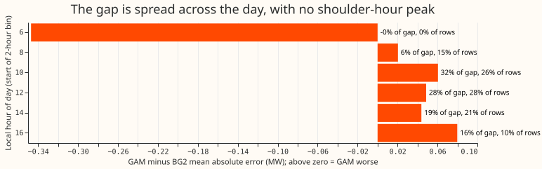
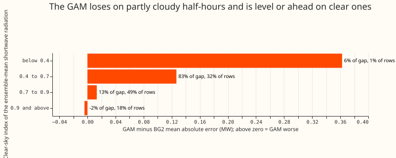
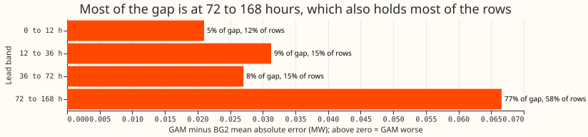
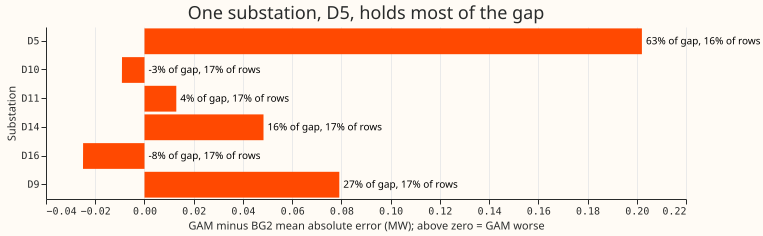
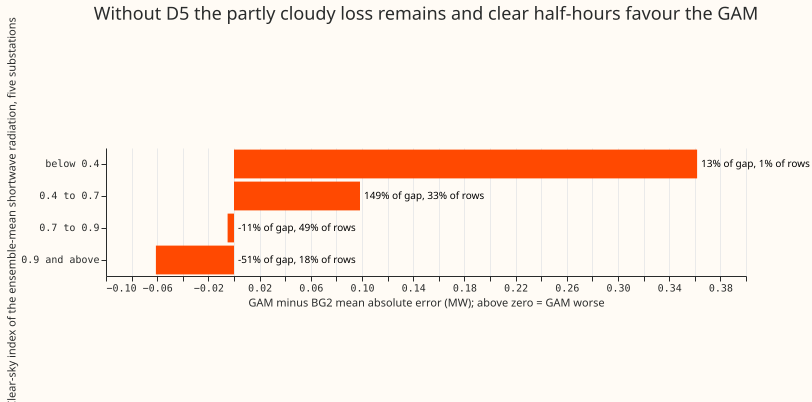

**On sunny daylight half-hours, the best generalised additive model (GAM) has a mean absolute error
0.05 MW higher than BG2.** One substation, D5, holds most of that gap. A sunny daylight half-hour is
one in the top third of its substation's daylight half-hours, ranked by the output per megawatt of
capacity of a fixed south-facing solar fleet driven by CAMS irradiance. BG2 is the second
best-guess XGBoost forecast, built in experiment 87. We asked which hour of day, clear-sky band
(the ensemble-mean forecast irradiance as a fraction of clear-sky irradiance), lead band (hours
between the forecast run and the half-hour), or substation holds the gap. We joined both models'
stored forecasts for the scored year on the same substation, daily forecast run, and half-hour, and
cut the gap four ways. Without D5, the gap falls to 0.02 MW and its 95% interval, resampled by
month, includes zero.

**An earlier plot of errors by weather condition gave a gap of 0.13 MW, and we could not reproduce
it.** The plot's code is not in the repository, so the rows above are our reconstruction. Under this
definition the gap is 0.05 MW over all leads, and we do not know whether the plot used different
rows. The definition gives 90,143 half-hours over all leads and 13,198 at 12 to 36 hours, against
12,125 in the plot.

**The GAM is experiment 164's fix O.** It is a convex model fitted by experiment 155 and calibrated
by experiments 160 and 164, the same forecast as arm A of experiment 169. Its median forecast equals
that of experiment 155's arm D on these rows. BG2 is experiment 87's `p_s6_bg2`. The ranking uses
the unit solar shape of experiment 106's feature cache, the definition experiment 139 uses for its
sunniest third.

## Figures

## Results

- **Rows and scope:** six substations (D5, D10, D11, D14, D16, D9), the 291 daily runs of
  `fold_a_daily_gap_v1` that both models forecast, from 2025-07-02 to 2026-06-29, on rows outside
  the hand-filtered switching events. The plan did not fix the lead range, so the headline uses all
  leads to 168 hours (chosen after seeing the data). The 12 to 36 hour range, nearest to the plot's
  row count, is beside it. The "five decision substations" are D5, D10, D11, D14, and D16, the
  substations of the differentiable-physics series' contrasts; D9 is reported beside them.
- **Absolute errors (MW), sunny daylight, all leads:** mean absolute error 0.590 for the GAM against
  0.541 for BG2; pinball loss 0.166 against 0.152.
- **Gap (GAM minus BG2 mean absolute error, MW), with month-resampled 95% intervals from 12 monthly
  blocks:**

| Scope | Rows | Gap | Interval | Pinball gap |
|---|---|---|---|---|
| All leads, six substations | 90,143 | +0.050 | +0.014 to +0.079 | +0.0143 |
| All leads, five decision substations | 74,728 | +0.044 | +0.006 to +0.071 | +0.0123 |
| 12 to 36 h, six substations | 13,198 | +0.031 | -0.017 to +0.065 | +0.0083 |
| 12 to 36 h, five decision substations | 10,952 | +0.027 | -0.018 to +0.059 | +0.0072 |
| All leads, D5 only | 14,045 | +0.202 | +0.111 to +0.273 | +0.0519 |
| All leads, without D5 | 76,098 | +0.022 | -0.009 to +0.046 | +0.0073 |

- **Verdict against the pre-registered rule:** `partly supported`. On the headline definition and
  all leads the rule is met: D5 holds 63% of the gap with 16% of the rows, and the total gap's
  interval excludes zero. The rule is not met for the 12 to 36 hour range, whose interval includes
  zero, or when sunny half-hours are ranked by realised clear-sky index (next bullet). The stated
  prediction also failed: the shoulder hours did not hold 60% to 70% of the gap.
- **The size of the gap depends on how sunny is defined; D5's loss does not.** The audit of this
  experiment ranked each substation's daylight half-hours three ways (all leads, top third per
  substation):

| Ranking measure | Half-hours | Total gap | D5 only | Without D5 |
|---|---|---|---|---|
| Unit solar shape (headline) | 87,690 | +0.049 (+0.013 to +0.080) | +0.206 | +0.020 |
| Realised irradiance (CAMS) | 87,701 | +0.055 (+0.018 to +0.083) | +0.219 | +0.024 |
| Realised clear-sky index | 87,684 | +0.015 (-0.024 to +0.049) | +0.118 | -0.004 |

The three rows drop half-hours where the clear-sky irradiance is under 20 W per square metre, so
  the headline row differs slightly from the 90,143 half-hours above. D5 is worse than BG2 under all
  three, and the other five substations together are level under the third.

- **Cuts (all leads; rule: at least 60% of the gap in a level holding under 40% of the rows):**
    - Substation: D5 holds 63% of the gap with 16% of the rows. The rule is met.
    - Clear-sky band: the 0.4 to 0.7 band holds 83% of the gap with 32% of the rows. The rule is
      met. In this band the GAM's error is 0.749 MW against BG2's 0.622 MW. In the 0.9 and above
      band, the GAM's error at the five substations other than D5 is 0.438 MW against BG2's 0.499 MW.
    - Hour of day: no 2-hour bin holds more than 32% of the gap (10:00 to 12:00 UK local time), and
      the two busiest bins hold 26% and 29% of the rows. The rule is not met. The 16:00 to 18:00 bin
      holds 16% of the gap with 10% of the rows. Without D5, that bin holds 35% of the remaining gap
      with 10% of the remaining rows.
    - Lead band: 72 to 168 hours holds 77% of the gap and 58% of the rows. The rule is not met.
- **D5 loses in every band:** at every hour from 08:00 to 18:00; in all four lead bands (0 to 12 h
  0.572 against 0.387 MW, 12 to 36 h 0.581 against 0.393, 36 to 72 h 0.610 against 0.411, 72 to 168
  h 0.704 against 0.494); and in every clear-sky band with more than 100 half-hours (0.873 against
  0.590 MW at 0.4 to 0.7,
  0.523 against 0.412 at 0.7 to 0.9, 0.602 against 0.304 at 0.9 and above). The gap at 0.9 and above
  (0.298 MW) is about as large as at 0.4 to 0.7 (0.283 MW), so at D5 the loss is not confined to
  half-hours with a lower clear-sky index.
- **D9 is a second loss site:** it holds 27% of the gap with 17% of the rows (0.497 against 0.418
  MW), and its loss grows with lead.
- **Solar share:** D5 has the largest relative fall from the night mean to the sunny-daylight mean
  (3.44 to 1.14 MW, 67%), which we use as a proxy for its solar share because the fitted capacities
  can only be read in the GPU environment, which this session does not have. D10 has the next
  largest relative fall (2.42 to 1.26 MW, 48%) and the GAM beats BG2 at D10 (-0.009 MW), so solar
  share alone does not explain D5. D9's sunny-daylight mean is not lower than its night mean.
- **Ensemble clear-sky index on the sunny rows:** the median is 0.77, and the 5th to 95th
  percentile range is 0.52 to 0.98.

## Checks

- **Mean versus median forecast:** not computable for BG2, which stores no mean. The GAM's stored
  mean equals its median in the files of experiment 164, so the median is used for both models.
- **Mean-forecast error beside the quantile score:** the mean absolute error of the median forecast
  and the pinball loss point the same way in every row of the results table and in every hour bin.
- **Audit conditions met:** two of the `ml-experiment` skill's audit conditions apply. Leaving out
  one substation changes a verdict: without D5, the all-leads gap's interval includes zero. The
  result also contradicts the experiment's own prediction, because the shoulder hours did not hold
  60% to 70% of the gap. One Opus audit re-derived the conversion, the join, and the gaps from the
  stored files and reproduced every number. It found that the size of the gap depends on the
  ranking measure, which the page now reports and which lowered the verdict from `supported`.

## Caveats

- **The row set is our reconstruction.** The plot's mean absolute error (0.58 against 0.45 MW) is
  not reproduced: the same definition gives 0.59 against 0.54 over all leads and 0.52 against 0.49
  at 12 to 36 hours. An exploratory check that defined sunny days by the realised daily clear-sky
  index (top third of days) also gave almost no gap (0.44 against 0.45 MW at five substations, 12 to
  36 hours, 11,670 half-hours). That daily check is not in the script.
- **Level shares are descriptive.** Only the totals carry month-resampled intervals, and 12 monthly
  blocks make those intervals coarse.
- **The plot's 12,125 half-hours are close to our 13,198 at 12 to 36 hours,** and not to our 90,143
  over all leads. At 12 to 36 hours the total gap's interval includes zero.

## What to try next

- Check the solar shape of D5 and D9 (orientation, tilt, and fitted capacity) against D10, where
  the GAM does well.
- Ask for the by-condition plot's row definition and the models it scored, so the 0.13 MW gap can
  be reproduced before another experiment is built on it.
