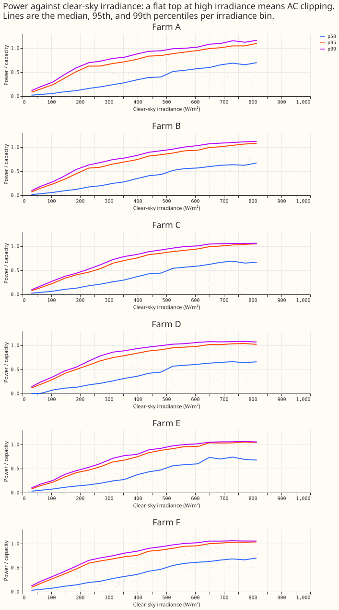
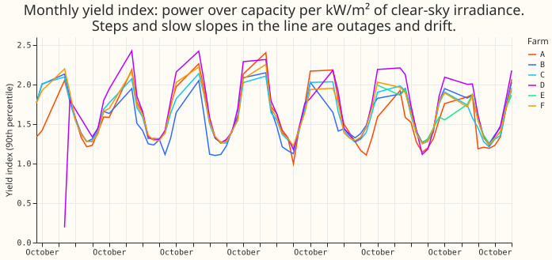
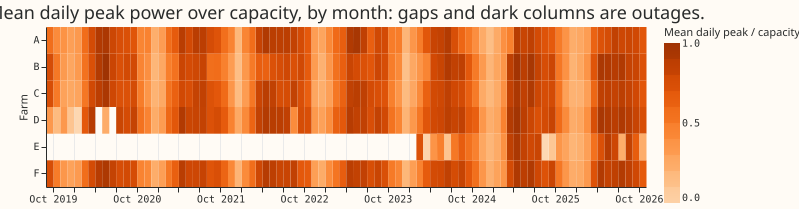

**Four of the 6 metered solar farms (C, D, E, and F) flatten at about 1.05 times capacity at high
clear-sky irradiance, but the pre-registered test found only one, and the flat top may be an export
cap.** We asked whether the 6 farms (labelled A to F) show AC clipping, step drops, or slow drift.
We plotted each farm's half-hourly power over capacity against clear-sky irradiance (Ineichen model,
the `pvlib` default), ran the `data-validation` checklist, and wrote a cleaned series. No model was
fitted.

Under the pre-registered rule, 1 of 6 farms (E) shows clipping, against a prediction of at least 4.
The stop rule (fewer than 3 farms) therefore fires: follow-up 4 (DC versus AC loss) is dropped for
the other 5 farms. The rule required the 99th percentile within 2% of the 95th, and noise puts it
above that at 4 farms. A rule chosen after seeing Figure 1 (post hoc) asks only that the 95th
percentile's slope over the top three irradiance bins be under 25% of its slope at mid irradiance.
It finds C, D, E, and F. The maintainer decides whether the stop rule stands.

## Checks

- **Clipping tests** (`clipping_tests.csv`): the 99th-to-95th ratio over the top three bins is 1.02
  (E), 1.02 (C, fails the slope test), 1.02 to 1.08 elsewhere; slope ratio top over mid is 0.85 (A),
  0.46 (B), 0.15 (C), -0.09 (D), 0.06 (E), and 0.07 (F).
- **Plateau level:** the 95th percentile peaks at 1.04 to 1.10 times effective capacity. If
  effective capacity is itself estimated from the observed output, a plateau near 1.0 is partly by
  construction; not checked here.
- **Export cap confound:** the flat top is what an export cap also produces, and
  `studies.export_cap` was not applied. Clipping and curtailment are not separated.
- **Timestamp convention:** power correlates best with clear-sky irradiance at lag 0 for all 6
  farms, so the period-ending stamps are consistent.
- **Gaps:** 7.6% (B) to 27.6% (E) of half-hours are missing, 22.4% at D; no duplicate timestamps.
- **Zeros in clear sun:** 250 to 1,291 half-hours per farm read zero or less when clear-sky
  irradiance exceeds 500 W/m², flagged `zero_in_clear_sky` (outage or curtailment).
- **Stuck runs:** 3 half-hours at D only (6 or more identical positive daylight readings).
  **Negative and night-time readings:** 0 to 24 and 0 to 30 half-hours per farm.
- **Commissioning:** 9,226 half-hours at E before 2024-10-06 are flagged, as `studies.commissioning`
  already does.
- **Step drops:** four runs of 3 or more April-to-September days with peak under 5% of capacity
  (`candidate_outages.csv`): B 2022-08-09 (3 days), D 2022-08-10 (5) and 2022-08-27 (3), E
  2025-09-20 (4).
- **Slow drift** (trend of the monthly yield index after removing month means, `drift.csv`): -0.55
  (A), +0.93 (B), -0.53 (C), +1.35 (D), -1.8 (E, 18 months only), and -0.21 (F) percent per year.
  No farm shows a drift larger than 2% a year.
- **Median minus mean forecast, and mean-forecast error beside quantile scores:** not applicable,
  because no forecast was made.
- **Audit triggers:** trigger 2 (a result against its own prediction) fires in form; the
  explanation, a too-strict rule, was tested by the post hoc rule above. Trigger 7 applies because
  follow-up 4 depends on the count. No control, nesting, or leave-one-out check exists here. No audit
  was run; the manager decides whether one is needed.

## What the next experiment should answer

- Does each farm's flat top coincide with export-cap hours (`studies.export_cap`)?
- What is each farm's DC capacity from an independent source, so that the AC limit can be separated
  from it?
- Neural components: a small learned clipping response (a smooth saturation of power against
  irradiance) could replace the fixed envelope; the prediction that could fail is that it fits
  farms C, D, E, and F no better than a hard cap at 1.05 times capacity.
