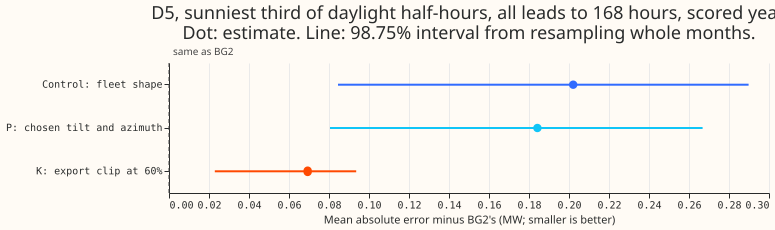
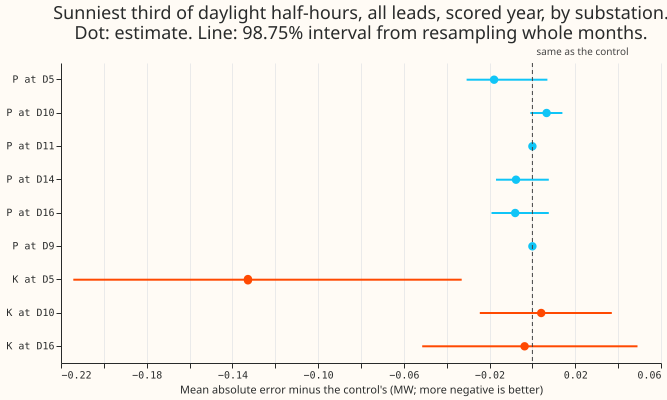
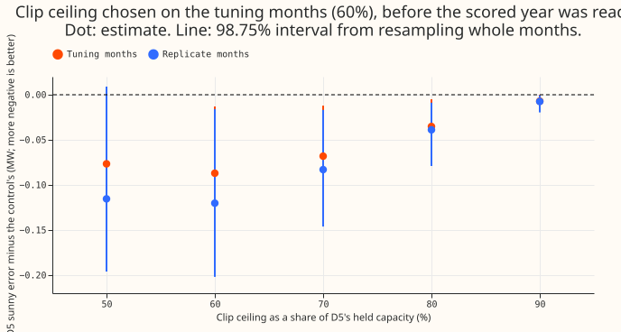
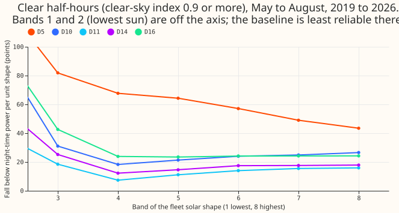

**D5's solar output is limited at the export point, and a 60% ceiling on the solar term removes most
of the substation's loss to BG2.** We asked whether the best generalised additive model (GAM) loses
to
BG2 on sunny afternoons at one substation, D5, because the GAM subtracts the wrong solar shape from
demand. [Experiment 178](../00178-dp-sunny-daylight-gap-diagnosis/result.md) had found that D5 holds
63% of the six-substation gap. We re-ran the GAM of [experiment
155](../00155-dp-bg-stage2-assembly-night-offset-and-error-correction/result.md) with three solar
terms and scored the same half-hours. Choosing each substation's panel tilt and azimuth did not
help.
Capping the solar term at 60% of D5's held capacity, using the smooth clip that experiments 103 and
110 had flagged at D5, cut the gap from +0.202 MW to +0.069 MW. A learned response from irradiance
to solar output was not run, because the clip already met the target.

## Results

- **Rows and scope:** experiment 178's rows, the scored year (2025-07-02 to 2026-06-29), leads to
  168
  hours, outside the switching events. A sunny daylight half-hour is in the top third of its
  substation's daylight half-hours ranked by the fixed fleet shape. D5 has 14,045 such half-hours.
  The control re-run reproduces experiment 178's D5 gap of +0.202 MW and arm D's forecasts exactly.
- **Absolute scores at D5, sunny daylight (MW):** the control's mean absolute error is 0.655, arm
  P's
  is 0.637, arm K's is 0.523, and BG2's is 0.453. Pinball loss (average over 11 quantiles) is 0.185
  for the control, 0.181 for P, and 0.154 for K.
- **Headline (arm K minus control, mean absolute error, 98.75% interval):** -0.133 MW (-0.214 to
  -0.033). The gap to BG2 falls to +0.069 MW (98.75% interval +0.023 to +0.094). Over all D5
  half-hours, arm K's gap to
  BG2 is -0.011 MW (-0.040 to +0.009), against +0.007 MW for the control.
- **Placebos:** arm K moves D10 by +0.004 MW (-0.025 to +0.037) and D16 by -0.004 MW (-0.051 to
  +0.049), inside the 0.02 MW margin. Over all half-hours the clip raises D10's error by +0.005 MW
  (+0.001 to +0.011) and D16's by +0.006 MW (-0.000 to +0.014), and the audit found rises of +0.012
  to +0.020 MW on daylight half-hours outside the sunny third at D5, D10, and D16. A clip belongs
  only where the export limit exists. Arm K was not run at D9, D11, or D14.
- **Arm P (tilt and azimuth):** the selection kept the fleet shape at D11 and D9. It chose a tilt of
  15 degrees at D5, 55 at D10, and 15 at D14 and D16. The sunny-daylight change against the control
  is -0.018 MW at D5 (-0.031 to +0.007), +0.007 at D10 (-0.001 to +0.014), -0.008 at D14, and -0.008
  at D16, none with an interval excluding zero. The 25-cell selection surface per substation is in
  the private `work/select.json`.
- **A fixed ceiling in points gives the same gain.** D5's held capacity swings from 62 to 81 points
  across the cuts, so a ceiling of 60% of it moves with the capacity. A post hoc arm with a fixed
  ceiling of 39 points (60% of the held capacity's typical value before the scored year) gives
  -0.130 MW (-0.225 to -0.021) on the scored year and -0.088 and -0.119 MW on the tuning and
  replicate months, so the gain does not come from the capacity's swings.
- **Six-substation total:** with arm K at D5 and the control elsewhere, the total sunny-daylight gap
  to BG2 is about +0.029 MW, against +0.050 MW (computed from the per-substation means, without an
  interval).
- **By-condition slices at D5 (mean absolute error, MW; control, K):** all half-hours 0.344 and
  0.325; winter 0.365 and 0.367; winter nights 0.225 and 0.226; cold nights (834 half-hours) 0.197
  and 0.201; Economy 7 step hours 0.156 and 0.155; bank holidays (1,900 half-hours) 0.328 and 0.291.
  Arm K changes none of the winter slices by an interval excluding zero. Over all D5 half-hours it
  lowers the error by 0.018 MW (-0.041 to -0.000). Christmas has too few
  half-hours to score.
- **Decision rule:** `supported`. The best arm's D5 gap is +0.069 MW against a target of +0.10 MW,
  its
  interval against the control lies wholly below zero, and both placebos move by under 0.02 MW. The
  other four substations are unchanged by construction for arm K.
- **Not run:** the learned response (arm L), the neural network (arm N), the farm-learned response
  (arm F), and known-answer gates 1 and 2. The plan ran them only if the target stayed out of reach
  (arm N) or after the gates (arms L and F), and arm K met the target. Gate 1 therefore did not
  fail,
  and the verdict is not capped.
- **Post hoc:** the clip ceiling. The plan fixed 100% of held capacity, which clips nothing, so
  the planned arm K gave an exact null (-0.000 MW). We then scored ceilings of 50%, 60%, 70%, 80%,
  and 90%, and chose 60% on the tuning months alone. The replicate months agreed (figure 3). The
  scored year was read for arm K at 60% after that choice. It had also been read earlier for arm K
  at 80%, the first post hoc guess, before the sweep. The other ceilings were scored on the tuning
  and replicate months only. The scores of every ceiling and of the
  null arm are in the private `work/scores_*.json` files.

## Checks

- **Median minus mean forecast:** zero at all six substations in arm D's stored forecasts (the mean
  equals the median), so no spread shifts the forecast.
- **Mean-forecast error beside the quantile score:** the pinball loss and the mean absolute error
  point the same way at D5, D10, and D16 for arm K. At the placebos both are indistinguishable from
  the control.
- **Tail calibration at D5, sunny rows (coverage; pinball loss in MW):** for the control, q01 0.051
  and 0.025, q05 0.168 and 0.097, q95 0.967 and 0.081, q99 0.993 and 0.022. For arm K, q01 0.056 and
  0.023, q05 0.176 and 0.085, q95 0.996 and 0.076, q99 0.999 and 0.021. Arm K narrows the upper tail
  losses but leaves the lower tail under-covered (q05 coverage 0.18 against 0.05 nominal).
- **Triggers fired:** a result that contradicts its own prediction (the plan expected no arm to
  reach
  +0.10 MW). The explanation, tested before the audit, is figure 4: D5's solar output per unit of
  shape falls towards midday while the other four substations stay flat. The Opus audit reproduced
  the headline (-0.133 MW, 98.75% interval -0.223 to -0.036) and found no leakage. The Sonnet code
  review found that arm P's fits had been trained on the fleet shape; we fixed that, refitted arm P,
  and replaced its numbers. The audit's request for a ceiling fixed in points is the fixed-ceiling
  bullet above.

## Caveats

- **One substation and one year.** The headline interval is 98.75% from 12 monthly blocks, and it
  spans -0.214 to -0.033 MW. The clip ceiling was chosen on 6 tuning months at the same substation.
- **The clip ceiling is a share of the capacity held after each cut.** It follows the pinned
  capacity, so a step in D5's capacity moves the ceiling with it.
- **The learned response was not tested.** Whether it beats the clip at D5 is unknown.
- **The gain is concentrated late in the scored year.** The audit found 80% of it in April to June
  2026, though dropping any one month leaves it between -0.100 and -0.147 MW, and every lead band
  improves (-0.087 MW at 0 to 24 hours to -0.147 MW).
- **The clip is a partial fix.** On clear summer days D5's net power stays flat from about 08:00 to
  15:00 UTC, as an export limit would make it, and D10 and D16 show no plateau. The shoulder
  half-hours keep an error, and the sunny rows keep a negative bias (the forecast is too low by 0.36
  MW for the control and 0.39 MW for arm K).
- **Shared limits of the chain.** The monthly fits train on the CAMS-derived shape of experiment
  106's cache and the forecasts use a shape recomputed from the same irradiance, which is identical
  to 1e-9 for the fleet. Arm P's selection scored all half-hours with a reading, including those in
  the switching events.

## What to try next

- Re-score the 60% ceiling at D5 on a later year, once the hold-out from 2026-07-01 is lifted.
- Test the same clip at D9, the second substation where the GAM trails BG2 by +0.079 MW (it has no
  clip flag in the site table, and no pinned-capacity vintage before 2025-04).
- A learned response from irradiance to solar output is still untested. Its target is now D9 and any
  residual at D5 after the clip.

## Pre-registered plan

**Reading the earlier advice.** The plan follows experiments 139 and 157 (the pinned capacity stays
untouched in every arm), experiment 111 (month-block bootstrap on paired differences), and
experiment 178 (state the row definition and the lead range with every gap). It departs from
experiment 73, which dropped the search over the DC:AC ratio as unidentified: arm P searches tilt
and azimuth only and holds the ratio at 1.15. Experiment 77's null result for a fitted shape is
the main reason the prediction above expects failure.

**Row set.** Experiment 178's rows: the 291 daily runs of `fold_a_daily_gap_v1` in the scored year
(2025-07-02 to 2026-06-29), leads 0.5 to 168 hours, outside the hand-filtered switching events. A
half-hour is sunny when it is in the top third of its substation's daylight half-hours ranked by the
fixed fleet unit shape on CAMS irradiance. The ranking uses the fixed fleet shape in every arm, so
every arm is scored on identical rows. Forecast rows stay before 2026-07-01.

**Control.** Experiment 155's arm D re-run through the same code path as the arms, with the fixed
fleet shape (tilt 35, south, DC:AC 1.15, 0.4%/K de-rating, cell temperature = air + 25 K x shape).
The control's median forecast must reproduce the stored arm D's to 0.005 MW mean absolute
difference at all six substations, or the comparison does not proceed. The chain is experiment 136's
A2 (T-all monthly
fits, pooled noise setting, calibrated ensemble mean), then experiment 155's winter night offset and
recipe R. Each arm reruns the whole chain, including its spread table, so the pinball contrasts
include
that refit. The pinball scores are arm D's, not the calibrated quantiles of experiments 160 and
164, which change quantile offsets only; the median forecast of 178's GAM equals arm D's, so the
headline mean absolute error is comparable.

**Where the solar shape enters, and how an arm swaps it.** The shape enters the training rows
(`unit_pv_shape` from CAMS), the analysis proxy (`proxy_cache`), and each ensemble member
(`SunGeometry.pv_shape_and_ghi`). Each of the three takes an optional plant. The pinned capacity,
in points of effective capacity, multiplies the shape in all three places, and stays as it is.
Three more couplings are fixed here. First, the temperature de-rating and the finite-row and
last-trained masks (`derated_unit_shape`, `LAST_TRAINED_MIN_SHAPE`, the filters in `dp_gam`,
`dp_ens`, and experiment 136's scripts) read the swapped shape, as the control reads the fleet
shape. Second, any rescaling of an arm's shape is applied after the inverter clip. Third, the
sunny-row ranking reads a separate frozen copy of the fleet shape, never the swapped array, and
the scripts assert that every arm's scored row keys equal experiment 178's. The code review
checks each of these readers.

Arms L and N apply their nonlinear response to the calibrated ensemble-mean irradiance, because
the chain forecasts from the mean as one member. A response fitted on CAMS rows therefore meets a
smoother input at forecast time. The write-up reports this as a limit.

### Stage 0: inspect D5's solar properties (CPU, no fit, before any arm)

Each item is reported as a finding, not only the one that explains the gap.

- **Orientation:** the hour-of-day profile of D5's net power on clear days, against the fixed
  shape's profile at the same hours, at D5 and at the placebo; the time of the net-power minimum
  against the shape's peak (an east or west bias moves it); the same for the nearest metered solar
  farm, if one lies within 30 km.
- **Solar share:** the share of D5's demand that is solar (night mean minus sunny-daylight mean over
  the night mean, as experiment 178), beside the other five substations.
- **Shading and clipping:** whether the clear-day output flattens at midday (a clip, which
  experiments 103 and 110 flagged at D5, whose `clip` flag in the site table is true and is false at
  the five others) or drops sharply at one end of the day (shading).
- **Capacity:** D5's pinned capacity per season-year against experiment 129's inferred 80% range for
  D5, and the pin's year-on-year step.
- **Neighbouring generators and meter:** any metered generator in the NGED table within 30 km of D5,
  and D5's meter type (the site table gives `units` MW, signed, `role` `mw_long`).

### Known-answer gates (before arms L, N, and F)

- **Gate 1, held-out farm:** fit each learned response on five of the six metered solar farms (A to
  F, as experiments 129 and 157 use) and score it on the sixth farm's metered output, against the
  fixed fleet shape's best single scale. Arms L and N each have their own gate. The response and the
  fleet shape each get one scale fitted on the held-out farm's first calendar year and are scored on
  its later years, so both see the same
  amount of the held-out farm. The response must lower the held-out MAE by 10% or more at 4 of 6
  farms. The farms' output comes from experiment 179's `cleaned_solar_farms.parquet` (rows
  with a null `drop_reason`), which is provisional until experiment 179 merges. The metered-PV
  session adds the
  same test; its code is reused if merged. Farms appear on any page only under their anonymised
  letters.
- **Gate 2, injection:** inject a metered farm's output at 50% of the substation's pinned capacity
  into its net power for the forecast year, with the shape held at the response learned without
  the injection. The recovery is (mean absolute error on the injected half-hours with the injection
  and the
  old capacity, minus the same with the raised capacity) divided by the injection's mean. It must
  lie in 0.75 to 1.25 (experiments 129 and 157). The injection enters the training rows of the
  monthly refits, and the forecast year's refits are the ones scored. The gate
  runs at D5 and at the placebo only.
- **Stop rules:** if gate 1 fails, arms L, N, and F do not run, the shape ceiling (experiment 157
  found one scale of the fleet shape fits a median 0.92 to 0.94 of a farm's output) is written up
  as real, and the verdict is capped at `inconclusive`. Arms P and K change only the shape's fixed
  parameters, have their
  own selection rule, and still run. If gate 2 fails at D5 or at the placebo, the confounding is
  reported and only arm F runs.

### Arms

Every arm changes only the solar term of the control. Arms run at D5 and at the placebo; arm P also
runs at the four other substations (D9, D10, D11, D14) as the no-harm check.

- **C, control:** the fixed fleet shape.
- **P, per-substation tilt and azimuth (the lead arm):** the shape comes from `plant_power_mw` for
  the substation's chosen tilt (15, 25, 35, 45, 55 degrees) and azimuth (135, 157.5, 180, 202.5, 225
  degrees), DC:AC 1.15. Each candidate shape gets one scale per substation, fixed so that its sum
  over all daylight
  half-hours from 2023-04-01 to 2024-03-31 on CAMS irradiance equals the fleet shape's. The scale
  is then frozen for every later cut. This keeps the pinned capacity's annual meaning. The
  selection rule is fixed here: for each of the 25 cells, fit T-all at the quarterly cuts
  2023-04-01, 2023-07-01, 2023-10-01, and 2024-01-01, score each fit on the following quarter's
  sunny daylight half-hours (the fleet-shape ranking, with the CAMS-driven shape), and take the
  cell with the lowest mean absolute error over the four quarters. The scores of all 25 cells are
  reported per substation. D9 has no pinned-capacity vintage before 2025-04, so it keeps the fleet
  shape. At the other substations the early cuts use the later vintage's level (hindsight, as the
  `dp_pinned_capacity` docstring says); the capacity is the same for all 25 cells at a cut, so
  it cannot favour one cell. The chosen cell replaces the fleet shape only if its error is at
  least 1% lower than the fleet's (35, 180), a guard against selection noise that the reported
  surface lets a reader judge; otherwise the substation keeps the fleet shape, and arm P equals
  the control there. The write-up lists the substations that changed, and arm P is left out of the
  best-arm choice at D5 if D5 keeps the fleet shape. All
  selection data end before 2024-04-01, the first scored-chain run. If the selection fits take
  more than 4 hours at the slot's cores, the grid shrinks to tilt 25, 35, 45 and azimuth 157.5,
  180, 202.5 before any score is read.
- **K, export clip:** the control with `ClipSpec` (multiplier 1, `p_max_share` 1, the default
  sharpness) of `studies.dp_gam`, at D5 and the placebo. Experiment 110 found the clip helps at D5
  and fails its gate; this arm tests it on 178's rows.
- **L, convex learned response:** the solar output as a tensor-product spline in the
  ensemble-calibrated irradiance (non-decreasing, through cumulative basis functions) and sun
  elevation, per substation, in MW per unit of pinned capacity. The coefficients are non-negative,
  so the fit stays a bounded quadratic. A quadratic penalty pulls the response towards the
  coefficients that reproduce the fleet shape, so where the data cannot tell solar from demand the
  response falls back to the physics. The temperature de-rating is applied as in the control.
- **N, small neural network:** a monotone multilayer perceptron from irradiance, direct and
  diffuse irradiance, sun elevation, sun azimuth, and air temperature to unit solar output,
  backfitted with the GAM by alternating least squares and gradient steps. It runs only when the
  best of C, P, K, and L leaves D5's gap above +0.10 MW. Its GPU share is at most 4 GB.
- **F, farm-learned response, frozen:** the response of L or N learned on the farms A to F pooled,
  then frozen and used at D5 and the placebo. It runs only if gate 1 passes and gate 2 fails.

**Placebo:** D16 is the placebo, and D10 (-0.009 MW) is a second placebo for every arm because
both are cheap and neither is the target;
D16 is chosen before any fit because it has the most negative sunny-daylight gap in
experiment 178's rows (-0.025 MW; D10 -0.009, D11 +0.013, D14 +0.048, D9 +0.079, D5 +0.202). Every
arm that changes the solar term at D5 also runs at D16, which must move by under 0.02 MW. A larger
move means the change is not specific to D5's shape.

### What is recorded

- The learned response drawn per substation against the fixed shape (output against irradiance at
  four sun elevations), and the chosen tilt and azimuth per substation.
- Whether gate 2's recovery of capacity falls at substations where capacity is growing (D10, D16).
- The sunny-daylight error by clear-sky-index band for each arm, since 178 found the gap depends on
  the definition of sunny.
- Absolute scores per arm: MAE and pinball loss at D5, at the placebo, and for arm P at all six
  substations, on the maintainer's by-condition slices (all days, sunny daylight, winter, winter
  nights, cold nights, Economy 7 step hours, Christmas, bank holidays).
- Per-substation fitted solar properties, for the substation cards.

### Stop rules

- After the replicate period (the even months of 2024-07 to 2025-06), stop if the best arm minus
  control at D5 has an interval wholly above zero on sunny daylight half-hours. The best arm is
  chosen on the replicate period, and the scored year then tests it once.
- If D5's gap stays above +0.15 MW with every arm and no interval lies wholly below zero, say the
  cause is not the solar shape and stop. Arm K's earlier failure at D5 (experiment 110) counts as
  prior evidence for this outcome.
- Arm F is descriptive and outside the four-contrast correction.

### Compute and reviews

- At most 8 cores (`OMP_NUM_THREADS=1` per worker), `systemd-run --user --scope -p MemoryMax=16G
  -p OOMPolicy=continue` per job, and a GPU share of at most 4 GB for arm N only. One monthly
  T-all fit is timed at D5 before any grid is launched. The fit count is about 27 monthly
  fits per arm per substation (arms C and P at six substations, K, L, N, F at D5, D16, and D10),
  plus 25 cells x 4 cuts x 5 substations = 500 selection fits. The 4-hour shrink rule counts the
  selection fits only, at the timed cost per fit and 8 cores.
- Reviews: one Sonnet plan review (done; the manager's brief asks for Sonnet reviewers, so the Opus
plan and
  code reviews of the full tier are skipped), one Sonnet code review for leakage (no response sees
  data after
  its fit's cut) and for the control reproducing arm D, and one Sonnet prose review. An Opus audit
  runs only if one of the seven triggers in the `ml-experiment` skill's "Audit before merge" fires.
  The experiment adds no
  production code.
- Departures from the design brief, for the manager to overrule: arm K is added; the DC:AC search is
  dropped from arm P; arms P and K run when gate 1 fails; and arm P's selection keeps the fleet
  shape unless a candidate is at least 1% better.
