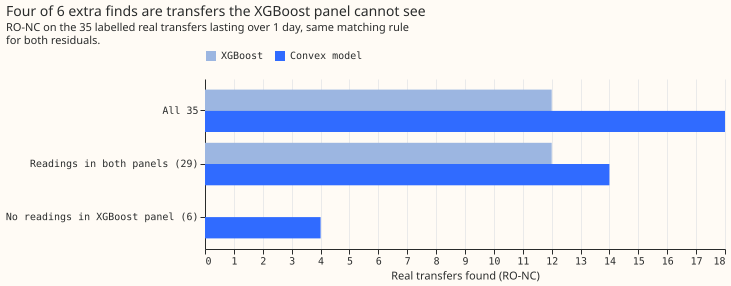
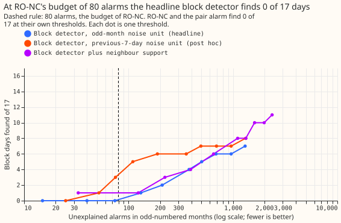
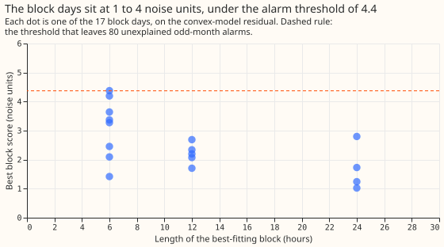
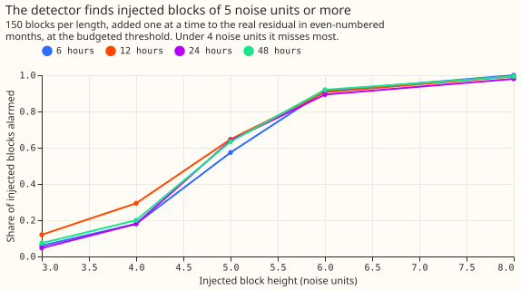

# Experiment 181: why were 17 block days missed, and can a block detector find them?

**A detector built for blocks finds none of the 17 unlabelled worst days.** The days are short
blocks of 1 to 4 noise units, where one noise unit is the usual spread of the forecast residual
(observed minus forecast power) of that series. A block is a switching-like change in the power a
Primary substation draws: it steps up, stays level, and steps back. [Experiment
175](../00175-dp-unlabelled-day-shapes/result.md) found 17 sharp-edged block days among the 37 worst
days that no label explains. Neither RO-NC (the refit-offset neighbour-count detector of [experiment
82](../00082-sw2-18-19-combined-refit-offset-and-same-sign-count/result.md)) nor the opposite-step
pair alarm of [experiment 156](../00156-switching-faster-onset-alarm-from-opposite-steps/result.md)
fired on any of them. We asked why, wrote a rectangular-block detector, and counted how many of the
17 days it finds when it is allowed the same 80 unexplained alarms in odd-numbered months as RO-NC.
It finds 0 (prediction: at least 12), so the verdict is `refuted`. **RO-NC finds more real transfers
on the convex-model residual than on the XGBoost residual, but most of the difference comes from
Primaries that the XGBoost panel does not cover.** A transfer is a labelled period in which
switching moved load from one Primary substation to others. On the 35 labelled transfers lasting
over 1 day, RO-NC finds 18 on the residual of the convex demand model and 12 on the residual of the
XGBoost model. Four of the 6 extra transfers sit at Primaries where the XGBoost panel (its table of
readings and forecasts) has no readings. NGED is National Grid Electricity Distribution; a Primary
substation steps transmission voltage down to distribution voltage. The 35 transfers are those of
the 66 labelled real transfers that last over 1 day.

## Results

- **Part 3, like-for-like table.** RO-NC's threshold gives 80 unexplained odd-month alarms on each
  residual. A transfer counts as found when an alarm falls within 2 hours of the labelled start and
  the alarm's end within the larger of 6 hours and 10% of the duration. The same code scored both
  residuals. The MW-weighted figure is the share of the moved megawatts that the found transfers
  carry, and the interval resamples transfers 20,000 times.

| Transfers | XGBoost residual found (MW-weighted) | Convex-model residual found (MW-weighted) | Paired MW-weighted gap (95% interval) |
|---|---|---|---|
| All 35 (42.7 MW) | 12 (0.357) | 18 (0.657) | +0.300 (+0.089 to +0.505) |
| 29 with readings in both panels (31.2 MW) | 12 (0.489) | 14 (0.604) | +0.115 (-0.046 to +0.300) |
| 6 with no readings in the XGBoost panel (11.5 MW) | 0 (0.000) | 4 (0.800) | +0.800 (+0.402 to +1.000) |

- **Injected transfers** (experiment 130, quoted): 0.794 convex against 0.772 XGBoost, a gap of
  +0.023 (-0.001 to +0.046).
- **What differed between experiments 101 and 130:** nothing in the matching rule or the 35
  transfers, because experiment 130 copied experiment 101's scoring code. The two differ in the
  residual, in the 15 series (against 16, with the same 12 found by the XGBoost arm on either), and
  in the 6 transfers at two Primaries that the XGBoost panel lacks. The convex model also trained
  with these real transfers masked, which flatters it on them.
- **Part 1, step 1: why the 17 days were missed.** On the convex-model residual, the best-fitting
  block of each day has a median score of 2.3 noise units (largest 4.4) and a median length of 12
  hours; 13 of the 17 best-fitting blocks last 12 hours or less. RO-NC's 24-hour step statistic has
  a median of 2.2 noise units against its threshold of 4.35, and exceeds it on 2 days (5.2 and 7.2),
  where RO-NC still raises no alarm; why is not tested. All 17 days have at least two metered
  interconnected Primaries, so a missing partner does not explain the misses. No RO-NC or pair alarm
  falls inside any of the 17 local days.
- **Part 1, step 2: block detector.** Threshold at 80 unexplained odd-month alarms: 4.37 noise
  units (78 unexplained alarms in even months). S0 finds 0 of 17 days (0 of the 5 in even months).
  Neighbour support (S1, threshold 5.37) finds 1. The post hoc S2, which divides by the previous 7
  days' spread, finds 5 of 17 (4 of 5 in even months; 84 unexplained even-month alarms). S0 finds 7
  of 17 only at about 1,300 unexplained odd-month alarms.
- **Injected-block control.** Blocks of height 5 noise units are found 57% to 65% of the time at
  lengths of 6 to 48 hours, and 6 noise units 89% to 92%, so the detector works on blocks of the
  size it is tuned for. At 3 to 4 noise units it finds 5% to 29%.
- **Part 2, candidate label table:** 133 rows in
  `data/ml-experiments/briefs/sw_block_detector_label_table.csv` (private, not committed): 17 block
  days (3 of medium confidence), 21 balanced-opposite alarms (all low), 29 drops of D8 (23 of medium
  confidence, with a logged closure within 24 hours), and 66 labelled real transfers (50 of medium
  or high confidence). Columns: onset, end, depth in MW, duration, pair, source, confidence.

## Checks

- **Median minus mean forecast, and the mean-forecast error:** not applicable, because no forecast
  is scored.
- **Trigger 2 (a result contradicts its prediction) fired**: 0 days found against a prediction of at
  least 12. The explanation that the blocks are too small is tested by the threshold curve and the
  injected-block control. The audit that trigger 2 calls for was not run here.
- **Trigger 4** (leaving a site out) was not run. **Triggers 1, 3, 5, 6, and 7** did not fire: the
  injected-block control passes.

## Deviations and caveats

- **Residual.** The block detector reads the convex-model residual of experiment 130 (ERA5 weather,
  frozen), not the forecast residual of arm D (ensemble weather and Kalman filter) on which
  experiment 175 found the days. The blocks are visible in both, but the noise unit differs, and
  the Kalman filter in arm D absorbs a multi-day block. This is the main caveat on "0 of 17".
- **Found rule.** The plan said an alarm within 3 hours of the block's onset. The median block
  length of 8 hours in the plan came from an earlier look at the detector's edges, and 12 hours is
  the best-fitting block's median here. The strongest edge of experiment 175 can be the block's
  return edge, so the headline counts an alarm inside the local day or within 3 hours of it. The
  edge rule finds 0 (S0) and 2 (S2).
- **Peak rule.** Alarms are local peaks within 48 half-hours, as in RO-NC, so a day whose best
  score (D5, 4.38) exceeds the threshold can lose to a larger peak nearby (4.56, outside the day).
  The count would then be 1 of 17.
- **Looser than the plan.** An alarm of either sign, or one that the masks call explained, counts as
  found; the injected-block recall includes chance exceedances. Both favour the detector. The
  noise-unit floor of S2 uses all months. The like-for-like intervals resample transfers, not
  Primaries, and "has readings" means at least half of the transfer's half-hours are present.
- **The 5-of-17 result is exploratory.** S2 was added after the 17 days were seen, so its count is a
  hint for a later pre-registered test and not evidence that block detection works. No Opus audit was
  run, by the manager's decision.
- **Post hoc.** S2 was added after S0 found nothing. Its threshold is set on odd months, but the
  choice of S2 followed the 17 days.
- **Unexplained alarms** may include true unlogged switching, so the budget is conservative for any
  detector that finds real blocks.
- **Two choices that live use would not allow.** The residual uses past weather that arrives about 5
  days late, and block extents use hindsight.

## What to try next

Send the candidate label table to NGED to learn which of the 17 blocks are switching. A block
detector on the arm D residual, which has a smaller noise unit on these days, is the untested
alternative, and needs a longer history than the one year experiment 175 covers.

Code: `ml-experiments/00181-switching-block-detector-and-like-for-like-table/`; the numbers above
are printed by `e00181_like_for_like.py`, `e00181_why_missed.py`, `e00181_block.py`, and
`e00181_block_control.py`, and kept as `printed_*.txt` in that folder.
