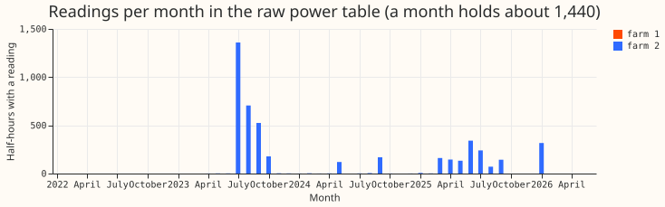
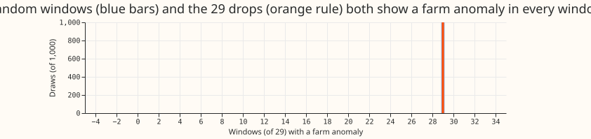
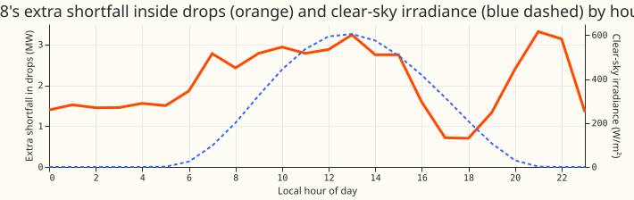

# Experiment 182: do D8's multi-day drops coincide with failed analogues of its two disaggregated farms?

**The two farms' own readings cannot answer the question, because they are absent from the power
table for the whole period of the drops.** D8 (Marsh Lane) is a disaggregated Primary substation:
the metadata table says the output of two solar farms was added back to its reading, and that the
analogue (the stand-in measurement that supplies each farm's output) of both farms is "not
working". [Experiment 159](../00159-switching-d8-multi-day-drops-recurrence-and-report/result.md)
found 29 multi-day drops at D8 that no neighbour step or detector explains. The hypothesis was
that, when an analogue fails, D8's reading loses that farm's output, so a drop equals the lost
output. Farm 1 has one reading in the power table, and farm 2 has 4,643 readings, of which 441
are above zero and none come after 2026-01-26. The farm reading is therefore "missing" inside all 29
drops and inside every random window (Figure 2), so the pre-registered count (at least 15 of 29
against at most 5 for random windows) cannot be met on the random side. The verdict is
`inconclusive`.

D8's shortfall does lean towards daylight. In 24 of the 29 drops the shortfall (expected minus
metered power) is deeper from 10:00 to 15:00 local time than from 22:00 to 04:00, by a median of 1.5
MW (bootstrap 95% interval 0.5 to 3.7). The hourly extra shortfall inside drops correlates with
clear-sky irradiance at Spearman +0.44 (p = 0.033) across the 24 hours, against -0.12 outside
drops. The extra shortfall is also large at 20:00 to 22:00 (2.4 to 3.3 MW), which a solar farm
cannot explain, so the daylight pattern is a hint and not a signature.

## Results

- **Farm readings:** farm 1 has 1 reading on the grid (a zero on 2024-09-26) and farm 2 has 4,643
  (2023-04-11 to 2026-01-26), 441 of them above zero and the last on 2026-01-23. Farm 2 is typed
  "Other (Generation)" in the metadata table, so it need not be solar.
- **Per-drop status in daylight (Figure 2):** farm 1 is missing in 29 of 29 drops, and farm 2 is
  missing in 28 and all-zero in 1. In the 7 days before a drop, farm 2 is missing in 28 and normal
  in 1. A farm anomaly that was not present in the previous 7 days appears in 1 of 29 drops,
  against a mean of 0.5 in 1,000 random draws (share of draws at or above 1: 0.37).
- **Farm output against drop depth:** the farms' combined daylight median over the 7 days before is
  0.0 MW in the 10 drops that have any reading there, against a median depth of 2.71 MW. The other
  19 drops have no reading to compare.
- **Random windows:** 1,000 draws of 29 windows of the same lengths and times of day, from 2023-07-01
  onwards, show a farm anomaly in 29.0 of 29 on average (5th to 95th percentile 29 to 29).
- **Depth by hour (Figure 3):** the extra shortfall inside drops is about 1.5 MW from 00:00 to
  06:00, 2.4 to 3.2 MW from 07:00 to 15:00, 0.7 MW at 17:00 to 18:00, and 2.4 to 3.3 MW from 20:00
  to 22:00. Per drop, the Spearman correlation of hourly depth with clear-sky irradiance has a median
  of +0.49 and is positive in 23 of 29 drops.
- **Metadata `information` field:** 5 of the 33 series have a value. They are D8's own note about the
  two disaggregated farms, "Analogues not working" for the two farms, "Analogues suspect" for one of
  the six metered solar farms of [experiment
  179](../00179-metered-solar-farm-exploration/result.md), and "Customer has not exported since June
  2026" for a biofuel generator. The last two are not connected to D8, so no other note explains a D8
  anomaly.
- **Raw JSON:** in the files read for D8 and the two farms (15.8 MB: the whole-history file and the
  first and last six-hour file of each series), every reading holds only `startTime`, `endTime`, and
  `value`, and the top-level fields are the ones the metadata table stores. The `Information` field
  is null in the whole-history file (to 2026-03-26) and set in the July and October 2026 files, so
  the notes are a snapshot and the files carry no history of when an analogue failed.

## Checks

- **Drop table and panel:** the drops are the 29 of experiment 159, unchanged. D8's expected power is
  the frozen convex demand model of experiment 130, so "shortfall" is relative to that model.
- **Daylight rule:** daylight is clear-sky irradiance above 50 W/m² at D8's location, and one rule
  (under half present, all zero, or 6 or more identical positive readings) is applied to both farms.
- **Triggers for audit:** none fired, because no forecast is scored.

## Caveats and next steps

- The test cannot discriminate because absence is the baseline for both farms, not because the
  hypothesis failed.
- The hourly pattern comes from 29 drops chosen by their depth in the residual, and the evening peak
  has no solar explanation.
- Next, either obtain the farms' output and capacity from NGED, or model them from capacity and
  weather estimates and compare with the drop depth by hour. A neural component is not suggested,
  because the limit is missing data.
