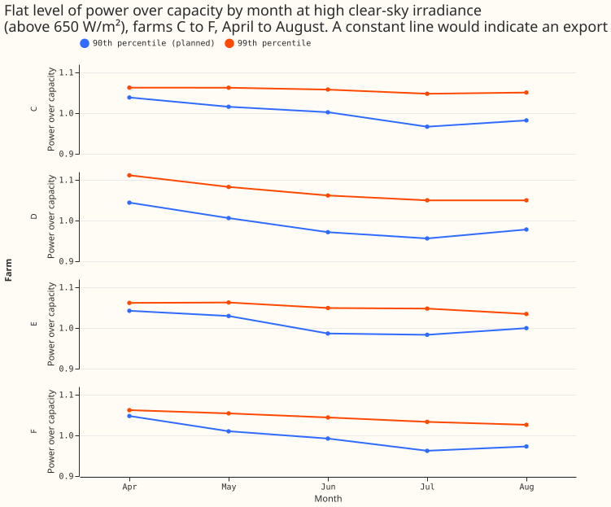

**Four metered solar farms (anonymised as farms C, D, E, and F) show a flat top, meaning output that
stops rising at a roughly constant level around midday on clear days. That level is lower in summer
than in spring, so the flat top does not behave like a fixed export cap, a limit on grid export.**
We asked whether each farm's flat level, measured as power divided by capacity, stays constant across
the months (as an export cap would) or changes with the season (as heat derating or the panels' tilt
and azimuth could make it). We took the half-hours in which the modelled clear-sky irradiance on a
horizontal plane exceeds 650 W/m², from the cleaned power series of the metered-solar-farm
exploration ([experiment 179](../00179-metered-solar-farm-exploration/result.md)). For each farm and
month from April to August we then took the 90th percentile, across those half-hours, of power
divided by capacity, which the page calls the flat level. No forecasting model was fitted.

**The pre-registered prediction fails and the stop rule fires.** The prediction was that at least 3 of
the 4 farms keep a flat level that varies by under 3% across months, where the variation is the range
of the monthly levels divided by their mean. The variation is 5.9% to 8.9%, so no farm is
seasonally constant. The stop rule then says that the per-farm plant fit (follow-up 2, a fit of each
farm's panel tilt, panel azimuth, direct-current (DC) capacity, and alternating-current (AC)
capacity) must fit tilt and azimuth, not only a clip level. September has under 30 qualifying
half-hours at every farm and is left out. The 650 W/m² threshold is the irradiance above which
experiment 179's figure showed the flat top.

## Numbers

- **Flat level, 90th percentile, range over mean, April to August,** farms C to F: 7.2%, 8.9%, 5.9%,
  and 8.6%. Each farm's level is highest in April (1.04 to 1.05 times capacity) and lowest in July
  (0.96 to 0.98 times capacity).
- **Replication by years:** even years alone give 5.0%, 8.7%, 6.4%, and 8.1%. Odd years alone give
  9.8%, 13.2%, 5.4%, and 11.9%, and farm E's odd-year figure covers April to July only. Every farm
  varies by more than 3% in both halves, so the result of 0 of 4 constant farms is replicated.
- **99th percentile (post hoc),** range over mean: 1.4%, 5.8%, 2.7%, and 3.4%. Farms C and E would
  pass the 3% rule at this percentile. Farm F narrowly fails at 3.4%, and farm D fails at 5.8%. All
  four 99th-percentile levels still fall from April to August (for example farm F, 1.06 to 1.03
  times capacity).
- **Morning against afternoon** (90th percentile, same half-hours): the ratio is 0.99, 1.02, 0.99,
  and 1.00 for farms C to F, so the level does not depend on whether the sun is east or west of
  south. A south-facing array and a fixed cap would both give this ratio, so the ratio does not
  separate them.

## Checks

- **More cloud in summer could lower the 90th percentile.** The clear-sky filter uses the
  clear-sky model, not observed irradiance, so cloudy half-hours enter the 90th percentile. The 99th
  percentile is less exposed to cloud, and its range across months is smaller. Part of the
  90th-percentile range may therefore be cloud, but the seasonal fall at the 99th percentile remains
  at all four farms, and at farm D its range (5.8%) is close to the 90th percentile's (8.9%).
- **Heat derating, panel tilt and azimuth, and a seasonal export cap are not separated,** because no
  temperature, no panel tilt or azimuth, and no export-cap record was used.
- **Absolute levels are not meaningful, only their change across months.** Power is divided by the
  effective capacity from `studies.pv_dataset`, which may itself be estimated from the output, so a
  level near 1.0 is partly by construction.
- **A monthly difference could come from sun elevation.** The qualifying half-hours in April and
  August are near midday only, so month and sun elevation are confounded.
- **Audit:** the audit rule for a result that contradicts its own prediction applies in form. The
  explanation that cloud lowers the 90th percentile was tested with the 99th percentile above, and
  the seasonal fall remains. No audit was run.

## What the next experiment should answer

- Does a per-farm physical plant fit (panel tilt, azimuth, DC capacity, AC capacity, and a
  heat-derating loss) reproduce the fall from April to August better than a clip level alone? The
  prediction is that it does; it fails if the clip-only fit does as well.
- Does each farm's flat top coincide with the hours in which the network operator limited grid
  export (`studies.export_cap` identifies these hours)?
