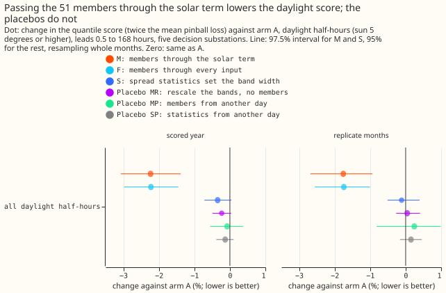
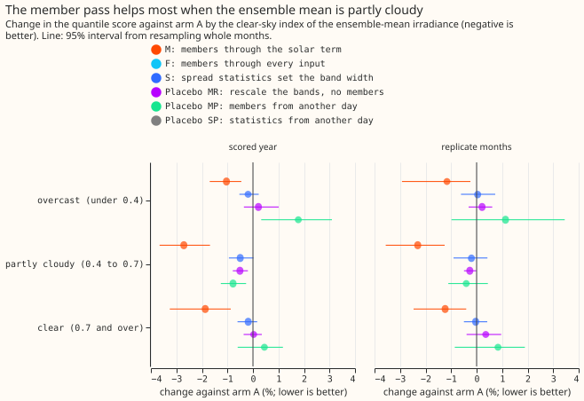
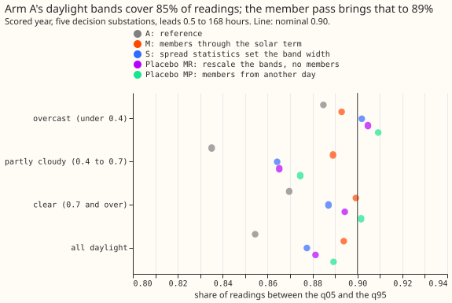
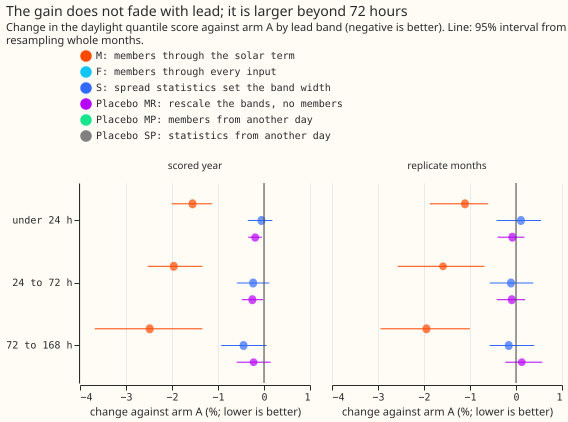
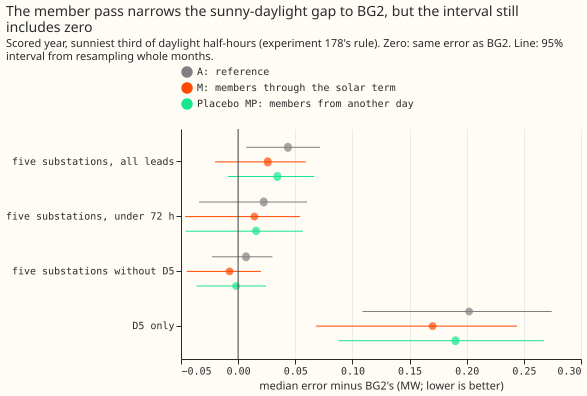
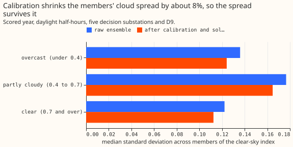

# Experiment 184: does the ensemble help calibrate the bands in daylight?

**Running each of the 51 ensemble members through the solar part of the demand model improves the
daylight bands by about 2%, and two placebos show the gain is information about cloud.** The
demand forecast's bands are quantiles of its error: the q05 is the value that the reading should
fall under on 5% of half-hours. We asked whether the disagreement between the 51 members of the
ECMWF ensemble about cloud helps those bands in daylight, where cloud changes demand through
embedded solar generation. [Experiment 169](../00169-calibration-combined-fixes-and-ensemble-spread/result.md)
had found no gain from the ensemble spread over all half-hours. We scored daylight (the sun 5
degrees or more above the horizon) and night separately, on the forecast that experiment 169 called
arm A. One arm passed each member's irradiance through the solar term and left every other input at
the ensemble mean. It lowered the daylight quantile score from 3.632 to 3.551 points in the scored
year (-2.2%). Night is unchanged because the arms only change daylight rows. Scores are in points
of effective capacity (percentage points of each substation's rated demand), lower is better.

- **Method of the member arms.** The fitted model is linear in its coefficients, so member m's
  forecast is arm A's mean plus the response of experiment 136's T-all fit to the member's unit PV
  shape minus its response to the ensemble mean's unit PV shape. Arm A's 11 quantile offsets from
  its mean, times one factor per calibration lead band (fitted on the tuning months), go around
  each member, and the 51 members are pooled as in experiment 111. The fitted factors are 0.95,
  0.90, 0.90, and 0.85 for leads of 0 to 24, 24 to 48, 48 to 144, and 144 to 168 hours: the member
  spread supplies part of the width that arm A's offsets supplied.
- **Arms.** A: reference. M: members through the solar term. Mc: M with the responses centred on
  zero. F: members through every weather input. S: arm A's daylight offsets times a scale fitted
  by linear programmes on three spread statistics of the members' clear-sky index (standard
  deviation, range, and `4 p (1 - p)` for the share p of members at 0.8 or more). MR (placebo):
  arm A's offsets times a factor per lead band, no members. MP (placebo): M with each row's 51
  responses taken from a random row of the same substation, calendar month, and hour band. SP
  (placebo): S's coefficients on statistics from such a row. K (the filter's observation variance)
  was not run, because it needs a refit of the filter's residual stream, outside the stored data.
- **Row set.** `fold_a_daily_gap_v1`, D5, D10, D11, D14, and D16 (D9 beside them, in no contrast),
  leads 0.5 to 168 hours, outside the hand-filtered switching events. Scored year 2025-07-02 to
  2026-06-29: 464,363 rows, 211,576 in daylight, 225,774 at night, 27,013 in twilight (0 to 5
  degrees, scored and unchanged). Mean forecasts are experiment 155's monthly refits, so no contrast
  depends on the retraining schedule. Ensemble weather is the stored 51-member forecast of
  experiment 111, available at forecast time; the weather source at lag times is the filter's, as in
  arm A.
- **Headline, C1 and C2 (daylight, change from arm A).** M: -2.23% (97.5% interval -3.07% to
  -1.38%) in the scored year, -1.76% (-2.68% to -0.93%) in the replicate months. S: -0.34% (-0.72% to
  +0.04%) and -0.11% (-0.51% to +0.39%). Arm M meets every part of the pre-registered rule in both
  periods. Arm S does not.
- **Controls.** MR -0.23% (-0.49% to +0.03%), MP -0.08% (-0.55% to +0.37%), SP -0.13% (-0.38% to
  +0.11%) in the scored year; replicate months +0.04%, +0.24%, +0.15%. Mc -1.99% (-2.76% to -1.30%).
  F -2.22% (-2.98% to -1.45%), the same as M, so temperature spread adds nothing in daylight.
- **Absolute scores, scored year (quantile score).** Daylight: A 3.632, M 3.551, F 3.552, S 3.620,
  MR 3.624, MP 3.630. Night, all arms 1.981. All rows: A 2.752, M 2.715, S 2.746. Replicate months,
  daylight: A 3.453, M 3.393, S 3.449.
- **Calibration, daylight, scored year.** The q05-to-q95 coverage (nominal 0.90) is 0.854 for A,
  0.894 for M, 0.877 for S, 0.881 for MR, and 0.889 for MP. Coverage alone cannot separate M from
  the placebos, which is why the scores matter. The median q05-to-q95 width is 24.6 points for A and
  26.8 for M.
- **Tails, daylight, scored year (coverage / pinball loss).** A: q01 0.027 / 0.265, q05 0.078 /
  0.907, q95 0.933 / 0.924, q99 0.979 / 0.262. M: 0.013 / 0.230, 0.053 / 0.837, 0.947 / 0.880,
  0.986 / 0.243. S: 0.021 / 0.251, 0.069 / 0.889, 0.946 / 0.920, 0.987 / 0.253. Most of the gain is
  in the lower tail, where high irradiance from some members lowers demand.
- **By clear-sky index band of the ensemble-mean irradiance (M, scored year).** Overcast (under
  0.4, 18,210 rows) -1.04% (-1.69% to -0.46%); partly cloudy (0.4 to 0.7, 100,922 rows) -2.71%
  (-3.66% to -1.68%); clear (0.7 and over, 92,444 rows) -1.87% (-3.26% to -0.87%).
- **By lead band (M, scored year).** Under 24 hours -1.55% (-2.01% to -1.13%); 24 to 72 hours -1.96%
  (-2.53% to -1.34%); 72 to 168 hours -2.48% (-3.68% to -1.34%); 12 to 36 hours -1.82% (-2.35% to
  -1.19%). The prediction that the gain sits under 72 hours was wrong.
- **By substation (M, scored year).** D5 -3.15% (-4.41% to -1.83%); without D5 -1.89% (-2.66% to
  -1.13%); D10 -1.30%, D11 -1.09%, D14 -1.73%, D16 -3.42%. The five-substation result holds
  without D5 and without any one substation. In the replicate months D11's interval includes zero
  (-0.65%, -1.92% to +0.91%).
- **Sunniest third (experiment 178's rule).** M -4.85% (-7.67% to -2.92%) in the scored year; MP
  -1.77% (-3.74% to -0.47%). The gap to BG2 in the absolute error of the median, over 74,728 sunny
  half-hours at the five substations: arm A +0.044 MW, reproducing experiment 178's +0.044 MW (the
  interval 0.006 to 0.071); M +0.026 MW (interval includes zero, -0.022 to +0.059); MP +0.034 MW.
  Without D5: A +0.007, M -0.008 MW. At D5: A +0.202, M +0.170 MW. D5 holds most of what remains.
- **Checks.** Median minus mean forecast per substation at 12 to 36 hours: exactly 0.000 for A and
  S, and -0.14 (D5), -0.05, -0.05, -0.05, and -0.05 points (D10, D11, D14, D16) for M, because the
  members' skewed responses pull the mixture median below the mean. The mean forecast's own daylight
  error changes by -0.13% (-0.45% to +0.27%) for M, the same direction as the score. The reproduction
  control G1 rebuilds experiment 136's mean to 5e-6 points on every row of all three periods.
  Experiment 178's gap for arm A is reproduced. **Gates.** G2 passes: the unit PV shape built from
  CAMS irradiance equals the cached shape (slope 1.000, largest gap 0) at all six substations. G3
  fails its monotonicity criterion: member responses fall with the multiplier on 1,036 of 1,058
  daylight rows of the fake ensemble (868 of 884 where the fake clear-sky index stays at or under
  1.1). The failing rows are at elevations of 14 to 16 degrees, where the unit PV shape from
  `SunGeometry.pv_shape_and_ghi` itself falls as irradiance rises (0.099, 0.124, then 0.090 as
  irradiance rises from 97 to 227 W/m2 at one half-hour), so the cause lies in the existing shape
  function. The wiring checks of G3 pass exactly: the response of the multiplier-1 member is zero,
  responses at night are zero, and the fake ensemble's spread statistic equals the known multiplier
  spread. The pre-registered rule capped the verdict at `inconclusive` on a failed gate. M restricted
  to elevations of 17 degrees and over scores -2.47% (-3.57% to -1.44%), so the result does not
  depend on those rows. G4: the members' median clear-sky-index spread is 0.122 raw and 0.112 after
  calibration in clear conditions, 0.177 and 0.165 when partly cloudy, 0.136 and 0.124 when
  overcast: calibration shrinks the spread by about 8%, so a null could not be blamed on it.
- **Prediction check.** The pre-registered expectation (probability about 0.7) was that no arm would
  reach -1%, that arm M would change the score by -0.5% to +1.0%, and that any gain would sit under
  72 hours. Arm M's -2.2% and its larger gain beyond 72 hours contradict all three, and the result
  also contradicts experiment 169's null on ensemble spread. The placebos MR, MP, and SP test the
  explanation that widening alone produces the gain, and none reproduces it. Audit triggers fired:
  the failed monotonic check of G3, and a result that contradicts its prediction and an earlier
  experiment.
- **Caveats.** Arms M and F add a 51-member pass of the solar term to the weather layer and four
  fitted factors. The result depends on the weather layer's shape function, which falls with
  irradiance at low sun. The factors below 1 show that the offsets of arm A and the member spread
  overlap, as experiment 125 expected. The pass shifts daylight medians below the mean by 0.05 to
  0.14 points. No term of the best-guess stack beyond arm A was tested on top. The replicate months
  hold only 6 months, so their intervals are wide.
- **What to try next.** (1) Test the member pass inside the full best-guess stack and score the
  curtailment-cost proxy for the lower tail. (2) Check the production cost of the 51-member solar
  response. (3) A learned scale on the member responses (a small neural network) is a candidate
  extra arm; its prediction that could fail is that it beats M's -2.2% on partly cloudy rows without
  widening night.
