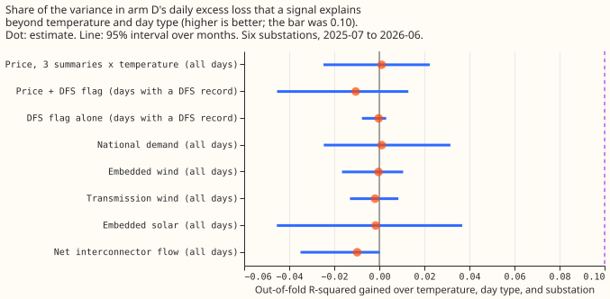
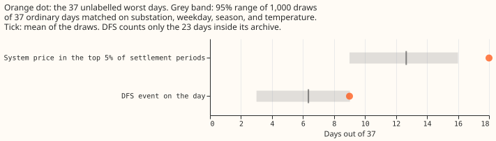
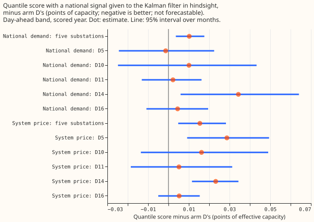

**Take-home message: the national system price, Demand Flexibility Service (DFS) events, and the
other national signals do not explain the bad days of the day-ahead demand forecast.** We asked
whether any of them explains which days the forecast gets most wrong, and whether giving the
forecast's Kalman filter each day's signal value after the event would help it read the past. The
answer to both questions is no. Each signal explains under 1% of the variance in the forecast's
daily error score (out of fold, beyond temperature and day type), and the hindsight test made the
score slightly
worse. The national system price stands out a little on the 37 days with the largest unexplained
error, but the excess fell just short of the pre-registered bar. No national signal explains the bad
days, so local causes remain untested.

**Arm D is the forecast being tested.** It is arm D of [experiment
155](../00155-dp-bg-stage2-assembly-night-offset-and-error-correction/result.md),
a convex demand model with a Kalman filter (the method of [de Vilmarest et al.
(2024)](https://doi.org/10.1109/TPWRS.2023.3310280)) on ensemble weather, for six Primary
substations. A Primary substation steps transmission voltage down to distribution voltage. The "37
worst unlabelled days" are
the 37 substation-days with the largest forecast error that no known cause explains (a switching
event, a holiday, a cold snap, a flagged reading, or an Economy 7 step), taken from experiments
[172](../00172-dp-error-budget-worst-days/result.md) and [175](../00175-dp-unlabelled-day-shapes/result.md).

**The test has three parts.** [Experiment 177](../00177-dp-worst-days-other-data-sources/result.md)
found a high national system price on 18 of those 37 days and a DFS event on 9. Part 1 tests those
two
signals on all 1,683 substation-days of the scored year (2025-07-03 to 2026-06-30). Part 2 tests
five
other national signals: national demand, embedded wind, transmission wind, embedded solar, and net
interconnector flow. Part 3 replays arm D with a signal as an extra input to the filter. The loss of
a day is the mean quantile score (twice the mean pinball loss over 11 quantiles, in points of
effective capacity, where lower is better) of its day-ahead forecasts (lead 15 to 39 hours, the "D+1
band"). **Verdict: refuted.** The pre-registered prediction (a price or DFS signal explaining at
least 10% of the variance beyond temperature and day type) failed.

## Results

- **Part 1, all days.** The price (three summaries, with temperature products) gains +0.001
  out-of-fold R-squared (95% interval -0.025 to +0.022). Price plus the DFS flag, on the 1,231 days
  with a DFS record, gains -0.010 (-0.045 to +0.013). The DFS flag alone gains 0.000 (-0.008 to
  +0.003). The prediction needed +0.10 with an interval above +0.05. Temperature, day type, and
  substation alone have a negative out-of-fold R-squared (-0.030), because the excess loss is
  dominated by a few days.
- **Effect sizes.** Per standard deviation of the signal, price changes arm D's daily excess loss by
  -0.001 (daily mean, -0.050 to +0.060), +0.059 (daily maximum, -0.051 to +0.211), and +0.003
  (evening peak, -0.118 to +0.188) points, and a DFS day changes it by +0.026 (-0.043 to +0.073).
  The signed daily residual (actual minus mean forecast) rises by +0.407 points (+0.180 to +0.859)
  per standard deviation of the daily mean price, so the forecast runs a little low on dear days.
  The other
  price summaries and the DFS flag show no effect (all intervals include zero), and models of the
  signed
  residual do worse out of fold than the baseline (price + DFS -0.100, -0.190 to -0.001).
- **Matched ordinary days.** A high price (top 5% of settlement periods) covers 18 of the 37 days,
  against 12.7 on matched ordinary days (95% range 9 to 16, p = 0.006). The excess is 5.3 days (14.4
  points), just under the 5.6-day (15-point) bar, so the 18-of-37 excess does not pass the
  pre-registered rule. A DFS event covers 9 of the 23 days that have a DFS record, against 6.4 on
  matched ordinary days with
  a record (3 to 9, p = 0.09). Experiment 177's
  month-matched draws gave 14.9 and 8.5.
- **Part 2, other national signals.** Out-of-fold gains over the baseline for all days: national
  demand +0.001 (-0.024 to +0.031), embedded wind 0.000 (-0.016 to +0.010), transmission wind
  -0.002 (-0.013 to +0.009), embedded solar -0.002 (-0.046 to +0.039), net interconnector flow
  -0.010 (-0.038 to 0.000), against price (mean and evening peak) +0.002. No signal beats price:
  every paired difference interval includes zero.
- **Hindsight covariate.** National demand was chosen on the tuning months (gain +0.011, interval
  -0.012 to +0.033, the largest of the seven signals). With it, arm D's day-ahead quantile score at
  the five
  decision substations is 2.437 against 2.427 for the stored arm D, a contrast of +0.010 points
  (95% interval +0.004 to +0.018, worse). The system price (added after the pre-registration, as the
  signal this question is about) scores 2.442, a contrast of +0.015 (+0.005 to +0.028). Over leads
  0.5 to 168 hours the contrasts are +0.003 (-0.004 to +0.011) and +0.017 (+0.004 to +0.030).
  In the day-ahead band, leaving out any one substation never flips a sign, and only the two
  contrasts without D14 include zero. Over all leads the national-demand contrast is within
  +0.006 and -0.001 and includes zero however substations are left out.
- **Tail calibration** (day-ahead band, five substations): arm D covers 2.4%, 7.0%, 94.5%, and 98.2%
  at the 0.01, 0.05, 0.95, and 0.99 levels, and neither hindsight arm moves any of them by more than
  0.15 points of coverage or 0.005 points of pinball loss. The curtailment-cost metric was not run,
  because the hindsight arms score worse and cannot be forecast.

## Post hoc checks

- **Heavy tails.** The excess loss is dominated by a few days, so the out-of-fold R-squared is
  negative for the baseline. With the day's log loss as the outcome and the price ranked, the
  baseline explains 11% and price adds +0.028 (+0.007 to +0.051), which is real but a quarter of
  the bar. With the DFS flag on its covered days, the gain is +0.009 (-0.008 to +0.028). Ranking
  the price against the raw excess gives +0.019 (-0.017 to +0.053).
- **Worst-5% rate.** A day with a top-5% price is a worst-5% day 6.3% of the time, against 4.5%
  without; for a DFS day, 6.2% against 3.3%. The raw rates are small differences between small
  counts.

## Checks

- **Median minus mean forecast, per substation:** 0.000 at each of the five decision substations,
  for arm D and both hindsight arms.
- **Error of the mean forecast beside the score contrast:** the mean absolute error changes by
  +0.023 (national demand, +0.012 to +0.037) and +0.034 (price, +0.013 to +0.059) points, the same
  direction as the quantile score.
- **Audit triggers of the `ml-experiment` skill:** none fired. The control (coefficients at zero)
  reproduced the stored arm D to 0.0
  over 484,113 rows, the prediction held in direction (no signal helps), and in the day-ahead band
  no leave-one-out
  flips a sign.

## Departures from the plan

- **The full price + DFS model uses the 1,231 days with a DFS record** (the archive ends on
  2026-03-27), compared with a baseline on the same days. The matched-day test for DFS uses the 23
  target days inside the archive and ordinary days
  inside it. The p-values add one to the count of draws, so the smallest is 0.001.
- **Coverage of the national data.** Transmission wind comes from Elexon's half-hourly generation
  by fuel, since the NESO file holds only embedded wind. The evening peak is settlement periods 33
  to 38 (16:00 to 19:00 on a 48-period day).
- **Covariates are clipped to plus or minus 4 standard deviations** (fixed before the replay), since
  one settlement period reached 2,900 pounds per megawatt-hour.
- **The two national-demand covariates (daily mean and evening peak) are strongly correlated**, so
  the fitted band coefficients are large and of opposite sign. The replay used the pre-registered
  pair regardless.
- **Departures from forecast-time conditions.** The covariate of the target day is read in
  hindsight (not forecastable), and
  ERA5 day-mean temperature (about 5 days late) is in the Part 1 baseline.
- **Schedule.** Monthly refits of arm A2 as in experiment 136, and the standardisation and
  coefficients use the tuning months only. The contrast could depend on refit cadence.

- **Choices that could favour or hurt the tests.** The spline knots and the signal standardisation
  in
  Part 1 use all days, including the held-out month (no outcome information). The tuning-month site
  median and spread are in-sample, so the tuning increments that chose the Part 3 signal are
  optimistic. The Part 3 replay runs national demand and system price whatever the tuning choice.

## Next steps

- **Local causes** (planned and unplanned outage notices, school terms, and local events) are the
  sources not tested in experiments 177 or 185.
- **A small learned model** of the daily loss on price, temperature, and calendar might find an
  interaction the linear fit cannot, such as a price effect only on cold weekday evenings. The
  prediction that could fail: it adds under 2% out-of-fold R-squared over the baseline, as the
  linear models do.

## Pre-registration (written before any result was read)

- **Data (public, under 100 MB).** Elexon settlement system prices (the cached 2025-07-02 to
  2026-07-01 of experiment 177, plus 2024-07-01 to 2025-07-01 for the tuning months); the NESO
  DFS service-requirement archive; the NESO historic demand data for 2024 to 2026 (national
  demand, transmission system demand, embedded wind and solar generation, wind generation, and the
  interconnector flows).
- **Day definition.** A local (Europe/London) calendar day. Price and national signals are
  aggregated over the local day's settlement periods.
- **Weather at lag times.** The temperature in the Part 1 baseline is the ERA5 day-mean
  temperature of experiment 172. ERA5 arrives about 5 days late, so Part 1 is a diagnosis of past
  days and not a forecast-time model.
- **Part 3 design.** The filter's residual stream is reduced by the coefficient times the
  standardised covariate of the day, per hour band, and each forecast adds back the coefficient
  times
  the covariate of the target day. The covariate is known for the target day only in hindsight.
  Coefficients are fitted on the tuning months and fixed for the scored year.
- **Chosen before results.** The signal for Part 3 is chosen on the tuning months only.
- **Anonymisation.** Demand series only; the sites keep their D labels.
