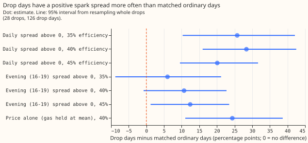
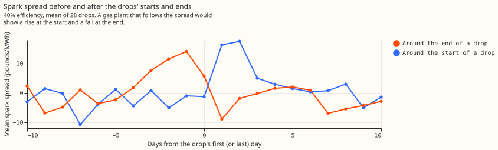
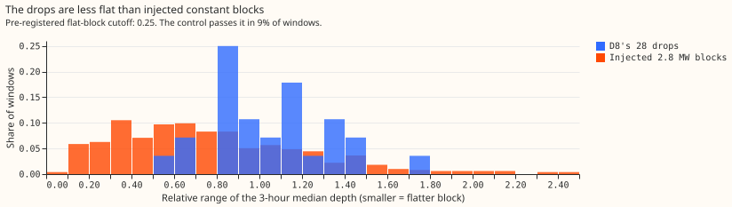

# Experiment 186: are D8's multi-day drops a gas engine following the spark spread?

**Take-home message: the evidence fits a gas engine below D8 that runs when electricity is dear
relative to gas, but does not prove it.** We asked whether D8's multi-day drops in net demand
(experiment 159: 28 drops since July 2023, median depth 2.8 MW) are a gas-fired generator running.
NGED suggested an embedded gas peaker that runs when the spark spread, the system price minus the
cost of the gas it burns, is positive. We built the spread from public data (the Elexon system price
and the National Gas daily gas price), compared drop days with matched ordinary days, and tested
whether the drops are flat on/off blocks, follow Triad half-hours, and sit near a registered gas
plant. The spread test supports the hypothesis, the flat-block test does not, and the Triad test
does not. Because exactly one half of the pre-registered prediction holds, the verdict is `partly
supported`.

**The drops start when the spread rises and end when it falls.** At 40% electrical efficiency,
82% of drop days have a positive daily spread, against 54% of ordinary days matched on weekday,
season, and temperature. The 95% interval of the difference (+28.4 points) runs from +16.0 to +42.5.
Most of this signal is the system price: holding the gas price at its mean still gives +24.4 points.
Experiment 185 found the same price signal on the worst days of the best-guess forecast, so the
spread test cannot separate a gas engine from any other load that follows the system price.

## Results

- **Method.** Public data only (about 22 MB of registers and 2 MB of prices; the National Gas data
  portal item "SAP, hourly actual" for the gas price, and the Elexon system price). Spark spread =
  system price − gas price in pounds per MWh thermal ÷ electrical efficiency − 5 pounds per MWh
  operating cost, at 35%, 40% (central), and 45% efficiency. A drop day has at least 75% of its
  half-hours inside a drop. Window: 2023-07-01 to 2026-06-30, 28 drops, 126 drop days, 839 ordinary
  days. Matching: same weekday, season within ±30 days, day-mean temperature within 2 degrees
  (widened to 4 or 6 if fewer than 3 days match), 1,000 draws, intervals from resampling drops.
- **Spread share.** Drop days minus matched ordinary days, in percentage points: +25.8 (+10.3 to
  +42.1) at 35%, +28.4 (+16.0 to +42.5) at 40%, +20.1 (+9.5 to +31.7) at 45%. The same test on the
  evening spread (16:00 to 19:00): +6.0 (−8.8 to +21.2), +10.7 (−0.8 to +22.7), +12.4 (+1.2 to
  +23.5). Price alone (gas held at its mean, 40%): +24.4 (+11.0 to +38.7). The system price in the top
  third of days: +12.0 (−2.2 to +28.3).
- **Prices.** Mean system price on drop days is 91.3 pounds/MWh against 77.9 on matched days
  (+13.8; +6.7 to +21.2). The gas price does not differ (−0.3 pounds/MWh thermal; −2.4 to +1.6).
- **Start and end.** The mean daily spread (40%) rises by +9.8 pounds/MWh (+2.6 to +16.9) between
  the 5 days before and the 5 days from a drop's first day, in the predicted direction for 20 of 28
  drops. It falls by 7.3 (+2.0 to +12.9 in the predicted direction) between the 5 days before and
  the 5 days after the last day, for 18 of 28 drops.
- **Half-hours inside drops.** After removing each drop's hour-of-day mean, depth is +0.43 MW (+0.32
  to +0.54) deeper in half-hours with a positive spread at 40%, higher in 27 of 28 drops. Without
  that removal, the contrast was +1.0 MW, because positive-spread half-hours cluster in the evening.
- **Shape.** 0 of 28 drops are flat blocks under the pre-registered cutoff (relative interquartile
  range of the 3-hour median depth under 0.25; median 1.06). The control, a constant 2.8 MW block
  injected into 494 ordinary windows of the drops' lengths, has median 0.70 and passes the cutoff
  in 9%. The shape evidence is therefore only that the drops are less flat than injected blocks:
  3 of 28 drops are below the control median. The median share of variance in a drop explained by
  hour of day is 0.51, and the median ramp at the start is 0.55 of the depth (end: 0.81).
- **D3, D14, and D5.** None has a drop under D8's definition (24-hour median under −1.5 MW for
  2 days). Runs under each series' own 5th percentile (9, 5, and 4 runs; median depths 0.4 to 0.8
  MW) have median relative range 0.58 to 0.77 and none passes the cutoff, so these series do not
  contrast with D8 on flatness.
- **Triads.** The nine Triad half-hours of 2023/24 to 2025/26 (list from
  [Modo Energy](https://modoenergy.com/research/en/gb-triads-2025-26-bess-eet-capture-battery-energy-storage-transmission-use-system-charges)
  and [Drax](https://energy.drax.com/insights/triads-up-in-2024-25-spring-update/), which
  reproduce NESO's published lists) are published after the winter ends, so a peaker can only run on
  a forecast of the peak. 1 of 9 falls inside a D8 drop (the start day of one drop), against 10% of
  winter weekdays in a drop (probability of at least 1 by chance: 0.61). Depth at the Triad
  half-hour minus depth at the same period on other winter weekdays outside drops: +0.2 MW (−1.4 to
  +1.8). Winter weekday depth at 16:00 to 19:00 minus other hours inside drops: −0.2 MW (−1.2 to
  +0.8) over 9 drops, against +1.2 MW on winter weekdays outside drops, a feature of the frozen
  convex model's evening shape.
- **Registers.** The Renewable Energy Planning Database (DESNZ, Q2 2026) lists a landfill-gas plant
  of 1.3 MW within 5 km of D8, and gas-fuelled plants (landfill gas, anaerobic digestion) totalling
  8.6 MW within 20 km; none is a natural-gas peaker. The Capacity Market register (NESO, 21 October
  2026) lists a gas plant of 6 MW (reciprocating engines, distribution-connected, delivery years
  2022-23 and 2023-24) at a grid reference 0.5 km from D8's coordinates, and a second unit of 20 MW
  at the same grid reference that the register describes as many generating units controlled
  centrally, so its sites are unknown. A further 20 MW reciprocating-engine unit lies 21.6 km away.
  Plant names are withheld here.
- **Daily regression.** Leaving one month out, adding the spark spread to temperature and season
  terms raises R-squared by +0.034, the gas price alone by +0.033, and the system price alone by
  −0.000, from a baseline of −0.07. The gas price probably proxies for a time trend, because drop
  days and matched days do not differ in gas price.

## Model term

- **Candidate hindsight regressor.** A D8 on/off indicator driven by the daily spread (spread above
  zero at 40% efficiency) could enter D8's training as a hindsight covariate. It explains little: the
  regression gain is +0.034 in out-of-fold R-squared, and 53% of ordinary days also have a positive
  spread.
- **Forecast time.** The indicator cannot be known exactly at forecast time. A spread forecast from
  day-ahead prices (the Elexon day-ahead market index and National Gas's forward price) might serve,
  but the signal is mostly the system price, which a day-ahead forecast does not reproduce.
- **Better data.** The plant's own half-hourly output would settle the hypothesis and give a direct
  regressor.

## Checks

- **Median minus mean forecast, per site.** Not applicable: the experiment scores no forecast.
- **Error of the mean forecast beside each contrast.** Not applicable, for the same reason.
- **Triggers.** Trigger 1 fired: the flat-block control failed, because injected constant blocks
  pass the pre-registered 0.25 cutoff in 9% of windows. The cutoff was too strict for the residual's
  noise, so the 0 of 28 count says only that the drops are less flat than injected blocks. The
  calibrated comparison (3 of 28 drops below the control median) is post hoc. A fresh audit has
  not run, so this page is not for merging yet. Triggers 2 to 7 did not fire: no contradiction with
  experiment 185 (the price signal here is a difference between drop days and matched days, not
  a share of the forecast's daily loss), no nested arms, no sister experiment, and no later design
  depends on this result.
- **Bad gas values.** The daily gas price has two values of 72.8 (2024-07-25) and 63.9
  (2026-06-12) pence per kWh, against a range of 1 to 11 for the others. Both are excluded, and
  4 of the 1,090 days in the window have no spread (a missing price or an excluded gas value). With
  them left in, the "price alone" comparison read +16.7 points and the gas price appeared to add
  about 12 points, which was wrong.
- **Hour of day.** The half-hourly contrast of +1.0 MW fell to +0.43 MW once each drop's hour-of-day
  mean was removed.
- **Efficiency.** The spread result holds at all three efficiencies (+25.8, +28.4, +20.1 points).
- **Lab shortcuts.** The residual comes from the frozen convex model with ERA5 temperature, which is
  not available at forecast time. Drops are defined on that residual, so they inherit its errors.

## What the next experiment should answer

Ask NGED for the plant's name, operator contact, and half-hourly output. With the output, test
whether D8's drops equal the plant's generation, and whether the plant's dispatch follows the
spread. Without the output, no further public-data test can separate a gas engine from other loads
that follow the system price.
