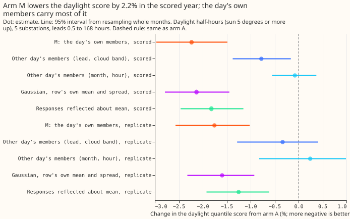
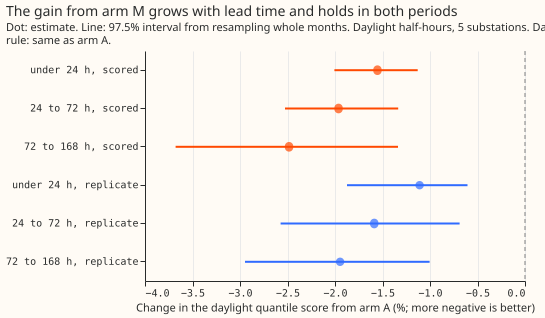
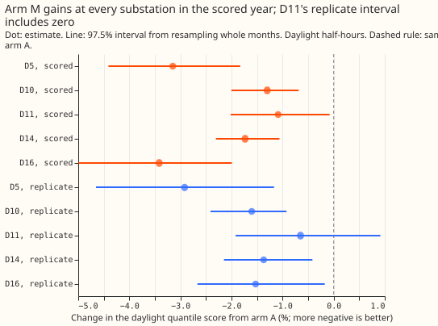

# Experiment 187: ensemble members through the solar term, inside the best-guess stack

**Running each of the 51 ensemble members through the solar part of the demand model still lowers
the daylight forecast score by about 2% in the full best-guess stack, and about two thirds of that
gain needs the day's own members.** The demand forecast's bands are quantiles of its error. Experiment
[184](../00184-dp-ens-daylight-calibration/result.md) found that the disagreement between the 51 members
of the ECMWF ensemble about cloud improves those bands in daylight (the sun 5 degrees or more above
the horizon), but a known-answer check of its fake ensemble failed, so its verdict was capped at
`inconclusive`. The check required each member's solar response to fall as irradiance rises. At low
sun the unit PV shape falls as irradiance rises, so the check was too strict. We replaced it with
a check that the response follows the member's own unit PV shape, which the fake ensemble passes on
every row. We then re-scored the same arms. The re-scoring reproduces experiment 184's numbers exactly,
because its reference (arm A) already is the full stack: the Kalman-filtered model, the winter night
offset, the 14-day error profile of recipe R, experiment 160's spread table, and experiment 164's
cold-day widening. Scores are in points of effective capacity (percentage points of each
substation's rated demand); lower is better.

- **Arms and row set.** A: reference (experiment 184's arm A, 2.7521 points over all rows in the
  scored year). M: arm A's mean plus each member's solar response, with arm A's 11 quantile offsets
  times one factor per lead band (0.95, 0.90, 0.90, 0.85) around each member, pooled over the 51
  members. Row set `fold_a_daily_gap_v1`, D5, D10, D11, D14, and D16 (D9 in no contrast), leads 0.5 to
  168 hours, outside the hand-filtered switching events; scored year 2025-07-02 to 2026-06-29. Mean
  forecasts are experiment 155's monthly refits, so no contrast depends on the retraining schedule.
  Ensemble weather is the stored 51-member forecast of experiment 111, available at forecast time.
- **Re-registered gate G3'.** The response is the fitted solar coefficient times the difference
  between the member's unit PV shape and the ensemble mean's, so it must be non-increasing in the
  member's unit PV shape. It holds on 1,058 of 1,058 daylight rows of the fake ensemble (the CAMS
  irradiance of 6 scored runs at D10 times 51 multipliers from 0.6 to 1.4). The multiplier-1
  member's response is 2e-14 points and night responses are zero. The old irradiance-monotone check
  holds on 1,036 rows; all 22 failures are at elevations under 17 degrees, and all 1,002 rows at 17
  degrees or more pass.
- **Headline C1 (daylight, change from arm A, 95% interval).** Scored year -2.23% (-2.97% to
  -1.48%), replicate months -1.76% (-2.57% to -1.02%). Night 0.00% in both periods, because the arm
  changes only daylight rows. The daylight q05-to-q95 coverage (nominal 0.90) is 0.894 for M against
  0.854 for A in the scored year, and 0.901 against 0.871 in the replicate months. The rule is met in
  both periods.
- **Absolute scores (quantile score).** Scored year, daylight A 3.632, M 3.551; night 1.981; all rows
  A 2.752, M 2.715. Replicate months, daylight A 3.453, M 3.392; night 2.027.
- **By lead band (daylight, A to M, scored year).** Under 24 hours 3.095 to 3.047 (-1.55%); 24 to 72
  hours 3.343 to 3.278 (-1.96%); 72 to 168 hours 3.906 to 3.809 (-2.48%); 12 to 36 hours 3.227 to
  3.169 (-1.82%).
- **By clear-sky band of the ensemble-mean irradiance (scored year).** Overcast (under 0.4) 3.127 to
  3.094 (-1.04%); partly cloudy (0.4 to 0.7) 3.861 to 3.756 (-2.71%); clear (0.7 and over) 3.483 to
  3.417 (-1.87%).
- **By substation (daylight, A to M, scored year).** D5 5.294 to 5.127 (-3.15%); D10 3.983 to 3.931
  (-1.30%); D11 2.794 to 2.763 (-1.09%); D14 2.855 to 2.805 (-1.73%); D16 3.354 to 3.240 (-3.42%).
  Without D5, -1.89%. In the replicate months D11 is -0.65% with an interval that includes zero
  (-1.92% to +0.91%).
- **Placebo shares (the percentage of M's daylight gain that each placebo recovers; scored year,
  replicate months).** Members from another day of the same substation, month, and hour band (MP):
  3%, -14%. Members from another day of the same lead day and cloud band as well (the stricter
  shuffle): 35% (-0.78%), 19% (-0.33%). A Gaussian with each row's own mean and spread of the
  responses: 95% (-2.13%), 91% (-1.60%). The responses reflected about their mean, which reverses
  the skew: 81% (-1.82%), 71% (-1.25%). So 65% (81%) of the gain needs the day's own members, and
  the size of the spread across the members carries nearly all of the gain, with the skew worth
  about 0.4 points.
- **Gap to BG2 on the sunniest third of daylight half-hours (mean absolute error of the median, five
  substations, 74,728 half-hours).** Arm A +0.044 MW (95% interval +0.007 to +0.072); M +0.026 MW
  (-0.020 to +0.059). Without D5: A +0.007, M -0.008 MW. At D5: A +0.202, M +0.170 MW, so D5 still
  holds most of what remains.
- **Tails (daylight, scored year; coverage / pinball loss).** A: q01 0.027 / 0.265, q05 0.078 /
  0.907, q95 0.933 / 0.924, q99 0.979 / 0.262. M: 0.013 / 0.230, 0.053 / 0.837, 0.947 / 0.880,
  0.986 / 0.243. The gain is largest in the lower tail.
- **Checks.** The median forecast minus the mean forecast at 12 to 36 hours is exactly 0.000 for arm
  A, and -0.14 (D5), -0.05 (D10), -0.05 (D11), -0.05 (D14), and -0.05 (D16) points for M, because the
  members' skewed responses pull the mixture median below the mean. The mean forecast's own daylight
  error changes by -0.13% (-0.45% to +0.27%) for M, the same direction as the score. No trigger from
  the audit rules fired in this experiment: no control failed, the quantile-score and mean-error
  contrasts agree in direction, the earlier null of experiment 169 was explained in experiment 184,
  and the control that should change nothing (the rescaling without members, MR) moves the score by
  -0.23% against a half-width of 0.26. The re-scoring reproduces experiment 184's numbers, so
  experiment 184's Opus audit (no leakage found, month-block bootstrap checked, C1 negative leaving
  out any substation or month) covers the same stored arrays.
- **Caveats.** This is a re-derivation: experiment 184's scores for M were known before the rule was
  registered, so only the gate and the placebo shares are new. The member pass adds a 51-member solar
  response and four fitted factors to the weather layer. The replicate months hold 6 months, so their
  intervals are wide. D5 and D16 give the largest gains; D11's replicate interval includes zero.
- **Prediction check.** Every part held. G3' passed on every row. Both intervals lie wholly below
  zero with point estimates under -1%. Night moved by 0.00%. Coverage lies within 0.02 of 0.90. The
  stricter-shuffle share fell in the predicted 25% to 45% range in the scored year (35%) and below it
  in the replicate months (19%).
- **Optional neural arm.** Not run. A Gaussian with the row's own mean and spread already recovers
  95% of the gain, so a learned scale on the spread has about 0.1 points of headroom in daylight.
- **What to try next.** (1) Replace the 51-member pass by a per-half-hour mean and standard deviation
  of the member responses, computed from the ensemble mean and the member irradiance spread, and test
  whether it keeps the gain (prediction that could fail: it keeps at least 80% of -2.2%). (2) Check the
  production cost of the member pass. (3) Test the member pass on the curtailment-cost metric of
  `studies.node_curtailment`, because the gain is largest in the lower tail.
