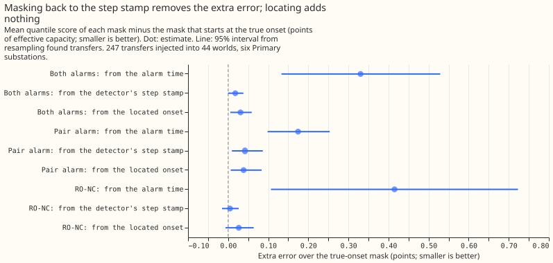
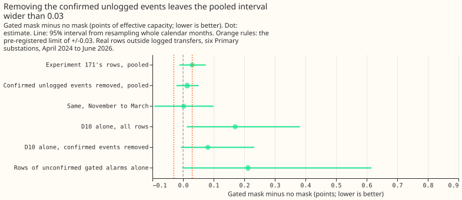
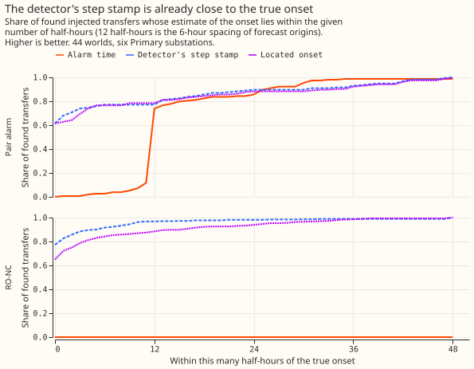

**Masking back to the detector's own step stamp removes almost all the extra error of masking only
from the alarm time, and a search of the readings since the last forecast for a more precise onset
adds nothing.** Part 2 meets its pre-registered rule (`supported`), but its comparison arm, masking
from the alarm time, is an arm that experiment 171 never used. Part 1 misses its rule
(`inconclusive`): the interval of the gated mask's difference from no mask is not inside +/-0.03.
The overall verdict, `partly supported`, is a judgement, because the plan registered a verdict for
each part only.

**Background: what a mask is.** Our forecast corrects itself using recent power. A "mask" sets
recent power aside while a switching alarm is active. A pair alarm is a step in power at one
substation matched by an opposite step at a neighbouring metered substation. A gated alarm is a
pair alarm whose balance score is 0.7 or more, meaning the two steps are close in size. RO-NC is the
detector of [experiment 147](../00147-causal-live-end-rule-for-ro-nc/result.md), which fires on a
step in a refitted residual with support from neighbouring series. A step stamp is the half-hourly
timestamp at which a detector says the step happened. The alarm time is the later timestamp at
which the alarm became known: about 6 hours after the step for the pair alarm (a median of 12
half-hours), and 48 hours for RO-NC (96 half-hours). The look-back is the readings between the step
and the forecast origin, the moment a forecast run is issued (every 6 hours in production).

**Background: what experiment 171 found and what we asked.** [Experiment
171](../00171-switching-gated-mask-no-harm-pooled-months/result.md) found that the gated mask scores
0.030 points of effective capacity worse than no mask on 27 months of rows outside logged transfers
(95% interval -0.011 to +0.074), and that leaving out one substation, D10, removes the difference.
Scores are twice the mean pinball loss over 11 quantiles, in points of effective capacity (the
score in megawatts over the substation's AC capacity, times 100). A logged transfer is a movement of
load between two substations recorded in the switching log of National Grid Electricity
Distribution (NGED). The six substations scored, anonymised as D5, D9, D10, D11, D14, and D16, are
Primary substations. **Part 1** asked whether D10's gated alarms follow switching that NGED did not
log. **Part 2** asked whether the onset of a transfer can be located more precisely in the look-back
than the alarm time gives, and whether masking from the located onset beats masking from the alarm
time.

**Part 1 method.** Of the 49 gated alarms since 2024-04-10, 40 touch a scored substation, and 31 of
those match no logged transfer. We confirmed an alarm when a persistent step (the median residual
over the 12 hours after the alarm's step stamp minus the median over the 12 hours before) at its
substation had an opposite step of similar size (0.5 to 2 times) at its partner substations, using
thresholds fixed in the plan. We removed the rows from the step to 72 hours after each confirmed
event and re-scored experiment 171's rows with the same quantile score and the same
month-resampled interval. A row is one forecast for one half-hour from one forecast origin. The
forecast is a frozen generalised additive model with a [Kalman
filter](https://doi.org/10.1115/1.3662552), as in experiment 171.

**Part 2 method.** Experiment 141's 44 worlds hold 210 injected transfers, and the two alarms find
them 247 times in total (a transfer found by both alarms counts twice). We score those 247 matches
and 15 logged transfers found by an alarm. At the first 6-hourly origin that can see an alarm, we
searched the stamps within 24 hours of the detector's step stamp for the largest step with the
same sign as the alarm's step, using only readings up to that origin. The stamp found is the
"located" onset. Four masks differ only in the first masked stamp: the alarm time, the detector's
step stamp, the located onset, and the true onset. The extra error of a mask is its score minus the
score of the mask from the true onset, in points of effective capacity, on all leads of the daily
forecast issued in the first 24 hours after the alarm. C2 is the share of the alarm-time mask's
extra error that another mask removes: 1 minus the extra error of that mask over the extra error of
the alarm-time mask.

## Results

- **Part 2, decisive contrast C2 (injected, both alarms, 247 transfers).** Extra error over the
  true-onset mask: alarm time +0.330 (+0.133 to +0.529), step stamp +0.018 (0.000 to +0.038),
  located onset +0.031 (+0.005 to +0.059). Reduction from the alarm time to the located onset:
  0.907 (0.735 to 0.984), against the pre-registered 1/3. Verdict for part 2: `supported`.
- **What C2 does not show.** The step stamp gives a reduction of 0.946 (0.832 to 1.001), and the
  located onset minus the step stamp is +0.013 (-0.008 to +0.037) points. The located onset is no
  better, so the gain comes from masking back to the detector's step stamp, which experiment 171
  already does.
- **By alarm.** Pair alarm (87 transfers): reduction 0.779 (0.519 to 0.961); extra error alarm time
  +0.175, step stamp +0.042, located +0.039. RO-NC (160 transfers): reduction 0.936 (0.725 to
  1.021); extra error alarm time +0.415, step stamp +0.005, located +0.027.
- **Absolute scores, injected, both alarms.** No mask 3.328, mask from the alarm time 3.127, step
  stamp 2.815, located onset 2.828, true onset 2.797, and the stream without the injected
  megawatts 2.483. Masking from the alarm time barely beats no mask because the readings since the
  step, which carry the transfer, stay in the filter.
- **Location error, injected (half-hours; median |error| / 90th percentile).** Alarm time: pair
  12.0 / 25.8, RO-NC 96.0 / 97.0. Step stamp: pair 0.0 / 29.6, RO-NC 0.0 / 5.1. Located onset: pair
  0.0 / 33.6, RO-NC 0.0 / 16.0. The median located error is 0 half-hours, well below the
  12-half-hour (6-hour) spacing of forecast origins. The located onset is closer than the step stamp
  for 10% (pair) and 14% (RO-NC) of transfers and farther for 14% and 26%.
- **Sensitivity (post hoc).** Resampling the 39 worlds with scored transfers (of 44) gives 0.907
  (0.747 to 0.974). Leaving out any one substation leaves the reduction between 0.88 and 0.97. D10
  alone, 14 transfers: 0.780 (-0.351 to 0.965).
- **Real logged transfers (secondary, decide nothing).** 9 transfers found by the pair alarm and 6
  by RO-NC. Pair alarm: extra error over the true-onset mask alarm time -0.027 (-0.713 to +0.677),
  step stamp +0.151, located +0.095. RO-NC: alarm time -1.536, step stamp +2.991, located +2.742
  (all intervals include 0 except the RO-NC difference between alarm time and located onset, -4.279,
  -6.881 to -1.590). On 6 transfers RO-NC's mask from the step stamp scores 12.949 against 8.298
  with no mask, as in experiment 156.
- **Part 1, pre-registered contrast.** Experiment 171's rows reproduce at +0.030 (-0.012 to +0.074,
  1,579,711 rows; experiment 171 printed -0.011 for the lower end, because this experiment uses
  a different bootstrap seed). With 8 confirmed unlogged events removed (1,543,752 rows) the pooled
  difference is +0.014 (-0.022 to +0.051), half-width 0.036 against the limit of 0.03. November to
  March: +0.002 (-0.094 to +0.100), half-width 0.097 against 0.05. G1' and G2' both fail and the
  point estimate is below +0.03, so the verdict for part 1 is `inconclusive`, and the prediction
  that the interval would fall inside +/-0.03 failed.
- **Part 1, how many alarms were confirmed.** 8 of the 31 unlogged gated alarms at a decision
  substation (the plan's candidates). The same rule applied at whole-week shifts of each alarm's
  stamp confirms 5.6%, a placebo share that estimates how often the rule confirms an alarm by
  chance. Unlogged and confirmed per substation (gated alarm intervals on the substation's series,
  so one alarm counts at each substation it touches; 50 unlogged intervals from 31 alarms, and 10
  confirmed intervals from 8 alarms): D5 6 and 2, D9 0 and 0, D10 13 and 3, D11 14 and 0, D14 14 and
  4, D16 3 and 1.
- **Part 1, where the harm is.** Rows of confirmed events alone: +0.726 (-0.011 to +1.191). Rows of
  unconfirmed gated alarms alone: +0.212 (-0.002 to +0.615). D10 alone: +0.170 (+0.012 to +0.382)
  before and +0.081 (-0.007 to +0.232) after removal. So the point estimate stays positive where the
  independent test finds no matching opposite step, but its interval includes 0.
- **Tail calibration (injected rows; coverage at q01 / q05 / q95 / q99, nominal 0.01 / 0.05 / 0.95
  / 0.99).** No mask 0.032 / 0.066 / 0.875 / 0.952. Alarm time 0.024 / 0.059 / 0.888 / 0.962. Step
  stamp 0.029 / 0.080 / 0.962 / 0.990. Located onset 0.029 / 0.080 / 0.962 / 0.991 (true onset
  0.029 / 0.081 / 0.964 / 0.991). Every masked arm covers the upper tail better than no mask, and
  the step stamp, located, and true-onset arms over-cover the lower q05 more (0.080 against 0.066,
  nominal 0.05). The curtailment-cost metric was not scored, because the experiment scores single
  substations and the metric needs a node and its generators.

## Checks

- **Median minus mean forecast, per substation (located-onset arm, part 2 rows).** D10 -0.110, D11
  -0.055, D14 +0.022, D16 +0.035, D5 -0.367, D9 -0.074 points. The part 1 values are
  those of experiment 171.
- **Error of the mean forecast beside the quantile contrast.** Part 2, alarm time minus located
  onset: +0.556 (+0.253 to +0.873) in the mean absolute error, the same direction as the quantile
  score. Part 1 reuses experiment 171's score tables, and its mean-forecast check (+0.064) was not
  recomputed after the removal.
- **Audit triggers.** None fired on the injected rows. On the 15 real transfers the true-onset
  mask (7.695) scores worse than no mask (6.899) and worse than the alarm-time mask (7.065), so
  the true-onset mask is not a floor on real data; those rows decide nothing. No control failed, the
  result does not contradict an earlier finding or the prediction, the quantile and mean-forecast
  contrasts agree, leaving one substation out changes no verdict, and no nested arm beats the arm
  that contains it. The interval of part 1 (half-width 0.036) is 0.86 of experiment 171's 0.042. No
  audit was run.

## Caveats

- **The alarm-time mask is a comparison arm, not an earlier design.** Experiment 171 already masks
  from the detector's step stamp, so C2 mainly shows what masking back to the step is worth.
- **Part 1's removal lowers the contrast by construction.** Rows with a gated alarm active carry the
  whole difference, so removing confirmed events removes some of it. The informative results are
  the small confirmed share, the 5.6% placebo share, and the harm that stays on unconfirmed alarms.
- **The confirmation rule has no positive control.** Its recall was not measured on logged
  transfers or injected events, so a low confirmed share could also mean a low-power rule. The
  5.6% placebo share bounds only the chance rate.
- **The confirmation rule is one choice.** A looser step test, or one that used the metered
  neighbours' own power, could confirm more alarms.
- **Counts of transfers.** The 247 injected transfers are (world, substation, transfer, alarm)
  rows, 210 distinct (world, substation, transfer) combinations, because a transfer found by both
  alarms counts once for each; the pooled interval treats them as independent, and the
  whole-world resampling partly covers this. The location errors are over all 153 pair-alarm and
  430 RO-NC matches, of which 87 and 160 have scored forecast rows.
- **The step stamp's location error is truncated.** An alarm counts as finding a transfer only when
  its step stamp lies within 24 hours of the true onset, so the step stamp's error cannot exceed
  48 half-hours, while the located onset (searched 24 hours either side of the step stamp) can.
  That truncation favours the step stamp in the location comparison.
- **The alarm-time mask starts at the known stamp.** The plan said the first usable origin's
  newest stamp; the code masks from the known stamp, up to 11 half-hours earlier (mean 5.0 to 5.7).
  That makes the alarm-time arm slightly better than registered and biases C2 downward.
- **Overlapping alarms.** Every alarm at a substation is applied to every scored row there, so a
  row scored for one transfer can see another alarm's located onset, computed from readings up to
  11 half-hours after that row's cutoff. The share of rows affected was not counted.
- **The overall verdict is a judgement.** The plan registered a verdict for each part only.
- **The real logged transfers are few.** 15 transfers found by an alarm, and the logged onset is
  coarser than a half-hour.
- **Lab shortcuts.** The residual comes from the analysis proxy (a weather estimate for the recent
  past), the transfers are injected as constant-weight shares, and the end rule is that of
  experiments 147 and 148.
- **The forecasts are daily.** A 6-hourly cadence is simulated by taking, per found transfer, the
  one daily run whose newest stamp lies in the first 24 hours after the first origin that sees the
  alarm. The located onset is computed once, at that first origin.
- **The retraining schedule does not affect the contrasts.** The cached forecasts are the frozen
  stack of experiment 171, with no refitting, so the contrasts do not depend on a retraining
  schedule.

## What the next experiment should answer

The next question is why D10's gated alarms raise the error when most of them match no opposite
step: whether they are false alarms that a stricter gate would drop, which would show in a
gate tuned on the rows with an active alarm. Showing no harm needs about 54 months of forecasts, as
in experiment 171.
