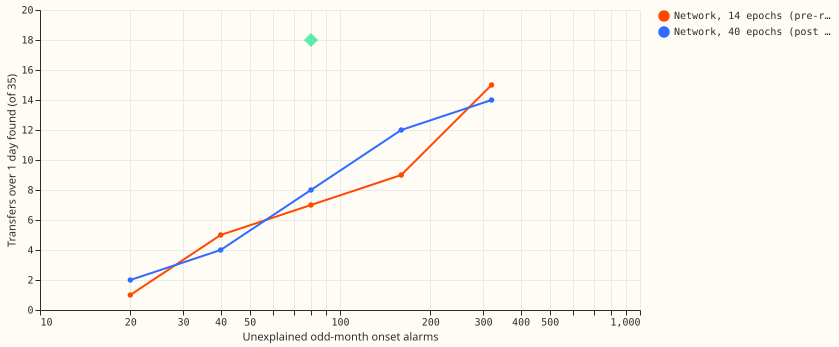
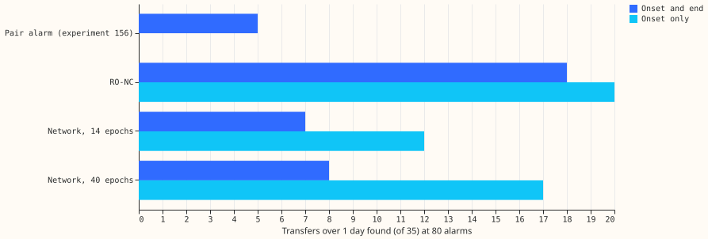
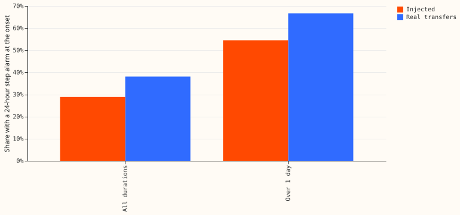

# Experiment 189: can a small neural network, trained on realistic injected transfers, find real switching?

**A small neural network (33,604 learned weights), trained only on synthetic transfers, found 7 of
the 35 real transfers that lasted longer than 1 day. The rule-based detector RO-NC found 18.** A
transfer is a period, labelled by hand in [experiment
41](../00041-sw2-0a-labeller-gate/result.md), in which switching moved load from one Primary
substation (a substation that steps transmission voltage down to distribution voltage) to
neighbouring Primary substations. A transfer counts as found when an alarm falls within 2 hours of
its start and the alarm's end falls within the larger of 6 hours and 10% of its duration of the
true end. RO-NC is the refit-offset neighbour-count detector of [experiment
82](../00082-sw2-18-19-combined-refit-offset-and-same-sign-count/result.md), scored at 80 unexplained
alarms in [experiment 181](../00181-switching-block-detector-and-like-for-like-table/result.md): an
unexplained alarm is one not near a logged closure or labelled transfer, and the count is over
odd-numbered months.

We built an injector that adds synthetic transfers to the real residuals (observed minus forecast
power from the convex demand model of [experiment
130](../00130-ro-nc-detector-on-the-gam-k-residual/result.md)). Its depth, duration, start time,
shape, and receivers are fitted to the real events. We trained the network on 7-day windows of one
Primary substation's residual and its neighbours', and scored it on real transfers of Primary pairs
it had never seen. The verdict is `refuted`, because the pre-registered prediction was at least 15
found. **The start of a transfer is learnable, and the end is the weak part.** The network placed
the start within 2 hours for 12 of the 35 transfers (17 after a second, longer training run),
against 20 for RO-NC, and the median start error among transfers found was 0.5 hours.

## Results

- **Architecture.** Dilated one-dimensional convolutions, 33,604 weights. Inputs: 336 half-hours of
  the Primary's residual and the four most-read neighbours' (each divided by its noise unit, with a
  present-or-not channel), the hour of day, and a bank-holiday flag. Outputs: a start alarm, an end
  alarm, and a per-half-hour map for each. The network assigns each onset alarm the earliest end
  alarm after it as its end.
- **Training data.** D8 and D9 are two of the 16 Primary substations. Windows come from
  even-numbered months only: 80,000 windows per fold (40% with an injected transfer, the rest real
  stretches with no logged or labelled event, a fifth near bank holidays, a fifth on D8, a fifth on
  D9). The network never sees a real event.
- **Folds.** The 66 labelled transfers fall in 23 Primary pairs, grouped into 3 folds. Each fold's
  network and injector are fitted without that fold's pairs (including D8 drops that overlap them).
- **Real transfers over 1 day (35), 80 unexplained odd-month alarms, experiment 130's rule (start
  within 2 hours, end within the larger of 6 hours and 10%):**

| Detector | Start and end found | Start only found |
|---|---|---|
| Pair alarm (experiment 156, quoted) | 5 | not run |
| RO-NC on the convex residual | 18 | 20 |
| Network, 14 epochs (pre-registered, seed 0) | 7 | 12 |
| Network, 40 epochs (post hoc, seed 1) | 8 | 17 |

- **All 66 labelled transfers:** the 14-epoch network finds 12 (start only 23) and the 40-epoch
  network 19 (start only 31), against 18 for RO-NC. The 31 transfers of 24 hours or less are
  mostly found by start alone.
- **Found against alarms (35 transfers).** Pre-registered network at 20, 40, 80, 160, and 320
  alarms: 1, 5, 7, 9, 15. Post hoc network: 2, 4, 8, 12, 14.
- **Median start error of found transfers:** 0.5 hours (both networks).
- **Injected transfers (odd months, same thresholds), start and end found:** 21% to 34% for the
  14-epoch network (21% on Primary pairs it never saw, 34% on the pairs the injector was fitted on),
  21% to 23% for the 40-epoch network. The network is as weak on injected as on real transfers, so
  the failure is not that the injector is easier than the real events.
- **Realism check 1.** A logistic regression on nine features measured from the residual (log depth
  in noise units and in MW, log duration, start hour as sine and cosine, weekend flag, day-night
  difference, count of opposite neighbours, balance, series count) separates real from injected
  events with area under the curve 0.59 (95% 0.52 to 0.66; 63 real events against 336 injected). The
  point estimate meets the pre-registered limit of 0.65, the upper end of the interval does not.
- **Realism check 2.** A stand-in for RO-NC (a 24-hour step above its threshold) has onset recall
  67% on real transfers over 1 day and 54% on injected ones, a gap of 12 points against the
  pre-registered tolerance of 10; for all durations the gap is 9 points (38% against 29%). The
  injected events are slightly harder than the real ones. The check therefore marginally fails for
  transfers over 1 day.
- **17 unlabelled block days of experiment 175.** Each fold's network is scored on all 17 days at 80
  alarms. The 14-epoch networks find 1, 0, and 0 days, the 40-epoch networks find 1, 1, and 1, and
  the block detector of experiment 181 found 0.

## Checks

- **Median minus mean forecast, mean-forecast error, tail calibration, curtailment cost:** not
  applicable, because no forecast is scored.
- **Triggers.** Trigger 2 fired (the result contradicts its prediction of at least 15). The
  explanation tested here is that the injector might be too easy: it is not, because the network
  also fails on injected transfers. No Opus audit was run (the Sonnet leakage review is below). The
  other six audit triggers of the `ml-experiment` skill did not fire; the check that leaves one site
  out was not run.

## Review and deviations

- **A Sonnet code review found a leak, fixed before scoring:** D8 drops overlapping two labelled
  transfers entered every fold's injector fit. Drops that overlap a held-out transfer are now
  excluded. A second fix: an all-missing donor window produced NaN inputs.
- **Reviewer findings not acted on.** The threshold ignores alarms inside labelled spans and gives
  the end alarm its own 80-alarm budget, so the combined budget is looser than RO-NC's; this favours
  the network, which still fails. Early stopping used even-month windows after the review. The
  classifier features cannot see edge sharpness or noise; a convolutional discriminator on raw
  windows would be a stronger test. The stand-in's threshold was tuned on the same real events.
  Logged closures at a held-out Primary with a different side tuple are not excluded from the
  duration fit.
- **Post hoc.** The 40-epoch run (seed 1) was added after the 14-epoch run failed; its validation
  loss was not lower, so it is a second draw and not an improvement. Only seed 0 is pre-registered.
- **Lab shortcuts.** The residual uses ERA5 weather, which arrives about 5 days late. The end alarm
  uses the days after the end (hindsight). Transfers are injected into the residual, not the power.
- **Not done.** The brief's optional learned alarm reliability classifier (item 2).
- **Interim report.** The experiment manager's session was inactive, so no interim message was sent.

## What to try next

One option is to pair the learned start alarm with RO-NC's end rule, because the start alone finds
12 to 17 transfers and the end is where the network fails. Another is a window long enough to hold
the end of a multi-day transfer, with the injector's durations fitted to the labelled transfers only.

Code: `ml-experiments/00189-switching-neural-onset-end-block-detector/`; numbers are printed to
`printed_realism.txt`, `printed_score_seed0.json`, and `printed_score_seed1.json` in that folder.
