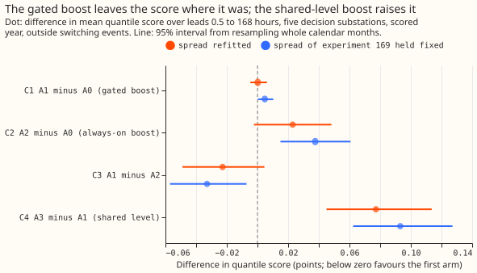
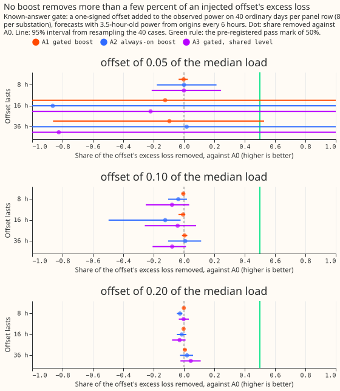
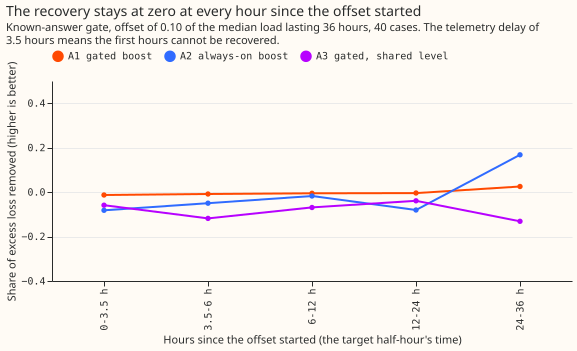
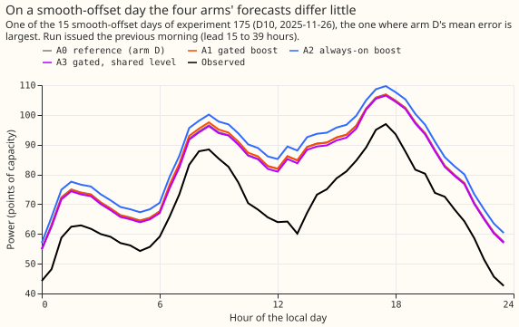

# Faster Kalman level state when the residual keeps one sign

---

**Take-home: a faster level state does not rescue the forecast on days when the residual keeps one
sign.** The gated version scored the same as the current filter, the always-on version scored worse,
and the known-answer gate failed, so the filter's speed is not the limit. The next lever is the mean
model or a new input.

We asked whether a Kalman filter that speeds up its level state when the recent forecast errors keep
one sign cuts the loss on days like those, without harming ordinary days. The filter is that of the
convex demand model ([experiment
111](../00111-differentiable-physics-6-ens-forecast-engine-against-bg2/result.md)),
and the forecast it corrects is the best-guess forecast of
[experiment 155](../00155-dp-bg-stage2-assembly-night-offset-and-error-correction/result.md) (arm
D).
We first added a known one-signed offset to the observed power of ordinary days and measured how
much
of its extra loss each filter removed. We then scored the filters on the real scored year at the
five
decision Primaries. The tested method is a variant of the Kalman filter on additive-model
coefficients, not a method of ours. Arm D is rebuilt here bit for bit (2.7562 against 2.7562).

**Verdict: `inconclusive`, by the pre-registered rule that a failed gate caps the verdict.** The
gate
asked for at least 50% recovery at the 0.10 size for 16-hour and 36-hour offsets. The gated boost
recovered -0.6% (95% interval -3.5% to +0.8%) and +0.4% (-1.3% to +2.2%).

## Arms and method

- **A0:** arm D of experiment 155: the T-all fits on the ensemble-mean weather (experiment 136's
  A2), the
  winter night offset, and recipe R, with the spread refitted on the tuning months.
- **A1, A2, A3:** only the level's process noise changes, as in the plan. A1 multiplies it by m
  while the
  counter is on. A2 multiplies it at every reading. A3 is A1 with the level increment shared across
  the four hour bands. The counter reads the one-step innovations in time order across bands.
- **Tuning:** the grid of 18 settings was scored on the odd tuning months of 2024-07 to 2025-06 at
  stage 1, with A0's spread held fixed. The pre-registered point (m 5, k 6, z 1.0) scored 2.7506
  against A0's 2.7486. The best cell (m 5, k 8, z 0.5) scored 2.7450, 0.0056 below the
  pre-registered
  point, which passes the 0.005 rule, so the frozen setting is **m 5, k 8, z 0.5**.
- **Row set:** `fold_a_daily_gap_v1`, the five decision Primaries (D5, D10, D11, D14, D16),
  leads 0.5 to 168 hours, 464,363 rows outside switching events. Telemetry delay 3.5 hours.
  Retraining
  schedule: monthly T-all fits stored by experiment 136; the contrast could depend on the
  schedule only through the filter's residuals, which every arm shares.
- **Gate (lab shortcuts):** offsets of 0.05, 0.10, and 0.20 of the day's median load lasting 8, 16,
  and 36 hours, 8 days per substation per cell (40 per cell), on days of the even months. The
  forecast
  of a half-hour is the proxy-weather prediction plus the filter's correction, with origins every 6
  hours. The loss uses a quantile table from the clean tuning-month errors. A matched 40 days
  without injection show the harm.

## Results

**Scores, scored year, quantile score in points (lower is better):**

- A0 2.7562, A1 2.7564, A2 2.7791, A3 2.8336 (spread refitted). Stage-1 versions: 2.7910, 2.7904,
  2.8232, 2.8969.
- With experiment 169's calibrated spread held fixed: A0 2.7521, A1 2.7568, A2 2.7897, A3 2.8499.
- C1 A1 minus A0: +0.0002 (95% interval -0.0046 to +0.0062; 1 of 5 substations better). With the
  fixed spread: +0.0048 (+0.0004 to +0.0103), a small loss.
- C2 A2 minus A0: +0.0229 (-0.0023 to +0.0482). C3 A1 minus A2: -0.0227 (-0.0489 to +0.0045). C4 A3
  minus A1: +0.0773 (+0.0450 to +0.1136; 0 of 5 substations better).
- The gate's counter was on for 0.6% to 1.2% of readings at the five substations (326 to 585
  triggers).

**Pre-registered predictions:**

- **P1 fails.** On the 15 smooth-offset days of experiment 175, A1 changed the excess loss by -1.4%
  (interval -2.5% to +0.3%); a cut of 20% was predicted.
- **P2 holds with the refitted spread.** A1 minus A0 is +0.0002 and the upper bound is +0.0062. With
  the
  fixed spread the upper bound is +0.0103, just above the +0.01 limit.
- **P3 holds on the point estimate.** A1 beats A2 by 0.023 points, with an interval that includes
  zero
  (excluding it with the fixed spread: -0.033, -0.057 to -0.007).
- **P4 fails.** A3 changed the excess loss on the smooth-offset days by -9.5% (-20.4% to +6.4%),
  worse than A1.
- **P5 holds.** On the 17 block days A1 cut the excess loss by 1.5% (+0.1% to +3.7%).

**Known-answer gate:**

- A1 recovered -0.4%, -0.6%, and +0.4% of the offset's excess loss at the 0.10 size for 8, 16, and
  36
  hours. At the 0.20 size the values for A1 were within about 3% of zero.
- The excess loss of A0 at the 0.10 size was 1.5, 1.0, and 0.9 points of quantile score, so there
  was
  loss to recover.
- A1 minus A0 on the 40 left-alone days: -0.001 points (-0.014 to +0.014); A2 +0.079 (+0.001 to
  +0.159); A3 +0.015 (-0.074 to +0.111).
- Post hoc, a multiplier of 100 on A1, A2, and A3 recovered no more (-1.1 to +0.1 at the 0.10 and
  0.20 sizes, 40 cases per cell).
- Wiring check (`e00190_wiring_check.py`): on a stream with no noise, A0 follows a 7.8-point offset
  to
  between 4.9 and 7.1 points, A1 to between 5.2 and 7.1, and A3 reaches the bands whose own
  windows have not been read (8.6 in one band). The code works; the real residual's noise is what
  limits recovery.

## Checks

- Median forecast minus mean forecast per site: 0.00 at every site and arm.
- Mean-forecast error beside the quantile score: C1 on the mean absolute error is +0.0060 (-0.0011
  to
  +0.0139), the same direction as the quantile score; C3 is -0.0567 (-0.0971 to -0.0157).
- Tails (all rows, q95 coverage 0.947 to 0.949 for every arm; q99 0.983 to 0.984). On the 5,395
  cold-night
  rows: q95 coverage 0.837 (A0), 0.841 (A1), 0.858 (A2), 0.763 (A3); quantile score 3.342, 3.317,
  3.309,
  3.765.
- Rows within 24 hours after a trigger (194,765 rows): C1 +0.0009 (-0.0060 to +0.0083).
- Audit triggers: trigger 1 fired (the known-answer gate failed). The failure was explained by the
  noise in the residual and tested by the wiring check above, and a fresh Opus audit has not been
  run.
- Curtailment cost was not scored: this experiment has no generator forecasts to feed the
  node-plus-generators metric.

## Caveats

- The gate runs on the proxy-weather forecast, not on ensemble weather, so it removes weather error
  from the
  comparison and makes recovery easier than in the real forecast.
- The counter's rule is one of several defensible gates, but no setting tried, up to 100 times the
  noise,
  recovered an offset.
- Tuning used the stage-1 score, not arm D's, to keep the 18 settings cheap.

## What to try next

- Look at the mean model: on the plotted day every arm forecasts about 10 points too high all day,
  so the
  error is in the weather-driven part or a missing input, as experiment 175 suggested.
- A small learned correction that reads whether several neighbouring Primaries show the same-sign
  residual
  (a neural head on the filter's innovations). The prediction that could fail: it recovers at least
  20%
  of the excess loss on the 15 smooth-offset days, which none of the four filters here did.
