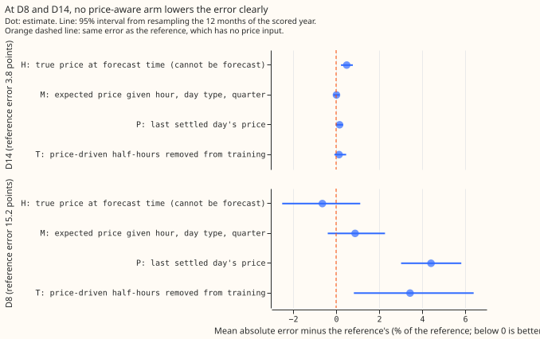
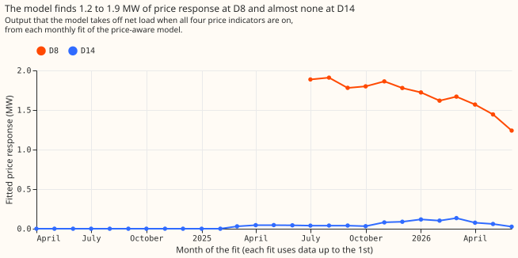

# Experiment 191: can price-following assets be modelled in the history so the forecast improves?

**Take-home message: modelling a price-following asset in the history does not improve the forecast
at D8 or D14.** D8 and D14 are two substations of National Grid Electricity Distribution (NGED) in
the Boston area. [Experiment 186](../00186-switching-d8-gas-peaker-spark-spread-and-triads/result.md)
found that D8's multi-day drops in demand look partly like a gas engine that runs when electricity is
dear relative to gas. A price cannot be forecast days ahead, so we asked a narrower question: if the
demand model sees the price in its training history, does it learn a cleaner picture of the rest of
the demand, and does the forecast improve even when the price is unknown at forecast time? We added
four price indicators to a convex demand model, each lowering net load by a fitted, non-negative
amount, switched on from the connection date of a registered 6 MW gas engine. We tested four ways of
using them at forecast time and scored the forecasts on a year that the fits had not seen. The best
arm, which uses the true price at forecast time and so cannot run live, lowers D8's mean absolute
error by 0.6%, with an interval that includes zero. The pre-registered bar was 5%, so the verdict is
`not supported`. The model reproduces earlier work to numerical precision (see Checks), the gas
engine's response is visible in the fitted coefficients, and it still does not carry forward.

## What was built

- **The register.** NGED's Embedded Capacity Register (August 2026) lists one connected gas engine
  that is not combined heat and power under the Primaries with metered series: 6 MW, connected on
  2023-06-13, 0.4 km from D14's coordinates and about 0.8 km from D8's. D8 itself lists only solar and
  a 1.35 MW row of unknown type. D5 has a 1 MW gas engine connected in 2021. Batteries of 0.2 to 0.25
  MW are connected at D2, D9 and D11 (2024 to 2026), and two more are accepted but not connected, at
  D3 and D16. The demand-side-response sheet holds no rows. The eight other Primaries that the
  register covers list no price-following asset (`printed_ecr.txt`).
- **Reference (A0).** The ensemble-driven convex demand model of
  [experiment 152](../00152-dp-mva-fold-aware-gam-k-at-mva-only-primaries/result.md) (fitted solar
  capacity, monthly refits on a 24-month window, shared Kalman filter, spread fitted on tuning months),
  with no price input. At D8 it has 12 monthly fits from 3 to 14 months of history, because the series
  is valid only from 2025-04-01. At D14 it has 27 fits. It is not the best-guess stack of
  [experiment 155](../00155-dp-bg-stage2-assembly-night-offset-and-error-correction/result.md): the
  winter night offset and the 14-day error profile are absent, because D8 has no tuning months to fit
  the offset on. At D14 the reference's mean absolute error is 3.84 points against 3.69 for the
  best-guess stack.
- **Arms.** H uses the true price at forecast time (a ceiling). M uses the expected indicator given
  the half-hour of the day, day type and quarter. P uses the last settled day's indicator at the same
  half-hour, the only price known at the 09:00 UTC origin. T removes the half-hours that the fitted
  price term explains from training and forecasts without a price term. A diagnostic arm (JB) is the
  price-aware fit's base model with its price term switched off at forecast time. The learned
  monotone price curve (arm N) was not run.
- **Price indicators.** System price above its 50th, 75th and 90th percentile, and a positive spark
  spread at 40% efficiency (system price minus gas cost per MWh of electricity minus 5 pounds per
  MWh), from public data, 2023-06 to 2026-06. The gate is 1 from the engine's connection date.
- **Masking rule (fixed after one coefficient check, before any score was read).** T drops a training
  half-hour when the fitted price output there is at least 25% of the largest fitted output and that
  largest output is at least 1 point (1% of the substation's effective capacity). Without the
  1-point floor the rule dropped half of D14's training rows for a response of 0.04 MW.

## Results

- **Absolute scores (D8, scored year, all rows, leads 0.5 to 168 hours).** Reference: mean absolute
  error 15.18 points (1.6 MW), quantile score 10.95, q05-to-q95 coverage 0.42. D14: 3.84, 2.16, 0.89.
- **Mean absolute error against the reference, D8.** H -0.64% (-2.51% to +1.12%), M +0.88% (-0.39%
  to +2.27%), P +4.41% (+3.02% to +5.82%), T +3.44% (+0.82% to +6.40%), JB +5.73% (+2.57% to
  +8.65%). The quantile score gives the same signs: H -1.04%, M +1.00%, P +5.36%, T +4.56%.
- **Mean absolute error against the reference, D14.** H +0.49% (+0.23% to +0.78%), M +0.02%, P
  +0.16%, T +0.14%, JB -0.13% (-0.54% to +0.24%).
- **High-spread half-hours (spark spread above zero), D8.** The reference's error is 16.37 points
  against 13.96 on other half-hours. H -0.74%, M +1.08%, P +3.73%, T +5.27%. No arm is better where
  the price signal should be strongest.
- **By lead, D8, H.** The quantile score falls 2.2% (interval -4.3% to -0.1%, not corrected for the
  number of cuts) at 0 to 24 hours, 1.8% at 24 to 72 hours and 0.4% at 72 to 168 hours.
- **In-sample gain (the ceiling).** On each fit's own training rows the price columns lower D8's mean
  absolute error by 4.1% on average over the 12 fits (2.7% to 4.8%). The fitted response, with all
  four indicators on, is 1.9 MW at the first fit and 1.2 MW at the last. At D14 the in-sample gain is
  0.0% and the response is 0 to 0.14 MW. At D5 it is 0.0%.
- **No-harm check.** The largest rise in quantile score at any of the five decision Primaries (D5,
  D10, D11, D14, D16) is 0.011 points, at D14 for H, against the 0.02 limit. With the gate switched on
  for the whole history at sites with no asset (placebo), D10 rises by 0.009 points for H.
- **Tails.** At D8 the reference's q05 quantile lies above 30.8% of readings (nominal 5%), q95 above
  73.1% (nominal 95%), q01 above 20.6% (1%) and q99 above 83.9% (99%). H changes none of them by more
  than 0.5 points. D14 is close to nominal (q05 6.4%, q95 95.1%). The D8 spread comes from six other
  Primaries and is far too narrow for D8, so D8's quantile scores are weaker evidence than its mean
  absolute errors.
- **Post hoc: settlement-day indicators.** Replacing the half-hourly indicators by the settlement
  day's mean price and spread lowers nothing: D8 H +2.23% (+0.41% to +4.29%), M +2.40%, P +3.83%, T
  +5.75%.
- **Not computed.** The curtailment-cost metric (it needs a node and its generators) and the
  climatology and manual-heuristic baselines.
- **Schedule.** Monthly refits on a 24-month window, as in experiment 152, not weekly refits, so the
  absolute scores are not production-setting scores. The contrasts could depend on the schedule at D8,
  where a longer history would help the price columns.

## Checks

- **Control.** The reference reproduces the stored experiment 152 arm N at D8 (mean absolute gap
  1e-12 on 97,012 rows) and `studies.dp_gam.fit_gam` at one cut (largest coefficient gap 2e-10).
  Where the gate is off (D10, D11, D16) every arm equals the reference.
- **Median minus mean forecast.** 0.000 points at every site and arm, because the spread is
  symmetric about the corrected mean.
- **Mean-forecast error beside the quantile score.** Both are reported in Results and have the same
  sign in every contrast of the main tables.
- **Audit triggers.** Trigger 2 fired: H gained 0.6% against a pre-registered 5%. The explanation was
  tested and is the in-sample figure: even on the rows the price columns are fitted to they explain at
  most 4.8%. Trigger 5 fired: at D14 H, which contains the reference, is 0.49% worse than the
  reference. JB, which keeps the base fit and drops the price term, is within 0.13% of the
  reference, so the loss comes from the price term, whose coefficients move between 0 and 0.9 points
  from fit to fit. No Opus audit was run, because neither result changes the next step. Triggers 1, 3,
  4, 6 and 7 did not fire.

## What the next experiment should answer

- **Does a spread fitted on D8's own residuals change the picture?** The reference covers 42% of
  readings where it should cover 90%, so D8's interval scores are weak evidence.
- **Does a wider band on spark-spread-positive days help?** D8's error is 17% larger on those
  half-hours. This was not tested.
- **What does the engine's own output show?** Ask NGED for its half-hourly output, because the
  price indicators reach at most 4.8% of the error on their own training rows.
