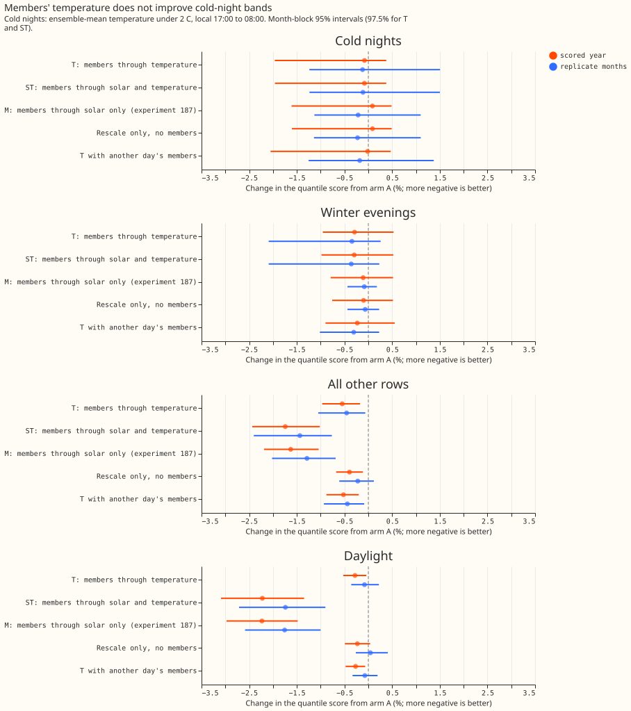
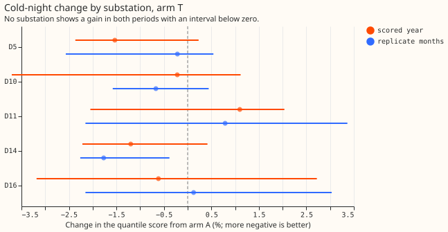
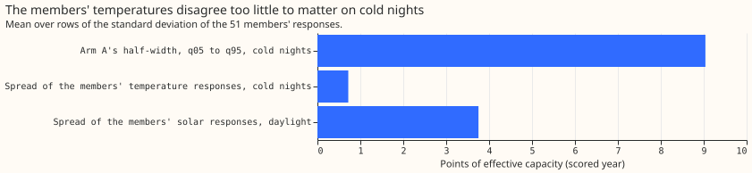

# Experiment 192: ensemble members through the temperature terms, scored on cold nights

**Running each ensemble member's temperature through the demand model's heating terms does not
improve the forecast bands on cold winter nights.** The 51 members' temperatures differ by too
little for their disagreement to carry a detectable signal about the day's error. Experiment
[187](../00187-dp-ens-members-in-stack/result.md) found that passing the 51 members of the European
Centre for Medium-Range Weather Forecasts (ECMWF) ensemble through the solar term of the demand
model lowers the daylight quantile score by 2.2%. The maintainer expected the same on cold nights,
where heating responds to temperature nonlinearly and the ensemble mean smooths away the cold tail.
We reused experiment 187's method: the demand model is linear in its fitted weights, so each
member's forecast is the best-guess mean forecast (arm A) plus the member's response, and the 11
quantiles are those of the 51 forecasts, each forecast getting arm A's 11 quantile offsets added
around that forecast. Arm T passes only the members' temperature (current and trailing means,
through the heating hinge and the photovoltaic (PV) cell-temperature derating), arm ST passes every
weather input, and the quantile score is twice the mean pinball loss over 11 quantiles, in points of
effective capacity (percentage points of each substation's rated demand; lower is better). D5, D10,
D11, D14, and D16 are anonymised substations. A cold night is a half-hour with an ensemble-mean
forecast temperature under 2 degrees C between 17:00 and 08:00 local time. The scored year is
2025-07 to 2026-06, and the replicate months are the even months of 2024-07 to 2025-06.

**The pre-registered prediction failed.** Arm T lowers the cold-night score by 0.08% (97.5% interval
-1.96% to +0.38%) against the required 1.5%, and cold-night coverage of the q05-to-q95 band moves
away from 0.90, to 0.857 from 0.880. Arm ST gives the same numbers, because the solar term does
nothing at night. The cold-night gain is far below the daylight gain of experiment 187.

- **Arms and row set.** A: reference (experiment 187's arm A, the full best-guess stack; 2.494
  points on cold nights, 2.752 on all rows in the scored year). T: members through temperature. ST:
  members through every input (experiment 184's all-input responses, reproduced exactly by this
  experiment's code). M: experiment 187's solar-only members, applied on every row. The row set is
  `fold_a_daily_gap_v1`: substations D5, D10, D11, D14, and D16, forecast leads of 0.5 to 168 hours,
  excluding hand-filtered switching events. Each arm's factors on arm A's offsets (one per lead band
  and per daylight, twilight, or night) were fitted on the odd months of 2024-07 to 2025-06. Mean
  forecasts are experiment 155's monthly refits.
- **Weather used.** Calibrated ECMWF ensemble temperature of experiment 111, available at forecast
  time; trailing temperature means stitch the analysis proxy before the forecast origin. Lighting
  depends only on solar elevation, so it receives no member input, and the demand model has no wind
  or cloud input, so the planned arm W was not run.
- **Pre-registered contrasts (cold nights, change from A, 97.5% interval).** Scored year: T -0.08%
  (-1.96% to +0.38%), ST -0.08% (-1.96% to +0.38%). Replicate months: T -0.12% (-1.24% to +1.50%),
  ST -0.11% (-1.23% to +1.50%). Verdict rule: not met.
- **Absolute scores, cold nights (quantile score; scored year, replicate months).** A 2.494, 2.021;
  T 2.492, 2.018; rescale only (no members) 2.496, 2.016. Mean absolute error (MAE) of the median
  forecast, in points: A 4.232, 3.548; T 4.234, 3.554.
- **Calibration on cold nights (scored year, replicate months).** The q05-to-q95 coverage (nominal
  0.90) is 0.880, 0.900 for A; 0.857, 0.879 for T; 0.862, 0.881 for rescale only. The share of
  readings at or under q95 (nominal 0.95) is 0.939, 0.940 for A; 0.924, 0.930 for T. Mean band width
  q95 minus q05: A 18.6 points, T 17.0, rescale only 17.4. The prediction quoted a cold-night q95
  coverage of 0.896 for arm A; this experiment's two coverage statistics are 0.880 and 0.939, and
  the source of 0.896 was not traced.
- **Tails on cold nights (scored year; pinball loss A to T).** q01 0.230 to 0.237, q05 0.691 to
  0.686, q95 0.668 to 0.679, q99 0.220 to 0.233. Only q05 improves slightly (0.691 to 0.686); q01,
  q95, and q99 worsen.
- **Other cuts (scored year, change from A: T, ST).** Coldest 5% of evening-to-morning rows (at or
  under 2.6 degrees C): -0.12%, -0.13%. Winter evenings (November to February, 17:00 to 23:00):
  -0.29%, -0.30%. Evening-to-morning rows at 2 to 6 degrees C: -0.34%, -0.40%. All other rows:
  -0.55%, -1.74%. Daylight: -0.28%, -2.22% (experiment 187's M is -2.23%). Night with the sun below
  the horizon: -0.90%, -0.90%.
- **By lead band, cold nights, arm T (scored year).** Under 24 hours +0.12%; 24 to 72 hours -0.10%;
  72 to 168 hours -0.11%. The replicate months' under-24-hour band is -1.61%, and the rescale-only
  arm gives -1.75% there.
- **By substation, cold nights, arm T (scored year, 97.5% interval).** D5 -1.53% (-2.37% to +0.23%);
  D10 -0.22% (-3.70% to +1.12%); D11 +1.10% (-2.05% to +2.04%); D14 -1.20% (-2.22% to +0.42%); D16
  -0.62% (-3.18% to +2.72%). D5's heating share does not make its result differ in kind: all five
  intervals include zero.
- **Controls.** Known-answer gate G4 (fake ensemble: ERA5 temperature of 6 winter runs at D10 plus
  51 offsets from -4 to +4 K, true irradiance in every member): passes on all 633 night rows under 8
  degrees C (response non-increasing in the member's temperature; the extreme members ordered); the
  zero-offset member's response is 0.0. The planned check that responses vanish above 21 degrees C
  had no rows in winter runs and was not tested. Shuffled-members placebo (members from another day
  of the same substation, month, hour band, lead day, and temperature band): -0.01% on cold nights,
  so the day's own members add nothing. Two-number version (a Gaussian with each row's own mean and
  spread of the responses): -0.06%, the same as T. Rescale-only placebo (zero responses): +0.09%; T
  minus rescale only is -0.17% (95% interval -0.36% to -0.06%) in the scored year and +0.11% (-0.08%
  to +0.37%) in the replicate months. Equal coverage: T and rescale-only have nearly equal coverage
  (0.857, 0.862), and their scores differ by 0.2%. The night placebo for the solar arms: M changes
  all night rows by -0.56%, the same as rescale only, because the solar response is zero at night.
- **Why the null.** The standard deviation of the 51 members' temperature responses is 0.72 points
  on cold nights (0.73 in the replicate months), against 3.8 points for the solar responses in
  daylight and a half-width of 9.0 points for arm A's q05-to-q95 band. The mean temperature response
  is 0.000 points, so the pass does not shift the forecast either.
- **Checks.** Median forecast minus mean forecast on cold nights: arm A's median equals its mean by
  construction, and the members' temperature responses have a mean of 0.000 points, so T's median
  minus A's median is +0.02 (D5), +0.03 (D10), -0.00 (D11), +0.01 (D14), and 0.00 (D16) points. The
  error of the median forecast (MAE) moves +0.05% for T on cold nights, in the same direction as no
  gain. Triggers from the audit rules: (3) the quantile-score and error contrasts are both zero
  within noise, not opposite; (4) no leave-one-out flips the verdict, because only D5 alone reaches
  -1.5% and its interval includes zero; (5) the rescale-only control moves non-cold rows by -0.39%
  against a half-width of 0.28%, because its night and twilight factors (0.85 to 0.90) narrow the
  bands; arm T scores -0.17% (95% interval -0.36% to -0.06%) beyond it. No separate audit was run.
  The verdict rests on a spread of 0.72 points, which the gate and the exact reproduction of
  experiment 184's all-input responses check.
- **Caveats.** The scored-year cold nights fall in 6 valid-time months (2025-11 to 2026-04, one with
  2 rows), so the month-block intervals may be too narrow or too wide. Cold nights lie far below the
  heating hinge at 15.5 degrees C, so the response is linear there and its mean of 0.000 points is
  guaranteed, not a finding; only the spread could help. The ensemble calibration of experiment 111
  maps temperature to the training weather before the pass and may shrink the members' spread; the
  spread of the raw members was not measured. The cold-night sample has 11,064 rows in the scored
  year, spread over a few winter weeks, so the intervals are wide (the scored-year interval of
  -1.96% to +0.38% does not exclude a gain of 1.5%, so the result is "no detectable gain", not proof
  of none).
- **Prediction check.** The prediction failed on the gain (-0.08% against at least -1.5%), on
  coverage (0.857 against 0.90), and on the comparison with the daylight gain. It held on non-cold
  rows (T -0.55%, never worse than +0.3%).
- **Neural suggestion (ranked, as the common brief asks).** (1) A small learned heating curve would
  only reshape a response whose spread is already 0.72 points, so its headroom on cold-night bands
  is small; the prediction that could fail is a gain of 0.3% or more. (2) A small neural network
  that corrects the cold-night error could reach the 9-point band half-width, which is where the
  error is.
- **What to try next.** (1) Fit the band factors on cold-night rows separately, then test the
  coverage at equal width (prediction that could fail: q05-to-q95 coverage returns to 0.90 with a
  score gain of 0.5% or more). (2) Add the ensemble's wind speed and night cloud cover as inputs to
  the demand model's heating term, then pass the members through (prediction that could fail: the
  members' response spread on cold nights rises above 2 points). (3) Look at the 20 worst cold
  nights by substation to see whether switching or other causes dominate.
