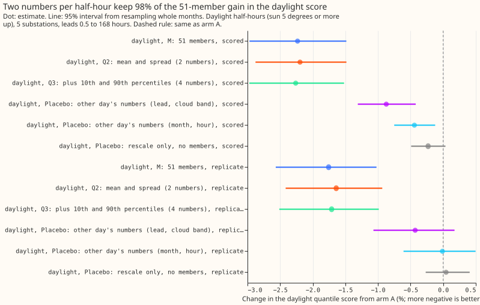
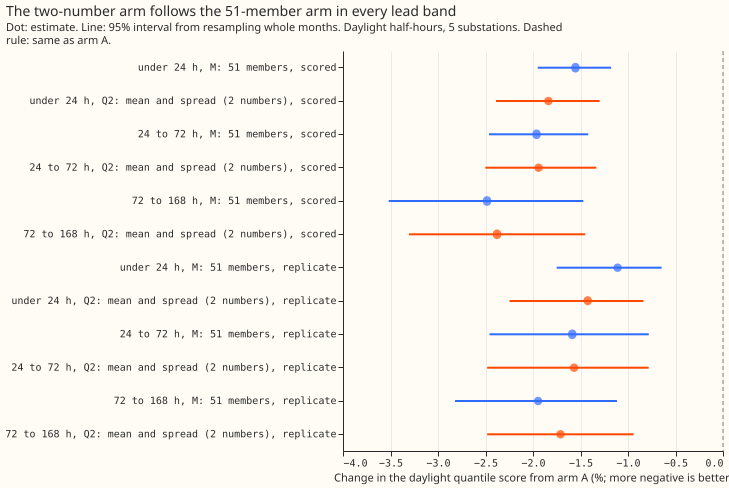
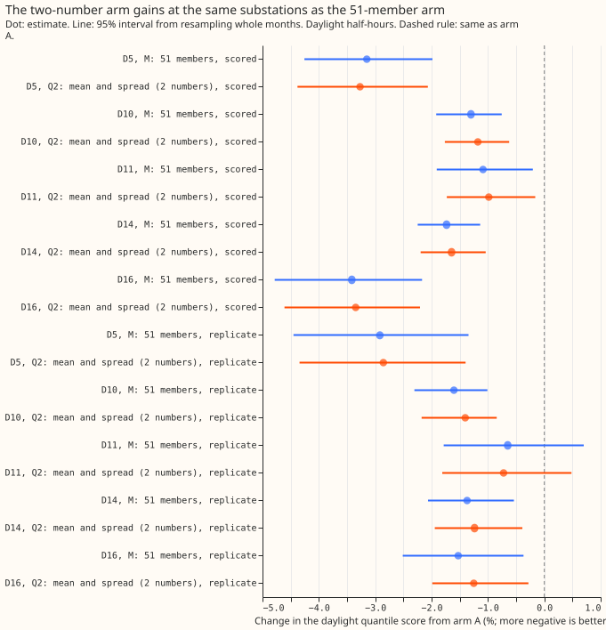

# Experiment 193: two numbers per half-hour in place of 51 ensemble members in the solar term

**Two numbers per half-hour, the mean and the standard deviation of the 51 ensemble weather members'
estimates of solar output, keep 98% of the improvement that running all 51 members gives to the
daylight forecast bands.** The weather layer can therefore store two columns per half-hour instead
of 51.

Experiment [187](../00187-dp-ens-members-in-stack/result.md) passed each of the 51 members of the
European Centre for Medium-Range Weather Forecasts ensemble through the solar-power part of the
demand model, so each member gave its own change to the forecast (a "solar response"). That lowered
the daylight quantile score by 2.2%. A Gaussian shape with each half-hour's own mean and standard
deviation of the 51 responses recovered 95% of that gain.

Here we rebuilt the forecast bands from those two numbers alone. We also rebuilt them from four
numbers, adding the 10th and 90th percentiles of the responses. The bands are the forecast's 11
quantiles. For each lead band, a fitted offset factor rescales the quantiles' distance from the mean
forecast, and a fitted spread factor rescales the spread of the responses. The rows are the same as
in experiment 187.

The score is the quantile score, twice the mean pinball loss over 11 quantiles, in points of
effective capacity (percentage points of each substation's rated demand); lower is better. Arm A is
the full best-guess forecast of experiment 187 (a Kalman-filtered convex demand model with a winter
night offset and a 14-day error profile). Arm M is its 51-member arm. Arm Q2 uses the two numbers
and arm Q3 the four. D5, D10, D11, D14, and D16 are anonymised substations. BG2 is the
production-style blend of five XGBoost models. The scored year is 2025-07 to 2026-06; the replicate
months are 2024-08, 2024-10, 2024-12, 2025-02, 2025-04, and 2025-06. Each interval is a 95% interval
from resampling whole months.

The rule registered before the run was met in both periods: Q2's daylight gain is at least 80% of
M's, with an interval wholly below zero. The verdict is `supported`.

- **Arms and row set.** A and M are experiment 187's, read from experiment 184's stored arrays. Q2:
  51 Gaussian points with each half-hour's mean and standard deviation of the member responses (the
  spread multiplied by a fitted factor), each with arm A's 11 quantile offsets times a fitted
  factor, pooled. Q3: the same, with a two-piece normal shape set by the 10th and 90th percentiles
  in place of the Gaussian. Q2s1: Q2 with the spread factor fixed at 1. Both factors are fitted per
  lead band on the tuning months (odd months of 2024-07 to 2025-06). Fitted Q2 offset and spread
  factors by lead band: 0.90 and 1.3 (under 24 hours), 0.90 and 1.2, 0.90 and 1.0, 0.85 and 1.0; M
  used offset factors 0.95, 0.90, 0.90, 0.85. Row set `fold_a_daily_gap_v1`, the same five
  substations, leads 0.5 to 168 hours, outside the hand-filtered switching events. Mean forecasts
  are experiment 155's monthly refits, so no contrast depends on the retraining schedule. Ensemble
  weather is available at forecast time.
- **Headline C1 (daylight, change from arm A, 95% interval).** Scored year: Q2 -2.20% (-2.88% to
  -1.48%), M -2.23% (-2.97% to -1.48%), Q3 -2.26% (-2.97% to -1.52%), Q2s1 -2.13% (-2.79% to
  -1.45%). Replicate months: Q2 -1.64% (-2.42% to -0.93%), M -1.76% (-2.57% to -1.02%), Q3 -1.71%
  (-2.51% to -0.99%), Q2s1 -1.60% (-2.32% to -0.92%). C1 is this change. The registered thresholds
  were 80% of M's change: -1.78% and -1.41%. Night and twilight (sun under 5 degrees above the
  horizon) are unchanged because only daylight rows change.
- **Retained share of M's gain.** Scored year 98% (95% interval 93% to 105%); replicate months 93%
  (84% to 101%). Q2 minus M, as a percentage of M's score: +0.04% (-0.10% to +0.19%) and +0.12%
  (-0.01% to +0.27%).
- **Absolute scores (quantile score).** Scored year, daylight: A 3.632, M 3.551, Q2 3.553, Q3 3.550;
  all rows A 2.752, Q2 2.716. Replicate months, daylight: A 3.453, M 3.392, Q2 3.396, Q3 3.394.
  Night is 1.981 (scored year) and 2.027 (replicate months) for every arm except the night placebo
  (2.112 and 2.128).
- **Coverage (daylight q05-to-q95, scored year; replicate months).** A 0.854, 0.871; M 0.894, 0.901;
  Q2 0.896, 0.903; Q3 0.897, 0.903.
- **By lead band (daylight, A to Q2, scored year).** Under 24 hours 3.095 to 3.038 (-1.84%, M
  -1.55%); 24 to 72 hours 3.343 to 3.278 (-1.94%, M -1.96%); 72 to 168 hours 3.906 to 3.813 (-2.38%,
  M -2.48%); 12 to 36 hours 3.227 to 3.164 (-1.97%, M -1.82%).
- **By clear-sky band (scored year, Q2 and M).** Overcast 3.127 to 3.103 (-0.77%, M -1.04%); partly
  cloudy 3.861 to 3.756 (-2.71%, M -2.71%); clear 3.483 to 3.419 (-1.82%, M -1.87%). The overcast
  band keeps the least (74% of M's gain), and its Q2 interval (-1.54% to -0.12%) is wide.
- **By substation (daylight, Q2 against A, scored year; M in brackets).** D5 -3.27% (-3.15%); D10
  -1.18% (-1.30%); D11 -0.99% (-1.09%); D14 -1.65% (-1.73%); D16 -3.35% (-3.42%). Without D5 -1.79%
  (-1.89%). In the replicate months D11 is -0.72% with an interval that includes zero (-1.81% to
  +0.48%), as for M.
- **Placebos (daylight change from arm A, and the share of Q2's gain each recovers; scored year,
  then replicate months).** Rescale only, with every response zero: -0.23%, 10%; +0.04%. Two numbers
  taken from another day of the same substation, month, and hour band: -0.44%, 20%; -0.01%. Taken
  from another day of the same lead day and cloud band as well: -0.87%, 40%; -0.43%, 26%. So about
  60% (74%) of the gain needs the day's own two numbers. Night placebo (night rows given a daylight
  row's two numbers, same substation, month, and lead day): the night score is 6.6% worse (95%
  interval 2.7% to 11.5%) in the scored year and 5.0% worse (1.0% to 9.3%) in the replicate months,
  so the summary does not help where it should not.
- **Gap to BG2 (arm minus BG2, so positive means worse than BG2) on the sunniest third of daylight
  half-hours (mean absolute error of the median, five substations, 74,728 half-hours, scored
  year).** A +0.044 MW (95% interval +0.007 to +0.072); M +0.026 (-0.020 to +0.059); Q2 +0.028
  (-0.017 to +0.060); Q3 +0.027 (-0.019 to +0.059). Without D5: A +0.007, M -0.007, Q2 -0.005 MW. At
  D5: A +0.202, M +0.170, Q2 +0.171 MW.
- **Tails (daylight, scored year; coverage / pinball loss).** Q2: q01 0.013 / 0.233, q05 0.051 /
  0.839, q95 0.947 / 0.879, q99 0.986 / 0.242. M: 0.013 / 0.230, 0.053 / 0.837, 0.947 / 0.880, 0.986
  / 0.242. A: 0.027 / 0.265, 0.078 / 0.907, 0.933 / 0.924, 0.979 / 0.262.
- **Checks.** The median forecast minus the mean forecast at 12 to 36 hours for Q2 is -0.14 (D5),
  -0.03 (D10), -0.05 (D11), -0.04 (D14), and -0.05 (D16) points (M: -0.14, -0.05, -0.05, -0.05,
  -0.05), the shift probably comes from asymmetry in arm A's quantile offsets, which Q2's symmetric
  Gaussian centres do not remove; arm A is 0.000. The
  mean forecast shared by M, Q2, and Q3 (arm A's mean plus the mean response) has a daylight mean
  absolute error of 6.366 against A's 6.375, a change of -0.13% (-0.45% to +0.27%), in the same
  direction as the score. No trigger from the audit rules fired. No control failed: the rescale-only
  placebo moves the score by -0.23% against a half-width of 0.26, and the night placebo worsens
  night. The result matched its prediction on every point (Q2 -2.20% against a predicted near -2.1%;
  Q3 changes the score by 0.06 points against under 0.2; the strict shuffle recovers 40% against
  under 45%). Q2 beats Q2s1, the arm nested in it, by 0.07 percentage points, so no nested arm beat
  its container. The
  interval widths match experiment 187's.
- **Serving-path saving.** The two numbers replace 51 member responses per half-hour with 2, a drop
  from 204 to 8 bytes in float32. The solar response is linear in the member's unit photovoltaic
  (PV) shape (experiment 187), so the same two numbers are the fitted solar coefficient times the
  mean and standard deviation of the 51 members' unit PV shapes. The 51 members' irradiance is still
  needed once, when the weather layer computes the two numbers; the saving is in the stored columns
  and in the 51 passes through the demand model per run. No runtime was measured.
- **Caveats.** The scored contrasts reuse experiment 187's rows and arm M, so the experiment tests
  one new summary on rows and arms already scored. Q2 carries two fitted factors per lead band where
  M carries one, all fitted on the tuning months. The replicate months hold 6 months, so their
  intervals are wide, and Q2's retained share in the replicate months (93%) has an interval reaching
  84%.
- **Optional neural arm (Q5).** Not run. Q2 and M differ by 0.04% of the score, so a learned scale
  function has at most the upper end of that interval (0.19%) to gain, and the point estimate gives
  it none.
- **What to try next.** (1) A follow-up experiment could put the two numbers into the weather layer
  and the serving path and measure the runtime saving. (2) Test whether the standard deviation can
  be computed from the ensemble's irradiance mean and spread without running each member through the
  unit PV shape (prediction that could fail: the computed standard deviation keeps at least 80% of
  the gain). (3) Score Q2 on the curtailment-cost metric of `studies.node_curtailment`, because the
  pinball-loss reduction from A to Q2 is largest at q01 (12%, against 5% to 8% at the other three
  tail quantiles).
