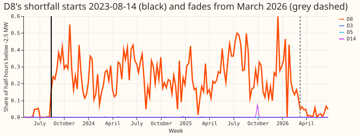
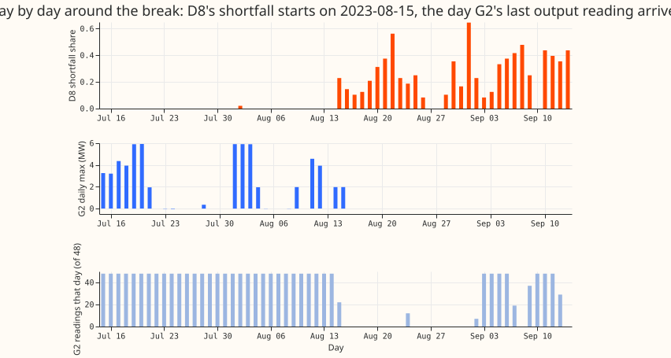
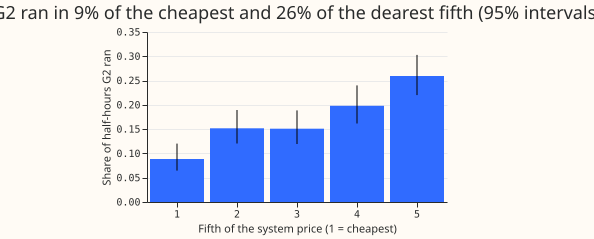
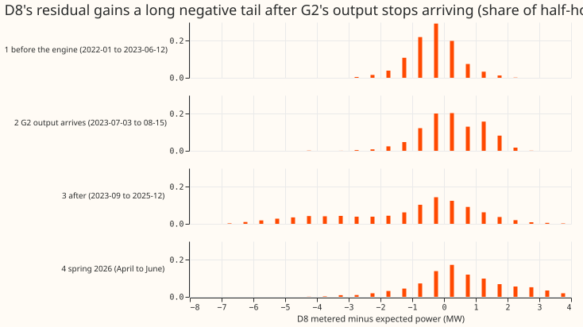
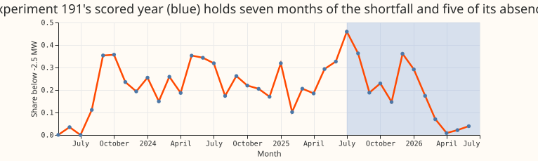

# Experiment 194: D8's drops follow one engine whose output stopped being added back

**We asked whether the long stretches in which D8 (one of the 16 Primary substations in the trial)
draws less power than a fitted model expects come from one 6 MW gas engine, labelled G2 on this
page.** NGED's notes say that G2's output is added to D8's reading, so that D8 shows demand plus the
engine's output, and that G2's own telemetry channel (its analogue) does not work. We reran the
design note's calculations from committed code. We call the share of half-hours in which D8's
metered power sat more than 2.5 MW below the fitted model's expected power the "shortfall share". We
found the date on which that share jumped. We also checked the same share on three comparison
Primaries (D3, D5, and D14) with no known engine.

**The design note's numbers reproduce, and its account of D8's drops holds in outline.** While G2's
output arrived, D8's
reading rose with G2's output (D8's reading rose by 0.02 MW for each 1 MW of G2 output; had the
output not been added back, D8's reading would fall by 1 MW for each 1 MW). The shortfall share
stepped from 0.010 to 0.257 in the week of 2023-08-14, the week G2's last
output reading arrived. It stayed between 0.10 and 0.46 in every month to January 2026. The
shortfall share of the three comparison Primaries stayed near zero.

**Two findings differ from the design note's wording.** G2's readings did not stop arriving: 98
later days
carry all-zero readings, and D8's shortfall share is the same with a zero reading present as with
none. D8's shortfall also fades from March 2026 with no matching change in G2's readings (they
already stopped on 2026-01-26). Experiment 191's scored year (2025-07-01 to 2026-06-30) therefore
holds both high-shortfall and low-shortfall months.

## Figures

*Figure 1. D8's weekly shortfall share against D3, D5, and D14 (near zero throughout).*

*Figure 2. The break by day: D8's shortfall starts on the day G2's last output reading arrives.*

*Figure 3. G2 ran in 9% of the cheapest fifth of half-hours and 26% of the dearest.*

*Figure 4. D8's residual in four periods. The negative tail after August 2023 is broad, not clearly
quantised in units of 2 MW.*

*Figure 5. Monthly shortfall share. The blue band is the scored year of experiment 191.*

## Reproduction of the design's numbers (PS1)

- **Stop rule:** passed. 2,054 half-hours join to the system price, exactly the design's count.
- **G2's output (2023-07-03 to 2023-08-15, 44 days):** units running 0, 1, 2, 3 in 1,704, 137, 133,
  80 half-hours (exact). Running share 0.170 (Wilson 0.155 to 0.187). Only 440 of G2's 441 positive
  readings fall in these weeks; the other is 0.2 MW on 2026-01-23.
- **Running by price fifth, cheapest to dearest:** 0.089, 0.152, 0.151, 0.198, 0.259, against the
  design's 0.090, 0.151, 0.152, 0.191, 0.271 (the top fifth differs by 0.012). The cheapest and
  dearest fifths' intervals are 0.065 to 0.120 and 0.220 to 0.303. Spearman correlation of price
  with running 0.160.
- **By hour (UTC):** 0.02 to 0.20 from 00:00 to 05:59 (design 0.02 to 0.10) and 0.25 to 0.28 from
  19:00 to 21:59 (exact). The design's low range misses 05:00 UTC (0.20), where running starts.
- **Running spells (consecutive half-hours with G2 running):** 56 (design 55), lengths 1 to 29
  (exact) and median 4 half-hours (design 6; not reproduced, probably because a missing reading
  ends a spell here).
- **D8's residual while G2 ran, median at 1, 2, and 3 units running:** over 2023-07-03 to 2023-08-15
  we find +0.49, +0.43, and +0.23 MW. The design quotes +0.49, +0.53, and +0.23 MW for July, so the
  2-unit value is not reproduced and the design's label ("July") does not match its first and last
  values. For July alone the medians are +0.19, +0.37, and +0.60 MW, which rise with output. All six
  medians are positive.
- **Shortfall share by month:** May 2023 0.001 (design 0.000), July 0.000, September 0.353, October
  0.357 (design 0.353), November 2025 0.147, January 2026 0.292, April 2026 0.008, May 0.022, June
  0.039. The June and August 2023 values (0.035 and 0.112) are exact.
- **By calendar quarter, 2023Q4 to 2025Q4:** 0.198 to 0.338 (design 0.197 to 0.343, which used
  quarters starting in September). 2023Q3 is 0.153 because July and August were mostly clean.
- **Springs:** March to May 0.267 in 2024, 0.228 in 2025, 0.034 in 2026.

## Prediction and decision rule

- **July 2023 at most 0.02:** held (0.000, Wilson 0.000 to 0.003).
- **At least 0.10 in every month from September 2023 to January 2026:** held, narrowly. The lowest
  month is February 2025 at 0.102.
- **Change point between 2023-08-10 and 2023-09-10:** held. The weekly step is at 2023-08-14
  (likelihood-ratio set and bootstrap 95% both 2023-08-14 to 2023-08-21).
- **No control within 30 days:** held, with a caveat. D3 and D5 have no step (0.000). Their best
  split falls on the earliest allowed week, 2023-06-26, 49 days before D8's, because the likelihood
  is flat and the search returns the first tie. D14's step is +0.005 at 2025-09-29.
- **Two-step fit of D8 over the whole window:** up at 2023-08-14 (0.010 to 0.254), down at
  2026-03-09 (to 0.029).
- **Sensitivity:** a threshold of 0.241 times each site's capacity equals -2.5 MW at D8, so D8's
  fit is unchanged. The controls stay below a step of 0.007, though D5's best split moves to
  2025-11-10.

## Does the account hold?

- **Gross while G2's output arrived: yes.** Had D8 been net of G2, 10.2% of those half-hours would
  fall below -2.5 MW. The observed share is 0.0%.
- **Net afterwards: yes, from the shortfall's timing.** The shortfall starts on 2023-08-15, when
  G2's readings stop mid-day (22 of 48 readings that day).
- **"Reading stopped arriving": only partly.** G2 has 98 days with readings after 2023-08-24, all
  zero except the 0.2 MW. D8's shortfall share is 0.329 with a reading present and 0.270 with none
  (2023-08-25 to 2023-12-31; the intervals do not overlap), and 0.232 and 0.255 in 2024 to January
  2026. The difference has no consistent sign, and G2's later readings give no record of the engine
  running.
- **Quantised steps (output rising in units of 2 MW, one per running engine unit): not shown.** The
  histogram's local peaks are at -4.1 MW and -3.1 MW, where steps of 2 MW would put them at -2, -4,
  and -6 MW. Noise in the expected power is wide enough to blur 2 MW steps.
- **2026:** the shortfall share falls from 0.292 in January to 0.070 in March and 0.008 in April
  while G2 has no readings after 2026-01-26. Either the engine stopped running, or NGED resumed
  adding the engine's output to D8's reading. The data cannot tell which.
- **Experiment 191's window (its constants: D8 data from 2025-04-01, scored runs 2025-07-01 to
  2026-06-30):** in those 12 months, 59% of half-hours fall before February 2026 (shortfall share
  0.292) and 41% from February 2026 onwards (0.061). The window includes the 2026 change.
- **Register entries near G2 (MW and distance only):** a 6 MW gas engine connected 2023-06-13 at
  0.00 km in the ECR (under D14 in the register's Primary column); two Capacity Market gas-fuelled
  components at 0.05 km (six-figure grid reference, so about 0.07 km precision); a connected 10.98
  MW battery at 0.27 km, registered under none of the 16 Primaries.

## PS5: census

- **Series notes:** 5 of 33 series carry an `information` note. Among the 16 Primaries, only D8 has
  an added-back note, and its note says that generators' analogues are not working. Of 13 metered
  generators and batteries, 4 carry a note: 1 solar analogue "not working", 1 solar analogue
  "suspect", G2 "not working", 1 biofuel customer "has not exported since June 2026".
- **Reading availability, 2024-01-01 to 2026-06-30:** 11 of the 13 generators and batteries have
  readings in at least 74% of half-hours. G2 has 4% (last 2026-01-26), and 1 solar farm has none
  since 2024-09-26.
- **Shortfall share across all 16 Primaries:** D8 is the only Primary with a sustained upward step
  of at least 0.10 (+0.246). D9's usable weeks start in January 2024 and open with a four-week burst
  (weekly shares 0.08, 0.52, 0.65, 0.34 from 2024-01-08), after which the share is near zero, so the
  fit reads a step of -0.198 at 2024-02-26. D18 has 27 usable weeks and one week at 0.301 in October
  2025, fitted as a step of -0.038. D15 has no usable weeks. D14's highest week is 0.074.
- **ECR price-following assets under the 16 Primaries (connected):** 2 gas or oil engines of 7.00 MW
  (6.00 MW at D14 from 2023-06-13, 1.00 MW at D5 from 2021-03-11) and 3 batteries of 0.65 MW (D11,
  D2, D9). 2 batteries (0.2 MW each, D16 and D3) are accepted to connect. 9 Primaries have none. The
  demand-side response register holds no rows. CHP: 2 slots, 1.40 MW, both at D10, none gas or oil
  engines.
- **Whole register:** 168 connected gas or oil engines of at least 1 MW each, totalling 1,265.8 MW.
  Engines of this size are therefore not confined to the trial's Primaries.
- **PS5 prediction:** held for sustained upward steps. D9's transient burst fits a step down of more
  than 0.10, and D15 and D18 lack the data for a fit, so "no other series" covers 13 of 16
  Primaries fully.

## Checks

- **Median minus mean forecast per site and mean-forecast error beside each contrast:** not
  applicable, because the experiment scores no forecast.
- **Audit triggers:** none fired. No control failed, the result matches its prediction, and no
  planned contrast exists to flip. Later experiments (PS2 to PS4) depend on this result, and this
  experiment is the replication the design asked for.
- **Caveats:** the stored residual panel comes from experiment 130's frozen convex model driven by
  ERA5, so a changing model error shifts the shortfall share. The threshold of -2.5 MW is the
  design's; D8 is measured in apparent power (MVA, not MW), so a dip in apparent power at low demand
  can look like generation. The bootstrap interval resamples weeks within each side of the fitted
  split, so it is narrow by construction; the likelihood-ratio set is the more cautious interval.

## What to try next

- **Ask NGED** whether G2's output is still added back to D8, from when, and whether its analogue
  was repaired (design questions 1 to 3).
- **PS2** may use G2's 44 summer days as a known answer, and must treat D8 as gross before
  2023-08-15 and net after.
- **PS3 and PS4** need an "engine visible in the target" flag, set to off from March 2026 until
  NGED answers.
