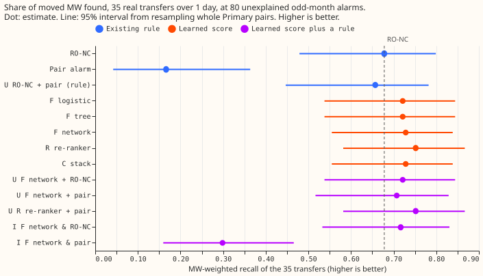
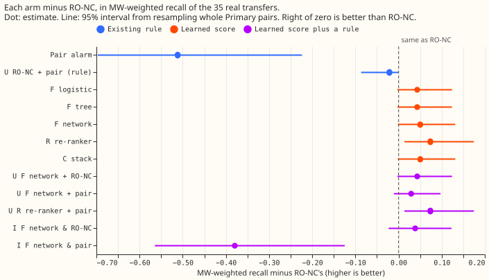
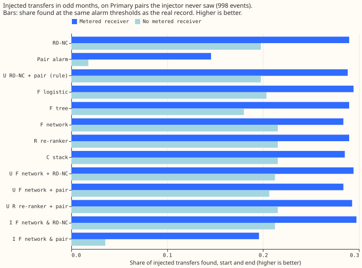

# Experiment 195: a learned score on detector features finds 24 of 35 real transfers, not 19

**On 35 real transfers lasting over 1 day, a small learned score found 22 to 24, against 19 for
RO-NC, the rule-based switching detector with the best score of those we tested, at the same 80
unexplained alarms.** A transfer is a period, labelled by hand in [experiment
41](../00041-sw2-0a-labeller-gate/result.md), in which switching moved load from one Primary
substation (a substation that steps transmission voltage down to distribution voltage) to its
neighbours. An alarm is unexplained when no logged closure or labelled transfer lies within 24 hours
of it, and the 80 are counted over odd-numbered months. RO-NC is the refit-offset neighbour-count
detector of [experiment 82](../00082-sw2-18-19-combined-refit-offset-and-same-sign-count/result.md):
it raises a candidate alarm wherever the 24-hour step in a Primary substation's forecast error
reaches 2.5 noise units, and it keeps the candidates that a logistic score ranks highest. Our re-run
finds 19 transfers where its original run found 18, probably because our end rule differs in one
detail from experiment 130's.

**A learned score re-ranks RO-NC's candidates, and a logistic regression does nearly as well.** Each
score reads 25 numbers per candidate, among them the 24-hour step, the opposite step at a
neighbouring Primary substation, and the hour and season. We trained each score only on synthetic
transfers, added to the forecast error with the injector of [experiment
189](../00189-switching-neural-onset-end-block-detector/result.md), plus real stretches with no
logged or labelled event. We scored each on real transfers of Primary pairs it had never seen. The
best score, a neural network that also reads 4 days of the raw forecast error, found 24 and lost
none of RO-NC's (+0.074 in the share of moved MW found, 95% interval +0.013 to +0.175, resampling
whole Primary pairs).

**The verdict is `partly supported`, because the re-ranker clears the recall bar only with a
feature that reads 2 days after the step.** RO-NC's score reads no such feature. Without it, the
re-ranker finds 22 and its interval reaches below zero (-0.002), so only the count bar holds. The
logistic regression finds 22 with or without that feature. The extra transfers are small. The
learned scores find no more injected transfers than RO-NC does. The gated-mask bar was not run.

## Results

- **Arms.** F: features only, as a logistic regression, a gradient-boosted tree, and a neural
  network of 2,449 weights ("F network"). R: re-ranker of RO-NC's candidates, a neural network of
  10,249 weights that reads the features and a raw window of 4 days. C: logistic stack of the F
  network, RO-NC's score, and the pair statistic (the smaller of the 6-hour step and the opposite
  step at the best neighbour), fitted on validation worlds only. U and I: union and intersection of
  a learned arm with RO-NC or the pair alarm, with the split of the alarm count chosen on validation
  worlds. Comparators: RO-NC, the pair alarm of [experiment
  156](../00156-switching-faster-onset-alarm-from-opposite-steps/result.md), and their rule-based
  union.
- **Rows.** The 35 real transfers over 1 day, out of 66 labelled transfers, in 18 Primary pairs
  divided into 3 folds that hold out whole pairs. Alarms are chosen at 80 unexplained odd-month
  alarms per fold (0.185 per Primary-month, equal for every arm by construction). A transfer is
  found when an alarm starts within 2 hours of its start and ends within the larger of 6 hours and
  10% of its duration of its end (experiment 130's rule). Every arm uses RO-NC's end rule.
- **Real transfers over 1 day found, out of 35 (MW-weighted recall and difference from RO-NC, 95%
  intervals; "gained" and "lost" count transfers found by the arm and not by RO-NC, and the
  reverse):**

| Arm | Found | Start only | MW-weighted recall | Minus RO-NC | Gained / lost |
|---|---|---|---|---|---|
| RO-NC (this re-run) | 19 | 22 | 0.678 [0.479, 0.799] | 0 | 0 / 0 |
| Pair alarm | 5 | 5 | 0.166 [0.042, 0.364] | -0.512 [-0.697, -0.224] | 1 / 15 |
| Union of RO-NC and pair alarm (rule) | 18 | 20 | 0.657 [0.447, 0.782] | -0.021 [-0.087, 0.000] | 0 / 1 |
| F logistic regression | 22 | 24 | 0.721 [0.538, 0.844] | +0.043 [-0.003, +0.124] | 4 / 1 |
| F gradient-boosted tree | 22 | 24 | 0.721 [0.538, 0.844] | +0.043 [-0.003, +0.124] | 4 / 1 |
| F network | 22 | 25 | 0.728 [0.555, 0.839] | +0.050 [-0.002, +0.132] | 4 / 1 |
| **R re-ranker** | **24** | 26 | 0.752 [0.582, 0.867] | **+0.074 [+0.013, +0.175]** | 5 / 0 |
| C stack | 22 | 25 | 0.728 [0.555, 0.839] | +0.050 [-0.002, +0.132] | 4 / 1 |
| Union F network + RO-NC | 22 | 24 | 0.721 [0.538, 0.844] | +0.043 [-0.003, +0.124] | 4 / 1 |
| Union R re-ranker + pair alarm | 24 | 26 | 0.752 [0.582, 0.867] | +0.074 [+0.013, +0.175] | 5 / 0 |
| Intersection F network and RO-NC | 21 | 24 | 0.717 [0.533, 0.831] | +0.039 [-0.023, +0.123] | 3 / 1 |

- **Pre-registered bars, with every feature.** Primary bar: the re-ranker, and the union of the
  re-ranker with the pair alarm, have a lower interval end above zero and find more than the
  rule-based union (24 against 18). Count bar: 24 is at least 22, and 5 transfers are gained with
  none lost. The logistic regression and the F network agree within 2 transfers (22 and 22), as
  predicted. The other learned arms' lower interval ends run from -0.023 to -0.002, so they do not
  meet the primary bar. The prediction that recall falls by under 15 percentage points when the
  receiver is unmetered is met: 0.215 against 0.290 for the re-ranker on injected transfers. The
  gated-mask bar was not run.
- **The extra transfers are small.** The re-ranker's five gains are 0.4 to 0.9 MW each (3.2 of the
  42.7 MW in the 35 transfers) and sit in 4 of the 18 Primary pairs, 48 to 93 hours long. The three
  pairs that carry most of the moved MW keep their RO-NC counts. Dropping any one pair leaves the
  re-ranker 3 to 5 transfers ahead of RO-NC, and the F network 2 to 3.
- **Transfers that both forecast-error models can see (29 of the 35).** Re-ranker 20, RO-NC 15, F
  network 18. The two models are the convex model and the XGBoost model of experiment 181.
- **The candidate ceiling is 26.** RO-NC's candidate list contains an alarm within 2 hours of the
  start of 29 transfers, and a candidate with the right start and end for 26. The pair-alarm
  candidates add none. The re-ranker's 24 is 2 below that ceiling.
- **Start error.** The median start error of found transfers is 0.5 hours for every arm.
- **Alarm accounting (per fold, at 80 unexplained odd-month alarms).** Alarms that look like a
  balanced transfer (an opposite step at a neighbour of 0.4 to 2.5 times the own step) number 10 for
  RO-NC, 13.3 for the F network, and 14.7 for the re-ranker. Those extra balanced alarms may be
  unlogged real transfers, so we do not count them as failures. Unexplained alarms over all months
  fall from 149 (RO-NC) to 94 (re-ranker), but the scores were trained on the even-month candidates,
  so that fall is in-sample and is not a result.
- **Injected transfers (odd months, 998 injected transfers on pairs the injector never saw).**
  Start-and-end recall is 0.259 for RO-NC, 0.265 for the re-ranker, 0.261 for the F network, and
  0.264 for the logistic regression. Recall with no metered receiver is 0.198 for RO-NC and 0.215
  for the re-ranker, against 0.290 and 0.290 with a metered receiver, so the learned scores do not
  collapse without a metered partner. The pair alarm falls from 0.146 to 0.018, and its intersection
  with the F network inherits that fall.
- **Hindsight control (post hoc, after the code review).** Dropping the "level after the step"
  feature, which reads 1 to 2 days after the candidate, leaves the logistic regression at 22
  (+0.043 [-0.003, +0.124]), and the re-ranker falls to 22 (+0.050 [-0.002, +0.132]). The
  re-ranker's raw window still reads 4 days ahead. Tables are in
  `printed_report_ablation_no_persist.txt`.
- **Post hoc ablation.** Without the noise scale (a proxy for the series), the hour, and the season,
  the re-ranker finds 23 of 35 (+0.064 [+0.012, +0.154]) and the logistic regression 23 (+0.064
  [+0.012, +0.154]). The F network falls to 21 (-0.041 [-0.261, +0.115]) because it loses one large
  transfer. The ablated networks have 2,209 and 10,089 weights. Tables are in
  `printed_report_ablation.txt`.

## Checks

- **Median minus mean forecast, mean-forecast error, tail calibration, curtailment cost:** not
  applicable, because no forecast is scored.
- **Audit triggers.** None fired. No control failed: the re-implemented pair alarm finds 5, as in
  experiment 156. The result meets its prediction. Dropping any one pair never changes the sign of
  the re-ranker's lead. No nested arm beats the arm that contains it. No later design depends on
  this result yet. No Opus audit was run.
- **Even-month transfers gain more.** The re-ranker's net gain over RO-NC is 4 transfers in
  even-month transfers, the months its injected training transfers sit in, and 1 in odd-month
  transfers (RO-NC 8, F network 8, and re-ranker 9 of 15). The ablation without season, hour, and
  noise scale keeps the gain, which argues against a seasonal shortcut, but 15 transfers cannot
  settle it.

## Caveats and lab shortcuts

- **RO-NC is re-implemented.** It finds 19 here against 18 in its original run. Every arm uses the
  same end rule, so the contrasts are paired.
- **Hindsight inputs.** The feature "level after the step" reads 2 days after the start, and the raw
  window reads 4 days after it, so the learned scores alarm days late. Reading future data is a lab
  shortcut.
- **Residual leakage.** The convex model behind the real forecast errors was trained with the
  labelled transfers masked, which makes the features of the real transfers look cleaner than they
  would at serving time. We did not recompute the features from an unmasked model.
- **Negatives.** Training negatives are real unexplained candidates in even months. They include
  probable unlogged transfers, which lowers every learned score slightly. The multi-day drops of one
  Primary substation that a gas peaker explains (D8), the 17 unlabelled block days of experiment
  175, and all labelled or logged spans are excluded from the training negatives. An injected
  transfer that lands next to one of them still counts as a positive, and none of them is removed
  from the pool that sets the 80-alarm threshold (the same for every arm). The validation worlds
  hold the same real negatives as the training worlds, so early stopping, the tree's settings, and
  the stack were chosen on in-sample negatives and fresh positives.
- **Held-out pairs are held out by pair, not by Primary substation.** A Primary substation of a
  held-out pair can sit in another fold's pair, so training sees synthetic transfers and real quiet
  stretches on the same Primary substations as the held-out transfers, as in experiment 189.
- **Best of several arms.** The re-ranker's interval is not corrected for being the best of 11
  learned and combined arms, and its lower end sits just above zero.
- **Intersection arms on injected transfers.** Alarms of one world can match alarms of another
  world on the same series, which inflates the intersection arms' injected recall slightly. The
  real-record scores are unaffected.
- **Scoring months.** Thresholds come from odd months, and transfers are scored in every month, as
  in experiment 189. We did not rescore on even months with thresholds from odd months only.
- **Not done.** The gated-mask test of experiments 163 and 171, features from an unmasked model, and
  training that leaves one pair out (the leave-one-pair-out table drops a pair from the scores and
  does not retrain).

## What to try next

- **Test the extra alarms in the gated mask**, because that bar decides porting.
- **Swap the odd and even months** for training and thresholds, to settle whether the even-month
  gain is real.
- **Make the injector more realistic.** The learned scores find injected transfers no more often
  than RO-NC does, so injected recall cannot rank detectors yet. A neural component is not the next
  step, because the logistic regression already matches the features-only neural network.

Code: `ml-experiments/00195-switching-neural-plus-detector-features/`; the printed numbers are in
`printed_report.txt`, `printed_report_ablation.txt`, and `printed_report_ablation_no_persist.txt` in
that folder.
