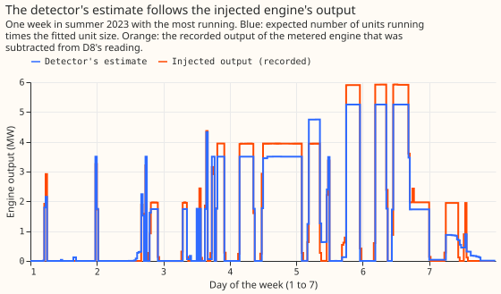
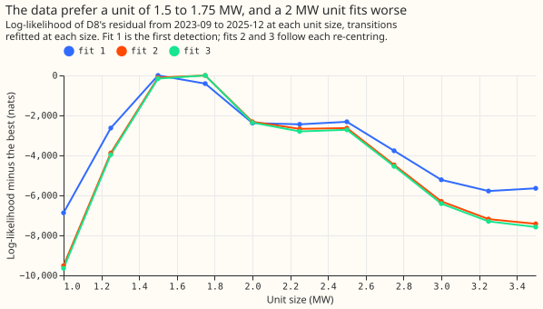

**An engine of up to three units, with a unit of about 1.75 MW, is detected in the recorded engine
output that we injected into D8, but the detector cannot yet be trusted after March 2025.** We asked
whether a hidden Markov model whose state is the number of engine units running (0 to 3), read
through the magnitude meter with no price input, can find a gas engine in the residual of D8 (the
reading minus the expected power). To test it, we subtracted the recorded output of a metered
generator (a gas-engine generator, G2) from D8's reading, once at the true times (K1) and once at
nine other places in D8's history that had no engine (K2), and counted how many running half-hours
the model found again. The model found all of the half-hours with 2 or 3 units running and 83% to
85% of those with 1 unit, and step detectors found at most 24%. The pre-registered verdict is `not
supported`, because the false-alarm bar fails at three Primaries, and the over-flagging after
2025-03 is a larger problem than the false alarms at the three Primaries.

Ideas from [Hart (1992)](https://doi.org/10.1109/5.192069) and [Kolter and Jaakkola
(2012)](https://proceedings.mlr.press/v22/zico12.html) (load disaggregation with a discrete state
per appliance) are applied here; the autoregressive error, the magnitude meter and the known-answer
test are this project's.

## Figures

## Results

- **Row set and detector.** The detector fitted on D8 from 2023-09 to 2025-12 (40,900 half-hours).
  It flags a half-hour when the smoothed probability of at least 1 unit exceeds 0.5. Noise was
  fitted on odd months of D8's engine-free history (2022-01 to 2023-06-12 and July 2023). No convex
  demand model was refitted: the expected power is the stored panel's, and each retrain step
  re-centres it by a monthly offset and an hour-by-day-type profile.
- **K1 (G2's output replayed, 2,054 scored half-hours: 1,704 at 0 units, 137 at 1, 133 at 2, 80 at
  3).** Recall at 2 or 3 units 1.00 (95% 1.00 to 1.00); at 1 unit 0.83 (0.63 to 0.97); precision
  0.84 (0.67 to 0.97); energy error -1.3% (-10% to +13%). All four thresholds pass.
- **K2 (nine shifted copies, 18,486 scored half-hours).** Recall at 2 or 3 units 1.00; at 1 unit
  0.85 (0.79 to 0.91); precision 0.93 (0.89 to 0.96); energy error -8.4% (-10.8% to -5.8%). All four
  thresholds pass. Intervals resample whole days.
- **Synthetic spells at 0.5 and 2 times G2's running rate (secondary).** Recall at 1 unit 0.94 and
  0.94; precision 0.82 and 0.96; energy error -0.1% and -6.2%. All pass. Reactive-power floor of 0,
  0.5, and 1.0 MVA: recall at 1 unit 0.85 to 0.86, precision 0.89 to 0.92, all pass.
- **False alarms on D8's clean history.** 0.7% of half-hours flagged (5 false active days in 559
  days, 0.27 a month); on even months, which the noise fit did not use, 0.008%.
- **False alarms at the other Primaries (share flagged; false active days a month).** D3 0.5%, 0.34;
  D5 1.7%, 2.02; D10 0.7%, 1.05; D11 3.2%, 1.12; D14 0.3%, 0.30; D16 0.02%, 0.04. D5 has a 1 MW gas
  engine in the Embedded Capacity Register and D11 a small battery, so some flags may be real. The
  pre-registered bars (3% of half-hours; 1 false active day a month) fail at D5 (2.02 days), D10
  (1.05 days), and D11 (3.2% flagged). The audit judged that arguing these Primaries hold real
  assets would be post hoc, so the verdict stands.
- **Unit size.** The fit puts it at 1.75 MW, on a grid of 0.25 MW, in the final round (1.5 MW in the
  first), with the design prior (centre 1.97 MW) and the wide prior (centre 2.5 MW) alike, and with
  the fit window cut at 2025-02. The log-likelihood is 2,300 nats lower at 2.0 MW than at 1.75 MW,
  so the log-likelihood favours a smaller unit than G2's 1.97 MW. The prediction (1.7 to 2.3 MW)
  holds only at its lower edge.
- **Step detectors on the same injections (half-hours inside a found spell, K1 and K2).** RO-NC at
  24 hours: 0.08 and 0.02 alone, 0.00 and 0.00 with the neighbour check; RO-NC at 4 hours: 0.24 and
  0.20 alone, 0.00 and 0.01 with the neighbour check; block detector 0.09 and 0.09. One of five
  operating points (RO-NC at 4 hours) reaches 20% or more on both injections, so the prediction of
  under 20% holds for four of five.
- **Regimes.** Share flagged against share below -2.5 MW: 2023-09 to 2025-12, 40% against 26%;
  2026-02 to 2026-03, 41% against 12%; 2026-04 to 2026-06, 43% against 2%. D8's residual noise
  (median absolute step-to-step error) is 0.17 to 0.27 MW in clean months and 0.35 to 0.75 MW from
  2024-05, rising most after 2025-03, when 8.91 MW of solar was connected. A local noise multiplier
  (post hoc) leaves the flagged share at 39% in 2026-04 to 2026-06. The audit found the cause is the
  observation model, not re-centring and not an engine: from 2025-03 steps of 1.5 to 2.5 MW occur
  about 69 times per 1,000 half-hours against 0.5 in clean history, in both directions, and upward
  excursions of more than 1 MW (26% of half-hours) outnumber downward ones (18%), which an engine
  cannot produce. With error correlation 0.906 the level carries little weight in the emission, so
  the detector reads steps.
- **Positive spells at D8** (4 or more half-hours more than 1.5 MW above a 30-day rolling median):
  2.5 per 100 days in clean history, 35 in 2023-09 to 2025-02, 67 in 2025-03 to 2025-12, and 89 in
  2026-04 to 2026-06. The rolling median is pulled down by the engine, so this measure cannot tell
  battery charging from a biased offset.

## Checks

- **Median minus mean forecast per site:** not applicable; the experiment makes no forecast.
- **Mean-forecast error beside a quantile-score contrast:** not applicable.
- **Triggers that fired:** trigger 1 (a control failed: the false-alarm control at D5 and D11) and
  trigger 2 (the step detector at 4 hours reached 24%, against a prediction of under 20%, and the
  unit size sits at the edge of its predicted range). An Opus audit ran, and its findings are below.
- **The gate is easy where it was run.** Every injection sits in 2022-23 or July to August 2023,
  when D8's noise is low, so passing says nothing about 2025-26. In the audit, adding noise of 0.40
  MW lowered K1 precision to 0.51 and K2 precision to 0.61, and shifting G2's record into 2026-04
  gave precision 0.29. D8's innovation scale is 0.21 MW in the injected history against 0.37 to 0.53
  MW in the periods the labels are needed for.
- **Lab shortcuts.** ERA5-driven expected power (from the stored panel), smoothed rather than
  filtered posteriors for the scores (the filtered recall of any running is 0.91 to 0.94), and the
  unit size quantised to 0.25 MW.
- **Leakage.** G2's record sets only the injections, the scoring truth, the 0-to-3 state space and
  the design prior; the wide prior gives the same fit. The noise fit saw July 2023 and the odd
  months the K2 windows overlap, but never the injected output.

- **Review caveats.** The unit size is on a grid of 0.25 MW, so 1.75 MW means between about 1.6 and
  1.9 MW. The plan's stop rule (a unit size outside 1.2 to 3.0 MW) never triggered. Each Primary's
  noise was fitted on its whole history, including any real engine, which makes its false alarms
  easier to pass. A K2 window that spans a clock change is up to an hour out of local-time alignment
  for part of its length.

- **Audit findings accepted.** (1) The false-alarm bar fails at D5, D10, and D11, so the verdict is
  `not supported`. (2) The gate needs a noise-matched arm and per-window precision; K2's window in
  summer 2022 has precision 0.78. (3) The flags after 2025-03 are an observation-model failure. (4)
  Re-centring from half-hours with P(k=0) above 0.9 biases the offset up by 0.5 to 1.3 MW, which
  deepens apparent drops. (5) The injection and the detector use the same fixed reactive floor, so
  they agree by construction; at power factor 0.95 K1 precision is 0.80, and at 0.90 the energy
  error is -15% (K1) and -22% (K2), so those two thresholds are not robust to a load-proportional
  reactive power. (6) On running half-hours alone the energy error is -8.5% (K1) and -10% (K2), and
  false positives cancel part of it. (7) K1's truth is wrong on two days in August 2023, when the
  analogue was failing; those days hold 46 of K1's 61 false positives, and precision is about 0.95
  without them. (8) The noise fit saw July 2023 and the odd months that K2's windows overlap.
- **Audit finding not accepted.** The code reviewer's claim of a gap-handling bug: a missing
  previous reading already makes the previous error non-finite, which selects the stationary scale.

## What to try next

- Re-fit the noise per regime (before and after 2025-03), then repeat the false-alarm and
  known-answer tests on 2025-26, with injections into months where D8 has no engine.
- PS3 can use these labels for 2023-09 to 2025-02 only. Whether the 2026 flags are an engine that is
  back, solar misfit, or noise cannot be told from the residual alone; NGED's answer to question 1
  would settle it.
- Allow unit sizes of 1.5 and 2 MW together (the profile has two close peaks) and test whether D5's
  1 MW engine and D11's battery are what the detector flags there.
