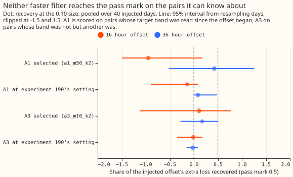
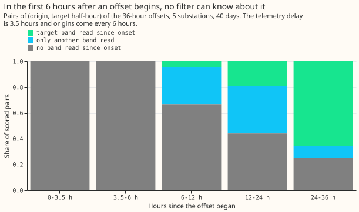
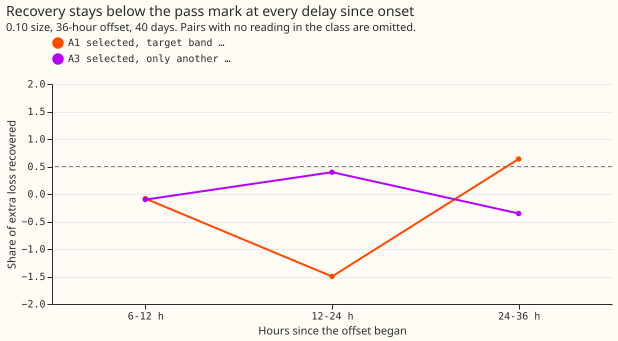
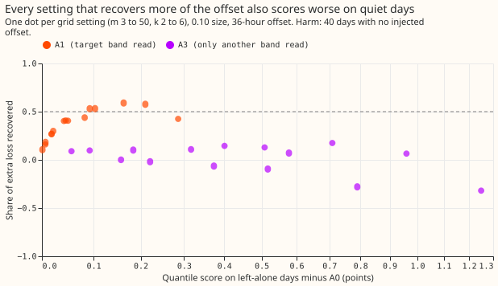
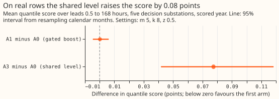

# Retest of the faster Kalman level state with a fair known-answer gate

---

**Take-home: making the level state faster does not fix offsets that last for hours.** A faster
filter recovers a long offset only late, and only by scoring worse on quiet days. A level shared
across the four hour bands recovered under a fifth of the offset. The 15 smooth-offset days of
[experiment 175](../00175-dp-unlabelled-day-shapes/result.md), on which the forecast error kept one
sign for hours, are therefore unlikely to be a filter-speed problem: no setting recovered an
injected offset of that kind. Level adaptation is dropped.

We asked again whether a Kalman filter that speeds up its level state helps when the forecast error
keeps one sign for hours. The level state is the slowly moving offset that the filter adds to the
forecast, in the convex demand model (a generalised additive model, GAM) with a Kalman filter
(GAM-K). The filter keeps one level state for each of four hour bands of the day. [Experiment
190](../00190-dp-kalman-level-adaptation-gated-boost/result.md) could not tell, because its test
counted many pairs (an origin and a target half-hour) that no filter with one state per hour band
can learn about. This time we added a
known one-signed offset to the observed power of ordinary days, as in experiment 190, and scored only
the pairs the filter could know about. We measured the share of the offset's extra quantile-score loss that each
filter removed (its recovery), and checked the filters on quiet days, which have no injected offset.
A0 is the unchanged filter, A1 a faster per-band level, and A3 a level shared across bands (there is
no A2 here; experiment 190's A2, the always-on boost, appears only in the next paragraph).

**Verdict: `not supported`.** Neither pre-registered recovery of 50% was reached within the +0.005-point
bound on harm on quiet days. Experiment 190's finding stands: the always-on boost scored 0.023 points worse on the
scored year, so a faster filter alone is not the answer.

## Arms and method

- **A0:** arm D of experiment 155, with the filter's level noise unchanged.
- **A1:** the level's process noise is multiplied by m while the last k one-step innovations (pooled
  over the four hour bands) share one sign and their mean exceeds 0.5 times the day-before
  innovation spread. Grid: m in 3, 5, 10, 20, 50 and k in 2, 4, 6.
- **A3:** as A1, and while the counter is on, one innovation moves the level of every band. Same
  grid. A3 was run under experiment 190's frozen setting (m 5, k 8, z 0.5), where it failed;
  experiment 190's stored scored-year forecasts give A3's real-row result, so no forecaster or
  filter was rerun on real rows.
- **Gate:** offsets of 0.05, 0.10, and 0.20 of the day's median load, lasting 8, 16, and 36 hours, 8
  days per substation per cell (40 days per cell), the same days and offsets as experiment 190. Every
  pair is labelled `band_read` (the target's band has a reading since the onset), `other_read` (it
  has none, another band has), or `unread` (no band has). Recovery is one minus the arm's excess loss
  over the clean A0, divided by A0's excess over the clean A0. Intervals resample whole days (4,000
  resamples).
- **Selection:** each setting of A1 and A3 was chosen by its recovery on the sizes 0.05 and 0.20
  (A1 on `band_read` pairs, A3 on `other_read` pairs, all durations) and tested at 0.10. The chosen
  settings are **A1 m 50, k 2** and **A3 m 10, k 2**.
- **Lab shortcuts:** the forecast of a half-hour is the proxy-weather prediction plus the filter's
  correction, so weather error is absent. Origins come every 6 hours. Retraining schedule: the
  monthly T-all fits stored by experiment 136, shared by every arm.

## Results

**Pre-registered predictions** (the 0.10 size; recovery with its 95% interval):

- **P1 fails.** A1 at m 50, k 2 recovered -0.95 (-7.7 to +0.2) of a 16-hour offset on `band_read`
  pairs, and 0.42 (-0.5 to +1.3) of a 36-hour offset. Four settings (m 10 k 2, m 20 k 2, m 20 k 4, m 50 k 4)
  reached 0.53 to 0.59, at 36 hours only. The 16-hour test holds just 141 `band_read` pairs (26 days).
- **P2 fails.** A3 at m 10, k 2 recovered 0.11 (-1.1 to +0.8) and 0.17 (-0.3 to +0.5) of 16-hour and
  36-hour offsets on `other_read` pairs. At experiment 190's setting A3 recovered -0.01 and -0.02.
- **P3 fails.** On 40 days with no offset, A1 at m 50, k 2 scored +0.286 points against A0 (+0.145
  to +0.434), and A3 at m 10, k 2 scored +0.709 (+0.482 to +0.938). The smallest-harm settings
  (m 3, k 6) recovered about 0.1 of a 36-hour offset.
- **P4 fails.** On the scored year, A3 minus A0 is +0.0775 (95% interval +0.042 to +0.118; 0 of 5
  substations better), from experiment 190's stored forecasts at m 5, k 8, z 0.5. A1 at that
  setting minus A0 is +0.0002 (-0.0046 to +0.0062).
- **P5 holds.** In the first 6 hours after the onset, no band has been read in any pair, so no
  filter can learn about the offset. The share of pairs with the target band read rises from 0 to
  0.05 (6 to 12 hours), 0.19 (12 to 24 hours), and 0.65 (24 to 36 hours) for the 36-hour offsets.

**Where the boost helps and where it overshoots** (A1, m 50, k 2, 36-hour offset, `band_read`
pairs): recovery is 0.64 at 24 to 36 hours after the onset and -4.4 at 12 to 24 hours, because A0
already follows most of the offset there and the boost overshoots. Figure 3 clips values at -1.5.

- Post hoc: A3 on pairs whose target band was already read recovers -2.1 (-15.6 to -0.5) at 36
  hours, so sharing the level moves a band that was already right.
- Experiment 190's setting for A1 (m 5, k 8) recovers 0.09 (0.00 to 0.48) at 36 hours on
  `band_read` pairs, close to arm D by construction.

## Checks

- Median forecast minus mean forecast per site: not computed here, because no forecast was built;
  experiment 190 found 0.00 at every site and arm for the stored arms used.
- Mean-forecast error beside the quantile score: not recomputed; experiment 190 reported C4 (A3
  minus A1) as worse on both.
- Triggers: trigger 1 fired (a known-answer test was failed by A3 and by A1 at 16 hours), and
  trigger 2 may apply, because P2 contradicts the prediction. No audit has run. The explanation
  tested here is that sharing the level moves bands that are already right (post hoc recovery above,
  and +0.7 points on quiet days).
- Tails and curtailment cost were not scored: no new forecast exists.

## Caveats

- Gate days are the even months of 2024-07 to 2025-06, on proxy weather, at 5 substations.
- Origins are aligned to the offset's start (every 6 hours from 6 hours before it), so the first 6
  hours are unread by construction, and the shares of read classes in later bins lean towards unread.
- The 16-hour band-read test has 141 pairs from 26 days, so its interval is wide (-7.7 to +0.2).
- Real-row evidence for A3 and A1 comes only from experiment 190's setting (m 5, k 8, z 0.5). The
  selected settings of this experiment were not run on real rows, because they already fail the
  gate's harm test.
- The counter counts readings, so after a gap in the data it can span more than the stated hours.

## What to try next

- One option is to look at the mean forecast model for the 15 smooth-offset days: an input the GAM lacks, such as heating or
  behaviour, is the remaining candidate.
- Another option is a small learned head that reads whether neighbouring Primaries show the same-sign residual, with
  the convex GAM-K as the comparison arm. The prediction that could fail: it recovers at least 20% of
  the excess loss on the 15 smooth-offset days, which no filter here did.
