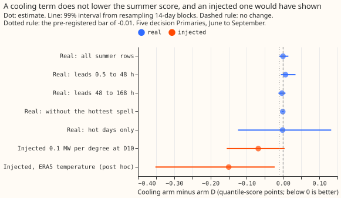
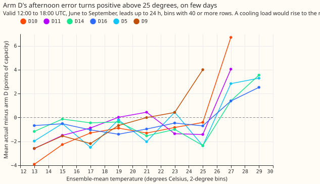
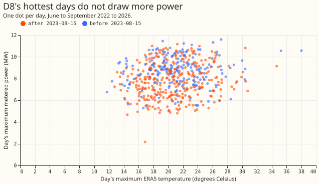
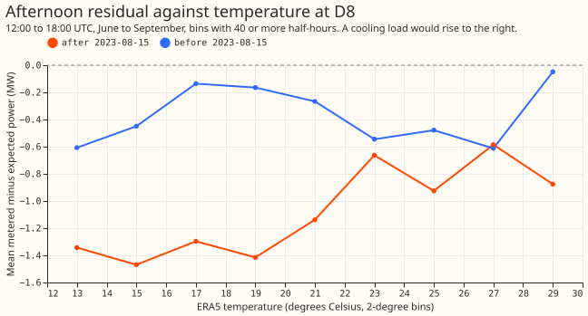
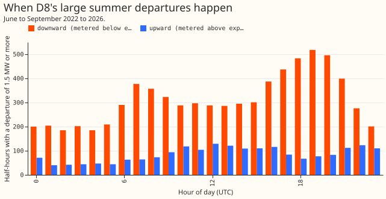

**We asked whether the upward jumps a colleague saw in the summer power of one substation, D8
(Marsh Lane, the label this project gives one of its Primary substations), are air-conditioning
load, and whether the best-guess forecast needs a cooling term.** The best-guess forecast is
experiment 155's arm D. A cooling term is an extra forecast input that adds power when the
temperature is above a threshold, called tau below. We looked at D8's June-to-September power
against temperature, and at the size and timing of its departures from expected power (the output of
a fitted demand model). We then added a cooling term to arm D at the five decision Primaries (D5,
D10, D11, D14, and D16), the substations that have stored arm D forecasts (D8 has none), and
rescored the June-to-September rows.

**D8's spikes are not cooling load, and the cooling term did not help, but the experiment could not
rule a cooling term out.** Before 2023-08-15, D8's afternoon residual (metered minus expected power)
has a partial Spearman correlation of +0.004 with the temperature above 20 degrees Celsius,
controlling for day of year. Its large departures from expected power are mostly downward (the
figures of D8's departures below), which matches experiments 186 and 194: a 6 MW gas engine, whose
output is added back to D8's reading, causes downward shortfalls that follow the electricity price.
The cooling term changed the five Primaries' summer score by -0.0002 points of quantile score (the
pinball loss averaged over 11 quantiles, in points of effective capacity). The check that a
threshold chosen on 4 fit months (July to September 2024 and June 2025) also helps in each held-out
month failed, so the rule we fixed before seeing any result gives the verdict `inconclusive`.
ERA5 below is the European Centre for Medium-Range Weather Forecasts' reanalysis of past weather.

## Figures

## Results

**D8 (experiment 159's stored table of D8's power, expected power, and ERA5 temperature; ERA5 is
observed after the fact, which a live forecast would not have).**

- Departures of 1.5 MW or more from expected power in June to September: downward in 18.3%, 18.8%,
  35.9%, and 52.1% of half-hours in 2022 to 2025, upward in 5.0%, 7.7%, 10.5%, and 6.5%. June 2026
  reverses: 11.3% downward and 21.3% upward.
- Each year's largest upward departure is 2.7 to 6.0 MW, and its largest downward departure is 4.6
  to 9.3 MW. The median hour of both kinds is about 14:00 UTC (13:30 upward, 14:00 downward).
  Readings flagged as zero are 0.2% or fewer of summer half-hours in every year, so zero-reading
  artefacts do not explain the spikes (we did not test for stuck values).
- Mean temperature is 19.0 degrees at upward departures, 17.6 at downward ones, and 17.0 across all
  summer half-hours. The daily maximum power has a correlation of 0.13 with the day's maximum
  temperature (a look at the data before the plan was written, not a test).
- Prediction (1), that the correlation is below +0.15: the partial Spearman correlation of the
  afternoon residual with the hinge
  max(0, T - 20), on days of 22 degrees Celsius or more and before 2023-08-15, when the engine's
  readings stop carrying output, is +0.004 on 912 half-hours,
  below the +0.15 bar. After 2023-08-15 it is +0.051 on 1,308 half-hours.
- We fitted the cooling hinge with tau 20 by median regression on summers 2022 and 2023 before
  2023-08-15. On 15,407 later summer half-hours it changes the mean absolute residual by -0.001 MW
  (99% interval -0.004 to +0.001), against 1.97 MW before the term. With noise added to the
  temperature the
  change is -0.0001 MW (-0.002 to +0.001). The noise standard deviation of 1.2 degrees is an
  assumption, not a measured ensemble error.
- The spikes are therefore not cooling load. The upward departures appear mostly when the downward
  shortfall fades in 2026. That pattern fits expected power having been learned from a window that
  contains the engine's shortfalls. We did not test that account here.

**The five decision Primaries (arm D of experiment 155, ensemble temperature at forecast time).**

- Eligibility: at the median Primary the 4 fit months hold 111, 91, 70, 41, and 18 days above 16,
  18, 20, 22, and 24 degrees Celsius, so all five thresholds were eligible. The leave-one-month-out
  comparison gave the best held-out score at 24 degrees, with a held-out gain in only 2 of 4 months,
  so the sign check failed.
- C1 (the cooling arm's score minus arm D's, quantile score over leads 0.5 to 168 hours, June to
  September): -0.0002
  points (99% interval -0.0103 to +0.0147; 14-day blocks, 11 blocks). Leads 0.5 to 48 hours: +0.0067
  (-0.0061 to +0.0344). Leads 48 to 168 hours: -0.0030 (-0.0127 to +0.0067). Without the hottest
  spell (7 days): -0.0009 (-0.0035 to +0.0019). Hot days (12 days in which some Primary reaches 25
  degrees, in 5 spells, a spell being a run of consecutive days): -0.0014
  (-0.1241 to +0.1327) on 12,174 rows.
- Absolute summer scores, arm D then cooling arm, in points: D5 3.182 and 3.178; D10 2.969 and
  2.972;
  D11 2.300 and 2.307; D14 1.978 and 1.979; D16 2.314 and 2.306.
- Placebo (200 draws of other weeks and years' temperatures, tau held at 24): gains from -0.0014
  (5th
  percentile) to +0.0079 (95th), median +0.0019. C1 lies above the 5th percentile, so the term did
  not beat the placebo.
- Known answer (0.1 MW per degree above 20 degrees injected at D10, shaped by an afternoon bell
  curve, driven by ERA5): the fitted effect is 49% of the injected sum, and C1 on the injected data
  is
  -0.068 (-0.155 to +0.004), so the check failed. Post hoc: forcing tau 20 gives 59%, and replacing
  the ensemble temperature by ERA5 gives 78% (tau chosen) or 83% (tau 20), with C1 -0.150 (-0.352 to
  -0.023) in the last case.
- Prediction (2), that the correlation is below +0.15 at 5 or 6 of 6 Primaries: the partial
  correlation of the afternoon residual with the hinge is +0.26 at D10 and +0.21 at D9, and +0.04,
  +0.07, +0.01, and +0.07 at D5, D11, D14, and D16. It is below +0.15 at 4.
- Post hoc, we selected afternoons with an ensemble-mean temperature of 25 degrees Celsius or more
  (leads up to 24 hours, June to September, all periods). On those afternoons, actual power minus
  arm D (in points of effective capacity) averages +0.90 (D5, 232 rows on 26
  days), +4.68 (D10, 85 rows on 8 days), +2.48 (D11, 109 rows on 12 days), +0.60 (D14, 174 rows on
  22
  days), +1.17 (D16, 251 rows on 29 days), and +5.09 points (D9, 45 rows on 5 days). At 19 to 25
  degrees the same difference averages -0.97, -1.08, -0.27, -1.36, -0.92, and +0.42 points.

## Checks

- Median minus mean forecast is 0.00 points at every Primary: arm D's median equals its mean.
- The mean forecast's mean absolute error beside each score change, arm D then cooling arm, in
  points:
  D5 5.548 and 5.538; D10 4.997 and 4.999; D11 4.121 and 4.131; D14 3.458 and 3.454; D16 4.081 and
  4.062. Neither the score nor the error moves in a consistent direction.
- Leaving one Primary out moves C1 between -0.0020 and +0.0019. Every 99% interval includes zero.
- Two conditions for a fresh audit were met. The known-answer check and the sign check failed, and
  the correlation prediction failed at 2 of 6 Primaries (the post hoc hot-end table is the
  explanation we
  tested). No audit has been run. Whether to run one is the maintainer's call, because the headline
  is a null. This page claims no more than `inconclusive`.

## Caveats

- Arm D's spread was fitted on its tuning months (the months used to set the quantile width). Its
  mean includes recipe R, the step that corrects the last 14 days' error, and R may absorb part of
  a cooling load.
- Only 4 summer months fit the hinge and 4 score it, from 2024 to 2026, so the scored rows are one
  summer (2025) plus June 2026 and hot days are few. The blocked intervals rest on 11 blocks.
- D8 has no stored forecast from arm D, so its test uses the residual of the convex demand model,
  refitted on the 1st and 16th of each month (the table stored by experiments 130 and 159), with
  ERA5 temperature. D8's cooling term is not comparable with the Primaries'.
- The pre-registered fit rule deviates in two small ways from the plan text: the eligibility count
  uses the median Primary, and the placebo draws temperatures a year (plus or minus 0 to 28 days)
  away for each 14-day block.

## What to try next

- Fit a cooling hinge on the long weather history, pooled across Primaries, so that the fit holds
  dozens of days above 25 degrees instead of 4 to 18. Keep the known-answer injection as the gate.
- Ask NGED whether the engine's output is still added back to D8's reading, which decides whether
  D8's upward departures are real demand.

## Plan

- **Look first.** Plot D8's June to September power against the day's maximum temperature and the
  hour of day, for each year from 2022 to 2026. Say whether the spikes are upward or downward, their
  size in MW, and when they occur.
- **Separate the candidates.** Cooling load rises smoothly with temperature and peaks in the
  mid-afternoon of the hottest days. The engine shortfalls of experiments 186, 194, and 196 are
  downward and follow the price. Switching transfers are steps that repeat at both ends. Metering
  artefacts are readings of zero or a stuck value. The look sorts each large departure into one of
  the four by its shape, hour, and temperature.
- **Cheap test, then fit.** Correlate the summer afternoon residual with temperature at every
  Primary, then fit the cooling hinge of the decision rule above and score it against arm D on the
  same rows.
- **Weather source.** The hinge uses the ensemble-mean temperature at the valid time, which exists
  at
  forecast time. D8's panel uses ERA5, which arrives about 5 days late; that is a lab shortcut and
  is
  labelled.
- **Prior advice followed.** Experiment 155's scoring (quantile score, rows outside the hand-
  filtered
  switching events) and its Primaries; the placebo is built from permuted days, not shifted
  indicators, as experiment 155's audit advised.
