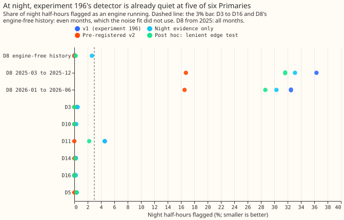
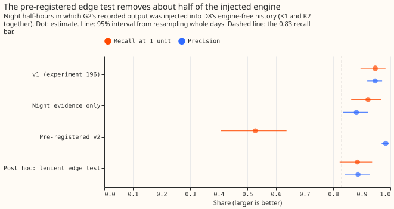
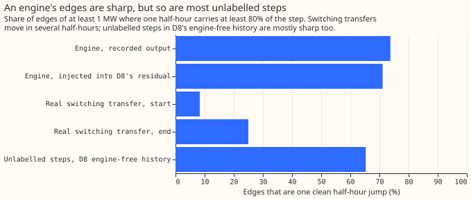
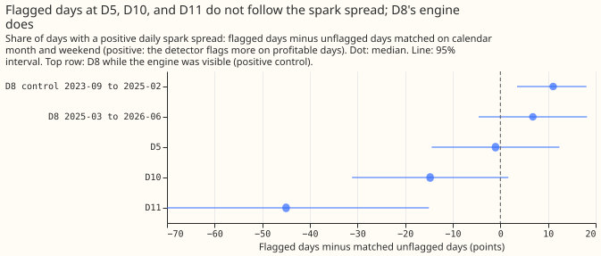
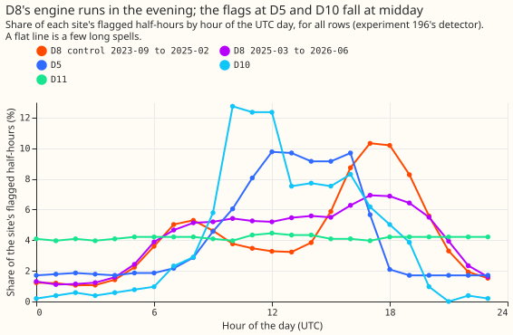

**D8's over-flagging from March 2025 is not caused by solar panels, and the three engine features
(edge shape, night evidence, price) do not fix it.** The detector from experiment 196 still flags
29% to 36% of D8's night half-hours from March 2025, when no solar panel produces power. The
pre-registered edge test also throws away about half of the engine that we inject. At the other
Primaries, the false alarms of experiment 196 turn out to be daytime flags: scored on night rows
alone, experiment 196's own detector passes the false-alarm bar at five of six, and the flagged days
at D5, D10, and D11 do not follow the spark spread. The verdict is `not supported`.

We asked whether three facts about a gas engine, which experiment 196's detector ignored, would cut
its false alarms. The facts are that an engine's edges are single-half-hour jumps, that it can run
at night when solar panels cannot, and that it runs more when the system price is high. We tested
each feature alone and together on the same known answer as experiment 196: the recorded output of a
metered gas-engine generator (G2), subtracted from D8's reading. We then counted false alarms at
seven other places, and checked whether the flagged periods at D5, D10, and D11 look like engines.
The method builds on [Hart (1992)](https://doi.org/10.1109/5.192069) and [Kolter and Jaakkola
(2012)](https://proceedings.mlr.press/v22/zico12.html) through experiment 196's hidden Markov model
of the number of engine units running; the edge test, the night mask, and the price gate are this
project's.

## Figures

## Results

- **Arms.** v1 is experiment 196's detector unchanged. N sets every daytime reading to missing so
  that only night evidence counts. S drops a flagged spell unless both edges are one sharp jump. P
  drops a spell whose mean spark spread is in the lowest fifth. v2 is N plus S plus P. Post hoc: N
  plus P, and N plus S with either edge sharp plus P. All arms are scored on night rows, with all
  rows as secondary (`printed_known_answers.txt`, `printed_false_alarms.txt`).
- **Look first (`printed_shape.txt`).** An engine's edges are sharp: 74% of G2's edges (61 edges)
  and 71% of the edges after injection into D8's residual (571 edges) are one clean half-hour jump,
  and the others have one partial half-hour. Real switching transfers are gradual: 8% of 12 starts
  and 25% of 12 ends are one clean jump. Unlabelled steps in D8's engine-free history are sharp as
  often as an engine's edges (65%, 49 steps), so sharpness cannot separate an engine from them. Only
  24 of the 70 edges of the 35 labelled transfers are 1 MW or more.
- **Known answers, K1 and K2 pooled, night rows (9,542 half-hours).** v1: recall at 1 unit 0.95
  (0.90 to 0.98), at 2 or 3 units 1.00, precision 0.95 (0.92 to 0.97), energy error -8%. N: 0.92, 1.00,
  0.88, -2%. **v2: 0.53 (0.41 to 0.64), 0.66, 0.98, -40%, so every recall threshold fails.** K1 and K2
  alone give 0.50 and 0.53 at 1 unit for v2. Edge-test levels 0.5 and 0.7 give 0.58 and 0.44. Post
  hoc N plus P: 0.90, 0.99, 0.88, -3%. Post hoc lenient edge test: 0.88 (0.82 to 0.94), 0.99, 0.89, -4%.
- **Why the edge test fails (post hoc, `printed_diag_edges.txt`).** At the true start of G2's runs only
  69% of edges pass the test, and at the true end 81%. The test misses short runs whose edges lie
  within 3 half-hours of each other, and steps that fall under half a unit in D8's noise.
- **K3 (G2 injected into D8's night rows from 2025-03, recall only, descriptive).** v1 recall at 1 unit
  0.92 (0.79 to 0.99); v2 0.36 (0.19 to 0.55). Precision is not meaningful there.
- **False alarms at night (flagged share; false active days a month).** Bar: 3% and 1 day. v1 passes
  at D3 (0.4%, 0.22), D5 (0.3%, 0.07), D10 (0.1%, 0.04), D14, D16, and D8's engine-free history, and
  fails at D11 (4.6%, 1.08). N fails at D8's engine-free history (2.6%, 1.45). v2 is 0.0% with 0.00
  days at every one of these, and v2 on all rows is also 0.0% at D3, D5, D10, D11, D14, and D16.
- **D8 from 2025-03 (relaxed bar capped at 10%).** v1 flags 36.3% of night half-hours (22.9 days a
  month) in 2025-03 to 2025-12 and 32.5% (18.8) in 2026-01 to 2026-06. N: 33.1% and 30.3%. v2: 16.7%
  (10.6) and 16.5% (9.7). Post hoc lenient: 31.6% and 28.7%. The left tail below -2.5 MW holds 18.8%
  and 11.6% of night half-hours. Both periods fail the bar for every arm.
- **Price gate.** It changes little: at night it removes under 1.5% of D8's flagged half-hours from
  2025-03 and none at D3, D10, or D14. On all rows it cuts D5's false active days from 2.02 to 1.72 a
  month and D10's from 1.05 to 0.90. The gate is only scored from 2023-06 (D8's engine-free history
  has 576 even-month rows with a price), and K2's price is G2's own at the time it recorded the
  output, which favours the gate.
- **Flagged periods at D5, D10, and D11 (supporting evidence only, `printed_step5.txt`).**
    - D8 while the engine is visible (2023-09 to 2025-02, positive control): flagged days have a
      positive spark spread +11.1 points more often than matched unflagged days (95% 3.5 to 18.1)
      and a
      spread £19.8 per MWh higher (15.4 to 24.6); the flagged half-hours peak in the evening.
    - D5: -1.0 points (-14.4 to +12.4); 27% of flagged half-hours at night against 46% of all rows;
      flags peak at 10:00 to 16:00 UTC. The 13 days with 4 or more flagged night half-hours show +30.8
      points (0 to 61.5), too few to read.
    - D10: -14.8 points (-31.1 to +1.6); 3% of flagged half-hours at night; flags peak at midday.
    - D11: -45.0 points (-70.0 to -15.0) from 20 flagged days; 65% at night, with a flat hour
      profile, which suggests a few long spells that are not an engine's evening pattern.
    - D8 from 2025-03: +6.8 points (-4.5 to +18.2), but 482 of 485 days are flagged, so the matched
      pool is 3 days and the test cannot be read.
- **ECR (`printed_ecr.txt`; supporting evidence, NGED has not been asked).** D5 has a 1.0 MW oil
  engine 3.25 km away, connected 2021-03-11, before every flagged period. D10 has no gas, oil, CHP,
  or battery site within 5 km. D11 has a 0.2 MW battery connected 2026-04-13 and a 0.499 MW biomass
  steam turbine connected 2014, neither of which is a price-following engine in the flagged period.
  D5's flags do not follow the spark spread, so the ECR engine and the flagged periods do not match.

## Checks

- **Median minus mean forecast per site:** not applicable; no forecast is made.
- **Mean-forecast error beside a quantile-score contrast:** not applicable.
- **Triggers fired (no audit was run; the experiment is short of credits for an Opus audit, and the
  maintainer can call one).** Trigger 2: the prediction that night evidence cuts D8's night flags to
  under 10% failed (33%), and the prediction that flagged days at D5 follow the spark spread failed.
  The session tested an explanation for each: the night rows of D8 are flagged at the same rate as the
  day rows, and the spark-spread test shows the positive control works. Trigger 5: v1 on night rows
  beats N (which holds less input) at D8's engine-free history (0.0% against 2.6%).
- **Edge-test thresholds** (0.6 of the step, 0.5 unit) came from the look at G2's edges, so K1 and K2
  could not test them independently; the test fails even there.
- **Lab shortcuts.** ERA5-driven expected power from the stored panel, smoothed posteriors, the
  frozen 1.75 MW unit from experiment 196, noise for the other Primaries fitted on their whole
  history. The noise fit saw D8's odd months, so D8's engine-free history is scored on even months.
- **Edge cases.** D3's coordinates are approximate (the night mask moves by minutes). Night is
  defined by solar elevation below -3 degrees, and an active day is a UTC date, so a night spanning
  midnight counts on two dates.
- **Plan review.** A Sonnet reviewer found 10 points before any score was read; the plan was revised
  for 9 of them (the price in the K2 injections was kept at G2's own recording time, flagged as
  favourable to the gate).

## What to try next

- Find what steps D8's night load from 2025-03 (the night flag rate of 29% to 36% is not solar), for
  example by looking at the hour of day and the size of those night steps against the 8.91 MW of 11 kV
  solar's connection date and any new battery.
- Do not run PS3 or later stages on the engine detector. Experiment 196's labels remain usable for
  2023-09 to 2025-02 only.
- If a detector of price-following assets is still wanted, use the evening pattern of D8's visible
  engine (Figure 5) as the signature, not the edge shape.
