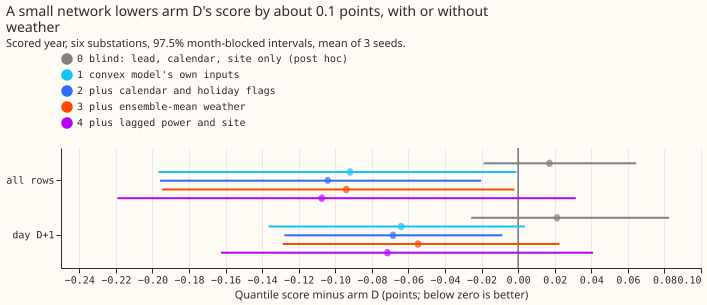
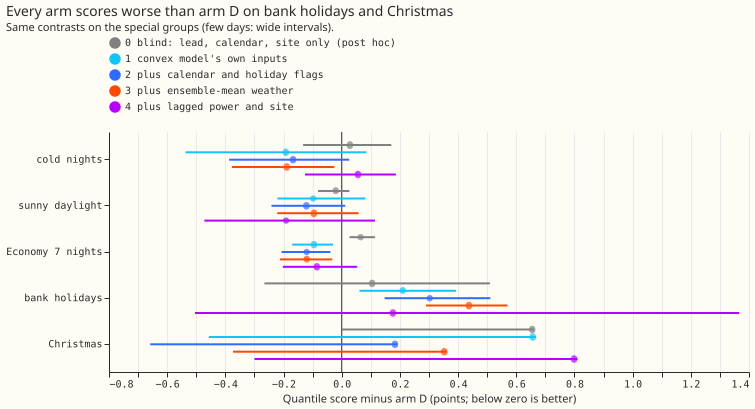
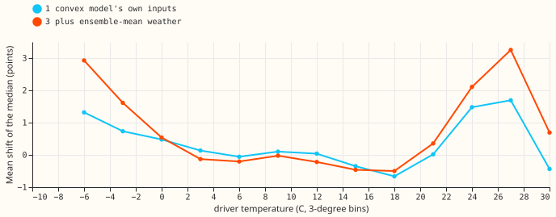
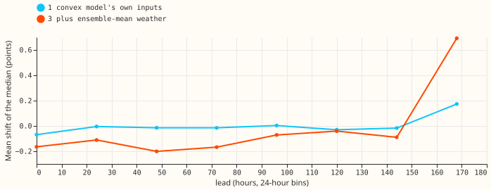
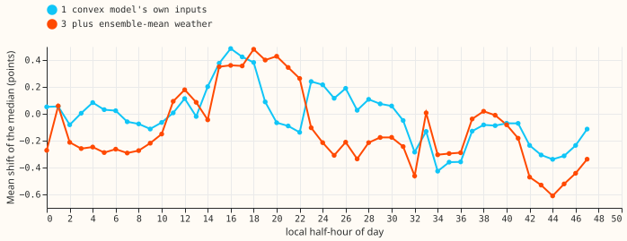
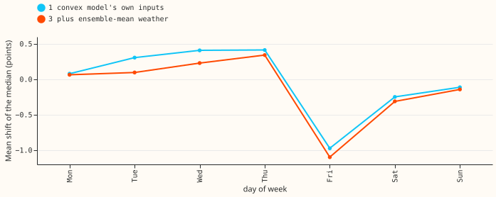

# Experiment 201: a small neural network that corrects the convex demand model's forecast

**A small neural network that reads the convex demand model's forecast lowers that forecast's
quantile score by about 0.09 points of effective capacity (3%), and adding weather, calendar, or
lagged power did not help further.** A negative contrast means a lower (better) score. Arm D is
the best-guess forecast from
[experiment 155](../00155-dp-bg-stage2-assembly-night-offset-and-error-correction/result.md): a
convex demand model whose recent errors feed a Kalman filter, with a winter night offset and a
14-day error profile (recipe R) subtracted. We trained a neural network with two hidden layers of
64 units to shift arm D's median and rescale the width of its uncertainty bands. Each arm gives the
neural network more inputs: arm 1 the demand model's own inputs, arm 2 adds calendar and holiday
flags, arm 3 adds ensemble-mean weather, and arm 4 adds power lagged by whole days. The neural
network never saw the scored year, 2025-07 to 2026-06, which covers six substations.
[Experiment 142](../00142-differentiable-physics-sequence-model-on-gam-k-residuals/result.md) gave
a network the residual history only.

**Most of the gain is a recalibration of arm D's own output, the useful lead is a lift of up to 3
points in the median below -3 °C and above 24 °C, and holidays get worse.** Arms 1 to 4 each score
about 0.09 to 0.11 points below arm D. A neural network given calendar, lead, and site but no
forecast or weather (arm 0) scored +0.017 against arm D, which is no gain. A neural network given
only arm D's forecast, lead, and time of day (arm 6) scored -0.086. The gain therefore comes from
re-reading arm D's own output. The neural network mostly raises the median on hot days and very cold
days, which suggests the convex demand model lacks a temperature term.

**The pre-registered prediction failed on both conditions.** The interval of arm 3 or arm 4 was not
wholly below -0.02 points, and bank holidays and Christmas worsened by more than 0.05 points. The
Christmas group is one month (2025-12, plus 2 days of 2026-01), so its interval is not informative.

## Results

- **Arms and inputs.** Arm 1 has 19 input columns, arm 2 28, arm 3 32, and arm 4 41, so the arms
  differ in their number of input columns. Arm 0 (blind: lead, calendar, site; 25 columns), arm 5
  (arm 1 without the filter's level and anomaly), and arm 6 (arm 1 without the temperature, solar,
  and darkness terms) are post hoc. Network: two hidden layers of 64, zero-initialised output,
  weight decay 1e-3, early stopping on every fourth month of the pool, pinball loss over 11
  quantiles, 3 seeds.
- **Row set.** Training uses every row before 2025-07: past-weather rows from 2020-01 to 2024-06,
  plus ensemble-era rows of experiment 155's tuning and replicate months. Scoring uses the 561,363
  scored-year rows (one per substation, forecast issue time, and valid time) at the six substations
  D5, D9, D10, D11, D14, and D16, outside the hand-filtered switching events. Arm D rows are
  experiment 155's stored forecasts, and its five-substation score reproduces experiment 155's 2.756
  exactly.
- **Scores over leads 0.5 to 168 h (points; arm D 2.691).** Arm 0 2.709; arm 1 2.599; arm 2 2.587;
  arm 3 2.597; arm 4 2.584; arm 5 2.621; arm 6 2.606.
- **Contrast against arm D (97.5% month-blocked interval).** Arm 1 -0.092 (-0.197 to -0.001); arm 2
  -0.104 (-0.196 to -0.020); arm 3 -0.094 (-0.195 to -0.002); arm 4 -0.107 (-0.219 to +0.032); arm
  0 +0.017 (-0.019 to +0.065); arm 5 -0.070 (-0.162 to +0.005); arm 6 -0.086 (-0.173 to -0.031). At
  day D+1: arm 1 -0.064, arm 3 -0.055, arm 4 -0.071.
- **Special groups, arm 3 minus arm D.** Cold nights -0.189; sunny daylight -0.096; Economy 7 nights
  -0.120; bank holidays +0.437 (+0.290 to +0.570); Christmas +0.352 (-0.374 to +0.360, from one
  month). The bank-holiday and Christmas groups hold 19 days from one year (9 at Christmas).
- **Tail calibration, arm D then arm 3.** Coverage of q01 2.3% then 2.1%; q05 7.1% then 7.3%; q95
  94.7% then 93.7%; q99 98.2% then 97.8%. Pinball at q95 1.452 then 1.391; at q99 0.445 then
  0.441. Arm 4's q95 coverage fell to 90.3%.
- **Known-answer gate (passed).** On the scored year the network recovered 71% of an injected
  interaction (cold-evening effect up to 3 points plus a 1-point Saturday-evening shift): 24% of the
  cold-evening part and 76% of the Saturday part. On rows with no injection the network scored 0.005
  points worse than the same network trained on the real power. Post hoc: the pre-registered
  wording measured change against arm D, which cannot work because the network also improves arm
  D (-0.09), so the recovery and the harm are measured against a control network trained on the
  real power.
- **What the network learned.** The median shift is 0 to 0.5 points between 0 and 21 °C and rises to
  +1.7 (arm 1) or +3.3 (arm 3) points at 24 to 27 °C and to +1.3 or +2.9 at -6 °C (figure 3); it is
  near zero at every lead except the last day (figure 4).

## Checks

- **Difference from experiment 200's blind arm.** The pooled correction head of experiment 200
  reports that a head with its error and Kalman-state inputs zeroed keeps most of its gain (-0.100
  of -0.125). Our arm 0 is blinder: it has no input from arm D at all, so it gains nothing (+0.017).
  The two agree where they overlap: arm 6, which keeps arm D's mean, bands, lead, and time of day
  but not the weather, scores -0.086, and arm 5, which drops the filter state, scores -0.070. The
  gain therefore comes from a function of arm D's own mean and the calendar, not from reading its
  recent errors.

- **Median minus mean, per site.** Arm D's `q50` equals its mean exactly at all six substations
  (0.000), so rescaling the bands cannot move the median.
- **Error of the median beside the quantile score.** The mean absolute error of the median is 4.623
  for arm D and 4.581 (arm 1), 4.535 (arm 2), 4.554 (arm 3), 4.476 (arm 4), the same direction as
  the quantile score.
- **Leave one substation out.** Every leave-one-out contrast for arms 1 to 4 stays between -0.047
  and -0.147; D16 carries the most (-0.32 alone).
- **Audit triggers.** The `ml-experiment` skill lists seven conditions that call for an audit.
  Trigger 2 (a result contradicts its own prediction) fired (arms 1 and 2 were predicted to gain
  0.00 to 0.01 and gained about 0.09 to 0.10); arms 0, 5, and 6 test the explanation and support it
  (see above), so no audit was run. Triggers 1, 3, 4, and 5 did not fire. Trigger 6 was not checked
  against a sister experiment.

## Caveats and what to try next

- **Early-era rows have smaller weather error than live rows.** The 2020-01 to 2024-06 training
  rows use ERA5 (the ECMWF reanalysis) and CAMS (the Copernicus atmosphere service) as the weather,
  so a neural network trained on them may under-correct. The scored
  year uses ensemble-mean weather only.
- **One scored year and six substations.** The gain rests on 12 months, and D16 gives the largest
  share of it. Sixteen Primaries were planned; the other ten lack a pinned solar capacity and
  ensemble frames, so they were not built.
- **The gain is concentrated in three substations.** Arm 1 scores -0.162 at D5, -0.091 at D14, and
  -0.320 at D16, but +0.024 at D10 and +0.028 at D9; arm 3 is +0.038 at D9. Arm 4's q99 coverage
  is 96.0% and its q99 pinball is 0.511 against arm D's 0.445.
- **The gate's weather part was weak.** The cold-evening effect was injected from the observed
  temperature while the network sees the ensemble-mean temperature, and only 24% of that part
  was recovered; the pass rests on the Saturday part (76%). The statement that weather adds nothing
  is therefore weaker than the calendar and lag statements.
- **Two small leaks and a clip.** 4,320 training rows from the last replicate run have valid times
  inside the scored year (targets only, 0.8% of valid times). The spread tables are refitted on
  the odd months of the training period, so training bands are slightly better calibrated than the
  scored year's. Network inputs are clipped at 5 standard deviations because a lagged-power spike
  of 140 points sent arm 4 far outside the data in a first run.
- **No refit through the scored year, and one seed pool.** The network is trained once on rows
  before 2025-07. A weekly refit, as production would use, was not tested.
- **Wind, humidity, and school holidays were not available** in the stored arrays, so arm 3 has
  temperature and shortwave only, and the calendar has no school-holiday flag.
- **A candidate follow-up is extra heating and cooling terms in the convex demand model.** The
  prediction that could fail: adding a cooling hinge above 21 °C and a steeper heating hinge below 0
  °C to arm D lowers its score by at least 0.05 points without a network.
