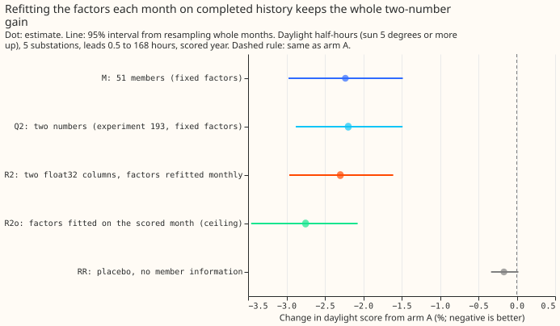
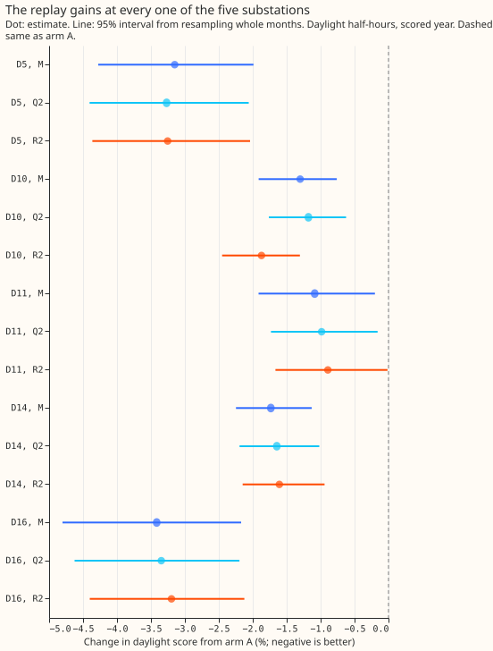
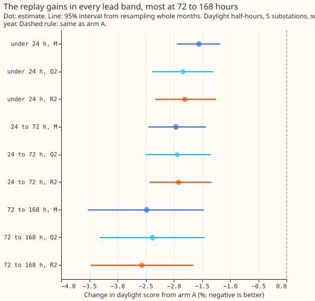
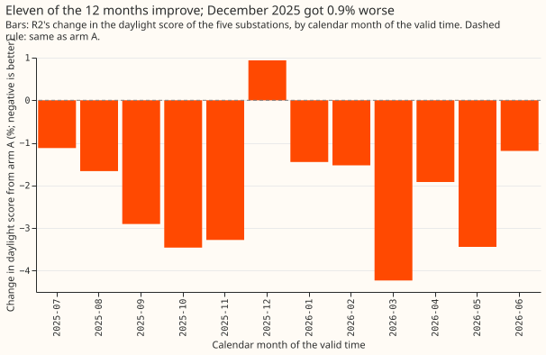

# Experiment 202: the two-number solar summary in a rolling replay of the live weather layer

**A weather layer that stores two numbers per half-hour keeps the whole daylight gain when it is
run the way production would run it.** The two numbers are the mean and the standard deviation of
the 51 ensemble weather members' estimates of solar output, stored as float32 columns. The
factors that rescale them are refitted each month, on history that had completed before the month
began.

Experiment [193](../00193-dp-ens-two-number-solar-summary/result.md) found that the two numbers keep
98% of the 2.2% daylight gain that running all 51 members gives
([experiment 187](../00187-dp-ens-members-in-stack/result.md)). Its factors, however, were fitted on
interleaved months, some later than months they were applied to, and held in float64. Here we
replayed the scored year of experiment 193: for each month, the factors came from the trailing 365
days of runs whose last valid time (origin plus 168 hours) was before the month's first origin, the
two columns were rounded to float32, and each run used only its own 00 UTC ensemble run (published 9
hours before the origin). The score is the quantile score (twice the mean pinball loss over 11
quantiles, in points of effective capacity; lower is better). Arm A is experiment 187's full
best-guess forecast; arm M passes all 51 members through the solar term; Q2 is experiment 193's
two-number arm with fixed factors; R2 is the replay. D5, D10, D11, D14, and D16 are anonymised
substations. Each interval is a 95% interval from resampling whole months.

The rule registered before the run was met: R2's daylight change from arm A is -2.30% (interval
-2.96% to -1.61%), under the -1.5% threshold, with all five substations negative. The verdict is
`supported`.

- **Arms and row set.** A and M are experiment 187's, read from experiment 184's stored arrays; Q2
  is experiment 193's stored arm. R2: Gaussian points from the two float32 columns, factors per lead
  band (offset 0.75 to 0.9, spread 1.0 to 1.4, refitted monthly), the fit rows being every stored
  run (all substations) of the trailing 365 days that had completed. R2o: factors fitted on the
  scored month itself, an in-sample ceiling outside the verdict. RR: placebo with every response
  zero. Row set `fold_a_daily_gap_v1`, five substations, leads 0.5 to 168 hours, outside switching
  events; 211,576 daylight rows in 291 complete runs and 12 month blocks (a 13th, 2026-07, holds no
  daylight row). Monthly refits of the mean forecast (experiment 155) are unchanged.
- **Headline C1 (daylight, change from arm A).** R2 -2.30% (-2.96% to -1.61%); Q2 -2.20% (-2.88% to
  -1.49%); M -2.23% (-2.97% to -1.48%); R2o -2.75% (-3.46% to -2.07%); RR -0.17% (-0.33% to
  +0.02%). R2 minus Q2: -0.11% (-0.24% to +0.06%). R2's share of M's gain: 103% (93% to 116%).
- **Absolute scores (quantile score, daylight).** A 3.632; M 3.551; Q2 3.553; R2 3.549; R2o 3.533;
  RR 3.626. All rows: A 2.752, R2 2.714. Night 1.981 and twilight 2.299 for every arm, because only
  daylight rows change.
- **Substations (daylight, R2; Q2 in brackets).** D5 -3.25% (-3.27%); D10 -1.87% (-1.18%); D11
  -0.89% (-0.99%), interval -1.67% to -0.01%; D14 -1.61% (-1.65%); D16 -3.20% (-3.35%). Leaving one
  substation out keeps the change between -1.9% and -2.6% with every interval under zero.
- **Lead bands (daylight, R2).** Under 24 hours -1.80%; 24 to 72 hours -1.91%; 72 to 168 hours
  -2.57%; 12 to 36 hours -1.89%. Clear-sky bands: overcast -0.81% (interval -1.74% to +0.11%),
  partly cloudy -2.80%, clear -1.96%; the sunniest third -4.75% (-6.92% to -3.18%).
- **Months and halves.** First six months -2.13%, last six -2.44%, so the early months with less
  history do not fall short. Monthly changes run from +0.94% (2025-12) to -4.23% (2026-03).
- **By valid hour of the day (stand-in for the slot cut).** The brief's four 6-hourly forecast slots
  cannot be scored: the stored forecasts have one origin per run (09:00 UTC after the 00 UTC run),
  so
  a 15:00, 21:00, or 03:00 origin would need the forecast stack refitted and re-run, which this
  experiment does not do. By valid hour (UTC): 06 to 09 -1.88%; 09 to 12 -2.50%; 12 to 15 -2.08%;
  15 to 18 -2.93%; 18 to 21 -0.62% (interval -1.16% to +0.12%).
- **Tails (daylight; coverage / pinball loss).** R2: q01 0.016 / 0.236, q05 0.058 / 0.838, q95 0.941
  / 0.877, q99 0.983 / 0.245. Q2: 0.013 / 0.233, 0.051 / 0.839, 0.947 / 0.879, 0.986 / 0.242. A:
  0.027 / 0.265, 0.078 / 0.907, 0.933 / 0.924, 0.979 / 0.262. Daylight q05-to-q95 coverage: A 0.854,
  Q2 0.896, R2 0.883 (nominal 0.90). The curtailment-cost saving against `manual_heuristic` was not
  scored, because the experiment changes daylight band widths on stored rows and writes no
  node-level forecast frame.
- **Gates.** G1: the copied code with experiment 193's fixed factors reproduces its stored Q2 to
  7.6e-06 (largest quantile difference). G2: float32 against float64 columns changes the daylight
  quantile score by 1.2e-10. G3: every run's initialisation plus 9 hours is at or before its origin
  (derived from the run index, so the gate checks the date arithmetic only). G4: RR recovers 7% of
  R2's gain, under 20%. All pass.
- **Checks.** The median forecast minus the mean forecast at 12 to 36 hours for R2 is -0.14 (D5),
  -0.03 (D10), -0.05 (D11), -0.04 (D14), and -0.05 (D16) points, as for Q2; arm A is 0.000. R2
  shares
  its mean forecast with Q2 (arm A's mean plus the mean response), whose daylight mean absolute
  error
  changed by -0.13% (-0.45% to +0.27%) in experiment 193, the same direction as the score. No audit
  trigger fired: no control failed (RR moved the score by -0.17% against a half-width of 0.18);
  R2 matches its prediction (-2.30% against an expected -1.9% to -2.2%) and experiment 193's; the
  leave-one-out check keeps the sign; no nested arm beat its container (R2o, the in-sample ceiling,
  beats R2 by design); the interval width (1.35 points) matches Q2's 1.39; no later design depends
  on
  this headline.
- **Caveats.** The replay reuses experiment 187's rows and arm A, whose offsets, Kalman state, and
  14-day profile were calibrated on the 2024-07 to 2025-06 months, so the fit rows are in-sample for
  arm A and the scored rows are not (shared with experiments 187 and 193). The switching mask and
  usable-row filter use hindsight and filter the fit rows as well as the scored rows. The 00 UTC run
  is the only run used, so the replay does not test a missing or late run. Fit rows pool all seven
  substations (the scored contrast uses five). The first month (2025-07) has 12 months of history,
  all of it from one summer. Two cuts (overcast daylight, and valid hours 18 to 21 UTC)
  have intervals that include zero.
- **What to try next.** (1) Build the two columns into the weather layer and the serving path, and
  measure the runtime saving (prediction that could fail: the stored columns reproduce R2's
  score to 0.001 points). (2) Score R2 on the node curtailment metric of `studies.node_curtailment`,
  because the gain is largest at q01 (pinball loss -11%). (3) Re-run the replay at 15:00, 21:00,
  and 03:00 origins once the forecast stack can be re-run at those origins, to test the slot cut.
