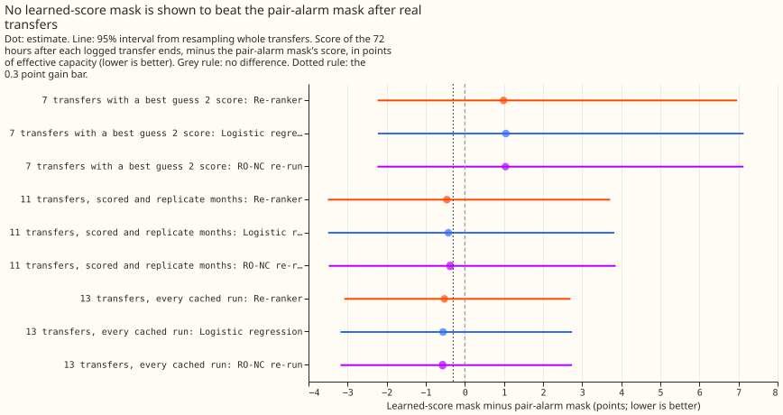
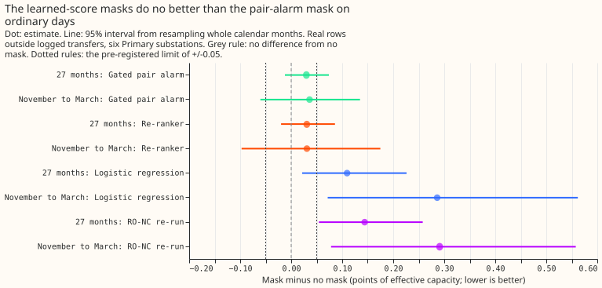
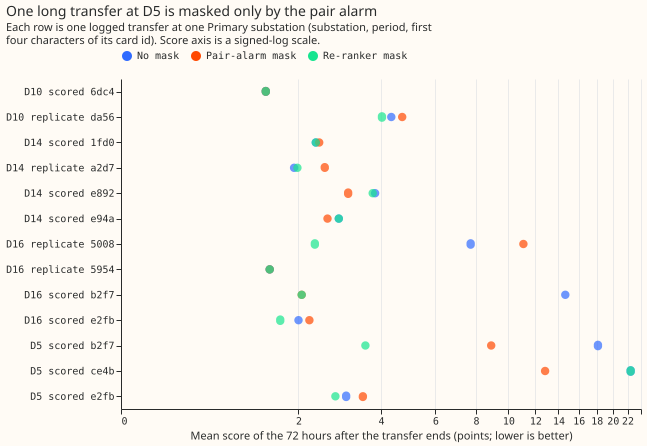

**Masking the forecast with the alarms of experiment 195's learned score did not lower the error
after real switching transfers by a reliable margin, and it did not meet the no-harm limit on
ordinary days.** A switching transfer moves load between Primary substations for hours or days. A
"mask" sets the forecast's recent power readings aside while an alarm says a transfer is under way.
The pair alarm (a step at one substation matched by an opposite step at a neighbour) fed the mask of
experiment 163, and experiment 195's learned score, a statistical score trained to flag transfers,
was meant to find more transfers. On the 7 logged transfers that best guess 2 (the best-guess
forecast of experiment 87) also scores, the learned-score mask scored 0.99 points of effective
capacity worse than the pair-alarm mask (7.31 against 6.32). On the wider set of 11 transfers it
scored 0.46 points better (5.62 against 6.08), but the 95% interval for that difference runs from
-3.5 to +3.7. The 11-transfer sign flips when the substation labelled D16 is left out. The pattern
in the transfers is consistent with this explanation: the learned alarms often fire late in a
transfer or near its end, while the pair alarm fires at the start of the long ones.

**Switching transfers contaminate the forecast's recent-power correction.** The forecast is a
generalised additive model with a Kalman filter ([Kalman, 1960](https://doi.org/10.1115/1.3662552))
on its recent errors (GAM-K, as in [experiment
163](../00163-switching-real-event-comparison-gam-stack-against-bg2/result.md)). Experiment 163
found that masking while the pair alarm is active brings the error after real transfers down to that
of a forecast with no recent power. [Experiment
195](../00195-switching-neural-plus-detector-features/result.md) found that a learned score on the
detectors' features matches 22 to 24 of 35 real transfers lasting over 1 day against 19 for the
refit-offset neighbour-count detector (RO-NC). This experiment replays those alarms through the mask
of experiments 163 and 171 and scores the forecast.

**The replay masks the unchanged GAM-K forecast with experiment 195's alarms.** Nothing is refitted.
An alarm sets readings missing from its step stamp, once the alarm is known, until its end is known.
Three alarm sources were replayed: the "R re-ranker" (a small neural network, known 4 days after the
step because it reads 4 days after the step), a logistic regression on the same features (known 2
days after the step), and experiment 195's re-run of RO-NC (2 days). The pair alarm and the unmasked
forecast were recomputed on the same rows as controls. A score is twice the mean pinball loss over
11 quantiles, in points of effective capacity (percent of a substation's effective capacity; lower
is better), on the six Primary substations of experiments 163 and 171.

## Results

- **Verdict: `partly supported` under the pre-registered rule, and a weak result.** G1' (gain on the
  11-transfer set) holds on its point estimate (-0.46, bar -0.3). G1 (the brief's bar on the 7
  transfers that best guess 2 also scores) fails (+0.99). G2 (no harm on ordinary days) fails
  because its upper bound, +0.086, is above the +0.05 limit. The G1' interval, -3.5 to +3.7,
  includes zero, and leaving D16 out gives +0.64.
- **Units.** A transfer is one logged event. The 7, 11, and 13 transfers are distinct events, and a
  bootstrap resamples whole transfers. Two of the 11 touch two of the six substations, so the 11
  transfers hold 13 scoring windows (one substation and one transfer each).
- **Arms.** Alarm sources LEARNED_R (re-ranker, known 192 half-hours after the step), LEARNED_F
  (logistic regression, 96), RONC_195 (96), and, post hoc, LEARNED_R96 (the re-ranker as if known at
  96). Controls: K0 (no mask), PAIR_NEW (every pair alarm), and PAIR_GATED (balance score of at
  least 0.7). Nothing is refitted: the cached daily GAM-K runs of 2024-04 to 2026-06 are reused. Two
  shortcuts apply. The end of an alarm that experiment 147 also raised is known at the later of
  experiment 147's stamp and the estimated end plus 60 half-hours, where the plan said 96 (a re-run
  with 96 leaves every transfer score unchanged and moves the ordinary-day contrast by +0.0005). The
  cached runs are daily (09:00 UTC) and not 6-hourly, because the cached member forecasts exist only
  for those runs.
- **The controls reproduce.** On the 7 transfers, K0, PAIR_NEW, and best guess 2 score 13.686,
  6.321, and 10.091, as experiment 163 printed. The pooled gated pair-alarm contrast is +0.030
  (-0.012 to +0.074), against +0.030 (-0.011 to +0.074) in experiment 171; the bootstrap draws
  differ in the third decimal.
- **Mean score of the 72 hours after a transfer ends (points).** The 7 transfers that best guess 2
  also scores: K0 13.686, PAIR_NEW 6.321, PAIR_GATED 6.336, LEARNED_R 7.310, LEARNED_F 7.370,
  RONC_195 7.361, best guess 2 10.091. The 11 transfers of experiment 163's scored and replicate
  months: K0 10.129, PAIR_NEW 6.083, PAIR_GATED 5.752, LEARNED_R 5.623, LEARNED_F 5.660, RONC_195
  5.707. All 13 transfers in every cached run (post hoc): K0 8.313, PAIR_NEW 5.351, PAIR_GATED
  5.119, LEARNED_R 4.829, LEARNED_F 4.795, RONC_195 4.782.
- **Gain contrasts (arm minus PAIR_NEW, 95% interval from resampling whole transfers).** LEARNED_R:
  7 transfers +0.989 (-2.229 to +6.963); 11 transfers -0.460 (-3.505 to +3.718); 13 transfers -0.522
  (-3.086 to +2.704). LEARNED_F and RONC_195 differ from LEARNED_R by under 0.1 points on each set.
  Each learned mask beats no mask by 3.5 to 6.4 points, and so does the pair alarm (-7.365 on the 7
  transfers).
- **One transfer decides the 7-transfer result, and its scoring window overlaps the next transfer.**
  A 580-hour transfer at D5 (card ce4b82, where a card is the identifier of a logged transfer)
  scores 22.45 with no mask, 12.81 with the pair alarm, and 22.45 with the re-ranker. No learned
  alarm lies near its onset. The only learned alarm there is the onset of the next transfer on the
  same series (card b2f7c0), known after the 72-hour scoring window closes. The 72 hours after ce4b
  ends lie wholly inside b2f7c0, so those 849 rows measure the forecast during b2f7c0. The overlap
  comes from experiment 163's row set, and no other of the 13 scoring windows of the 11 transfers
  overlaps another transfer. Leaving ce4b out would move G1 to -1.608 and G1' to -2.126 (post hoc,
  and not used to claim a pass).
- **The learned masks gain where the pair alarm does harm.** At D16 in the replicate months (card
  500860) the pair-alarm mask scores 11.07 against 7.71 with no mask, because its fragmented weak
  alarms keep the mask open until 166 half-hours after the end. The re-ranker scores 2.32. Three
  transfers carry the sign of the 11-transfer gain: ce4b adds +1.36 to the contrast, card 500860
  adds -0.90, and b2f7c0 at D5 adds -0.77. Leaving card 500860 out gives +0.488.
- **At these substations, the learned alarms do not come earlier.** Of the 45 logged transfers at
  the six substations, an alarm matching the transfer is known before the transfer ends for 16 with
  the pair alarm, 8 with the re-ranker, 11 with the logistic regression, and 10 with RO-NC
  (`printed_found.txt`). An alarm matches at all for 20 (pair alarm), 19 (re-ranker), 27 (logistic
  regression), and 20 (RO-NC) of the 45. The re-ranker's 19 include ce4b, which is really the onset
  of b2f7c0. Experiment 195 counted 35 transfers over 1 day and a stricter rule, so its counts of 24
  and 19 are not comparable.
- **Ordinary days (G2): mask minus no mask on 1,579,711 rows over 27 months, where no mask scores
  2.718.** LEARNED_R +0.031 (-0.020 to +0.086), and +0.031 (-0.097 to +0.175) from November to
  March. LEARNED_F +0.109 (+0.022 to +0.226), and +0.286 in winter. RONC_195 +0.144 (+0.054 to
  +0.258), and +0.291 in winter. The gated pair alarm +0.030 (-0.012 to +0.074). Per fold, LEARNED_R
  gives +0.039, +0.017, and +0.036. None of the learned masks meets the +/-0.05 limit.
- **The learned scores are partly in-sample on ordinary days.** Experiment 195 trained them with the
  real record's even-month candidates as negatives. The re-ranker's contrast is +0.048 (-0.052 to
  +0.156) on odd months, which it was not trained on, and +0.014 (-0.006 to +0.036) on even months.
  The odd-month figure is the fairer estimate of the harm a deployed score would do.
- **The learned masks cover fewer half-hours than the gated pair alarm.** From the half-hour an
  alarm is known to the half-hour its end is known, the re-ranker's alarms span about 18,800
  half-hours per fold (three folds), against 33,557 for the gated pair alarm over the same rows.
- **Leaving one substation out (ordinary days, pooled).** D10 carries the pair alarm's harm: +0.002
  without D10. The re-ranker's estimate without D10 is +0.012, the logistic regression's -0.000, and
  RO-NC's +0.028.
- **Tail calibration on the 11-transfer rows (coverage at the 0.01, 0.05, 0.95, and 0.99 quantiles,
  then pinball loss in points).** No mask: coverage 0.297, 0.353, 0.841, 0.893; loss 3.55, 4.98,
  2.69, 1.47. Pair-alarm mask: 0.172, 0.247, 0.898, 0.937; 1.47, 2.53, 1.42, 0.57. Re-ranker mask:
  0.130, 0.178, 0.935, 0.980; 2.14, 3.01, 0.93, 0.25. The re-ranker mask has better upper-tail
  coverage and loss than the pair-alarm mask and worse lower-tail loss. Every mask leaves the lower
  quantiles too high: the measured power falls below the 0.01 quantile in 13% to 30% of rows,
  because these rows follow a transfer and the spread is that of the unmasked forecast.
- **Checks: median and mean forecast.** The median forecast minus the mean forecast per site
  (ordinary rows, points) is the same for K0 and LEARNED_R to three decimals (D10 -0.058, D11
  -0.030, D14 +0.037, D16 +0.017, D5 -0.146, D9 -0.019), because the mask changes the correction
  only through the mean.
- **Checks: mean-forecast error and audit.** The error of the mean forecast points the same way as
  every quantile-score contrast: LEARNED_R minus PAIR_NEW +0.525 (7 transfers) and -1.221 (11
  transfers), and LEARNED_R minus K0 on ordinary days +0.042 (-0.031 to +0.123). Leaving D16 out
  flips the 11-transfer gain from -0.46 to +0.64, which triggers an audit.
- **Checks: audit findings.** An independent audit re-derived G1, G1', and G2 from the stored
  per-row scores with its own code and reproduced them (+0.989, -0.460, and +0.031 with -0.020 to
  +0.088). It matched the controls to experiment 163's and 171's stored rows within 2e-6, and found
  the onset stamps causal and the fold mapping equal to experiment 195's. All of its findings are in
  this page (the ce4b overlap, the in-sample caveat, the end-rule deviation, and the timing counts);
  none was rejected.
- **Caveats.** The learned alarms come from three folds that hold out whole Primary pairs. Each
  transfer uses the fold that held out its pair, and ordinary rows average the three folds' scores.
  The 7, 11, and 13 transfers are few, so every gain interval is wide. Experiment 195 found the
  extra transfers small (0.4 to 0.9 MW each). The pair alarm raised 242 alarms and the learned
  alarms 104 to 150 per fold.
- **What this narrows.** Finding more transfers is not the bottleneck: the re-ranker matches no more
  transfers than RO-NC at these substations and masks no better. The missing piece is an early alarm
  on the long transfers, which among the alarms tested here only the pair alarm gives. A candidate
  next experiment is the union of the pair alarm and the learned alarms (pair alarm when its balance
  score passes, learned alarm otherwise), judged on the 13-transfer set and the ordinary rows.
  Experiment 195's look-ahead features cannot give an early alarm, so another candidate is a small
  neural network that reads only data up to the alarm, such as the first 24 hours after a step.
