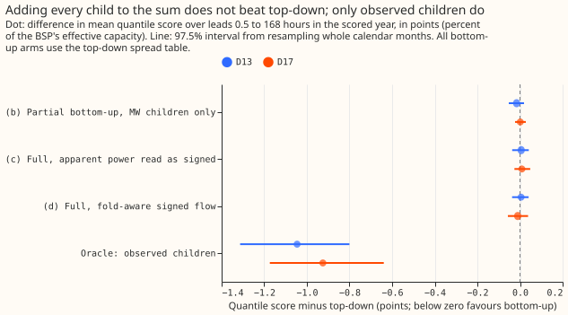
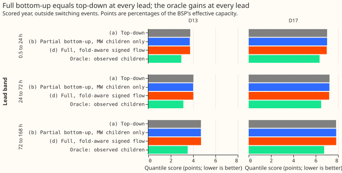
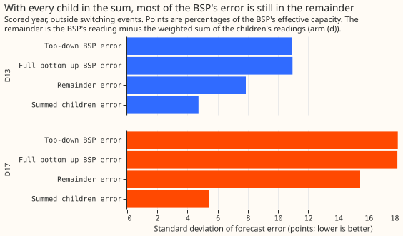
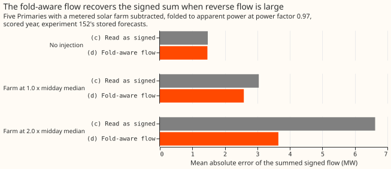

# Experiment 204: a bulk supply point is forecast no better from all its children than on its own

**Take-home: putting every child Primary substation into the sum did not improve the forecast of
either bulk supply point (BSP).** A BSP is the substation above a group of Primaries. D13 (Skegness)
and D17 (Boston) are the two BSPs studied. The top-down forecast treats the BSP's own half-hourly
reading as a stand-alone series. The bottom-up forecast adds forecasts of the children (the
Primaries
beneath the BSP) to a forecast of the remainder, the BSP's reading minus the weighted children's
readings. Scores are quantile scores in points: percentages of the BSP's effective capacity (its
reference power), and lower is better.

The bottom-up forecast, with the children that report apparent power (MVA) converted to signed flow,
scored 4.375 points at D13 against 4.370 for the top-down forecast (C1, bottom-up minus top-down:
+0.005, 97.5% interval -0.037 to +0.040) and 7.532 against 7.542 at D17 (-0.011, -0.057 to +0.038).
Each interval comes from resampling whole calendar months of the scored year. The intervals do not
exclude a difference of up to about 0.06 points either way, so experiment 161's null result gave no
sign of being caused by the sum covering too little of the BSP. The verdict is `inconclusive`,
because both intervals include zero, and the plan's rule reads that as no detectable gain from
coverage.

**We asked** whether the bottom-up forecast of a BSP beats the top-down forecast once the sum
includes every child Primary that has a long history, as [experiment
161](../00161-dp-bsp-top-down-against-bottom-up/result.md) could not test. Experiment 161 summed
only
the 3 children per BSP that report real power (MW). This experiment adds the 4 children at D13 and
the 3 at D17 (D3, D12, D22) that report apparent power. Apparent power hides the sign of the flow,
so
a child whose solar panels push power back up the network at midday (reverse flow) reads positive
when its flow is negative. This experiment builds each such child's signed flow with the fold-aware
generalised additive model of [experiment
152](../00152-dp-mva-fold-aware-gam-k-at-mva-only-primaries/result.md), which fits a hidden (latent)
signed flow and the reading that follows from it. **We found** that the
children's forecasts give no detectable gain over the BSP's own forecast chain: the bottom-up error
equals the top-down error, and the children's forecast errors correlate positively with the
remainder's. With each child's reading known exactly (the oracle), the score gains 24% at D13 and
12% at D17, so better child forecasts would help, but the current child forecasts do not. Scored
rows are the 291 daily runs of
2025-07-02 to 2026-06-29, leads 0.5 to 168 hours, outside switching events.

**Scope.** D13 is Skegness (7 children) and D17 is Boston (9 children). The sum covers 7 children at
D13 and 6 at D17. D8 (Marsh Lane) stays in D17's remainder, because its series changes meaning in
April 2025 and no consistent history exists. The two Wrangle transformers (D15 and D18) stay there
too, because they have under 8 months of readings, so arm (e) of the plan was not run. The metered
generators under each BSP also stay in the remainder.

**Arms.** All arms use the top-down forecast's spread of quantiles around the mean, so they differ
in the mean only.

- **(a) top-down:** the best-guess forecasting chain of [experiment
  155](../00155-dp-bg-stage2-assembly-night-offset-and-error-correction/result.md) (arm D) applied
  to
  the BSP alone.
- **(b) partial bottom-up:** experiment 161's sum over the 3 children per BSP that report real power
  (MW).
- **(c) full, apparent power read as signed:** the sum over every child with a long history, each
  apparent-power child's reading and forecast taken as signed.
- **(d) full, fold-aware:** the same sum with each apparent-power child's signed flow forecast by
  experiment 152's fold-aware model, and the sign of its past readings set from that model.
- **(d, sign at probability 0.5):** arm (d) with the sign set wherever the fitted flow is more
  likely
  than not to be reverse (arm (d) requires a probability of 0.9).
- **Oracle:** arm (d) with the children's observed readings in place of their forecasts, a control
  with no verdict.

The contrasts are C1 (bottom-up (d) minus top-down), C2 ((d) minus (c)), C4 (C1 by lead band), C6
(C1 at the 0.01, 0.05, 0.95, and 0.99 quantiles), and C7 (oracle minus top-down). The scored year is
the 291 daily runs from 2025-07-02. The replicate year is the even months of 2024-07 to 2025-06.

## Results

**Every bottom-up arm scored the same as top-down, within the noise.** Experiment 161's partial
bottom-up arm (b) is reproduced exactly on 161's own rows (4.345 and 7.674 with the top-down spread
table, 4.387 and 7.706 with its own; top-down 4.361 and 7.672). The table below uses the smaller set
of rows on which every arm has a forecast. Adding 4 children at D13 and 3 at D17 to arm (b) moves
the score by +0.021 (-0.011 to +0.050) at D13 and by -0.012 (-0.049 to +0.026) at D17. In the
replicate year (even months of 2024-07 to 2025-06), C1 is -0.038
(-0.102 to +0.026) at D13 and 0.000 (-0.041 to +0.043) at D17.

| Arm (scored year) | D13 score | D17 score |
|---|---|---|
| (a) Top-down | 4.370 | 7.542 |
| (b) Partial bottom-up, MW children only, top-down spread table | 4.354 | 7.543 |
| (c) Full, apparent power read as signed | 4.375 | 7.551 |
| (d) Full, fold-aware signed flow | 4.375 | 7.532 |
| (d, sign at probability 0.5) Full, signed flow | 4.375 | 7.523 |
| Oracle: observed children | 3.324 | 6.617 |
| Manual heuristic | 5.485 | 8.305 |
| Climatology | 5.908 | 8.833 |

Rows are the shared rows, 95,547 at D13 and 79,839 at D17. The sum of the children's effective
capacities is 117% of D13's and 99% of D17's (against 42% and 56% for arm (b)); the children peak at
different times, so this is not a share of the load.

**The sign of the converted flow mattered at D17 only, and not detectably.** (d) minus (c) is -0.000
(-0.001 to +0.000)
at D13, where no child has reverse flow, and -0.019 (-0.051 to +0.011) at D17, where D12 has it.
Setting the sign at probability 0.5 instead of 0.9 gives -0.028 (-0.058 to -0.003) at D17, the one
sign contrast whose interval excludes zero. This contrast was not pre-registered and is not adjusted
for the number of contrasts, so it is a lead for later work, not a finding.

The fitted flow of D12 is reverse on 18.5% of its usable half-hours at probability 0.9 and 26.9% at
0.5. D22 has none at 0.9 and 39 half-hours at 0.5. The other five apparent-power children in the sum
have none.

**No lead band favoured full bottom-up with confidence.** C1 by band at D13 is -0.011, -0.006, and
+0.015 (0.5 to 24, 24 to 72, 72 to 168 hours), and at D17 -0.034, -0.031, and +0.005. Every interval
includes zero. The estimates are lowest below 72 hours at both BSPs.

**Most of each BSP's error is in the remainder, and the children's errors share its cause.** At D13
the remainder's error has a standard deviation of 7.9 points and the weighted children's summed
error 4.7 points; at D17 the figures are 15.4 and 5.4. The two parts' errors correlate positively
(0.48 and 0.32). The bottom-up error (10.95 and 17.91) is therefore about the same as the top-down
error (10.94 and 17.94). The remainder is the load that no Primary in the sum meters: the generators beneath
the BSP, losses, and D8 and the Wrangle transformers at D17.

**The fold-aware flow recovers the signed sum where reverse flow is large.** At the larger injection
(power factor 0.97 folding) the summed flow's mean absolute error is 3.65 MW against 6.62 MW for
reading the magnitude as signed, 45% lower; with no injection the two are 1.46 and 1.47 MW. Both
pre-registered pass conditions hold: at least 20% lower at level 2.0, and at most 5% worse at level
0. Level 0 uses the idealised `q0` folding, the only level-0 folding experiment 152 stored.
At level 1.0 the figures are 2.58 against 3.04 MW.

| BSP, arm | Coverage at 0.01 | 0.05 | 0.95 | 0.99 |
|---|---|---|---|---|
| D13 top-down | 0.018 | 0.067 | 0.920 | 0.969 |
| D13 (d) | 0.017 | 0.068 | 0.919 | 0.969 |
| D17 top-down | 0.018 | 0.071 | 0.906 | 0.963 |
| D17 (d) | 0.016 | 0.069 | 0.902 | 0.962 |

**Both arms are too narrow in the tails by the same amount**, because they share the top-down spread
table. C6, the pinball loss at the four tail quantiles, differs from top-down by 0.02 or less at
both
BSPs, and the 0.99 quantile at D17 (+0.020, +0.004 to +0.040) is the one interval that excludes
zero.

## Checks

- **Median minus mean forecast, per BSP and arm:** 0.000 for every arm, because the residual table
  is centred.
- **Mean forecast's error beside each contrast (mean absolute error):** C1 +0.023 at D13 and -0.027
  at D17, the same sign as the quantile score; C2 -0.001 and -0.048; C7 (oracle) -1.95 and -1.55.
- **Controls:** the reproduction of experiment 161 passed (4.361 and 7.672 for top-down, 4.387 and
  7.706 for (b) on its rows). The known-answer check passed. The oracle gained 24% at D13 (predicted
  20% to 40%) and 12% at D17 (below the predicted 20%), which matches the error decomposition
  (figure
  3) and is no data-handling fault: the oracle's error equals the remainder's.
- **Audit triggers:** the `ml-experiment` skill lists seven. Trigger 2 (a result contradicts its
  prediction) fired: C1 was predicted at -3% to -10% at D13 and came out at +0.1%. The explanation
  was tested and is recorded here: the oracle and the decomposition show the bottom-up error equals
  the top-down error. Trigger 1 (a control fails) did not fire. Trigger 3 (the quantile score and
  the mean's error disagree in sign) did not fire. Trigger 4 (leaving one site out flips a verdict)
  does not apply to two BSPs. Trigger 5 (a nested arm beats its container) did not fire. Trigger 6
  (an interval more than twice or less than half as wide as a sister experiment's) did not fire: the
  C1 intervals are 0.6 to 0.9 times the width of experiment 161's. Trigger 7 (a later design depends
  on the headline) did not fire. No Opus audit was run, because only the explained trigger 2 fired
  and the verdict is `inconclusive` either way.

## Caveats

- **Two BSPs, one scored year,** and the weights come from one winter (2023-10 to 2024-03). Five of
  the six D17 weights and five of the seven D13 weights sit on the bounds (0.8 or 1.2); the
  unbounded fit gives weights from 0 to 5.9 and explains 82% (D13) and 45% (D17) of the BSP's
  variance, against 76% and 38% for the bounded fit.
- **The children's chains differ.** The MW children use arm D (winter night offset and recipe R);
  the apparent-power children use experiment 152's GAM-K chain (meter fit, additive filter), which
  has neither correction. The oracle bounds how much better any child chain could be.
- **The latent flow is signed corrected apparent power** and is multiplied by 0.97 here to match the
  signed history, which is converted the same way. The stored flow carries the fit's
  probability-0.5 sign, so the arm with the sign at probability 0.5 is internally consistent and
  arm (d) is the pre-registered arm.
- **Not run:** arm (e) (short-history children), C5 and C8. The decomposition shows that the two
  Wrangle transformers and D8 sit in a remainder whose error has a standard deviation of 7.9 to 15.4
  points, so adding them
  cannot change the conclusion by much.
- **The curtailment metric was not scored,** because this experiment did not build the generator
  inputs it needs for these BSPs.

## What to try next

- **Forecast the generators and the unmetered load beneath each BSP** (the remainder), where most of
  the error lives, before building any further sum.
- **Draw the children and the remainder from the same ensemble members**, so that their shared
  weather errors cancel in the sum rather than adding; the 0.32 to 0.48 correlation says they share
  a cause.

## Plan

**Departures from this plan.** D8 stays in the remainder (the plan fixed its weight at 1 and entered
it from 2025-04-01). Arm (e), C5, and C8 were not run. The signed history uses the monthly meter
fits of experiment 152 with the sign from the latest cut at or before each half-hour, as planned,
and the forecast flow is multiplied by the power factor 0.97 to match the history.

## Question

Experiment [161](../00161-dp-bsp-top-down-against-bottom-up/result.md) found that forecasting a BSP
bottom-up scored 0.5% to 0.6% worse than forecasting it as a stand-alone series. Its sum reached
only
42% (D13) and 56% (D17) of the BSP's effective capacity, because the children that report apparent
power (MVA) stayed in the remainder with the unmetered load. NGED say we hold data for every Primary
under both BSPs. This experiment puts every child with a usable history into the sum and asks
whether coverage was the reason for the null result.

## The children, from NGED's hierarchy file of 2026-10-15

Both BSPs have every child NGED lists in our data. No child is missing. Years of readings count
present, unflagged half-hours (17,520 to the year). Primaries may be named. The BSP D13 is Skegness
33 kV and D17 is Boston 33 kV.

| BSP | Child | Unit | First usable reading | Years of readings | Enters |
|---|---|---|---|---|---|
| D13 | D9 Trusthorpe | MW | 2023-08-23 | 3.05 | (b), (c), (d) |
| D13 | D10 Spilsby | MW | 2019-09-17 | 6.95 | (b), (c), (d) |
| D13 | D11 Horncastle | MW | 2019-09-17 | 6.99 | (b), (c), (d) |
| D13 | D2 Warth Lane Skegness | MVA | 2019-09-17 | 6.99 | (c), (d) |
| D13 | D4 Ingoldmells | MVA | 2019-09-17 | 6.98 | (c), (d) |
| D13 | D19 Chapel St Leonards | MVA | 2019-09-17 | 6.99 | (c), (d) |
| D13 | D21 Alford | MVA | 2019-09-17 | 6.94 | (c), (d) |
| D17 | D5 Kirton | MW | 2019-09-17 | 6.97 | (b), (c), (d) |
| D17 | D14 Mount Bridge Boston | MW | 2019-10-21 | 6.89 | (b), (c), (d) |
| D17 | D16 Donington | MW | 2020-12-22 | 5.68 | (b), (c), (d) |
| D17 | D3 Sleaford Road Boston | MVA | 2019-09-17 | 6.97 | (c), (d) |
| D17 | D8 Marsh Lane | MVA | 2019-09-17 | 6.98 | (c), (d) from 2025-04-01 |
| D17 | D12 Stickney | MVA | 2019-09-17 | 6.97 | (c), (d) |
| D17 | D22 Langrick | MVA | 2019-09-17 | 6.97 | (c), (d) |
| D17 | D15 Wrangle T1 | MW | 2025-02-06 | 1.56 | (e) only |
| D17 | D18 Wrangle T2 | MW | 2024-12-11 | 1.64 | (e) only |

The two Wrangle transformers have under 8 months of readings at the first scored run, so no arm D
forecast exists for them. NGED's hierarchy also lists metered generators under each BSP (wind,
solar,
biofuel, and battery sites). They are not Primaries and stay in the remainder, as in experiment 161.
Experiment 152's Step 0 found reverse flow at D12 only (every sunny midday); D22 has 3.7% and the
other six apparent-power children have none, so arms (c) and (d) differ materially at D17 only.

## Arms

All arms are scored on the same runs as experiment 161 (the 291 daily runs of 2025-07-02 to
2026-06-29), leads 0.5 to 168 hours. Every arm turns a mean forecast into quantiles with
**experiment 155's top-down spread table**, row by row, so the comparison isolates the mean.
Experiment 161's bottom-up arm refitted its table on the sum's corrected errors, and that narrowed
its tails and gave C1 its positive sign (experiment 161's C5). Experiment 152 stored forecasts for
the apparent-power children only in the scored and replicate years, with no tuning months, so a
table fitted on the sum's own residuals could not be built for the full arms in any case.

| Arm | Forecast of the BSP |
|---|---|
| (a) top-down | Arm D's chain on the BSP's reading alone (reference; stored by experiment 161) |
| (b) partial bottom-up | Experiment 161's sum over the three MW children plus arm D's forecast of the remainder; scored with its own table (reproduction) and with the top-down table |
| (c) full, naive | Sum over all children with a long history, each apparent-power child's reading and forecast taken as signed (experiment 152's arm N mean), plus arm D's forecast of the remainder `BSP - sum(w_i * y_i)` |
| (d) full, fold-aware | The same sum with each apparent-power child's signed flow forecast by experiment 152's fold-aware model (the latent `flow` column of arm F, not the folded quantiles), and the remainder built from the child's estimated signed history |
| (e) full plus short-history children | (d) plus D15 and D18, forecast with the pooled shapes of [experiment 158](../00158-dp-partly-pooled-gam-shapes-heating-and-calendar-curves/result.md) at 5 to 7 months of history; D17 only, reported separately |
| oracle | (d) with the children's observed readings in place of their forecasts (control, no verdict) |

**Signed history of an apparent-power child.** The remainder chain trains on `BSP - sum(w_i * y_i)`,
which needs each child's observed signed flow. The observed signed flow does not exist for a child
that reports only magnitude. Arm (c) uses the magnitude as it stands. Arm (d) uses the magnitude
times 0.97 (the power factor of experiment 124, which turns apparent power into active power, the
quantity the latent `flow` forecast measures), with the sign set negative on every half-hour where
the reverse-flow probability exceeds 0.9 (experiment 152's "sure" rule). The probability comes from
the monthly meter fit of experiment 152 that was trained before that half-hour's cut
(`work/fits/real/*_meter.pkl`), not from experiment 110's single fit, so no sign uses a later
reading. A sensitivity arm (d-p50) sets the sign at probability 0.5 instead. The history changes at
D12 on sunny middays and at essentially no other child. The sign of the converted flow is the main
risk, so Step 1 prints it for D12 before anything is fitted. The sign error enters the remainder
and the child forecast through the same meter fit, so the two are coupled, not independent.

**Weights.** Non-negative least squares of the BSP's reading on all children's signed readings with
no
intercept, on the winter window 2023-10-01 to 2024-03-31 of experiment 161, bounded to 0.8 to 1.2.
The unbounded fit is printed as a diagnostic only. Winter has no reverse flow, so the weights do not
depend on the sign convention. D8's series changes meaning in April 2025 (experiment 152), so its
weight is fixed at 1 and it enters only from 2025-04-01; D17's full arms are therefore scored in
the scored year only, and D13 also has a replicate year.

## Steps

1. **Feasibility, before any chain runs.** Print the child table above from the stored files, the
   covered share of each BSP's effective capacity for every arm, and the per-half-hour sign estimate
   at D12 (share of sunny-midday half-hours with reverse flow, by month). Stop and report if the
   signed history of D12 cannot be rebuilt from stored experiment 110 outputs or a re-run of
   `studies.dp_meter` on D12 alone.
2. **Controls.** Reproduce experiment 161's top-down and partial bottom-up scores to three decimals.
   **Known-answer check.** For the five MW Primaries of experiment 152's injection test (D5, D10,
   D11,
   D14, D16), take its folded series at injection levels 0, 1.0, and 2.0 times the midday median,
   sum
   the five children, and compare the sum's mean forecast built as in (c) (arm N's `mean`) and as in
   (d) (arm F's `flow`) with the signed sum from the `signed` files. The pass criterion uses the
   power-factor-0.97 folding (`pf97`, which matches real meters); the idealised `q0` folding is
   reported beside it. This check tests experiment 152's latent-flow forecast only. It does not test
   the signed-history rule or the remainder chain. Pass: at level 2.0 the mean absolute error of
   (d)'s summed signed flow is at least 20%
   below (c)'s, and at level 0 (d) is no more than 5% worse than (c). Experiment 152 stored these
   forecasts, so the check costs minutes.
3. **Chains.** Remainder chains for (c) and (d) at both BSPs, and for (e) at D17: experiment 161's
   copy of experiment 136's A2 and experiment 155's arm D. The oracle reuses the (d) remainder.
4. **Score.** The contrasts below, the tail table, absolute skill for climatology and
   `manual_heuristic`, and the covered share beside every arm.

## Planned contrasts

C1 (d) minus (a), headline, at D13 and D17. C2 (d) minus (c). C3 (c) minus (b), the effect of adding
the apparent-power children without a sign model. C4 C1 by lead band (under 24 hours, 24 to 72,
72 to 168). C5 (e) minus (d) at D17. C6 (d) minus (a) at the tail quantiles. C7 oracle minus (a).
C8 (d) minus (a) leaving D12 out of the sum, which tests whether one child with reverse flow decides
D17. Each is read through `studies.bootstrap`. The reported checks include the mean forecast's error
beside every quantile-score contrast and the median minus mean forecast, per BSP.

## Triggers and size

- **Stored:** private files only.
- **Serving path:** not touched.
- **Degradation rule:** not touched.
- **More than one defensible design:** yes, three, each pre-registered above.
- **Callers not nameable without searching:** no, the scripts copy experiment 161's.

Audit triggers watched: a failed control (the known-answer check, the oracle), a result that
contradicts experiment 161 (it should not, since (b) reproduces it), and the mean's error pointing
the other way from the quantile score. One Opus audit is allowed and, if a trigger fires, it checks
the sign convention of the converted flow.

## Resources

CPU only, at most 4 cores with every thread cap at 1, each job under `systemd-run --user --scope -p
MemoryMax=16G -p OOMPolicy=continue`. No GPU. The children's forecasts of experiments 152 and 155
and
the spread tables of experiment 161 (`d_tuning_D13`, `d_tuning_D17`, and its `bu_r_tdspread` files)
are reused. Arm (e) needs new pooled-shape fits and chains for D15 and D18, so it runs last and is
dropped if the earlier arms use up the budget.

## Advice followed and departures

- **Followed:** experiment 161's advice to fix the weights' bounds and forecast the apparent-power
  children before expecting a gain; experiment 152's advice to keep the meter fit and fold only
where reverse flow exists (here, D12). The latent flow of experiment 152 is a signed corrected
  apparent power, so it is multiplied by the power factor 0.97, as the signed history is.
- **Departure from the brief's wording:** the brief asks for a gain of 5% with an interval wholly
  below zero. This plan requires the interval to lie wholly below minus 5%, which is stricter. For
  (d) beats (c), the plan requires only that (d) is no worse (upper end at most +0.03), because no
  apparent-power child at D13 has reverse flow. At D17 the predicted gain is 0% to 5%, so
  `supported` is expected to be reachable at D13 only.
- **Departure:** the spread table. All bottom-up arms use the top-down table, which experiment 161
  showed isolates the mean, instead of a table refitted on the sum.
- **Departure from the brief's wording:** the brief says the 5% threshold is experiment 161's.
  Experiment 161 used 2%. This plan uses the brief's 5%, and also reports the 2% reading.
- **Chain mismatch:** the apparent-power children's forecasts come from experiment 152's GAM-K chain
  (meter fit, additive filter), which has no winter night offset or error-correction recipe, so the
  MW children (arm D) and the apparent-power children are corrected differently. The page says so.
