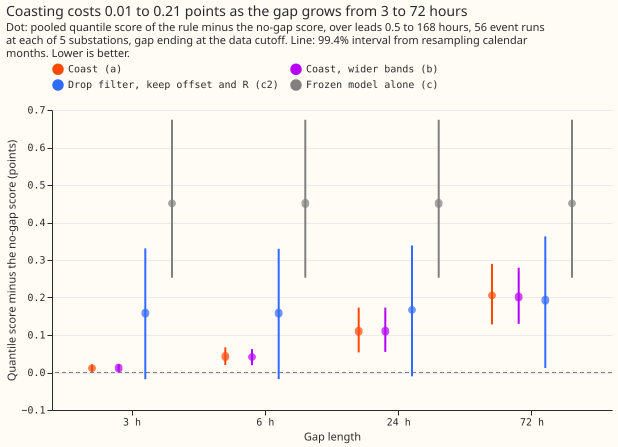
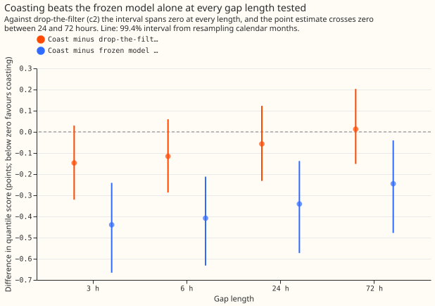
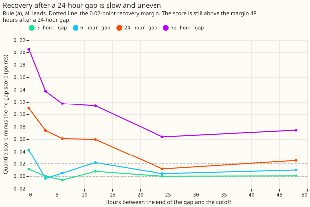
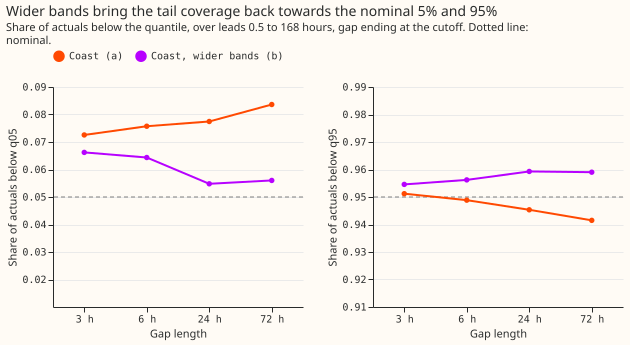

# Gap robustness of the convex model with a Kalman filter: coast or fall back

**Take-home: when power readings stop, keep the Kalman filter running with no update and widen the
bands.** That forecast scores 0.25 to 0.44 points better than the frozen demand model alone at every
gap length from 3 to 72 hours. Whether dropping the filter would beat coasting at about 72 hours
could not be told. The formal verdict is `inconclusive`, because the pre-registered contrasts
against the filter-free pipeline all span zero.

We asked what a live forecast should do when power readings go missing: let the filter coast, widen
the bands as well, or drop to the demand model with no filter. The demand model is the convex model
of [experiment 111](../00111-differentiable-physics-6-ens-forecast-engine-against-bg2/result.md)
with a Kalman filter on its recent errors (GAM-K, a method re-implemented from [de Vilmarest and
Wintenberger (2022)](https://arxiv.org/abs/2104.10777)), plus the corrections of arm D of
[experiment
155](../00155-dp-bg-stage2-assembly-night-offset-and-error-correction/result.md). We hid the
readings
of 3, 6, 24, or 72 hours before the forecast's data cutoff, at up to 56 forecast runs at each of
five substations (275 in all), and scored the forecast over the next 168 hours. Coasting kept the
forecast within
0.011
points of its no-gap score (2.747) after a 3-hour gap and 0.206 points after a 72-hour gap. Dropping
the filter cost 0.158 to 0.193 points whatever the gap.

## Headline numbers

- **Arms (rules).** (a) coast: the filter, the winter night offset, and recipe R on the gapped
    readings. (b) coast with the quantile offsets widened by the filter's variance growth since the
    last reading. (c2) the same pipeline with the filter dropped. (c) the frozen model alone, with
    no filter, offset, or recipe R. Pre-registered in [the plan](#planned-design) below.
- **Row set.** Five decision substations (D5, D10, D11, D14, D16), 53 to 56 event runs each (275 in
    all) (one per 8-day
    block of the replicate and scored runs), leads 0.5 to 168 hours outside the hand-filtered
    switching events. Gap ends at the cutoff for the headline (k = 0). Spread tables are the no-gap
    ones. Filter, GAM, and settings are those of experiment 136's arm A2. No weather input changes.
- **Absolute scores (all leads, points).** No gap 2.747. Rule (a): 2.758, 2.790, 2.857, 2.953 at 3,
    6, 24, 72 hours. Rule (b): 2.759, 2.788, 2.857, 2.948. Rule (c2): 2.905, 2.905, 2.914, 2.940.
Rule
    (c): 3.198 (no gap dependence).
- **Headline contrasts (a minus c2, 99.4% month-resampled interval).** 3 h: -0.147 (-0.321 to
    +0.030). 6 h: -0.116 (-0.287 to +0.060). 24 h: -0.057 (-0.232 to +0.123). 72 h: +0.013 (-0.152
to
    +0.203). All four span zero, so the crossover is not established, and C1 and C2 fail the
    pre-registered test. Under 24 hours of lead the contrast is below zero at 3, 6, and 24 hours
    (-0.480, -0.401, -0.295) and spans zero at 72 hours (-0.167, -0.353 to +0.022).
- **Against the frozen model alone (a minus c, descriptive).** -0.439 (-0.666 to -0.241), -0.408,
    -0.341, and -0.245 (-0.478 to -0.040) at 3, 6, 24, and 72 hours.
- **Wider bands (b minus a).** Score -0.004 to +0.000 at every length, every interval spanning
    zero (72 h: -0.004, -0.033 to +0.014). The q05 coverage moves by -0.006, -0.011, -0.023, and
    -0.028 (24 h: -0.032 to -0.015), and the q95 coverage by +0.003, +0.007, +0.014, and +0.018.
Rule
    (a) covers 7.3%, 7.6%, 7.7%, and 8.4% below q05 and 95.1%, 94.9%, 94.5%, and 94.2% below q95;
rule
    (b) covers 6.6%, 6.4%, 5.5%, and 5.6% and 95.5%, 95.6%, 95.9%, and 95.9%; no gap 7.1% and 95.1%.
- **Rule (b) replaces rule (a).** The mean absolute distance of the q05 and q95 coverage from
    nominal is 0.016 for (a) and 0.007 for (b) at 24 hours, and 0.021 and 0.008 at 72 hours. The
    month-resampled intervals of the coverage differences exclude zero (24 h: q05 -0.032 to -0.015,
    q95 +0.010 to +0.018), and the score difference is at most +0.000 against the +0.01 limit. The
    plan's binomial standard error is replaced by the month-resampled interval, which allows for
    months moving together.
- **Tails (rule a, 3 to 72 h).** Pinball loss at q01 0.222 to 0.257 and q99 0.231 to 0.242; coverage
    below q01 2.5% to 3.2% and below q99 98.1% to 98.4%; rule (b) 1.6% to 2.2% and 98.6% to 98.8%.
- **Recovery after a 24-hour gap.** Rule (a) minus no gap is +0.110, +0.074, +0.061, +0.060,
    +0.012, and +0.025 points when the gap ended 0, 3, 6, 12, 24, and 48 hours before the cutoff. It
    does not stay within 0.02 points, so the pre-registered recovery (6 hours or less) fails. The
    filter alone (arm a0 minus its own no-gap score) is within 0.02 points from 24 hours on. After
    gaps of 3 and 6 hours the recovery is 0 and 24 hours; after 72 hours it is not reached in 48
hours.
- **Differences between substations (a minus c2).** At 3 hours: D10 -0.171, D11 -0.228, D14
    -0.342, D16 +0.056, D5 -0.040. At 72 hours: +0.033, -0.012, -0.235, +0.222, +0.061.

## Checks

- **Median minus mean forecast.** Exactly 0.000 at every substation and rule, because the centred
    spread table places the median at the mean. The check cannot expose a shifted forecast here.
- **Error of the mean forecast beside the quantile score.** Rule (a) minus rule (c2) is -0.270
    (3 h, below zero), -0.219, -0.124, and -0.006 points; the sign agrees with the quantile score at
3, 6, and 24 hours and differs at 72 hours, where both contrasts are indistinguishable from zero
(mean error -0.006, interval -0.233 to +0.234). Trigger 3 (contrasts pointing different ways)
therefore fired at 72 hours only, on two contrasts whose intervals both span zero.
- **Controls.** The rebuilt no-gap arm D reproduces experiment 155's stored arm D exactly (largest
    mean difference 0.0 at all five substations); widening by zero variance leaves the quantiles
    unchanged; randomising every actual at or after a run's origin leaves three tested runs' mean
    forecasts unchanged (0.0).
- **Triggers.** Trigger 4 fired: leaving out D14 moves a minus c2 at 24 hours from -0.057 to +0.001,
    and leaving out D16 moves it at 72 hours from +0.013 to -0.040. Both contrasts span zero, so the
    verdict cannot change. AUDIT_PLACEHOLDER

## Caveats

- **Gaps are injected, not real.** Hiding readings in clean data does not reproduce a stuck meter,
    a communications fault that backfills later, or a gap at a switching event.
- **The model's refits stay on.** The monthly refits of the demand model read every reading up to
    the refit date, so a gap that spans a refit cut would also thin the training data. This is not
    modelled.
- **Spread tables are no-gap tables.** Tuning-month rows keep the no-gap forecast, so every rule's
    spread is the no-gap one. Rule (c) has its own table.
- **Events are one per 8-day block.** The 275 events sit in the replicate months and
    the scored year; the interval resamples 18 calendar months.

## What to try next

- **Real outages.** Score the rules on the telemetry's genuine gaps once the cleaned power table's
    outage periods are listed. The 72-hour crossover between coasting and dropping the filter needs
    more events or real gaps to resolve.
- **A learned recovery.** A small neural head on the filter state that takes the hours since the
    last reading and rescales the transient's decay could shorten the recovery. A prediction that
    could fail: it brings the 24-hour gap's score within 0.02 points of the no-gap score at 12
hours.
    The convex GAM-K stays the comparison arm.

## Planned design

The design below was fixed before any score was read. Two details changed after the plan review and
before any run: the comparator for the headline contrasts is rule (c2), and the gap hides the
actuals from the offset and recipe R as well as the filter.

**Question.** In production the convex demand model with a Kalman filter (GAM-K, the Kalman filter
on recent errors of [experiment
111](../00111-differentiable-physics-6-ens-forecast-engine-against-bg2/result.md); the method
re-implements [de Vilmarest and Wintenberger (2022)](https://arxiv.org/abs/2104.10777)) will
sometimes receive no power readings for hours or days. We ask which rule to serve then, and whether
a gap length exists beyond which the filter should be dropped.

**Design.**

- **Inputs.** The unfiltered forecast of every run (experiment 136's A2: the T-all fits driven by
    the calibrated ensemble mean), rebuilt from the stored fits and ensemble arrays as in
[experiment
    197](../00197-dp-kalman-level-adaptation-retest/result.md), and the filter's residual stream.
The
    full pipeline is the arm D of [experiment
    155](../00155-dp-bg-stage2-assembly-night-offset-and-error-correction/result.md): the filter,
the
    winter night offset, and recipe R (minus 0.75 times the 14-day mean error profile).
- **Events.** For each substation the origins of the replicate and scored runs (excluding the
    every-fifth-day stride runs and any origin before 2024-07-16) are cut into blocks of 8 days, and
    one run is drawn at random (seed 205) from the first 3 days of each block, so two events are at
    least 6 days apart and no gap window reaches the previous event's cutoff. The same event runs
    are used for every gap length and rule.
- **Gap.** The readings of all four hour bands are removed for the L hours up to k hours before the
    event run's data cutoff, with L in {3, 6, 24, 72} and k in {0, 3, 6, 12, 24, 48}; all 24
    combinations are scored, and the headline contrasts use k = 0. One filter pass per (substation,
    L, k) applies the gaps of all that substation's events together, which is equivalent to one pass
    per event because the windows do not overlap.
- **What each stage sees.** The filter reads the gapped stream. The winter night offset is refitted
    monthly on the errors of the earlier rows of the gapped timeline, as in experiment 155, with the
    actuals inside gaps hidden. Rows of the tuning months keep the no-gap filter's forecast, so
    every rule's spread table is the no-gap one even where a gap reaches back into a tuning month.
    Recipe R is recomputed from the gapped timeline: it uses the errors of the earlier runs from the
    gapped filter, and the actuals whose valid time falls inside any gap are hidden from its error
    blocks (a block with fewer than 40 readings is unusable, as in experiment 155). Scoring reads
    the true actuals of the event run's own rows, which all fall after its origin.
- **Rules.** Each rule's offset, R profile, and spread come from that rule's own forecast errors.
    (a) Coast: the gapped filter, then the offset and R. (b) Coast with widened bands: rule (a)'s 11
    quantiles with their offsets from the mean multiplied by sqrt(1 + v / s^2), where s = (q95 -
    q05) / 3.29 of the row, in points, and v is the extra predictive variance of the level and
    transient, in points squared, over the no-gap filter at the same cutoff. With n and n0 the
    half-hours from the target band's last reading to the cutoff in the gapped and the no-gap
    stream, v = max(0, w(n) - w(n0)), where w(n) = q n / 48 + sigma_z^2 (1 - phi^(2n)) / (1 -
    phi^2), using the single pooled setting (q, phi, sigma_z) of experiment 133 that arm A uses.
    (c2) The no-gap pipeline with the filter dropped for all runs: the frozen GAM plus its own
    offset and R. (c) The frozen GAM alone, with a spread refitted on its tuning months, no offset
    and no R. Secondary: (a0) and (b0) are (a) and (b) with the filter alone, no offset and no R,
    spread refitted on the filtered tuning errors.
- **Scored.** Five decision substations, D5, D10, D11, D14, and D16, over leads 0.5 to 168 hours,
    then under 24 hours and 12 to 36 hours; per-substation contrasts and the number of events per
    substation and length are reported beside the pooled ones.
- **Compute.** CPU only, 4 cores, no new fit; the filter re-runs on a masked stream per (substation,
    L, k).

Prior advice followed: the Kalman state is the one of experiment 111 with the POOL setting
(experiment 136, A2); no faster level is used (experiment 197); recipe R at every lead and no offset
on top of R is experiment 155's finding, but this plan keeps arm D, the pipeline that experiment 155
tested, so the offset stays in the gapped pipeline and the comparison stays with the stored arm D.
