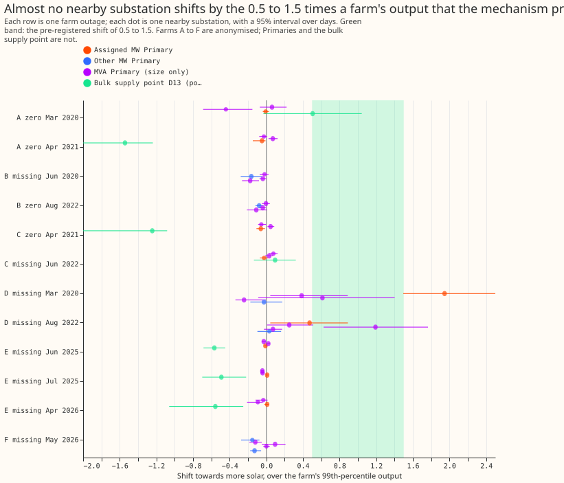
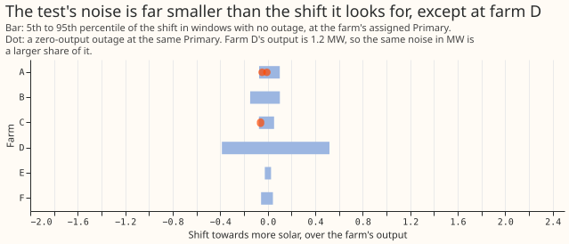

# E1: do a solar farm's meter outages show up in its Primary's power?

**NGED's Primary substations do not show the predicted return of a solar farm's output when the
farm's meter fails.** We asked whether the power supplied by a Primary substation rises, by the
output of a metered solar farm nearby, when that farm's readings stop. We found each of the 6 metered
farms' outages of 3 days or more in clear-sky hours, and compared the Primary's power in those days
with the 14 days either side. At the Primary assigned to the farm, the 3 zero-output outages that
could be tested changed the Primary's solar generation by 1% to 6% of the farm's output, in the
wrong direction, where the prediction was 50% to 150% in the right direction. This narrows the
search: meter failures at these six farms do not explain the capacity jumps, unless the farms feed
substations that this test could not reach.

**Verdict `not supported`.** The pre-registered rule needed at least two thirds of the tested
outages to show the shift, and 0 of 3 did. The brief's stop rule therefore holds: experiments E3 and
E4 are not run. Experiment 207 (E2) ran at the same time, as instructed, and is a separate result.

## Checks

- **Tested outages at the assigned Primary, as a share of the farm's 99th-percentile output (more
  solar is positive):** farm A in March 2020 at D10 is -0.01 (95% interval -0.04 to 0.03), farm A in
  April 2021 at D10 is -0.05 (-0.15 to -0.01), and farm C in April 2021 at D10 is -0.06 (-0.11 to
  -0.02). In megawatts the Primary's power rose by 0.05, 0.29, and 0.49 MW, against farm outputs of
  6.2, 6.2, and 8.1 MW. The two April 2021 outages overlap in time, so they are not independent.
- **Untestable:** farm F's zero outage (August 2025) has 1 sunny half-hour at D5, and farm B's
  zero outages are at D15 and D18, which are not decision Primaries. No farm is assigned to D11 or D16.
- **Noise of the test:** in 840 placebo windows with no outage, 7 met the rule, all at farm D. The
  5th to 95th percentile of the placebo shift is within -0.15 to 0.10 of the farm's output for farms
  A, B, C, E, and F and -0.39 to 0.52 for farm D, whose output is only 1.2 MW.
- **Other nearby substations:** none of the 9 zero outages tested at the MVA Primaries (which carry
  no sign) and none of the 1 tested at another MW Primary shows a shift. Of the 13 outages with no
  readings, 1 of 20 MVA tests (farm D, August 2022, at D8: 1.19, interval 0.63 to 1.76) is in the
  band.
- **Farm D's 101-day stretch without readings (March to July 2020)** shifts its assigned Primary D14 by
  1.95 farm outputs (1.49 to 2.59). The stretch is 7 times longer than the 14-day reference windows
  and spans the start of the 2020 lockdown, so the shift mixes demand and season changes with any
  generation effect.
- **Skegness bulk supply point, post hoc and with no placebo:** farm E's three stretches without
  readings coincide with a rise of 9 to 10 MW in D13's power, -0.49 to -0.57 of farm E's output (more
  solar is positive). Farms A and C's overlapping April 2021 outages coincide with a rise of about 10
  MW, -1.54 and -1.25 of their outputs; one event could cause both.
- **Triggers of the audit rule:** trigger 2 fired, because the result contradicts its own
  prediction. The explanations tested are the wrong parent Primary (the MVA Primaries, above) and
  a connection above the Primaries (the bulk supply point, above); neither shows the predicted shift
  at a Primary. The placebo control passed (7 of 840). No forecast is scored, so triggers 3 to 6 do
  not apply, and no later experiment is built on this result.

## Method

- **Row definition:** a Primary's half-hourly supplied power in MW (the feature cache of experiment
  106, with switching-event half-hours dropped), on sunny daylight half-hours only (clear-sky
  irradiance above 300 W/m² and CAMS irradiance at least 80% of clear-sky). No forecast is scored.
- **Outages:** 19 found (farm A 2, B 3, C 2, D 5, E 3, F 4), of which 6 are `zero` outages and 13
  `missing`. Farm E counts from its commissioning on 2024-10-06.
- **Farm-to-Primary map:** NGED's hierarchy file gives bulk supply points for five of the six farms
  and no Primary, so the assigned Primary is the nearest MW Primary with the same bulk supply point
  (D10 for farms A, C, and E; D15 for B; D14 for D; D5 for F). The nearest Primaries of several farms
  report in MVA, which carries no sign, so the true parent may be one of those. The distances are
  3.1 to 9.2 km.
- **Amendment before any shift was seen:** the minimum sunny half-hours were lowered from 100 and
  300 to 20 and 60 (plan page).
- **Post hoc, labelled:** MVA Primaries and the Skegness bulk supply point D13 were tested after the
  decision rule was applied, to explain the result. The bulk supply point uses the CAMS irradiance of
  D10 for its sunny mask.

## What the next experiment should answer

The result does not say that meter failures never matter; it says that the farms' outages are not
visible at the substations we could test. The farm-to-Primary connection list from NGED would show
whether the farms feed the MVA Primaries, and the bulk supply point's response to farm E suggests
they feed something above the Primaries.
