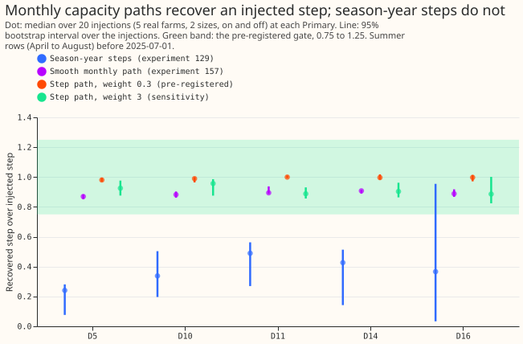
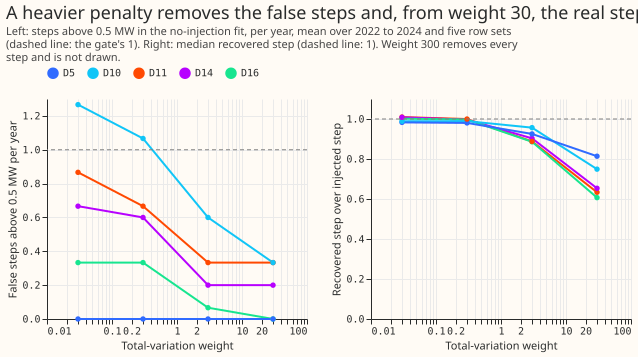
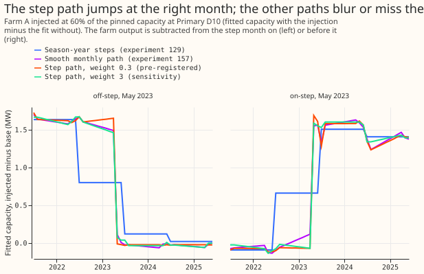

# E2: can a step in solar capacity be seen? A known-answer test

**A solar capacity that can change each month finds a known step in solar output, in size and to
within a month, but at the pre-registered penalty it also invents steps at 2 of 5 Primaries (D10 and
D11), so the gate fails.** We asked whether the demand model
of `studies.dp_gam` (a regression that stays convex, so it has one best fit) can find a sudden step in
the solar capacity it infers for a Primary substation, which is a substation that feeds homes and
businesses. The pinned capacity is the real-time estimate of the Primary's solar capacity that
experiment 45 produced.
We added the recorded output of a real solar farm to a Primary's power, from a known month onward or
before it, at 30% or 60% of the Primary's pinned solar capacity, and checked how much of the step the
fit found. The fit used April to August rows before 2025-07-01 only. We repeated the
test for 20 injections at each of the 5 decision Primaries (5 farms, 2 sizes, on and off), and
compared three capacity paths on the same rows. A path is the capacity in each month. The step path
penalises the sum of the month-to-month changes, so it stays flat except where the data need a jump;
the weight 0.3 is the pre-registered strength of that penalty. At that weight the step path found a
median 0.98 to 1.00 of the injected step (the capacity change found, over the capacity change added), the smooth monthly path of experiment 157 found 0.87 to 0.91,
and experiment 129's capacity that changes once a season-year found 0.24 to 0.49. The result narrows the
search: a step as large as one farm's output is visible in summer data, so the open question is
whether the real series contain such steps (experiment 206 found no meter-failure signal).

**Verdict `partly supported`.** At the pre-registered weight 0.3 the step path passes the size test
(median in 0.75 to 1.25) at 5 of 5 Primaries. The step path passes the date test (at least 75% of
dates within one month boundary of the true date) at 5 of 5 Primaries. The false-step test (fewer
than 1 step above 0.5 MW per placebo year) passes at 3 of 5, so all three tests pass at 3 of 5
Primaries and the pre-registered gate, which needs 4 of 5, fails. D10 and D11 fail with 1.73 and 1.00
false steps per year. At weight 3, one of the pre-registered sensitivity weights, all three tests
pass at 5 of 5, but the weight was picked after seeing the results. The smooth path also passes the
size and date bands, so the claim that it blurs the step is not supported: it shrinks the size to 87%
to 91%.

## Checks

- **Gate table (tests passed, out of 5 Primaries), size / date / false steps / all three:** weight
  0.03 is 5 / 5 / 2 / 2, weight 0.3 is 5 / 5 / 3 / 3, weight 3 is 5 / 5 / 5 / 5, weight 30 is 1 / 5 /
  5 / 1, and weight 300 is 0 / 2 / 5 / 0 (no step is allowed).
- **False steps per placebo year at weight 0.3 (no injection, mean of 5 row sets over 2022 to
  2024):** D5 0.00, D10 1.73, D11 1.00, D14 0.93, D16 0.60. At weight 3 they are 0.00, 0.60, 0.67,
  0.53, and 0.13. A false step is a month-to-month change above 0.5 MW between two summer months, or
  the net change from the August level to the next April level. The largest false step at weight
  0.3 is 1.79 MW. A step in the no-injection fit may be a real change in capacity, so the count is
  an upper bound.
- **Absolute recovery, median (95% interval over the 20 injections), weight 0.3:** D5 0.98 (0.97 to
  0.99), D10 0.99 (0.96 to 1.00), D11 1.00 (0.99 to 1.01), D14 1.00 (0.98 to 1.02), D16 1.00 (0.97 to
  1.01). Smooth path: 0.87, 0.88, 0.90, 0.91, 0.89. Season-year steps: 0.24, 0.34, 0.49, 0.43, 0.37.
- **Date within one month boundary (31 days):** 100% of injections for the step path (weights 0.3
  and 3) and the smooth path at every Primary and 40% to 90% for season-year steps. The exact month is
  found in 100% of injections for the step path at weight 0.3 and the smooth path, 95% at D11 for
  weight 3, and 15% to 45% for season-year steps. The date is read on month boundaries, so the test
  cannot tell a step placed a few days into a month from one at its start.
- **Spread over the injections:** the median ratio is 0.99 to 1.00 for each combination of size and
  direction, and 0.89 (farm B) to 1.02 (farm D) by farm.
- **Non-negativity of the level was not enforced:** the lowest level is -0.68 points (a point is 1%
  of the Primary's effective capacity) at weight 0.3, in 3 path values.
- **Audit triggers:** the first trigger of the `ml-experiment` skill fired, because the placebo
  control fails at D10 and D11 at the pre-registered weight (1.73 and 1.00 against a limit of 1), although the false
  steps are marginal and may be real steps. No forecast is scored, and no later experiment is built
  on this result.

## Notes

- **Arms:** the step path (weights 0.3, 0.03, 3, 30, and 300 per unit of step, as a share of the mean
  diagonal of the month Gram matrix; 30 and 300 were added after the first results), experiment
  157's smooth monthly path (growth share 0.1), and experiment 129's season-year steps (ridge 0.1).
  All use one Gram matrix, so the row set is the same.
- **Row definition:** half-hourly rows of April to August, before 2025-07-01, with a reading for the
  injected farm, about 26,000 rows per fit. No forecast is scored, so there is no lead range.
  Injected steps were 0.83 to 2.36 MW.
- **Step dates:** the first of May, June, or July of 2022 to 2024 (seeded). A step in winter is
  not tested, because winter rows are not in the fit.
- **D9** is left out: its readings start in 2025, so no 2022 to 2024 step can be injected.
- **Disclosed differences from the plan:** the bounded solver keeps the smooth path's levels at or
  above zero but not the step path's (the lowest step level is -0.68 points at weight 0.3, in 3 path
  values). The date tolerance is 31 days, so a step one month boundary away passes. The first draft
  counted only single month-to-month changes as false steps; a reviewer pointed out that the fit has
  no winter rows, so the count now also includes the net change from one summer to the next.
- **Injection:** the farm's output is scaled by its 99th percentile and subtracted from the target
  from the step month on (on-step) or before it (off-step). Recovery is the change in the fitted
  level across the step, injected fit minus the fit without injection, over the injected capacity.

## What the next experiment should answer

Experiment 206 found no meter-failure signal at the Primaries, so experiments E3 and E4 of the brief
are not run. A later experiment that needs steps would fit the step path with weight near 3 and read
candidate steps as "inferred, unconfirmed". The recovery here is a ceiling: a real meter-regime
step has its own shape and may sit in winter, where this fit cannot see it.
