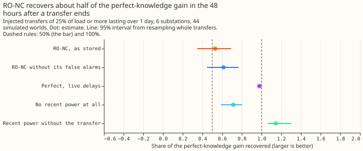

**Telling the forecast about a switching transfer lowers its error by about 1.5 points of capacity
during the transfer and in the 48 hours after it ends, but only about 0.005 points over a whole
year, and no real alarm source gains more than it costs on ordinary days.** A switching transfer
moves load from one Primary substation to its neighbours for hours or days. We asked three questions
about the "mask", which sets the forecast's recent power readings aside while a transfer is known:
whether a detector is worth having, where exactly the benefit lies, and what a better or worse
detector would be worth. We simulated transfers on the real power record of six substations (44
simulated copies of the record, 371 transfers), degraded perfect knowledge of them in controlled
steps, and replayed the real alarms and NGED's switching table on the real record. The forecast and
its masks are those of [experiment
163](../00163-switching-real-event-comparison-gam-stack-against-bg2/result.md), [experiment
171](../00171-switching-gated-mask-no-harm-pooled-months/result.md), and [experiment
203](../00203-switching-replay-learned-score-in-masked-forecast/result.md), and the simulated
transfers are those of [experiment 141](../00141-switching-detector-fed-into-gam-k/result.md) scored
as in [experiment 151](../00151-nra-forecast-rescored-against-the-true-nra-series/result.md). The
pre-registered verdict is `not supported`, because perfect knowledge gains 1.50 points where the bar
was 3.

**Answers to the three questions.** (1) Perfect knowledge helps, but modestly: 0.005 points over the
year, in line with the 0.42% of experiment 44. (2) The benefit lies during the transfer (+1.46, 0.69
to 2.29) and in the 48 hours after it ends (+1.50, 1.08 to 1.96), grows with forecast lead (+0.81 at
0 to 12 hours, +1.79 at 36 hours to 7 days), and differs by substation from +0.12 to +4.88. (3)
RO-NC (the refit-offset neighbour-count detector) finds 37% of the injected transfers and recovers
53% (35% to 69%) of the 48-hour gain. The value curve is steep in recall and flat in delay and
megawatt error.

## Results

- **Arms and rows.** Sources (a) none (K0), (b) PERFECT (known at the true onset, end known at once)
  and PERFECT_LAG (the live delays: onset 96 half-hours after the step, end 60 half-hours after the
  end), (c) LOGGED (NGED's switching table, the oracle mask of experiment 163), (d) the detector,
  which is the stored RO-NC intervals on injected worlds and experiment 195's learned score
  LEARNED_R on the real record, (e) PAIR_NEW, PAIR_GATED, RONC, RONC_195. Designs are MASK
  (headline) and SUB (subtract the span's megawatts). References: CLEAN (recent power without the
  injected transfer) and GAM_ONLY (no recent power). Injected rows are 213,533 forecast rows from
  371 transfers (the 25%-of-load-or-more stratum is 301 to 353 transfers per phase). Retraining:
  none, the cached GAM-K forecasts are reused. No weather source is introduced; weather is the
  analysis proxy of experiments 141 and 163 and is not available at forecast time beyond the cached
  ensemble members.
- **Headline gain over K0 in points (25% of load or more, lasting over 1 day; 95% interval from
  resampling whole transfers).** PERFECT: before the alarm +0.61 (0.43 to 0.81), during +1.46 (0.69
  to 2.29), after +1.50 (1.08 to 1.96). PERFECT_LAG: +0.29, +1.46, +1.47. RO-NC (DET): -0.09 (-0.34
  to +0.16), +0.44 (-0.02 to +1.03), +0.79 (0.44 to 1.19). K0's mean score in the 48 hours after is
  4.17 and CLEAN's is 2.46. Share of the PERFECT gain after the transfer: RO-NC 53% (35% to 69%),
  RO-NC without its false alarms 61% (45% to 77%), PERFECT_LAG 98%, no recent power at all 71% (59%
  to 80%), subtracting RO-NC's megawatts 30% (2% to 52%).
- **Pre-registered bar, "worth having".** The recovery clause holds on the point estimate on
  injected worlds (53%) and fails its lower bound (35%); leaving out D11 raises it to 86%, and
  leaving out D9 lowers it to 44%. On the real record LEARNED_R recovers 85% of LOGGED's gain in the
  48 hours after (6 transfer-substation windows; its gain interval, +0.11 to +11.99 points, is too
  wide to inform). The harm clause fails for every real source (next bullet). Whole-year pooled gain
  on injected worlds: PERFECT +0.0053, RO-NC +0.0013, PERFECT_LAG +0.0045.
- **Ordinary days (points of effective capacity, mask minus no mask, 1,579,711 rows, 27 months;
  interval from resampling whole calendar months).** PAIR_GATED +0.030 (-0.012 to +0.074), PAIR_NEW
  +0.055 (+0.009 to +0.105), LEARNED_R +0.031 (-0.020 to +0.086), LEARNED_F +0.109 (+0.022 to
  +0.226), RONC_195 +0.144 (+0.054 to +0.258). None has an interval inside +/-0.05. Random false
  alarms added to LOGGED, at 16 alarms (precision 0.75) cost -0.000 (-0.000 to +0.000) and at 46
  alarms (precision 0.5) cost +0.013 (+0.005 to +0.024). Per alarm, the cost is about +0.0003 points
  for the random false alarms (46 alarms), the pair alarm (+0.055, 242 alarms), and the re-ranker
  (+0.031, 104 to 150 alarms per fold), and about +0.0014 for RO-NC (+0.144, 104 alarms). The real
  sources raise 104 to 242 alarms of which 15 to 20 match a logged transfer, so their precision
  against the log is under 0.2 (an alarm that matches no logged transfer may still be a real,
  unlogged transfer). Perfect recall with precision 0.75 or 0.5 would net about +0.020 or +0.007
  points pooled (LOGGED's pooled gain less the false-alarm harm).
- **Real logged transfers (scored against metered power).** In the 48 hours after a transfer ends,
  LOGGED gains +7.40 (2.32 to 10.22), PAIR_GATED +6.35, LEARNED_R +6.31, RONC +6.18 (6 windows,
  intervals wide). Pooled over ordinary rows plus experiment 163's after rows the gain is about
  +0.017 for every real source (+0.020 for LOGGED), below the ordinary-day harm of +0.03 to +0.14.
  During a transfer the mask loses 4.75 points (LOGGED, -7.2 to -1.5), because metered power really
  does include the transfer; that is not a failure of the mask for a normal-arrangement forecast.
- **Quality sweep, share of the PERFECT gain recovered, after the transfer (during, before the
  alarm).** Recall 0.25: 37% (37%, 36%); 0.5: 63% (72%, 48%); 0.75: 77% (96%, 66%). Onset delay up
  to 2 days: 100%; 3 days (post hoc): 83% (90%, 36%); 4 days (post hoc): 64% (81%, 24%). Error in
  the megawatts (subtraction design only): 25% error 86%, 50% error 72%. Repairing RO-NC's misses in
  steps of 25% (from 53%): 59%, 72%, 73%, and 85% (69% to 99%) at 100%. Quality required for 50%
  after the transfer, other axes perfect: recall about 0.4 (0.25 fails, 0.5 passes), and no tested
  delay or megawatt error fails. RO-NC's recall is 37% (393 of 1,063 transfer-substation pairs), and
  19 of 45 logged transfers on the real record.
- **Strata (perfect knowledge, after the transfer).** Winter (November to March) +1.60 (0.94 to
  2.26) against summer +1.48 (1.00 to 2.00), and RO-NC recovers 74% in winter against 50% in summer.
  Substations: D10 +4.88, D11 +2.08, D9 +1.54, D14 +1.36, D16 +0.59 (-0.27 to +1.28), D5 +0.12
  (-0.25 to +0.53). Size and duration cannot be stratified: every simulated transfer moves 25% of
  the load or more, and all but 5 last over 1 day. The receiver metered or unmetered stratum is not
  scored, because the stored worlds do not record it.
- **Tails (after the transfer, headline stratum; coverage at q95 and q99, pinball at q05 and q95).**
  K0: 0.758 and 0.864; 1.00 and 1.41. PERFECT: 0.948 and 0.983; 0.63 and 0.77. RO-NC: 0.845 and
  0.916; 0.78 and 1.06.
- **Checks.** The median minus the mean forecast per substation is identical for K0 and PERFECT (D5
  -0.31, D10 -0.09, D9 -0.11, D11 -0.04, D14 +0.10, D16 +0.06), because the mask moves the
  correction only through the mean. The mean-forecast error (mean absolute, after the transfer)
  agrees with every score contrast: K0 6.90, RO-NC 5.74, PERFECT 4.63, CLEAN 4.27. Controls
  reproduce: K0 10.129 and PAIR_NEW 6.083 on experiment 163's 11 transfers, and PAIR_GATED +0.030
  (-0.012 to +0.074) with K0 2.718 on ordinary rows; K0 equals CLEAN before the first injected stamp
  (asserted in every job). Audit triggers: trigger 2 fired (perfect-knowledge gain 1.50 against a
  predicted 3 or more, and RO-NC recovering 53% against a predicted 15% to 40%). The explanation was
  tested: simulated transfers move a median of 9.5 points of capacity, the logged transfers a median
  of 15.4, and K0's mean score after is 4.17 on injected worlds against 13.6 on the real record, so
  the real transfers are about 1.6 times larger and the real gain larger. Triggers 1, 3, 4, 5, 6,
  and 7 did not fire (leaving out D11 moves the perfect gain to 0.97 and RO-NC's share to 86%, with
  the same sign and verdict). No Opus audit was run. A Sonnet code review found nine issues, of
  which the delay cap, the repair baseline, the real-record phase labels, the baseline of the
  false-alarm harm, and a missing fold check were fixed and rerun; its finding that the ordinary
  rows need the scored-period filter was rejected, because experiment 171 scored every cached run.
- **Deviations from the plan.** The learned score of experiment 195 does not exist on injected
  worlds, so RO-NC stands in there. The positive controls are experiment 163's published numbers on
  its 11 transfers (10.129 and 6.083), because the plan's 6.321 and 13.686 need best guess 2's
  shared rows. Coverage and pinball use `studies.tail_calibration.pinball` and transfer resampling,
  not its month-resampled table. The delay sweep's pre-registered steps (up to 24 hours) never reach
  the during and after rows, whose cutoffs are at least 96 half-hours after the onset, so delays of
  2, 3, and 4 days were added post hoc. A debug run on 8 of the 44 worlds was read before the final
  run. The real-record before-alarm and during phases are scored against metered power, not the
  normal arrangement.
- **Scale note for 2,500 series.** Sources (b) and (c) need NGED's switching labels. Sources (d) and
  (e) and the quality sweep can be reproduced without labels. The decision this supports: on today's
  detectors, drop the automatic mask in the forecast, and keep the alarms for the operator and for a
  normal-arrangement forecast. The quality to reach is recall of about 0.4 and a harm interval
  inside +/-0.05 on ordinary days.
- **What to try next.** An alarm source with an order of magnitude fewer alarms per matched transfer
  (for example a pair alarm that also demands balanced steps), a soft use of the alarm that does not
  switch recent power off, and a small learned gate that scores each alarm before masking, with the
  convex forecast as the comparison arm. Simulate transfers below 25% of load and under 6 hours
  first, since the stored worlds hold none.
