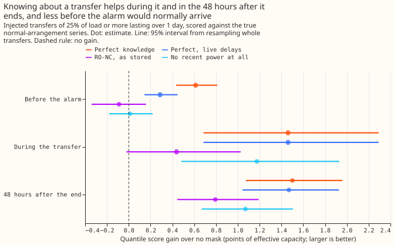
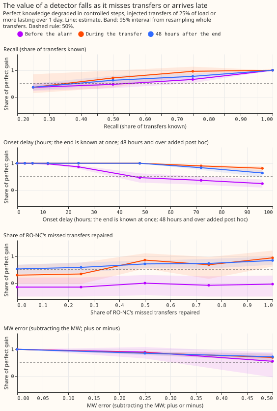
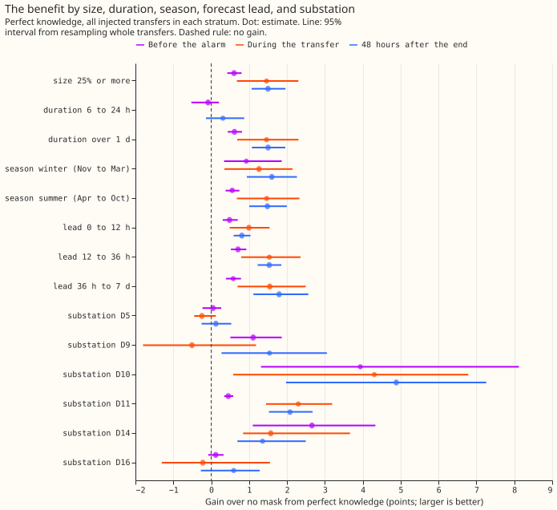
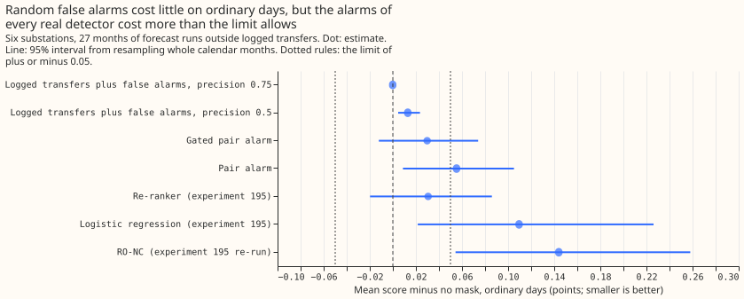
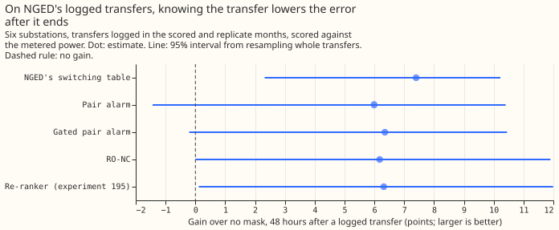

**Telling the forecast about a switching transfer lowers its error by about 1.5 points of capacity
during the transfer and in the 48 hours after it ends, but by only about 0.005 points averaged over
a year, and none of the five real alarm sources tested stays inside the ordinary-day error limit.**
A switching transfer moves load from one Primary substation (one fed at a higher voltage than its
customers) to its neighbours for hours or days. We tested one way of using that knowledge. The
forecast is a generalised additive model with a Kalman filter on its recent errors. A "mask" sets
the filter's recent power readings aside while a transfer is known, so the forecast leans on weather
and calendar alone. An "alarm source" is a detector that flags a transfer from the power record. A
score is twice the mean pinball loss over 11 quantiles, as a percentage of the substation's
effective capacity ("points"); lower is better, and a gain is the no-mask score minus the arm's.

**We answered three questions.** The answers rest on 371 transfers that we simulated on the
27-month power record of six substations (44 simulated copies of the record), and on NGED's log of
real transfers.

- **Is a detector worth having?** Perfect knowledge gains 0.005 points averaged over every forecast
  row in the year. The pre-registered verdict is `not supported` because the hypothesis predicted a
  gain of at least 3 points after a transfer and the measured gain is 1.50 (1.08 to 1.96).
- **Where is the benefit?** It sits during a transfer (+1.46, 0.69 to 2.29) and in the 48 hours
  after it ends (+1.50). It is smaller before an alarm would normally arrive (+0.61), rises with
  forecast lead (+0.81 at 0 to 12 hours, +1.79 at 36 hours to 7 days), and ranges across substations
  from +0.12 to +4.88.
- **What is a better or worse detector worth?** RO-NC finds 37% of the simulated transfers and
  recovers 53% of the 48-hour gain. The share recovered rises steeply with the share of transfers
  found, and falls with delay only beyond 2 days.

## Results

- **Sources compared.** K0 is no mask. PERFECT knows each transfer from its true onset and its end
  at once. PERFECT_LAG knows it with the live delays (onset 96 half-hours after the step, end 60
  after the end). RO-NC is the stored detector of [experiment
  147](../00147-causal-live-end-rule-for-ro-nc/result.md). LOGGED is NGED's switching table. On the
  real record, the re-ranker (LEARNED_R) is [experiment
  195](../00195-switching-neural-plus-detector-features/result.md)'s learned score, and the pair
  alarm (PAIR_NEW, and PAIR_GATED when its balance score is 0.7 or more) is that of [experiment
  156](../00156-switching-faster-onset-alarm-from-opposite-steps/result.md). CLEAN is recent power
  without the simulated transfer, and GAM_ONLY ignores recent power. The simulated transfers are
  those of [experiment 141](../00141-switching-detector-fed-into-gam-k/result.md), scored against
  the true normal-arrangement series as in [experiment
  151](../00151-nra-forecast-rescored-against-the-true-nra-series/result.md); the forecast and masks
  are those of [experiment
163](../00163-switching-real-event-comparison-gam-stack-against-bg2/result.md)
  and [experiment 203](../00203-switching-replay-learned-score-in-masked-forecast/result.md).
Nothing
  is retrained, and the weather is the analysis proxy of those experiments.
- **The gain after a transfer is 1.50 points (1.08 to 1.96) for perfect knowledge.** The rows are
  the 213,533 forecasts for transfers of 25% of load or more lasting over 1 day (133 transfers
  during, 301 after, 353 before the alarm). Gains over K0 by phase, before the alarm, during, and
  after: PERFECT +0.61 (0.43 to 0.81), +1.46 (0.69 to 2.29), +1.50 (1.08 to 1.96); PERFECT_LAG
  +0.29, +1.46, +1.47; RO-NC -0.09 (-0.34 to +0.16), +0.44 (-0.02 to +1.03), +0.79 (0.44 to 1.19).
  K0 scores 4.17 after a transfer and CLEAN 2.46. Averaged over every forecast row of the year,
  PERFECT gains +0.0053, PERFECT_LAG +0.0045, and RO-NC +0.0013.
- **RO-NC recovers 53% (35% to 69%) of the 48-hour gain, which is fragile.** The share is 61% (45%
  to 77%) without RO-NC's false alarms, 98% for PERFECT_LAG, and 71% (59% to 80%) for GAM_ONLY,
which
  uses no detector. Subtracting RO-NC's moved megawatts instead of masking recovers 30% (2% to 52%)
  of the gain of subtracting the true megawatts. Leaving out one substation gives 44% (without D9)
  to 86% (without D11). CLEAN gains 115% of PERFECT's gain.
- **The pre-registered bar, "worth having", is not met.** The bar needs the detector to recover at
  least 50% (point estimate) of the perfect gain in the 48 hours after a transfer and the
  ordinary-day error to have a 95% interval inside +/-0.05 points. RO-NC meets the first clause on
  the point estimate. No real alarm source meets the second.
- **Ordinary days (1,579,711 rows, 27 months; mask minus no mask, points; interval from resampling
  whole calendar months).** PAIR_GATED +0.030 (-0.012 to +0.074), PAIR_NEW +0.055 (+0.009 to
  +0.105), re-ranker +0.031 (-0.020 to +0.086), logistic regression of experiment 195 +0.109
  (+0.022 to +0.226), RO-NC re-run of experiment 195 +0.144 (+0.054 to +0.258). The last three
  intervals show a rise for PAIR_NEW, the logistic regression, and RO-NC.
- **The extra error scales with the number of alarms.** Per alarm it is about +0.0003 points for
  random false alarms (+0.013 over 46 alarms, at precision 0.5), the pair alarm (+0.055 over 242
  alarms), and the re-ranker (+0.031 over 104 to 150 alarms), and about +0.0014 for RO-NC (+0.144
  over 104 alarms). Random false alarms at precision 0.75 (16 alarms) raise it by -0.000 (-0.000 to
  +0.000). Random alarms copy the durations of logged transfers, which real alarms need not match.
  The real sources raise 104 to 242 alarms of which 15 to 20 match a logged transfer, a precision of
  under 0.2 against the log (an unmatched alarm may be a real, unlogged transfer).
- **On the real record the gain is small once averaged over rows.** In the 48 hours after a logged
  transfer ends, LOGGED gains +7.40 points (2.32 to 10.22), PAIR_GATED +6.35, the re-ranker +6.31
  (interval 0.11 to 11.99), and RO-NC +6.18, over six windows of transfer and substation. Averaged
  over ordinary rows plus these rows the gain is about +0.017 for every real source and +0.020 for
  LOGGED, below the ordinary-day rise of +0.03 to +0.14 for four of the five sources. During a
  transfer the mask loses 4.75 points (LOGGED, 1.5 to 7.2), because the metered power really does
  include the transfer.
- **The value curve is steep in recall and flat in delay up to 2 days (share of the PERFECT gain,
  after the end; during; before the alarm).** Recall 0.25: 37% (25% to 51%); 37%; 36%. Recall 0.5:
  63% (47% to 80%); 72%; 48%. Recall 0.75: 77%; 96%; 66%. Onset delay up to 24 hours: 100%
  after the end (by construction, because those rows start 48 hours after the onset). Delay of 2
  days: 100%; 100%; 46%. Delay of 3 days: 83%; 90%; 36%. Delay of 4 days: 64% (48% to 75%); 81%;
  24%. Error of 25% or 50% in the megawatts, for subtraction: 86% or 72%. Repairing 25%, 50%, 75%,
  or 100% of RO-NC's missed transfers: 59%, 72%, 73%, or 85% (69% to 99%). The delays of 2 to 4 days
  were added post hoc. RO-NC finds 393 of 1,063 simulated transfer-substation pairs (37%), and
  19 of 45 logged real transfers by this experiment's matching rule.
- **Quality needed for 50% after the end, other axes perfect.** Recall of 0.25 is below the
  threshold and 0.5 above, but each interval spans 50%, so "about 0.4" is an interpolation. No
  tested delay or megawatt error falls below it.
- **Strata after a transfer (perfect knowledge).** Winter (November to March) +1.60 (0.94 to 2.26)
  and summer +1.48 (1.00 to 2.00); RO-NC recovers 74% in winter (57 transfers) and 50% in summer.
  Substations: D10 +4.88, D11 +2.08, D9 +1.54, D14 +1.36, D16 +0.59 (-0.27 to +1.28), D5 +0.12
  (-0.25 to +0.53). Every simulated transfer moves 25% of the load or more, and almost all last over
  1 day, so the size and duration strata below those cannot be scored. The receiver metered or
  unmetered stratum is not scored, because the simulated transfers do not record it.
- **Tails after a transfer (coverage at q95 and q99, nominal 0.95 and 0.99; pinball at q05 and
  q95).** K0: 0.758 and 0.864; 1.00 and 1.41. PERFECT: 0.948 and 0.983; 0.63 and 0.77. RO-NC:
  0.845 and 0.916; 0.78 and 1.06. K0's upper quantiles sit too low after a transfer; PERFECT's are
  close to nominal.
- **Checks.** The median minus the mean forecast per substation is the same for K0 and PERFECT
  (D5 -0.31 to D14 +0.10). The error of the mean forecast agrees with the score contrasts: K0 6.90,
  RO-NC 5.74, PERFECT 4.63, CLEAN 4.27. The controls reproduce experiment 203's K0 10.129 and
PAIR_NEW
  6.083 on 11 real transfers, PAIR_GATED +0.030 (-0.012 to +0.074), and K0 2.718 on ordinary rows.
  Audit trigger 2 fired: the perfect gain (1.50) and RO-NC's share (53%) missed their predictions (3
  or more, and 15% to 40%). One possible explanation is size. The simulated transfers move a median
  of 9.5 points of capacity and the logged ones 15.4, and K0 scores 4.17 after a transfer on the
  simulated record against 13.6 on the real one. Size does not account for the whole gap (+1.50
  against +7.40), and the two scores use different references. The other triggers did not fire. No
  Opus audit was run.
- **Deviations from the plan.** The learned score of experiment 195 does not exist on simulated
  transfers, so RO-NC stands in there. The controls are experiment 203's printed numbers on 11
  transfers. Tail coverage and pinball resample transfers, not months. The real-record phases before
  the alarm and during a transfer are scored against metered power. A debug run on 8 of the 44
  simulated copies was read before the final run.
- **Next steps (options).** An alarm source with far fewer alarms per matched transfer (for example
  a pair alarm that also needs balanced steps); a soft use of the alarm that keeps recent power; and
  a small neural gate that scores each alarm before masking, with the convex forecast as the
  comparison arm. Simulating transfers below 25% of load and under 6 hours would fill the empty
  strata. For a 2,500-series deployment, the logged-table results need NGED's labels; the
  detector results and the sweep do not.
