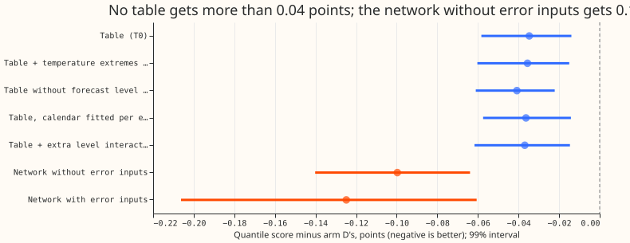

**Take-home: a table of binned corrections to arm D gains 0.03 to 0.04 points, a neural network given
the same inputs but no recent errors gains 0.10, so the network learns something a binned table
cannot.** Experiment 200 found that a network head beats arm D, that a copy given no past errors gets
most of that gain, and that a table came within 0.01 to 0.02 points of the network when both
trained on one year. This experiment asked whether a table still matches the network when both train
on 2020 onward. It does not. The table is 0.065 points worse than the network without error inputs
(99% interval 0.042 to 0.086), and five table variants stay within 0.006 points of one another. A
temperature-extremes term, the lead from experiment 201, adds under 0.001 points. The verdict is
`not supported`: the pre-registered rule needs the table to come within 0.02 points of the network.

## Results

- **Setup.** Arm D is the best forecast of
  [experiment 155](../00155-dp-bg-stage2-assembly-night-offset-and-error-correction/result.md).
  Each table is a sum of lookup terms, with no hidden layer, fitted by gradient descent on the pinball
  loss ([Koenker and Bassett (1978)](https://doi.org/10.2307/1913643)) over 11 quantiles. The terms
  shift arm D's median and scale its quantile offsets. Rows, training window (2020 to 2025-06-27),
  validation block, and scored rows (2025-07-02 to 2026-06-29, 15.5 to 39 hours ahead, outside
  switching events) are those of [experiment
  200](../00200-dp-pooled-correction-head-on-kalman-state/result.md). The network scores are
  experiment 200's stored rows. Three seeds are averaged. The table fits ran on CPU.
- **Arms.** T0: median shift by site and half-hour, site and weekday, site and lead band, half-hour
  and weekday, site by arm D's forecast level (12 bins) by weather era, and the ensemble-era flag.
  T1: T0 plus a temperature-extremes term. T2: T0 without the forecast level by era term. T3 and T4
  are post hoc: T3 fits the calendar terms separately for each weather era, and T4 adds forecast
  level by six-hour block by era and forecast level by weekday by lead band.
- **Scores (five decision substations, quantile score in points; lower is better).** Arm D 2.432, T0
  2.397, T1 2.396, T2 2.391, T3 2.395, T4 2.395, network without error inputs 2.332, network with
  error inputs 2.307.
- **Contrasts against arm D (99% month-resampled intervals).** T0 -0.035 (-0.058 to -0.014), T1
  -0.036 (-0.060 to -0.015), T2 -0.041 (-0.061 to -0.022), T3 -0.036 (-0.057 to -0.014), T4 -0.037
  (-0.062 to -0.015), network without error inputs -0.100 (-0.140 to -0.064), network with error
  inputs -0.125 (-0.206 to -0.061).
- **Decision contrasts.** T0 minus network without error inputs +0.065 (+0.042 to +0.086). T0 minus
  network with error inputs +0.090 (+0.038 to +0.171). T1 minus T0 -0.0009 (-0.0022 to -0.0001). T2
  minus T0 -0.006 (-0.014 to +0.001), so the forecast level by era term does not help the table. T3
  minus T0 -0.002 (-0.013 to +0.009). T4 minus T0 -0.002 (-0.009 to +0.004).
- **Tails (T0, decision substations).** Coverage at q95 94.8%, at q99 98.3%, at q05 6.3%, at q01
  2.0%. Pinball at q99 0.385 and at q01 0.352, against arm D's 0.411 and 0.386.
- **Per substation, T0 minus arm D.** D5 -0.056, D10 +0.026, D11 +0.014, D14 -0.099, D16 -0.063, D9
  +0.018. Leaving one decision substation out keeps T0 minus the network without error inputs between
  +0.039 and +0.077.
- **Checks.** Triggers fired: 2 (the result contradicts the pre-registered prediction and the
  experiment 200 audit's reading, and the post hoc arms T3 and T4 tested two explanations without
  closing the gap). No audit was run, by the manager's instruction. The rows align with experiment
  200's stored rows (arm D losses match within 0.001).
- **Caveats.** The network has continuous inputs (lead, the sine and cosine of the half-hour,
  arm D's forecast) where the table has bins, and a spread head. The experiment does not say which of
  these the network needs. The table's spread scale is a lookup by site, lead band, and six-hour
  block. The temperature term is a linear hinge per substation, and the driver temperature is the
  ensemble mean in the ensemble era and past weather before it.

## What to try next

- Ablate the network without error inputs one input at a time (lead, half-hour, forecast level,
  era) to find the input whose smooth use the table misses.
- Fit a gradient-boosted model with the pinball loss on the same inputs, as a second route to the
  same gain with an interpretable form.
