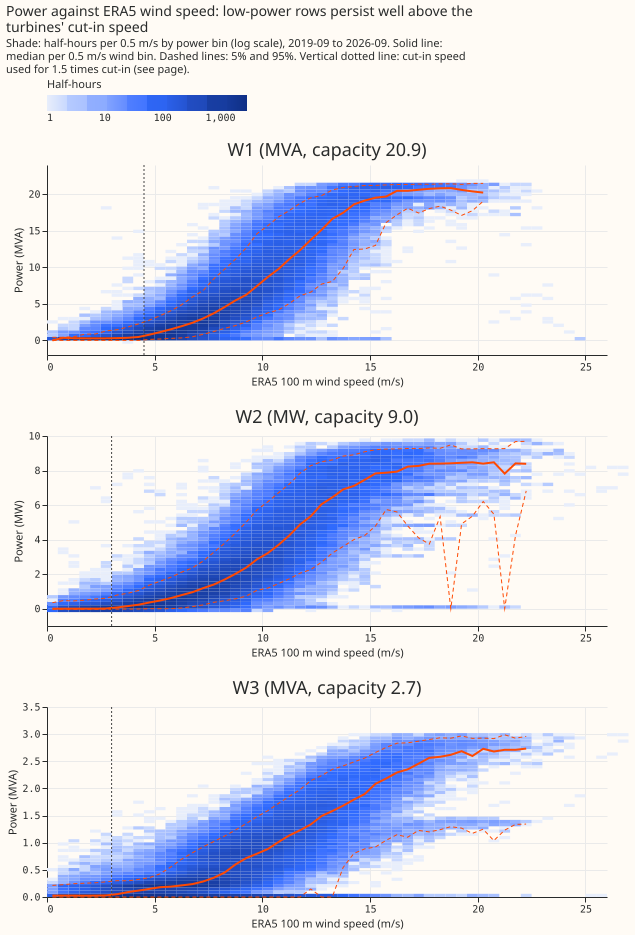
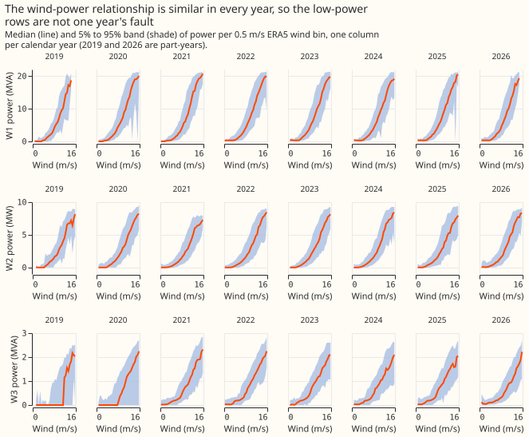
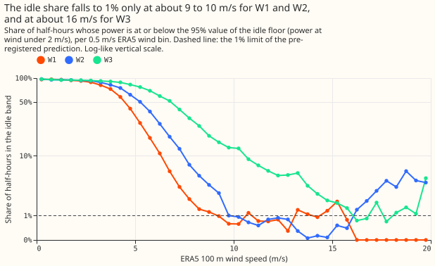
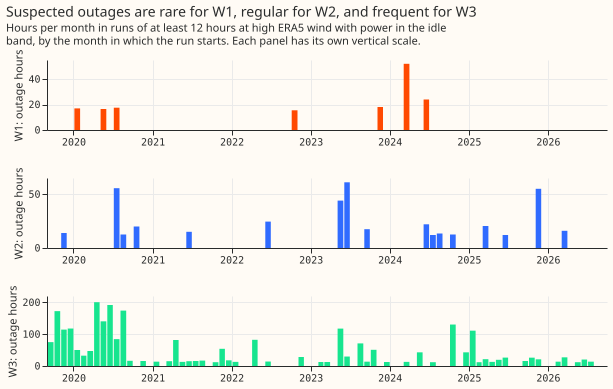
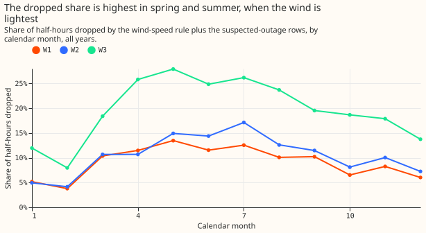

**The noisy near-zero rows in NGED's three metered wind series are not confined to low wind, so ERA5
wind speed alone cannot find them.** A rule that drops every half-hour below a wind-speed threshold
removes 8.9% (W1), 9.9% (W2), and 15.2% (W3) of the half-hours. It still leaves about 60% of the
idle-band half-hours in the data, because ERA5 gives the wind in a 25 km cell, which differs from
the wind at the turbines by more than the width of the cut-in region. The main wind-farm experiment
should therefore drop the rows listed in the stored mask and not expect a wind-speed threshold to
clean the series.

We asked whether the idle noise (readings near zero, with repeated values, and in MVA a small
non-zero floor) happens only when the wind is too light to turn the turbines. We took half-hourly
power from three wind farms, W1 to W3 (W1 and W3 in MVA, W2 in MW), and the ERA5 wind speed at 100 m
at each farm's cell ([Hersbach et al. (2020)](https://doi.org/10.1002/qj.3803)). We then measured
how often power sits in the idle band, which is the 5% to 95% range of power at ERA5 wind below 2
m/s, at each wind speed. The answer narrows the next step: a threshold on ERA5 wind speed is worth
using only as one flag among several.

Verdict: `not supported` for all three farms. The prediction failed on both counts at every farm.

## Results

- **Data and alignment:** 121,878 (W1), 121,940 (W2), and 121,535 (W3) half-hours from 2019-09 to
  2026-09, with no nulls or duplicate times. The cleaning rules flag none of the three series. W2
  has 62 gaps over 30 minutes (longest about 10 days), W3 has 227 (longest 38 hours). The longest
  identical-value runs are zeros of 100 to 155 half-hours. Power correlates best with ERA5 wind at
  lag 0 (0.858, 0.853, and 0.806), so no shift was applied.
- **Weather used:** ERA5 100 m wind speed, linearly interpolated between the two hourly instants
  either side of each half-hour's midpoint (the stored timestamp minus 15 minutes). ERA5 arrives
  about 5 days late, so this is a lab input and the detector below could not run live on it. The two
  farms W2 and W3 share one ERA5 cell, so their weather is one series.
- **Idle floor (ERA5 wind below 2 m/s):** W1 median 0.299 MVA, 5% to 95% band 0 to 0.608, 41%
  exactly zero, 30% repeating the previous value. W2 median 0.000 MW, band -0.033 to 0.482, 40%
  negative (minimum -0.071), 19% exactly zero, 15% repeating. W3 median 0.025 MVA, band 0 to 0.243,
  41% exactly zero, 27% repeating.
- **No dip above cut-in:** the lowest bin median between 2 and 5 m/s minus the idle median is -0.017
  MVA at W1 (0.08% of capacity), 0.000 MW at W2, and +0.001 MVA at W3. No bin median falls below the
  idle floor's 5% value, so the brief's expected dip is not visible at half-hourly, farm-level
  resolution.
- **H0 fails (pre-registered test):** cut-in came out at 4.5 m/s for W1 and was set to the 3.0 m/s
  default for W2 and W3, whose empirical estimates (5.5 and 7.0 m/s) fell outside 2.5 to 4.5 m/s. So
  "above 1.5 times cut-in" means wind above 6.75 m/s (W1) and 4.5 m/s (W2 and W3). The 5% to 95%
  width per bin above that wind exceeds the reference residual width in 78% (W1), 100% (W2), and
  100% (W3) of bins (median bin width 8.21 against 3.89 MVA, 4.38 against 0.99 MW, 1.68 against 0.34
  MVA). The share of those rows in the idle band is 1.6% (W1), 13.0% (W2), and 29.9% (W3), against
  the 1% limit.
- **The idle share falls to 1% only at high wind:** the idle share crosses 1% at about 9 to 10 m/s
  for W1 and W2 and about 16 m/s for W3 (Figure 3). Above 10 m/s it is 0.8% (W1), 0.8% (W2), and
  6.2% (W3). It is 11% to 27% at 5 to 6 m/s for W1, and 50% to 26% at the same speeds for W2.
- **Idle share by year:** at W1 and W2 the idle share above 1.5 times cut-in is steady across years
  (W1 1.0% to 3.1%, W2 11% to 14%). At W3 it is 70% in 2019, 45% in 2020, and 23% to 32% from 2021
  to 2026, and above 10 m/s it is 1.5% from 2021. The first 2 years of W3 therefore carry a regime
  change, not a wind effect (post hoc).
- **W3 has a half-capacity level:** at wind above 15 m/s, 13% of W3's half-hours sit between 40% and
  60% of capacity and 1.6% below 10%, which suggests one of its 2 turbines is often out. W1 (0.9%)
  and W2 (3.4%) show the same pattern far less (post hoc).
- **Outage rows (at least 12 hours in the idle band at wind above 1.5 times cut-in):** W1 has 9
  runs, 160.5 hours in total, longest 24 hours, begun in 2020 (3), 2022 (1), 2023 (1), and 2024 (4).
  W2 has 23 runs, 427.5 hours, longest 55 hours, begun in every year from 2019 to 2026 (7 in 2023).
  W3 has 151 runs, 2,741.5 hours (4.5% of its half-hours), longest 49 hours, with 80 of them begun
  in 2019 and 2020.

**Detector (threshold on ERA5 wind speed, largest threshold with at most 5% false drops on the
training years):**

| Farm | Threshold, all years (m/s) | Dropped | False drops | Idle-band rows missed |
|---|---|---|---|---|
| W1 | 3.2 | 8.9% | 4.8% | 61.5% |
| W2 | 3.7 | 9.9% | 4.9% | 61.7% |
| W3 | 4.5 | 15.2% | 4.9% | 59.8% |

Out of sample, odd years to even years: W1 3.4 m/s, 10.0% dropped, 5.2% false, 57.8% missed; W2
3.5 m/s, 8.8%, 7.0%, 61.0%; W3 4.0 m/s, 11.5%, 4.5%, 69.2%. Even years to odd years: W1 3.1 m/s,
8.4%, 5.0%, 62.1%; W2 3.9 m/s, 11.2%, 3.6%, 61.2%; W3 5.0 m/s, 19.6%, 5.9%, 51.0%. A false drop is
a dropped row with power above the idle band's 95% value plus 2% of capacity. A miss is an
idle-band row, outside the suspected-outage runs, that the rule keeps.

- **The mask:** the stored table `mask.parquet` holds 11,142 (W1), 12,903 (W2), and 24,009 (W3)
  rows, with `drop_reason` `low_wind_idle` (10,821, 12,048, and 18,526) or `outage_suspected` (321,
  855, and 5,483). That is 9.1%, 10.6%, and 19.8% of rows.
- **Effect on the retained rows (median, 5%, 95%):** W1 from 2.890, 0.000, 17.648 to 3.396, 0.251,
  18.026 MVA. W2 from 1.538, 0.000, 7.875 to 1.856, 0.089, 8.013 MW. W3 from 0.374, 0.000, 2.095 to
  0.617, 0.000, 2.211 MVA.
- **Dropped share by month:** highest from May to July (W1 about 13%, W2 about 15% to 17%, W3 about
  25% to 28%) and lowest in February and December (W1 4% to 6%, W2 4% to 7%, W3 8% to 14%).

## Checks

- **Median forecast minus mean forecast, and quantile-score contrasts:** not applicable, because the
  experiment fits no forecast and scores no quantile.
- **Audit triggers:** trigger 2 fired in the plain sense that the result contradicts its prediction.
  The explanation was tested here: the ERA5 smear is shown by the idle share falling smoothly over 3
  to 10 m/s (Figure 3), and the W3 excess by the year split. Trigger 7 may apply, because the main
  wind-farm experiment depends on the mask; the manager decides whether an audit runs. Triggers 1,
  3, 4, 5, and 6 do not apply (no control, no forecast contrasts, no nested arms).
- **Sensitivity not run:** the nearest-hour wind in place of the interpolated wind, and a cut-in
  speed other than the pre-registered estimate. The idle share at 10 m/s and above, which does not
  depend on the cut-in speed, shows the same result.

## What this narrows

- The idle floor exists, and above about 10 m/s it nearly disappears at W1 and W2, but ERA5 wind
  speed in a 25 km cell does not locate it. A rule on wind speed drops 9% to 15% of rows and finds
  only 30% to 50% of the idle-band rows out of sample.
- The main experiment can keep the mask as a default, with the caveat that it is a coarse, hard
  drop. An alternative to test is to leave the rows in and let the forecast's lower quantiles absorb
  the idle band.
- W3's first 2 years look like a different regime from the later years and are the largest single
  source of idle rows at high wind.
- Next: a detector that uses the farm's own recent power (available live after a 3.5-hour delay)
  rather than ERA5 alone, and a test of whether NGED's meters or turbine availability explain the
  12-hour runs.

## Caveats

- Cut-in speed, hub height, and turbine model are unknown, and the 1.5 times cut-in rule uses an
  estimate taken from ERA5, so the exact wind at which H0 is tested is soft. The conclusion rests
  also on the 10 m/s figure.
- W2 and W3 share one ERA5 cell, so they are one independent weather series.
- The mask rule uses ERA5, which is not available at forecast time. It is for training and
  evaluation rows only.
