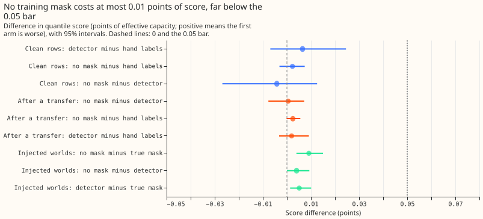

**Masking switching transfers when the forecast model is trained barely matters, so a detector has
almost nothing to replace.** A switching transfer moves load between Primary substations for hours
or days. Every earlier forecast in this project trained with the logged and hand-labelled transfers
set missing, and nobody had measured what that masking changed. We refitted [experiment
111](../00111-differentiable-physics-6-ens-forecast-engine-against-bg2/result.md)'s forecast model
at five Primary substations (D5, D10, D11, D14, and D16). That model is a convex additive model
(GAM) with a Kalman filter that corrects its recent errors (GAM-K), refitted each month on the
previous 24 months of readings. We refitted it three ways: with no training mask (arm A), with the
hand labels masked (arm B, experiment 111's own fits), and with the alarms of [experiment
195](../00195-switching-neural-plus-detector-features/result.md)'s detector masked (arm C). The
detector is a learned score that flags a likely transfer in the readings. Arm C used only the alarms
raised by each refit date, as a live service would have them. We scored each arm on clean rows (the
scored year, outside every logged transfer and the 72 hours after it) and on rows after a logged
transfer. The score is the quantile score in points of effective capacity, the error as a
percentage of each substation's effective capacity, where lower is better. We repeated the
comparison on 476 simulated transfers (generated with experiment 195's injector) added to the
training readings, in "worlds" of simulated records, and scored against the true readings. Arm A is
0.002 points worse than arm B on clean rows and 0.003 worse on rows after a logged transfer.
Simulated transfers widen the gap to 0.009. All three gaps are far below the 0.05-point improvement
that the pre-registered plan required, so the verdict is `inconclusive`: there is little for a
mask to repair, and the detector did not fail.

**The refits build on three earlier experiments.** The alarm intervals, the 4-day delay before an
alarm is known, and the end rule come from [experiment
203](../00203-switching-replay-learned-score-in-masked-forecast/result.md). The step stamp as the
mask's start comes from [experiment
188](../00188-switching-d10-audit-and-onset-location-in-look-back/result.md). Experiments
[163](../00163-switching-real-event-comparison-gam-stack-against-bg2/result.md) and
[171](../00171-switching-gated-mask-no-harm-pooled-months/result.md) masked the recent-power
correction instead of the training rows.

## Results

- **The positive control passes, and the verdict is `inconclusive`.** Arm B's coefficients equal
  experiment 111's stored fits exactly (maximum relative difference 0) at all 27 monthly refit
  dates of the five substations (`printed_control.txt`). Its scores equal experiment 203's
  no-mask scores row by row (maximum difference 0). Arm A minus arm B is under 0.05 on rows after a
  logged transfer (+0.0025) and in the worlds (+0.0091 net of the real record). That triggers the
  first row of the pre-registered verdict table, `inconclusive`.
- **The gates, reported although the table stops earlier.** G1 holds: arm C minus arm B on clean
  rows is +0.0065 (-0.0069 to +0.0246). G2 fails: arm A minus arm C on rows after a logged transfer
  is +0.0005 (-0.0077 to +0.0072), against the 0.05 bar. G3 holds on its two conditions (arm C
  minus B +0.0051, arm A minus C +0.0040 with an interval of +0.00003 to +0.0093), but the gap that
  arm C could close in the worlds is only 0.009.
- **Absolute scores.** Clean rows (scored year, 462,137 rows): A 2.7913, B 2.7890, C 2.7955. Rows
  after a logged transfer that the detector can know about (1,130,781 rows, 17 logged transfers):
  A 2.8215, B 2.8191, C 2.8210. Rows within 4 days after a transfer (14,895 rows, 4 months): A
  3.5462, B 3.6304, C 3.5452. The 4-day rows are too few to resolve anything: arm A minus B is
  -0.0842 (-0.2209 to -0.0064) there, with arm A scoring better.
- **Rows after a logged transfer are 86% of the ordinary rows, so that contrast is diffuse.** They
  are every cached run from 2024-04 whose latest monthly fit has, inside its 24-month window, a
  logged transfer that ended at least 4 days before the refit date.
- **The hand mask is too small to matter much.** It holds 0 to 2,406 half-hours in the 24-month
  window at the last refit (D5 2,406, D10 1,044, D11 0, D14 592, D16 2,085) out of about 35,000
  training half-hours. Arm A therefore trains on exactly that many more half-hours than arm B. The
  ridge penalty and the long window dilute a transfer's pull on the coefficients.
- **The detector's alarms cover the hand mask poorly.** The share of the hand mask covered, per
  fold of experiment 195, is D5 41%, D10 48% to 52%, D14 32% to 43%, and D16 67%. D11 has no hand
  mask. Between 50% and 100% of an alarm's half-hours lie outside the hand mask.
- **Replacing hand labels with the detector worsens the score slightly.** Arm C minus arm B on
  clean rows is +0.0065 (-0.0069 to +0.0246), and each of the three folds gives +0.0057, +0.0070,
  or +0.0068. In winter (November to March, 182,832 rows) the contrast is +0.0267 (-0.0015 to
  +0.0632), outside the plan's +/-0.02 band on its point estimate. On the odd months, which the
  learned score was not trained on, it is +0.0167 (-0.0047 to +0.0483). On the even months, which
  it was trained on, it is -0.0036 (-0.0153 to +0.0102).
- **Simulated transfers raise the gap only to 0.009.** 12 of experiment 195's held-out worlds (3
  folds, 4 worlds each) put 476 simulated transfers on 47 substation-and-world cells, and the
  detector found 125. Net of the real record (each arm against the real-record arm of the same
  fold), arm A minus arm B is +0.0091 (+0.0039 to +0.0150), arm A minus arm C +0.0040 (+0.00003 to
  +0.0093), and arm C minus arm B +0.0051 (+0.0013 to +0.0101). Worlds with 17 to 19 transfers on
  D5 worsen arm A by 0.10 and 0.13 points, and the other cells sit below 0.05, so the average rests
  on a few D5 worlds.
- **Checks: mean-forecast error.** The error of the mean forecast points the same way as every
  quantile-score contrast on clean rows: C minus B +0.0061 (-0.0198 to +0.0382), A minus B +0.0053
  (-0.0034 to +0.0135), A minus C -0.0008 (-0.0404 to +0.0312).
- **Checks: median minus mean forecast per site (clean rows, points).** B: D5 -0.1345, D10 -0.0639,
  D11 -0.0266, D14 +0.0331, D16 +0.0144. A differs from B by at most 0.0006.
- **Checks: leaving one substation out.** Arm C minus B on clean rows stays between +0.0006 and
  +0.0105 and positive without each substation. Arm A minus B changes sign without D16 (-0.0005)
  and stays between +0.0028 and +0.0035 otherwise. Arm A minus C on rows after a logged transfer
  runs from -0.0024 (without D16) to +0.0037 (without D11), changes sign without D5 or D16, and has
  an interval that includes zero in every case.
- **Checks: audit triggers.** Two audit triggers fired and no audit was run. The result contradicts
  the prediction that arm A minus arm C would reach 0.05. The explanation, that the hand mask is at
  most 7% of training half-hours, is tested by the worlds, where 476 simulated transfers still
  worsen the score by only 0.009 points. Two leave-one-out contrasts changed sign, arm A minus B
  without D16 and arm A minus C without D5 or D16. Both contrasts are under 0.003, and either sign
  sits far from the 0.05 bar, so the verdict is unchanged.
- **Tail calibration on clean rows (share of readings below the quantile; nominal 0.01, 0.05, 0.95,
  0.99).** A: 0.0150, 0.0484, 0.9564, 0.9873. B: 0.0148, 0.0478, 0.9564, 0.9872. C (fold 0): 0.0150,
  0.0480, 0.9555, 0.9865. Pinball loss at those quantiles and the curtailment-cost saving were not
  computed, because the contrasts are under 0.01 points.
- **The refits used monthly refit dates and a 24-month window.** This is experiment 111's
  schedule. A weekly schedule would refit on mostly the same rows, so the contrasts are unlikely to
  depend on it.
- **The alarms are not label-free.** Experiment 195's features come from the residual of a GAM
  trained with the labelled transfers masked. Its learned score was trained on the even months of
  the whole record, and its threshold of 80 alarms counts alarms that the logged transfers do not
  explain.
- **Five departures from the plan.** D9 is not scored. The detector's intervals are not padded like
  the hand mask, because the cache does not record the hand mask's padding. An alarm known exactly
  at the refit date counts as known, which moves one half-hour and is copied from experiment 203.
  In the worlds, a receiver takes an equal share of the moved MW, the random drift of experiment
  195's profile is omitted, and 4 of the 6 worlds per fold are used.
- **Intervals resample whole clusters.** The interval for rows after a logged transfer resamples
  the 17 logged transfers, and the clean-row interval resamples 12 calendar months. Arm C is the
  mean of the scores of the three folds' alarm tables, as experiment 203 scores ordinary rows,
  because a substation sits in Primary pairs of several folds. The three folds' own contrasts are
  listed above.
- **What this narrows.** A training-time mask is not where a detector helps most. The forecast's
  recent-power correction is where experiments 163 and 171 found changes of several points. An open
  question is how the unmasked GAM copes at D5, where large simulated transfers worsened the score
  by up to 0.13 points.
