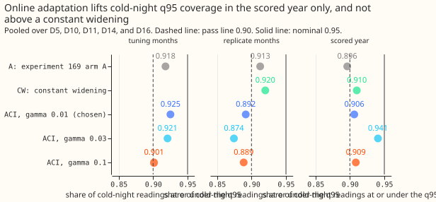
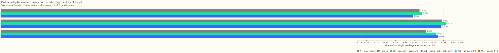

# Experiment 213: online band adaptation from recent coverage misses

**Learning the band widths from the misses of the last few days did not lift cold-night coverage
reliably, and a fixed widening of the upper quantiles did as well, with almost no change in the
all-row score.** A quantile is a level of the forecast's error distribution: the q95 is the value
that the demand reading should fall at or under on 95% of rows. Coverage is the share of rows on
which it does. A cold night is a winter night (November to March, evening or night hours) whose ERA5
day-mean temperature (the ECMWF reanalysis, an estimate of past weather) is below 2 °C.

**We asked whether the quantile offsets of the best demand forecast so far can learn from recent
misses.** That forecast is arm A of [experiment
169](../00169-calibration-combined-fixes-and-ensemble-spread/result.md). An offset is the distance
from the mean forecast to a quantile. After every reading that is at least 3.5 hours old, the offset
grows if the reading fell outside the quantile and shrinks if it fell inside. The aim was cold-night
q95 coverage of 0.90 or more without a second fitted model of the forecast's spread. The update is
that of adaptive conformal inference (ACI, [Gibbs and Candes
(2021)](https://arxiv.org/abs/2106.00170)).

**The result is a small gain in one period, a loss in the other, and a worse score.** In the scored
year (2025-07-02 to 2026-06-29) the best of three learning rates (gamma, the size of each update)
lifts coverage from 0.896 to 0.906. It also worsens the all-row quantile score by 0.013 points of
effective capacity (percentage points of each substation's rated demand; lower is better), which is
over the pre-registered limit of 0.010. In the replicate months (other months of the earlier year),
ACI at gamma 0.01 lowers coverage from 0.913 to 0.892. The pre-registered rule gives the verdict
`inconclusive`, because the coverage gain (+0.0102) is just over the 0.01 below which the rule says
`refuted`. In substance, online adaptation did not do what it was meant to do.

- **Arms.** Arm A: experiment 169's arm A. Arm ACI: arm A with each of the quantile offsets at q01,
  q05, q10, q25, q75, q90, q95, and q99 times `exp(u)`, where `u` is learned per series, hour band,
  and level by `u += gamma * (miss - alpha)` after each reading and clamped to [ln 0.7, ln 2.0]. The
  gamma grid is 0.01, 0.03, and 0.1. Arm CW (reference, post hoc): arm A with the q90, q95, and q99
  offsets times 1.06, 1.06, and 1.11, the intercept-only values of experiment 169's audit.
- **Contrasts.** C1: ACI minus A in all-row quantile score. C2: ACI minus A in cold-night q95
  coverage. C3 (descriptive, post hoc): ACI minus CW in cold-night q95 coverage. Each is a paired
  difference with a month-resampled 95% interval.
- **Row set and schedule.** `fold_a_daily_gap_v1`, the five decision substations D5, D10, D11, D14,
  and D16 (D9 written beside, in no contrast), leads 0.5 to 168 hours, rows outside the
  hand-filtered switching events: 464,363 rows in the scored year and 299,306 in the replicate
  months. The mean forecasts are experiment 155's stored monthly refits, so no contrast depends on
  the retraining schedule. The tuning and replicate months are alternate months, so the state
  restarts at 0 whenever readings are more than 36 hours apart; the restart may handicap ACI in
  those months.
- **Gamma selection (deviation from the plan).** No gamma had a tuning-month C1 upper bound at or
  under +0.01 (+0.012 at gamma 0.01, +0.051 at 0.03, +0.108 at 0.1), so the pre-registered selection
  rule selected no gamma. The script fell back to the smallest gamma, 0.01, which the plan did not
  state. Cold-night q95 coverage in the tuning months: A 0.918, ACI 0.925, 0.921, and 0.901 at the
  three gammas.
- **Headline, scored year (gamma 0.01).** Cold-night q95 coverage 0.906 against A's 0.896 (+0.010,
  95% interval -0.007 to +0.025; 5,395 rows). All-row q95 coverage 0.947, all-row q05 coverage 0.055
  (A: 0.948 and 0.065). C1, all rows: +0.0132 (-0.0010 to +0.0295). Of the pre-registered pass
  conditions (cold-night coverage, all-row coverage, score bound), only the score bound fails.
- **Headline, replicate months.** Cold-night q95 coverage 0.892 against A's 0.913 (-0.021, -0.041 to
  0.000). C1 -0.0017 (-0.0208 to +0.0189). ACI fails the coverage condition and the score bound.
- **Gamma sweep, scored year (cold-night q95 coverage, C1).** 0.01: 0.906, +0.013; 0.03: 0.941,
  +0.030; 0.1: 0.909, +0.034. Replicate months: 0.892, 0.874, and 0.889, so no step size passes both
  periods (post hoc reading of the sweep, not a selection).
- **Absolute scores, scored year, decision substations.** A 2.7519, CW 2.7532, ACI 2.7651, BG2 (the
  best-guess forecast of experiment 87) 2.7804, manual heuristic 3.4968, climatology 3.8038.
- **Cold spells, scored year (cold-night q95 coverage; A, ACI, CW).** First night of a spell: 0.870,
  0.857, 0.876 (516 rows). The 3 days after it: 0.917, 0.916, 0.925 (2,242 rows). Later nights:
  0.884, 0.908, 0.904 (2,637 rows). A night is keyed to the evening on which it starts. The stages
  hold 2, 5, and 8 distinct night dates, so these are point values without intervals. Replicate
  months: first night 1.000 for all three arms (804 rows); 3 days after 0.884, 0.856, 0.893; later
  nights 1.000 (112 rows).

- **Special days, scored year (A, ACI).** Bank holidays (9,812 rows): q95 coverage 0.934, 0.928; C1
  +0.086 (+0.019 to +0.131), so the score worsens. Christmas, 24 December to 1 January (8,641 rows):
  q95 coverage 0.934, 0.951; q05 coverage 0.075, 0.094; C1 +0.093, and no interval is quoted because
  the period lies in one month, which leaves the month-resampled bootstrap nothing to resample.
- **Tail calibration, scored year (coverage / pinball loss; A, ACI).** All rows: q01 0.022 / 0.216
  and 0.017 / 0.210; q05 0.065 / 0.714 and 0.055 / 0.718; q95 0.948 / 0.745 and 0.947 / 0.756; q99
  0.982 / 0.232 and 0.984 / 0.233. Cold nights: q01 0.045 / 0.392 and 0.031 / 0.354; q05 0.090 /
  0.950 and 0.099 / 0.943; q95 0.896 / 0.819 and 0.906 / 0.858; q99 0.959 / 0.282 and 0.959 / 0.291.
- **Against the constant widening.** ACI minus CW in cold-night q95 coverage: -0.004 (-0.019 to
  +0.006) in the scored year and -0.028 (-0.055 to 0.000) in the replicate months.
- **Caveats.** The scored year holds 10 cold days, so cold-night figures rest on a handful of
  spells, and the interval on the cold-night coverage gain is wide (-0.007 to +0.025). Leaving one
  substation out moves ACI's scored-year cold-night coverage to 0.901 (D5), 0.921 (D10), 0.925
  (D11), 0.879 (D14), and 0.907 (D16), so the 0.90 pass depends on D14. The chosen gamma is the
  fallback described above. Arm A's q05 coverage (0.065) already misses the plan's rule that
  coverage stay within 0.01 of nominal, so the plan used "no further from 0.05 than A, plus 0.01".
  The replicate-month result may reflect the monthly state restarts. That explanation was not
  tested. The curtailment-cost metric was not run: experiment 169's figures show that it cannot rank
  forecasts this close.
- **What to try next.** (1) A bias correction of the mean forecast at ensemble-mean temperatures of
  0 °C or below, since bands that learn from misses cannot react before a cold spell starts. (2) If
  an online band is still wanted, one that learns separately for ensemble-cold days, scored over at
  least two winters, with a continuous history instead of alternate months.

## Checks

- **Median forecast minus mean forecast, per site.** 0.000 for every arm at every substation: no arm
  scales the q50 offset.
- **Mean-forecast error beside each quantile-score contrast.** The mean absolute error of the mean
  forecast is identical across all arms (4.7096 points in the scored year), because the mean is
  unchanged, so the quantile-score contrasts cannot come from the mean.
- **Reproduction.** Arm A rescored from experiment 169's stored forecasts gives 2.7521 on all five
  decision substations' rows in this experiment's scorer (2.7519 on the rows shared with BG2), a gap
  of 0.0002 from the printed 2.7519, inside the 0.001 cap. A gamma of 0 reproduces arm A's quantiles
  exactly at every substation and period (the script raises otherwise).
- **Prediction check.** Cold-night coverage rose by 0.010 in the scored year (predicted 0.00 to
  0.03), but fell by 0.021 in the replicate months. The all-row score changed by +0.013 (predicted
  -0.01 to +0.01), just outside the range.
- **Audit triggers that fired.** Two of the seven triggers in the `ml-experiment` skill fired.
  (Trigger 2) The prediction failed in the replicate months, where coverage fell, and the monthly
  state restart is an untested explanation. (Trigger 6) The C1 interval in the scored year (-0.001
  to +0.030, width 0.031) is 2.3 times as wide as experiment 169's C2 interval on the same rows
  (width 0.013). An online scale that changes from month to month is expected to vary more than a
  fixed multiplier, but that expectation was not tested. No Opus audit was run, because this
  experiment's brief excluded Opus. The verdict is `inconclusive`, so an audit finding could only
  confirm or weaken it, and the decision to merge without an audit is left to the maintainer.
