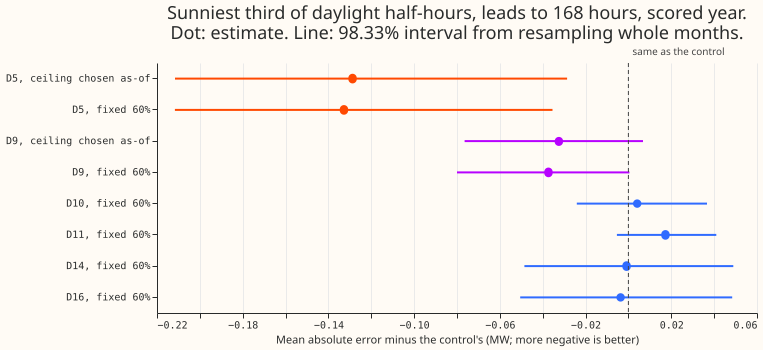
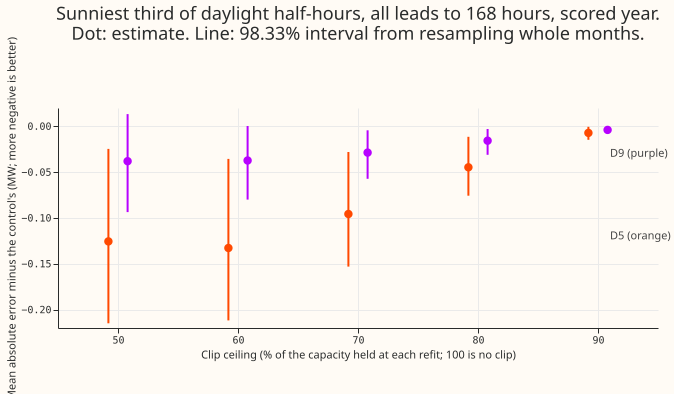
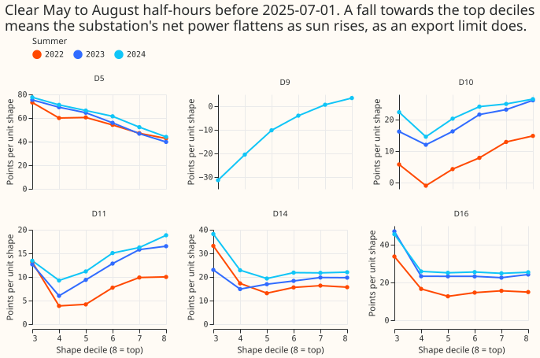

# Does capping D5's solar output at 60% still help when the cap is chosen using only earlier data?

**Choosing the 60% cap at D5 from earlier data alone keeps almost all of its gain, and none of the
other five Primaries shows the same pattern clearly.** A Primary substation is a substation that
feeds homes and businesses; D5, D9, D10, D11, D14, and D16 are anonymised labels for six of them.
[Experiment 180](../00180-dp-sunny-daylight-fix-d5-solar-shape/result.md) found that the D5
forecast has lower error on sunny half-hours when the solar output the forecast subtracts from the
substation's power is capped at 60% of the solar capacity held for D5. That cap mimics an export
limit on the solar generators behind D5. Experiment 180 chose 60% on some months and scored it on a
later year, so the choice never used only earlier data.

We asked two questions. First, does the gain remain if the cap is chosen at each monthly retraining
from the previous 12 months of forecasts, rather than using the scored year? Second, do the other
five Primaries show the same levelling-off of net power as the sun rises? Here "as-of" means chosen
using only data from before the retraining. The gain is the change in mean absolute error of the
median forecast, in megawatts (MW), against a control that has no cap; "sunny" means the sunniest
third of a substation's daylight half-hours. The as-of cap kept 97% of the gain (-0.129 MW against
-0.133 MW). Only D5 showed the levelling-off. D9 improved by 0.032 MW and D11 worsened by 0.017
MW, and the intervals of both include zero.

*Figure 1 shows each Primary's change in error, with D5 and D9 also shown with the cap chosen as-of.*

*Figure 2 shows the change in error at each fixed ceiling, at D5 and D9.*

*Figure 3 shows, per Primary and summer, the solar output implied by net power against the
fleet solar shape, a south-facing panel's expected output scaled by the sun's height and the
irradiance. Only D5 falls towards the sunniest half-hours.*

**Verdict `partly supported`.** The D5 prediction we wrote down before fitting holds. The as-of cap
lay in 50% to 70% at 12 of 12 refits (60% at 11, 50% at one), and the as-of arm keeps 0.129 MW of
the 0.133 MW gain against a required 0.08 MW. The D5 interval is wholly below zero, and D10 and
D16, which we expected to be unaffected, moved by under 0.02 MW. D9's estimated gain is 0.032 MW,
which meets the 0.03 MW threshold. Its interval includes zero, and `supported` required the
interval to lie wholly below zero. The decision rule did not cover that case, so we labelled it
`partly supported`. D11's estimate (+0.017 MW) exceeds the 0.01 MW we predicted for the other
Primaries, but its interval spans zero.

## Results

Rows: the 292 forecast runs of the scored year (2025-07 to 2026-06) used in [experiment
178](../00178-dp-sunny-daylight-gap-diagnosis/result.md), leaving out half-hours affected by
switching events, leads 0.5 to 168 hours. The forecasts are the monthly retrainings of the
generalised additive model (GAM) of experiment 180, so only the cap differs between arms and the
contrast does not depend on the retraining schedule. D5 has 14,045 sunny half-hours and D9 has 15,415.
[BG2](../00087-bg2-best-guess-assembled-with-drop-one-ablations/result.md) is the best-guess
forecast that experiment 180 compared against.

| Sunny daylight, mean absolute error (MW) | Control | As-of cap | Fixed 60% | BG2 |
|---|---|---|---|---|
| D5 | 0.655 | 0.527 | 0.523 | 0.453 |
| D9 | 0.497 | 0.465 | 0.460 | 0.418 |

- **D5 against the control (as-of, 98.33% interval from resampling whole months):** -0.129 MW
  (-0.212 to -0.029). Pinball loss averaged over 11 quantiles is 0.185 for the control, 0.155
  as-of, and 0.154 at fixed 60%. The gap to BG2 falls from +0.202 MW to +0.073 MW (+0.028 to
  +0.099).
- **D9 against the control (as-of):** -0.032 MW (-0.076 to +0.007). The cap is 60% at 10 of 12
  refits and 50% at two. The gap to BG2 falls from +0.079 MW to +0.047 MW (-0.008 to +0.080).
- **The other four Primaries at a fixed 60% cap, against the control:** D10 +0.004 MW (-0.024 to
  +0.037), D11 +0.017 (-0.005 to +0.041), D14 -0.001 (-0.049 to +0.049), D16 -0.004 (-0.050 to
  +0.048). Pooled: +0.004 (-0.029 to +0.043).
- **As-of choice at D5:** 60% at 11 refits and 50% at the refit of 2026-03-01 (mean error over the
  previous 12 months 0.468 MW at both). At the first refit the errors were 0.494 MW at 60%, 0.502 at
  50%, 0.519 at 70%, and 0.591 with no cap.
- **Screen (figure 3):** we ranked each Primary's clear May to August half-hours by the fleet solar
  shape and compared the implied solar output in the top two tenths with that in the fourth to
  sixth tenths. A ratio well below 1 means solar output levels off as the sun rises. The ratio is
  0.77, 0.68, and 0.73 at D5 in the summers of 2022, 2023, and 2024, and 0.98 to 3.74 at D10, D11,
  D14, and D16. D9 has 0 and 28 clear half-hours in 2022 and 2023, and its 2024 ratio is undefined
  because the middle tenths are negative, so D9 fails the screen.
- **Replicate months:** letting the as-of window grow from 3 to 11 months picks 60% at every refit
  again (gains of -0.124 MW at D5 and -0.031 MW at D9). Experiment 180 used these months to choose
  60%, so this repeats the choice and is not independent evidence.
- **Ceiling sweep (figure 2):** at D5 the gain peaks at 50% to 60% (-0.126 and -0.133 MW) and is
  -0.007 MW at 90%. At D9 the shape is the same at about one third of the size.
- **Caveats:** D9 has about six months of data before 2024-07, so its as-of sunny threshold
  (top third of the daylight shape before 2024-07) differs from the scored year's threshold. The
  as-of rule selects on the quantity scored.

| Sunny rows at D5, as-of against control | q01 | q05 | q95 | q99 |
|---|---|---|---|---|
| Share of actuals below the forecast, as-of | 0.056 | 0.178 | 0.996 | 0.999 |
| Share of actuals below the forecast, control | 0.051 | 0.168 | 0.967 | 0.993 |
| Pinball loss (MW), as-of | 0.0230 | 0.0841 | 0.0765 | 0.0209 |
| Pinball loss (MW), control | 0.0252 | 0.0972 | 0.0806 | 0.0218 |

The 95% and 99% quantile forecasts lie above the actual value more often than 95% and 99% of the
time, and the cap makes this worse.

## Checks

- **Reproduction:** the new fixed-60% forecasts at D5 are identical to experiment 180's (largest
  difference 0 in the median forecast and in the 99% quantile forecast; `e00214_checks.py`).
- **Median against mean forecast:** stage 2 of the forecast chain sets the mean forecast equal to
  the median, so the difference is 0 by construction and the check cannot show whether the spread of
  the forecast shifts it. The error contrast of the mean forecast is therefore the same as the
  median's, and this experiment cannot test whether the two point in different directions.
- **Audit conditions:** none was met. The reproduction passed, D10 and D16 stayed inside 0.02 MW, the
  as-of arm does not beat the fixed-60% arm that it contains, and the D5 interval has about the same
  width as experiment 180's. Leaving out D11 moves the pooled estimate for the other four Primaries
  from +0.004 MW to -0.000 MW, and leaving out any other Primary leaves it between +0.004 and +0.007
  MW (`e00214_checks.py`). The pooled interval includes zero in all five cases.

## What to try next

- The as-of rule adds one ceiling-selection step to each monthly retraining, and it is ready to
  consider for the next model release.
- Repeat the screen and the contrast at D9 once it has at least two summers of data before the
  scored year.
- The planned combination check can use the as-of ceiling rule in place of the fixed 60% ceiling.
